# Awesome Claude Opus 5.5

English · [简体中文](README.zh-CN.md)

[](https://awesome.re) [](#contents) [](docs/prompts.md) [](https://github.com/sandbase-lab/awesome-opus-5.5/actions/workflows/sync.yml) [](https://www.sandbase.ai/model/anthropic/claude-opus-5.5?utm_source=github&utm_medium=readme&utm_campaign=awesome-opus-5.5)

[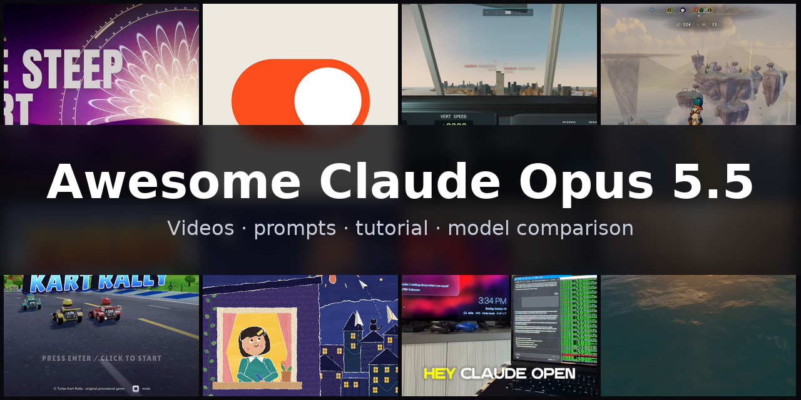](https://www.sandbase.ai/lab/ai-videos/opus-5-5?utm_source=github&utm_medium=readme&utm_campaign=awesome-opus-5.5&utm_content=banner)

A curated list of **Claude Opus 5.5 examples**: videos, prompts and demos made with Anthropic's flagship Claude 5 model. Motion design is its signature — one prompt, fifteen seconds of code-animated type and shapes — alongside walkable Three.js architecture, playable browser games, procedural 3D and launch films. Most pieces are a single HTML page the model wrote from a prompt, credited to the creator and linked to the original post.

**400 videos** from **268 creators** · **87** with the creator's prompt · synced daily from [SandBase Lab](https://www.sandbase.ai/lab/ai-videos/opus-5-5?utm_source=github&utm_medium=readme&utm_campaign=awesome-opus-5.5&utm_content=stats)

## Start here

| I want to… | Go to |
|---|---|
| Watch the videos | [Browse by category](#contents) below, or [play them full-size on SandBase Lab](https://www.sandbase.ai/lab/ai-videos/opus-5-5?utm_source=github&utm_medium=readme&utm_campaign=awesome-opus-5.5&utm_content=quickstart) |
| Copy a prompt | [Prompt index](docs/prompts.md): every video that comes with its prompt |
| Write your own prompt | [Prompt guide](docs/prompt-guide.md): 7 patterns and a fill-in template |
| Make a video | [Tutorial](docs/tutorial.md): prompt → HTML → MP4, with the API, the CLI and a recording script |
| Pick a model | [Claude Opus 5.5 vs. GPT-6 Astra, Fable 5.1, Gemini 4 Argon and DeepSeek V4.1 Flash](docs/model-comparison.md) |
| Try it now | [Run Claude Opus 5.5 in the Lab arena](https://www.sandbase.ai/lab/x/llm-arena?models=anthropic%2Fclaude-opus-5.5&utm_source=github&utm_medium=readme&utm_campaign=awesome-opus-5.5&utm_content=quickstart), next to other models |

<a id="contents"></a>

## Contents

- [Featured](#featured) (8)
- [3D scenes](#3d-scene) (77)
- [Motion graphics](#motion-graphics) (99)
- [Games](#game) (88)
- [Product UI](#ui-demo) (24)
- [Particles & shapes](#particles) (4)
- [Charts & diagrams](#data-viz) (2)
- [Kinetic type](#kinetic-type) (4)
- [Explainers](#explainer) (34)
- [Launch films](#launch-film) (19)
- [Tests & comparisons](#comparison) (49)
- [Recreate a video with Claude Opus 5.5](#recreate)
- [FAQ](#faq)
- [Suggest a video](#contribute)

Click a preview to play the video. Click a title for the post, the prompt and **Recreate** on SandBase Lab. **@handle** links to the creator's post on X.

<a id="featured"></a>

## Featured

<table>
<tr><td width="33%" valign="top"><a href="https://www.sandbase.ai/lab/media/x/opus-5-5/2102987981695132140/video.mp4">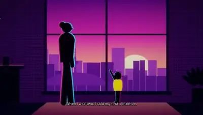</a><br><a href="https://www.sandbase.ai/lab/ai-videos/opus-5-5/2102987981695132140?utm_source=github&utm_medium=readme&utm_campaign=awesome-opus-5.5&utm_content=card"><b>A video predicting the next 50 years</b></a><br><sub><a href="https://x.com/andrewjiang/status/2102987981695132140">@andrewjiang</a> · 4:00</sub></td><td width="33%" valign="top"><a href="https://www.sandbase.ai/lab/media/x/opus-5-5/2104618175803609305/video.mp4"></a><br><a href="https://www.sandbase.ai/lab/ai-videos/opus-5-5/2104618175803609305?utm_source=github&utm_medium=readme&utm_campaign=awesome-opus-5.5&utm_content=card"><b>Motion design launch video created with three prompts</b></a><br><sub><a href="https://x.com/uxmiles/status/2104618175803609305">@uxmiles</a> · 0:15</sub></td><td width="33%" valign="top"><a href="https://www.sandbase.ai/lab/media/x/opus-5-5/2103821040174698674/video.mp4"></a><br><a href="https://www.sandbase.ai/lab/ai-videos/opus-5-5/2103821040174698674?utm_source=github&utm_medium=readme&utm_campaign=awesome-opus-5.5&utm_content=card"><b>Aeroplane simulator game built with Claude</b></a><br><sub><a href="https://x.com/karankendre/status/2103821040174698674">@karankendre</a> · 0:32</sub></td></tr>
<tr><td width="33%" valign="top"><a href="https://www.sandbase.ai/lab/media/x/opus-5-5/2104215873120764032/video.mp4">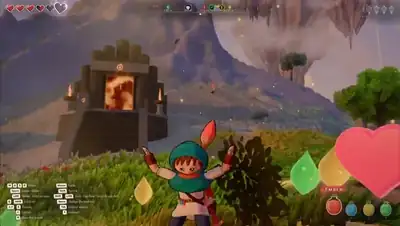</a><br><a href="https://www.sandbase.ai/lab/ai-videos/opus-5-5/2104215873120764032?utm_source=github&utm_medium=readme&utm_campaign=awesome-opus-5.5&utm_content=card"><b>Zelda inspired paintbrush adventure game</b></a><br><sub><a href="https://x.com/DannyLimanseta/status/2104215873120764032">@DannyLimanseta</a> · 1:44</sub></td><td width="33%" valign="top"><a href="https://www.sandbase.ai/lab/media/x/opus-5-5/2106027834217259394/video.mp4"></a><br><a href="https://www.sandbase.ai/lab/ai-videos/opus-5-5/2106027834217259394?utm_source=github&utm_medium=readme&utm_campaign=awesome-opus-5.5&utm_content=card"><b>Music synced project built from single prompt</b></a><br><sub><a href="https://x.com/minchoi/status/2106027834217259394">@minchoi</a> · 4:30</sub></td><td width="33%" valign="top"><a href="https://www.sandbase.ai/lab/media/x/opus-5-5/2102437977435893771/video.mp4">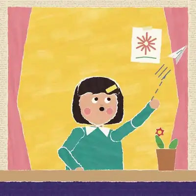</a><br><a href="https://www.sandbase.ai/lab/ai-videos/opus-5-5/2102437977435893771?utm_source=github&utm_medium=readme&utm_campaign=awesome-opus-5.5&utm_content=card"><b>JavaScript animated story about Claude and a question</b></a><br><sub><a href="https://x.com/kevin_t_ngo/status/2102437977435893771">@kevin_t_ngo</a> · 0:28</sub></td></tr>
<tr><td width="33%" valign="top"><a href="https://www.sandbase.ai/lab/media/x/opus-5-5/2111826236586570101/video.mp4">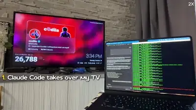</a><br><a href="https://www.sandbase.ai/lab/ai-videos/opus-5-5/2111826236586570101?utm_source=github&utm_medium=readme&utm_campaign=awesome-opus-5.5&utm_content=card"><b>Reverse engineering TV interface with Claude Opus</b></a><br><sub><a href="https://x.com/0xCodila/status/2111826236586570101">@0xCodila</a> · 0:23 · <a href="https://www.sandbase.ai/lab/ai-videos/opus-5-5/2111826236586570101?utm_source=github&utm_medium=readme&utm_campaign=awesome-opus-5.5&utm_content=card">prompt</a></sub></td><td width="33%" valign="top"><a href="https://www.sandbase.ai/lab/media/x/opus-5-5/2111306207239557288/video.mp4"></a><br><a href="https://www.sandbase.ai/lab/ai-videos/opus-5-5/2111306207239557288?utm_source=github&utm_medium=readme&utm_campaign=awesome-opus-5.5&utm_content=card"><b>Real-time ocean rendered with WebGPU</b></a><br><sub><a href="https://x.com/jurlycat/status/2111306207239557288">@jurlycat</a> · 0:32</sub></td></tr>
</table>

<a id="3d-scene"></a>

## 3D scenes

<table>
<tr><td width="33%" valign="top"><a href="https://www.sandbase.ai/lab/media/x/opus-5-5/2102441628661080384/video.mp4"></a><br><a href="https://www.sandbase.ai/lab/ai-videos/opus-5-5/2102441628661080384?utm_source=github&utm_medium=readme&utm_campaign=awesome-opus-5.5&utm_content=card"><b>Broken towers shader generated by Opus 5.5</b></a><br><sub><a href="https://x.com/emollick/status/2102441628661080384">@emollick</a> · 0:10</sub></td><td width="33%" valign="top"><a href="https://www.sandbase.ai/lab/media/x/opus-5-5/2102466523164274839/video.mp4"></a><br><a href="https://www.sandbase.ai/lab/ai-videos/opus-5-5/2102466523164274839?utm_source=github&utm_medium=readme&utm_campaign=awesome-opus-5.5&utm_content=card"><b>Pre-earthquake 1906 Market Street in Blender</b></a><br><sub><a href="https://x.com/alexalbert__/status/2102466523164274839">@alexalbert__</a> · 0:08</sub></td><td width="33%" valign="top"><a href="https://www.sandbase.ai/lab/media/x/opus-5-5/2102503719762018434/video.mp4">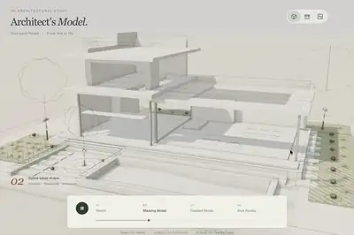</a><br><a href="https://www.sandbase.ai/lab/ai-videos/opus-5-5/2102503719762018434?utm_source=github&utm_medium=readme&utm_campaign=awesome-opus-5.5&utm_content=card"><b>Architectural evolution from sketch to 3D home</b></a><br><sub><a href="https://x.com/techartist_/status/2102503719762018434">@techartist_</a> · 0:19</sub></td></tr>
<tr><td width="33%" valign="top"><a href="https://www.sandbase.ai/lab/media/x/opus-5-5/2103008022369099992/video.mp4">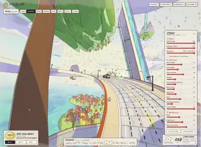</a><br><a href="https://www.sandbase.ai/lab/ai-videos/opus-5-5/2103008022369099992?utm_source=github&utm_medium=readme&utm_campaign=awesome-opus-5.5&utm_content=card"><b>Interactive 3D experience in Three.js</b></a><br><sub><a href="https://x.com/chetanankola/status/2103008022369099992">@chetanankola</a> · 0:28</sub></td><td width="33%" valign="top"><a href="https://www.sandbase.ai/lab/media/x/opus-5-5/2103194052850241739/video.mp4">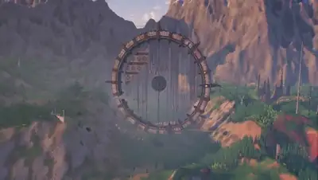</a><br><a href="https://www.sandbase.ai/lab/ai-videos/opus-5-5/2103194052850241739?utm_source=github&utm_medium=readme&utm_campaign=awesome-opus-5.5&utm_content=card"><b>Detailed 3D world with creative builds</b></a><br><sub><a href="https://x.com/LexnLin/status/2103194052850241739">@LexnLin</a> · 1:24 · <a href="https://www.sandbase.ai/lab/ai-videos/opus-5-5/2103194052850241739?utm_source=github&utm_medium=readme&utm_campaign=awesome-opus-5.5&utm_content=card">prompt</a></sub></td><td width="33%" valign="top"><a href="https://www.sandbase.ai/lab/media/x/opus-5-5/2103232621669220827/video.mp4">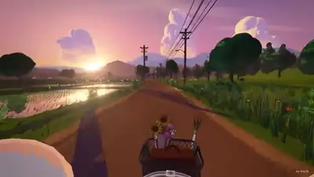</a><br><a href="https://www.sandbase.ai/lab/ai-videos/opus-5-5/2103232621669220827?utm_source=github&utm_medium=readme&utm_campaign=awesome-opus-5.5&utm_content=card"><b>Procedural 3D bike ride in browser</b></a><br><sub><a href="https://x.com/0x0SojalSec/status/2103232621669220827">@0x0SojalSec</a> · 3:23</sub></td></tr>
</table>

<details>
<summary><b>Show all 77</b></summary>

<table>
<tr><td width="33%" valign="top"><a href="https://www.sandbase.ai/lab/media/x/opus-5-5/2103305564973658114/video.mp4">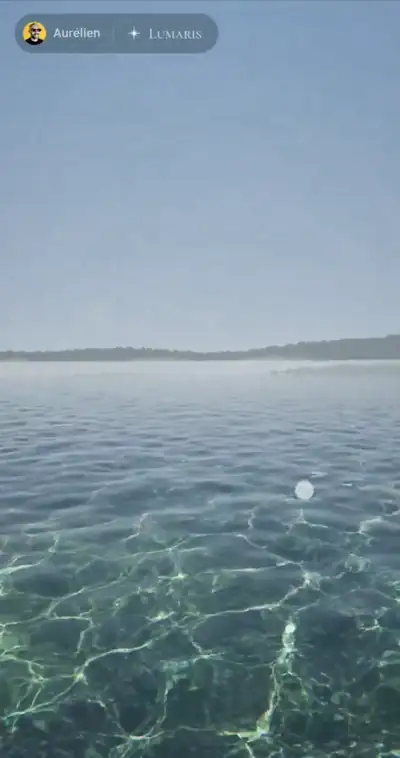</a><br><a href="https://www.sandbase.ai/lab/ai-videos/opus-5-5/2103305564973658114?utm_source=github&utm_medium=readme&utm_campaign=awesome-opus-5.5&utm_content=card"><b>A realistic 3D water simulation</b></a><br><sub><a href="https://x.com/Delroy715/status/2103305564973658114">@Delroy715</a> · 0:14</sub></td><td width="33%" valign="top"><a href="https://www.sandbase.ai/lab/media/x/opus-5-5/2103393323520299428/video.mp4">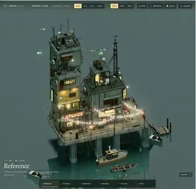</a><br><a href="https://www.sandbase.ai/lab/ai-videos/opus-5-5/2103393323520299428?utm_source=github&utm_medium=readme&utm_campaign=awesome-opus-5.5&utm_content=card"><b>Explorable 3D harbour town in Three.js</b></a><br><sub><a href="https://x.com/chetanankola/status/2103393323520299428">@chetanankola</a> · 0:25</sub></td><td width="33%" valign="top"><a href="https://www.sandbase.ai/lab/media/x/opus-5-5/2103724883301814408/video.mp4">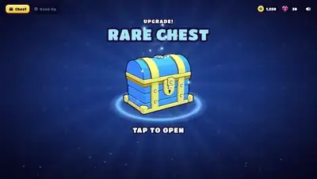</a><br><a href="https://www.sandbase.ai/lab/ai-videos/opus-5-5/2103724883301814408?utm_source=github&utm_medium=readme&utm_campaign=awesome-opus-5.5&utm_content=card"><b>Game settlement 3D chest animation</b></a><br><sub><a href="https://x.com/op7418/status/2103724883301814408">@op7418</a> · 0:15</sub></td></tr>
<tr><td width="33%" valign="top"><a href="https://www.sandbase.ai/lab/media/x/opus-5-5/2103738307033416132/video.mp4">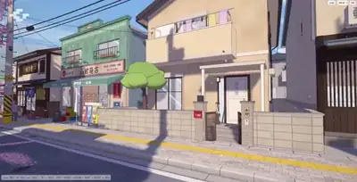</a><br><a href="https://www.sandbase.ai/lab/ai-videos/opus-5-5/2103738307033416132?utm_source=github&utm_medium=readme&utm_campaign=awesome-opus-5.5&utm_content=card"><b>Procedural cel-shaded Japanese scene in Three.js</b></a><br><sub><a href="https://x.com/Delroy715/status/2103738307033416132">@Delroy715</a> · 1:21</sub></td><td width="33%" valign="top"><a href="https://www.sandbase.ai/lab/media/x/opus-5-5/2103759350330544254/video.mp4">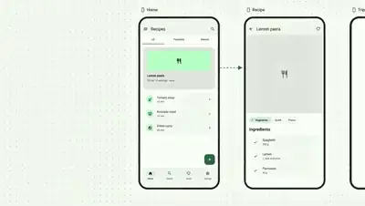</a><br><a href="https://www.sandbase.ai/lab/ai-videos/opus-5-5/2103759350330544254?utm_source=github&utm_medium=readme&utm_campaign=awesome-opus-5.5&utm_content=card"><b>M3E Canvas video in Remotion and Three.js</b></a><br><sub><a href="https://x.com/lnkiai/status/2103759350330544254">@lnkiai</a> · 0:32</sub></td><td width="33%" valign="top"><a href="https://www.sandbase.ai/lab/media/x/opus-5-5/2103788160031592572/video.mp4">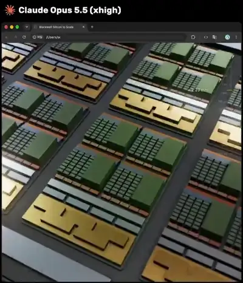</a><br><a href="https://www.sandbase.ai/lab/ai-videos/opus-5-5/2103788160031592572?utm_source=github&utm_medium=readme&utm_campaign=awesome-opus-5.5&utm_content=card"><b>3D zoom into NVIDIA Blackwell GPU</b></a><br><sub><a href="https://x.com/mdaman010/status/2103788160031592572">@mdaman010</a> · 0:49</sub></td></tr>
<tr><td width="33%" valign="top"><a href="https://www.sandbase.ai/lab/media/x/opus-5-5/2103792451551113363/video.mp4">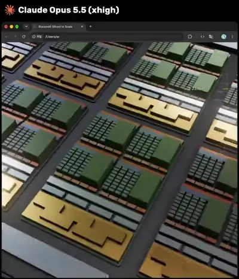</a><br><a href="https://www.sandbase.ai/lab/ai-videos/opus-5-5/2103792451551113363?utm_source=github&utm_medium=readme&utm_campaign=awesome-opus-5.5&utm_content=card"><b>3D zoom animation from datacenter to silicon atom</b></a><br><sub><a href="https://x.com/ai_ba_reza/status/2103792451551113363">@ai_ba_reza</a> · 0:49</sub></td><td width="33%" valign="top"><a href="https://www.sandbase.ai/lab/media/x/opus-5-5/2103866429741400535/video.mp4">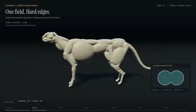</a><br><a href="https://www.sandbase.ai/lab/ai-videos/opus-5-5/2103866429741400535?utm_source=github&utm_medium=readme&utm_campaign=awesome-opus-5.5&utm_content=card"><b>Procedural cheetah built with code and math</b></a><br><sub><a href="https://x.com/majidmanzarpour/status/2103866429741400535">@majidmanzarpour</a> · 0:50</sub></td><td width="33%" valign="top"><a href="https://www.sandbase.ai/lab/media/x/opus-5-5/2103914892109517008/video.mp4">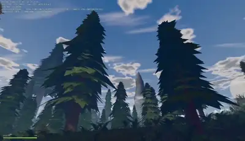</a><br><a href="https://www.sandbase.ai/lab/ai-videos/opus-5-5/2103914892109517008?utm_source=github&utm_medium=readme&utm_campaign=awesome-opus-5.5&utm_content=card"><b>Procedural 3D world with code</b></a><br><sub><a href="https://x.com/AndreiProvkin/status/2103914892109517008">@AndreiProvkin</a> · 1:39</sub></td></tr>
<tr><td width="33%" valign="top"><a href="https://www.sandbase.ai/lab/media/x/opus-5-5/2103919236653428985/video.mp4">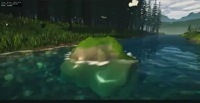</a><br><a href="https://www.sandbase.ai/lab/ai-videos/opus-5-5/2103919236653428985?utm_source=github&utm_medium=readme&utm_campaign=awesome-opus-5.5&utm_content=card"><b>A fully procedural 3D world in Three.js</b></a><br><sub><a href="https://x.com/AndreiProvkin/status/2103919236653428985">@AndreiProvkin</a> · 1:08</sub></td><td width="33%" valign="top"><a href="https://www.sandbase.ai/lab/media/x/opus-5-5/2104101736562467235/video.mp4">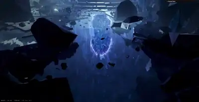</a><br><a href="https://www.sandbase.ai/lab/ai-videos/opus-5-5/2104101736562467235?utm_source=github&utm_medium=readme&utm_campaign=awesome-opus-5.5&utm_content=card"><b>Procedural Crystal Cave with a Portal</b></a><br><sub><a href="https://x.com/AndreiProvkin/status/2104101736562467235">@AndreiProvkin</a> · 0:38</sub></td><td width="33%" valign="top"><a href="https://www.sandbase.ai/lab/media/x/opus-5-5/2104131601663930588/video.mp4">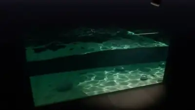</a><br><a href="https://www.sandbase.ai/lab/ai-videos/opus-5-5/2104131601663930588?utm_source=github&utm_medium=readme&utm_campaign=awesome-opus-5.5&utm_content=card"><b>Water and fluid simulation in Three.js</b></a><br><sub><a href="https://x.com/tetumemo/status/2104131601663930588">@tetumemo</a> · 1:12</sub></td></tr>
<tr><td width="33%" valign="top"><a href="https://www.sandbase.ai/lab/media/x/opus-5-5/2104147829589737806/video.mp4">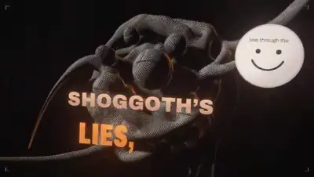</a><br><a href="https://www.sandbase.ai/lab/ai-videos/opus-5-5/2104147829589737806?utm_source=github&utm_medium=readme&utm_campaign=awesome-opus-5.5&utm_content=card"><b>A 3D music visualization rendered in Three.js</b></a><br><sub><a href="https://x.com/ricouii/status/2104147829589737806">@ricouii</a> · 2:37</sub></td><td width="33%" valign="top"><a href="https://www.sandbase.ai/lab/media/x/opus-5-5/2104548658171834749/video.mp4">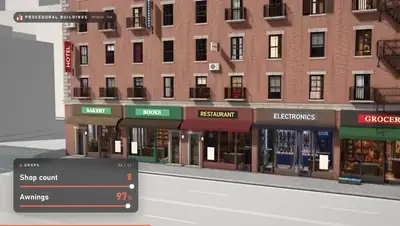</a><br><a href="https://www.sandbase.ai/lab/ai-videos/opus-5-5/2104548658171834749?utm_source=github&utm_medium=readme&utm_campaign=awesome-opus-5.5&utm_content=card"><b>Procedural buildings ported to Three.js web scene</b></a><br><sub><a href="https://x.com/chirovisuals/status/2104548658171834749">@chirovisuals</a> · 1:15</sub></td><td width="33%" valign="top"><a href="https://www.sandbase.ai/lab/media/x/opus-5-5/2104780688113455342/video.mp4">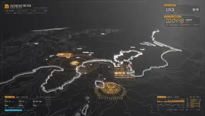</a><br><a href="https://www.sandbase.ai/lab/ai-videos/opus-5-5/2104780688113455342?utm_source=github&utm_medium=readme&utm_campaign=awesome-opus-5.5&utm_content=card"><b>Evangelion-inspired 3D WebGL scene</b></a><br><sub><a href="https://x.com/LuisBizarro/status/2104780688113455342">@LuisBizarro</a> · 0:22</sub></td></tr>
<tr><td width="33%" valign="top"><a href="https://www.sandbase.ai/lab/media/x/opus-5-5/2105216139647127750/video.mp4">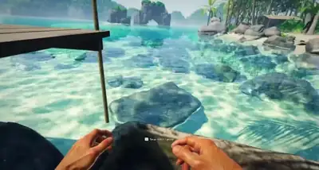</a><br><a href="https://www.sandbase.ai/lab/ai-videos/opus-5-5/2105216139647127750?utm_source=github&utm_medium=readme&utm_campaign=awesome-opus-5.5&utm_content=card"><b>Browser-based 3D open world in Three.js</b></a><br><sub><a href="https://x.com/maxt3chno/status/2105216139647127750">@maxt3chno</a> · 2:41</sub></td><td width="33%" valign="top"><a href="https://www.sandbase.ai/lab/media/x/opus-5-5/2105250266392224097/video.mp4"></a><br><a href="https://www.sandbase.ai/lab/ai-videos/opus-5-5/2105250266392224097?utm_source=github&utm_medium=readme&utm_campaign=awesome-opus-5.5&utm_content=card"><b>Interactive Chinese ink wash shrimps in WebGL</b></a><br><sub><a href="https://x.com/jshguo/status/2105250266392224097">@jshguo</a> · 0:10</sub></td><td width="33%" valign="top"><a href="https://www.sandbase.ai/lab/media/x/opus-5-5/2105304249060274631/video.mp4"></a><br><a href="https://www.sandbase.ai/lab/ai-videos/opus-5-5/2105304249060274631?utm_source=github&utm_medium=readme&utm_campaign=awesome-opus-5.5&utm_content=card"><b>3D animation and piano music rendered in Blender</b></a><br><sub><a href="https://x.com/kevin_t_ngo/status/2105304249060274631">@kevin_t_ngo</a> · 1:12</sub></td></tr>
<tr><td width="33%" valign="top"><a href="https://www.sandbase.ai/lab/media/x/opus-5-5/2105350783416021472/video.mp4">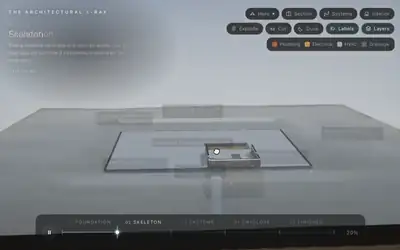</a><br><a href="https://www.sandbase.ai/lab/ai-videos/opus-5-5/2105350783416021472?utm_source=github&utm_medium=readme&utm_campaign=awesome-opus-5.5&utm_content=card"><b>Interactive 3D house with X-ray view in WebGPU</b></a><br><sub><a href="https://x.com/techartist_/status/2105350783416021472">@techartist_</a> · 0:37</sub></td><td width="33%" valign="top"><a href="https://www.sandbase.ai/lab/media/x/opus-5-5/2105723245722812598/video.mp4">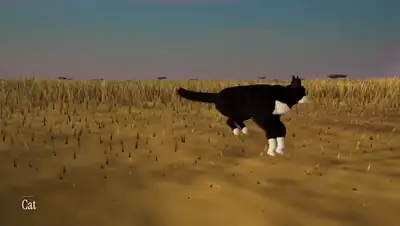</a><br><a href="https://www.sandbase.ai/lab/ai-videos/opus-5-5/2105723245722812598?utm_source=github&utm_medium=readme&utm_campaign=awesome-opus-5.5&utm_content=card"><b>Procedural Animals Sculpted and Animated in Three.js</b></a><br><sub><a href="https://x.com/majidmanzarpour/status/2105723245722812598">@majidmanzarpour</a> · 1:56</sub></td><td width="33%" valign="top"><a href="https://www.sandbase.ai/lab/media/x/opus-5-5/2105784343960629738/video.mp4">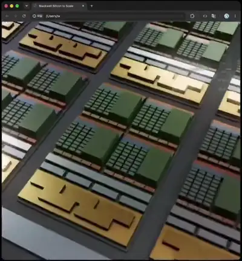</a><br><a href="https://www.sandbase.ai/lab/ai-videos/opus-5-5/2105784343960629738?utm_source=github&utm_medium=readme&utm_campaign=awesome-opus-5.5&utm_content=card"><b>Interactive 3D zoom of Nvidia Blackwell GPUs</b></a><br><sub><a href="https://x.com/bearlyai/status/2105784343960629738">@bearlyai</a> · 0:49</sub></td></tr>
<tr><td width="33%" valign="top"><a href="https://www.sandbase.ai/lab/media/x/opus-5-5/2105952457637699880/video.mp4"></a><br><a href="https://www.sandbase.ai/lab/ai-videos/opus-5-5/2105952457637699880?utm_source=github&utm_medium=readme&utm_campaign=awesome-opus-5.5&utm_content=card"><b>Browser-based night city scene in Three.js</b></a><br><sub><a href="https://x.com/ai_growth_avii/status/2105952457637699880">@ai_growth_avii</a> · 1:13</sub></td><td width="33%" valign="top"><a href="https://www.sandbase.ai/lab/media/x/opus-5-5/2106064200535859685/video.mp4">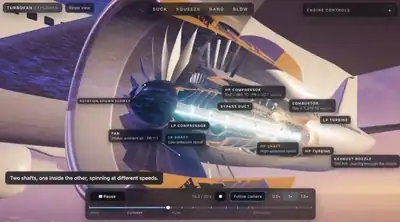</a><br><a href="https://www.sandbase.ai/lab/ai-videos/opus-5-5/2106064200535859685?utm_source=github&utm_medium=readme&utm_campaign=awesome-opus-5.5&utm_content=card"><b>Interactive 3D model of a jet engine</b></a><br><sub><a href="https://x.com/techartist_/status/2106064200535859685">@techartist_</a> · 0:24</sub></td><td width="33%" valign="top"><a href="https://www.sandbase.ai/lab/media/x/opus-5-5/2106369769956065518/video.mp4">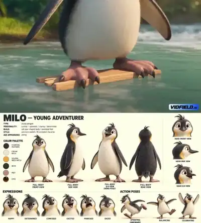</a><br><a href="https://www.sandbase.ai/lab/ai-videos/opus-5-5/2106369769956065518?utm_source=github&utm_medium=readme&utm_campaign=awesome-opus-5.5&utm_content=card"><b>Cinematic animated scene from a single prompt</b></a><br><sub><a href="https://x.com/HeyAbhishek/status/2106369769956065518">@HeyAbhishek</a> · 0:30 · <a href="https://www.sandbase.ai/lab/ai-videos/opus-5-5/2106369769956065518?utm_source=github&utm_medium=readme&utm_campaign=awesome-opus-5.5&utm_content=card">prompt</a></sub></td></tr>
<tr><td width="33%" valign="top"><a href="https://www.sandbase.ai/lab/media/x/opus-5-5/2106535398990377126/video.mp4">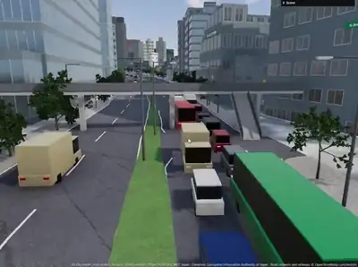</a><br><a href="https://www.sandbase.ai/lab/ai-videos/opus-5-5/2106535398990377126?utm_source=github&utm_medium=readme&utm_campaign=awesome-opus-5.5&utm_content=card"><b>A procedural 3D Tokyo simulation in Three.js</b></a><br><sub><a href="https://x.com/jeantimex/status/2106535398990377126">@jeantimex</a> · 3:04</sub></td><td width="33%" valign="top"><a href="https://www.sandbase.ai/lab/media/x/opus-5-5/2106763583250108511/video.mp4">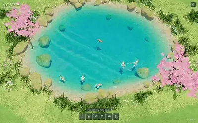</a><br><a href="https://www.sandbase.ai/lab/ai-videos/opus-5-5/2106763583250108511?utm_source=github&utm_medium=readme&utm_campaign=awesome-opus-5.5&utm_content=card"><b>Interactive water physics with fish and blossoms</b></a><br><sub><a href="https://x.com/buildwithsid/status/2106763583250108511">@buildwithsid</a> · 1:05</sub></td><td width="33%" valign="top"><a href="https://www.sandbase.ai/lab/media/x/opus-5-5/2106957256247902272/video.mp4">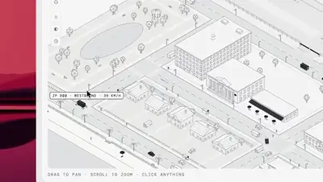</a><br><a href="https://www.sandbase.ai/lab/ai-videos/opus-5-5/2106957256247902272?utm_source=github&utm_medium=readme&utm_campaign=awesome-opus-5.5&utm_content=card"><b>Browser 3D scene built with WebGL and Three.js</b></a><br><sub><a href="https://x.com/KhalidDevLog/status/2106957256247902272">@KhalidDevLog</a> · 1:28</sub></td></tr>
<tr><td width="33%" valign="top"><a href="https://www.sandbase.ai/lab/media/x/opus-5-5/2107013497813172593/video.mp4">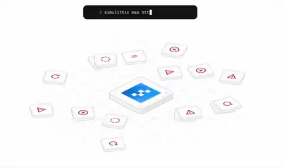</a><br><a href="https://www.sandbase.ai/lab/ai-videos/opus-5-5/2107013497813172593?utm_source=github&utm_medium=readme&utm_campaign=awesome-opus-5.5&utm_content=card"><b>Isometric design generated in five minutes</b></a><br><sub><a href="https://x.com/itsnotryan/status/2107013497813172593">@itsnotryan</a> · 0:07</sub></td><td width="33%" valign="top"><a href="https://www.sandbase.ai/lab/media/x/opus-5-5/2107058718882103388/video.mp4">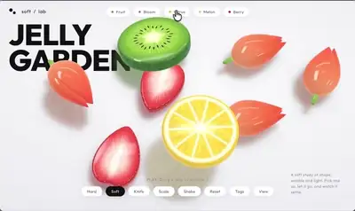</a><br><a href="https://www.sandbase.ai/lab/ai-videos/opus-5-5/2107058718882103388?utm_source=github&utm_medium=readme&utm_campaign=awesome-opus-5.5&utm_content=card"><b>Interactive slicing fruit in raw WebGL</b></a><br><sub><a href="https://x.com/viktoroddy/status/2107058718882103388">@viktoroddy</a> · 0:18</sub></td><td width="33%" valign="top"><a href="https://www.sandbase.ai/lab/media/x/opus-5-5/2107073547701289211/video.mp4"></a><br><a href="https://www.sandbase.ai/lab/ai-videos/opus-5-5/2107073547701289211?utm_source=github&utm_medium=readme&utm_campaign=awesome-opus-5.5&utm_content=card"><b>Flight through Van Gogh&#x27;s The Starry Night</b></a><br><sub><a href="https://x.com/EHuanglu/status/2107073547701289211">@EHuanglu</a> · 0:25 · <a href="https://www.sandbase.ai/lab/ai-videos/opus-5-5/2107073547701289211?utm_source=github&utm_medium=readme&utm_campaign=awesome-opus-5.5&utm_content=card">prompt</a></sub></td></tr>
<tr><td width="33%" valign="top"><a href="https://www.sandbase.ai/lab/media/x/opus-5-5/2107449104926482912/video.mp4">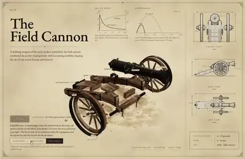</a><br><a href="https://www.sandbase.ai/lab/ai-videos/opus-5-5/2107449104926482912?utm_source=github&utm_medium=readme&utm_campaign=awesome-opus-5.5&utm_content=card"><b>Working 1857 Napoleon field cannon in Three.js</b></a><br><sub><a href="https://x.com/thebuggeddev/status/2107449104926482912">@thebuggeddev</a> · 0:51</sub></td><td width="33%" valign="top"><a href="https://www.sandbase.ai/lab/media/x/opus-5-5/2107458140279394589/video.mp4">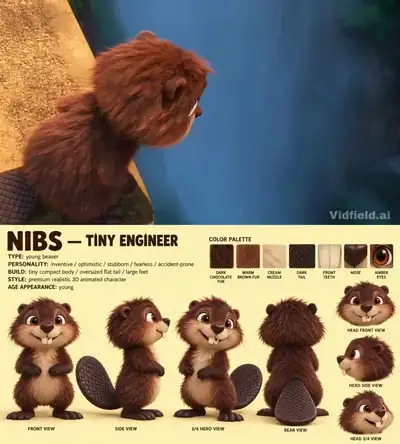</a><br><a href="https://www.sandbase.ai/lab/ai-videos/opus-5-5/2107458140279394589?utm_source=github&utm_medium=readme&utm_campaign=awesome-opus-5.5&utm_content=card"><b>3D animated scene created with Opus and Seedance</b></a><br><sub><a href="https://x.com/HeyAbhishek/status/2107458140279394589">@HeyAbhishek</a> · 0:30 · <a href="https://www.sandbase.ai/lab/ai-videos/opus-5-5/2107458140279394589?utm_source=github&utm_medium=readme&utm_campaign=awesome-opus-5.5&utm_content=card">prompt</a></sub></td><td width="33%" valign="top"><a href="https://www.sandbase.ai/lab/media/x/opus-5-5/2107572909086761325/video.mp4">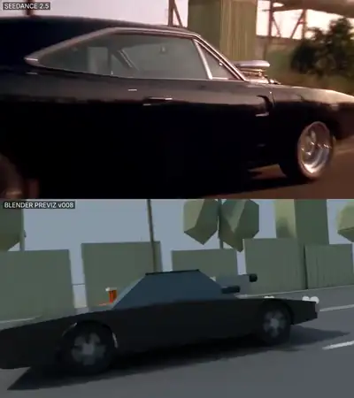</a><br><a href="https://www.sandbase.ai/lab/ai-videos/opus-5-5/2107572909086761325?utm_source=github&utm_medium=readme&utm_campaign=awesome-opus-5.5&utm_content=card"><b>Fast and the Furious scene rebuild in 3D</b></a><br><sub><a href="https://x.com/Ror_Fly/status/2107572909086761325">@Ror_Fly</a> · 0:25 · <a href="https://www.sandbase.ai/lab/ai-videos/opus-5-5/2107572909086761325?utm_source=github&utm_medium=readme&utm_campaign=awesome-opus-5.5&utm_content=card">prompt</a></sub></td></tr>
<tr><td width="33%" valign="top"><a href="https://www.sandbase.ai/lab/media/x/opus-5-5/2107653604144562177/video.mp4">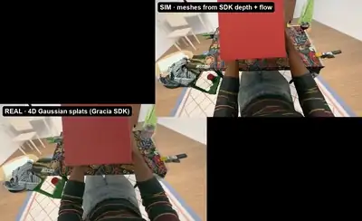</a><br><a href="https://www.sandbase.ai/lab/ai-videos/opus-5-5/2107653604144562177?utm_source=github&utm_medium=readme&utm_campaign=awesome-opus-5.5&utm_content=card"><b>Real2sim simulation from 4D reconstruction in MuJoCo</b></a><br><sub><a href="https://x.com/s1ddok/status/2107653604144562177">@s1ddok</a> · 0:21</sub></td><td width="33%" valign="top"><a href="https://www.sandbase.ai/lab/media/x/opus-5-5/2107696042053431360/video.mp4">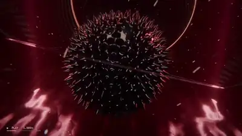</a><br><a href="https://www.sandbase.ai/lab/ai-videos/opus-5-5/2107696042053431360?utm_source=github&utm_medium=readme&utm_campaign=awesome-opus-5.5&utm_content=card"><b>Audio-reactive magma canyon animation rendered in Blender</b></a><br><sub><a href="https://x.com/kloss_xyz/status/2107696042053431360">@kloss_xyz</a> · 0:21 · <a href="https://www.sandbase.ai/lab/ai-videos/opus-5-5/2107696042053431360?utm_source=github&utm_medium=readme&utm_campaign=awesome-opus-5.5&utm_content=card">prompt</a></sub></td><td width="33%" valign="top"><a href="https://www.sandbase.ai/lab/media/x/opus-5-5/2107870449593909592/video.mp4">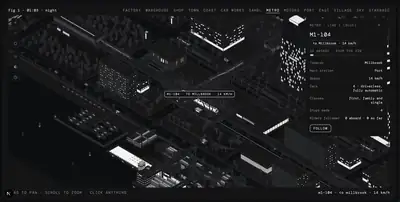</a><br><a href="https://www.sandbase.ai/lab/ai-videos/opus-5-5/2107870449593909592?utm_source=github&utm_medium=readme&utm_campaign=awesome-opus-5.5&utm_content=card"><b>Train journey simulated live in Three.js</b></a><br><sub><a href="https://x.com/KhalidDevLog/status/2107870449593909592">@KhalidDevLog</a> · 2:12</sub></td></tr>
<tr><td width="33%" valign="top"><a href="https://www.sandbase.ai/lab/media/x/opus-5-5/2108013423401353577/video.mp4">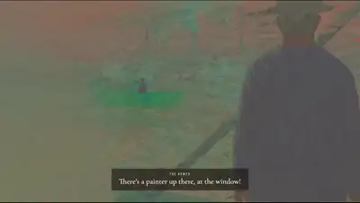</a><br><a href="https://www.sandbase.ai/lab/ai-videos/opus-5-5/2108013423401353577?utm_source=github&utm_medium=readme&utm_campaign=awesome-opus-5.5&utm_content=card"><b>Real-time 3D world in Claude Monet style</b></a><br><sub><a href="https://x.com/gruberbuilds/status/2108013423401353577">@gruberbuilds</a> · 1:31</sub></td><td width="33%" valign="top"><a href="https://www.sandbase.ai/lab/media/x/opus-5-5/2108203997480063196/video.mp4">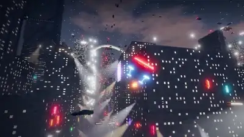</a><br><a href="https://www.sandbase.ai/lab/ai-videos/opus-5-5/2108203997480063196?utm_source=github&utm_medium=readme&utm_campaign=awesome-opus-5.5&utm_content=card"><b>Procedural endless city running in WebGPU</b></a><br><sub><a href="https://x.com/RyanSael/status/2108203997480063196">@RyanSael</a> · 0:52</sub></td><td width="33%" valign="top"><a href="https://www.sandbase.ai/lab/media/x/opus-5-5/2108284501394706447/video.mp4">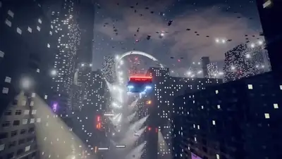</a><br><a href="https://www.sandbase.ai/lab/ai-videos/opus-5-5/2108284501394706447?utm_source=github&utm_medium=readme&utm_campaign=awesome-opus-5.5&utm_content=card"><b>An endless procedural city growing in browser</b></a><br><sub><a href="https://x.com/_Chain_Duck_/status/2108284501394706447">@_Chain_Duck_</a> · 0:39</sub></td></tr>
<tr><td width="33%" valign="top"><a href="https://www.sandbase.ai/lab/media/x/opus-5-5/2108845317122900188/video.mp4">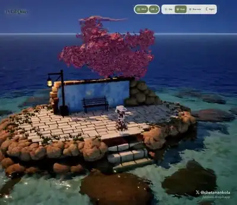</a><br><a href="https://www.sandbase.ai/lab/ai-videos/opus-5-5/2108845317122900188?utm_source=github&utm_medium=readme&utm_campaign=awesome-opus-5.5&utm_content=card"><b>Petal Quay 3D scene with anime character in Three.js</b></a><br><sub><a href="https://x.com/chetanankola/status/2108845317122900188">@chetanankola</a> · 0:38</sub></td><td width="33%" valign="top"><a href="https://www.sandbase.ai/lab/media/x/opus-5-5/2108929451811557694/video.mp4">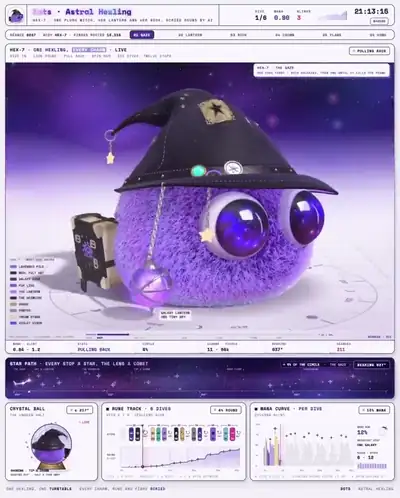</a><br><a href="https://www.sandbase.ai/lab/ai-videos/opus-5-5/2108929451811557694?utm_source=github&utm_medium=readme&utm_campaign=awesome-opus-5.5&utm_content=card"><b>Living 3D model generated from GitHub issues</b></a><br><sub><a href="https://x.com/0xWast3/status/2108929451811557694">@0xWast3</a> · 0:36</sub></td><td width="33%" valign="top"><a href="https://www.sandbase.ai/lab/media/x/opus-5-5/2109175863761859011/video.mp4">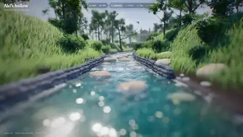</a><br><a href="https://www.sandbase.ai/lab/ai-videos/opus-5-5/2109175863761859011?utm_source=github&utm_medium=readme&utm_campaign=awesome-opus-5.5&utm_content=card"><b>A Three.js scene with Blender assets</b></a><br><sub><a href="https://x.com/anxuanng/status/2109175863761859011">@anxuanng</a> · 0:20</sub></td></tr>
<tr><td width="33%" valign="top"><a href="https://www.sandbase.ai/lab/media/x/opus-5-5/2109231561711427883/video.mp4">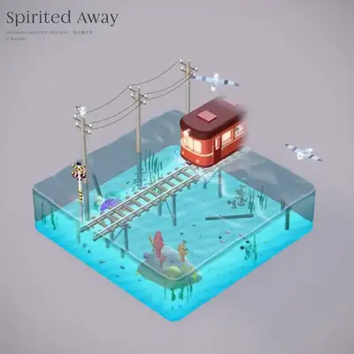</a><br><a href="https://www.sandbase.ai/lab/ai-videos/opus-5-5/2109231561711427883?utm_source=github&utm_medium=readme&utm_campaign=awesome-opus-5.5&utm_content=card"><b>Code-generated 3D sea train with sound effects</b></a><br><sub><a href="https://x.com/eviljer/status/2109231561711427883">@eviljer</a> · 1:12 · <a href="https://www.sandbase.ai/lab/ai-videos/opus-5-5/2109231561711427883?utm_source=github&utm_medium=readme&utm_campaign=awesome-opus-5.5&utm_content=card">prompt</a></sub></td><td width="33%" valign="top"><a href="https://www.sandbase.ai/lab/media/x/opus-5-5/2109257723246501895/video.mp4">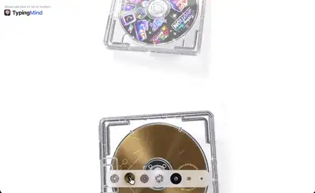</a><br><a href="https://www.sandbase.ai/lab/ai-videos/opus-5-5/2109257723246501895?utm_source=github&utm_medium=readme&utm_campaign=awesome-opus-5.5&utm_content=card"><b>Opening plastic CD case animated with Three.js shaders</b></a><br><sub><a href="https://x.com/ann_nnng/status/2109257723246501895">@ann_nnng</a> · 0:30</sub></td><td width="33%" valign="top"><a href="https://www.sandbase.ai/lab/media/x/opus-5-5/2109334686488990093/video.mp4">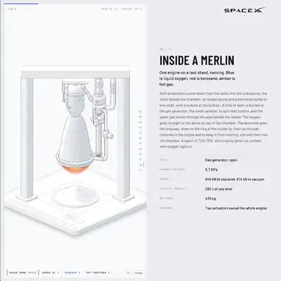</a><br><a href="https://www.sandbase.ai/lab/ai-videos/opus-5-5/2109334686488990093?utm_source=github&utm_medium=readme&utm_campaign=awesome-opus-5.5&utm_content=card"><b>Interactive isometric wireframes and WebGL shaders</b></a><br><sub><a href="https://x.com/0xMovez/status/2109334686488990093">@0xMovez</a> · 0:43</sub></td></tr>
<tr><td width="33%" valign="top"><a href="https://www.sandbase.ai/lab/media/x/opus-5-5/2109343932681171125/video.mp4"></a><br><a href="https://www.sandbase.ai/lab/ai-videos/opus-5-5/2109343932681171125?utm_source=github&utm_medium=readme&utm_campaign=awesome-opus-5.5&utm_content=card"><b>Lunar elevation model and shadow simulation in Blender</b></a><br><sub><a href="https://x.com/0xWast3/status/2109343932681171125">@0xWast3</a> · 0:26</sub></td><td width="33%" valign="top"><a href="https://www.sandbase.ai/lab/media/x/opus-5-5/2109420193399357665/video.mp4"></a><br><a href="https://www.sandbase.ai/lab/ai-videos/opus-5-5/2109420193399357665?utm_source=github&utm_medium=readme&utm_campaign=awesome-opus-5.5&utm_content=card"><b>Miniature Rainy Night Japanese Convenience Store</b></a><br><sub><a href="https://x.com/NFT_Chen/status/2109420193399357665">@NFT_Chen</a> · 1:53 · <a href="https://www.sandbase.ai/lab/ai-videos/opus-5-5/2109420193399357665?utm_source=github&utm_medium=readme&utm_campaign=awesome-opus-5.5&utm_content=card">prompt</a></sub></td><td width="33%" valign="top"><a href="https://www.sandbase.ai/lab/media/x/opus-5-5/2109523901105500260/video.mp4"></a><br><a href="https://www.sandbase.ai/lab/ai-videos/opus-5-5/2109523901105500260?utm_source=github&utm_medium=readme&utm_campaign=awesome-opus-5.5&utm_content=card"><b>3D paradise island in Three.js</b></a><br><sub><a href="https://x.com/badboyfoxy/status/2109523901105500260">@badboyfoxy</a> · 2:07</sub></td></tr>
<tr><td width="33%" valign="top"><a href="https://www.sandbase.ai/lab/media/x/opus-5-5/2109544637497298951/video.mp4"></a><br><a href="https://www.sandbase.ai/lab/ai-videos/opus-5-5/2109544637497298951?utm_source=github&utm_medium=readme&utm_campaign=awesome-opus-5.5&utm_content=card"><b>Realistic ocean simulation in Godot</b></a><br><sub><a href="https://x.com/KanaWorks_AI/status/2109544637497298951">@KanaWorks_AI</a> · 0:55</sub></td><td width="33%" valign="top"><a href="https://www.sandbase.ai/lab/media/x/opus-5-5/2109568757001756710/video.mp4"></a><br><a href="https://www.sandbase.ai/lab/ai-videos/opus-5-5/2109568757001756710?utm_source=github&utm_medium=readme&utm_campaign=awesome-opus-5.5&utm_content=card"><b>Video to 3D animal walk animation workflow</b></a><br><sub><a href="https://x.com/Stefan_3D_AI/status/2109568757001756710">@Stefan_3D_AI</a> · 0:13</sub></td><td width="33%" valign="top"><a href="https://www.sandbase.ai/lab/media/x/opus-5-5/2109702766671417760/video.mp4"></a><br><a href="https://www.sandbase.ai/lab/ai-videos/opus-5-5/2109702766671417760?utm_source=github&utm_medium=readme&utm_campaign=awesome-opus-5.5&utm_content=card"><b>Procedural scene generation in Blender</b></a><br><sub><a href="https://x.com/0xCodio/status/2109702766671417760">@0xCodio</a> · 0:24</sub></td></tr>
<tr><td width="33%" valign="top"><a href="https://www.sandbase.ai/lab/media/x/opus-5-5/2109703283614916812/video.mp4"></a><br><a href="https://www.sandbase.ai/lab/ai-videos/opus-5-5/2109703283614916812?utm_source=github&utm_medium=readme&utm_campaign=awesome-opus-5.5&utm_content=card"><b>Interactive EV teardown visualization in HTML</b></a><br><sub><a href="https://x.com/N01ennn/status/2109703283614916812">@N01ennn</a> · 0:44</sub></td><td width="33%" valign="top"><a href="https://www.sandbase.ai/lab/media/x/opus-5-5/2109718931409699043/video.mp4"></a><br><a href="https://www.sandbase.ai/lab/ai-videos/opus-5-5/2109718931409699043?utm_source=github&utm_medium=readme&utm_campaign=awesome-opus-5.5&utm_content=card"><b>An interactive 3D world with a nightclub</b></a><br><sub><a href="https://x.com/Ainthropos/status/2109718931409699043">@Ainthropos</a> · 0:56</sub></td><td width="33%" valign="top"><a href="https://www.sandbase.ai/lab/media/x/opus-5-5/2109984169845821651/video.mp4"></a><br><a href="https://www.sandbase.ai/lab/ai-videos/opus-5-5/2109984169845821651?utm_source=github&utm_medium=readme&utm_campaign=awesome-opus-5.5&utm_content=card"><b>Opening Ground Interactive 3D Scene</b></a><br><sub><a href="https://x.com/viktoroddy/status/2109984169845821651">@viktoroddy</a> · 0:22 · <a href="https://www.sandbase.ai/lab/ai-videos/opus-5-5/2109984169845821651?utm_source=github&utm_medium=readme&utm_campaign=awesome-opus-5.5&utm_content=card">prompt</a></sub></td></tr>
<tr><td width="33%" valign="top"><a href="https://www.sandbase.ai/lab/media/x/opus-5-5/2109993586951663626/video.mp4"></a><br><a href="https://www.sandbase.ai/lab/ai-videos/opus-5-5/2109993586951663626?utm_source=github&utm_medium=readme&utm_campaign=awesome-opus-5.5&utm_content=card"><b>Cinematic 3D animated adventure video</b></a><br><sub><a href="https://x.com/HeyAbhishek/status/2109993586951663626">@HeyAbhishek</a> · 0:29 · <a href="https://www.sandbase.ai/lab/ai-videos/opus-5-5/2109993586951663626?utm_source=github&utm_medium=readme&utm_campaign=awesome-opus-5.5&utm_content=card">prompt</a></sub></td><td width="33%" valign="top"><a href="https://www.sandbase.ai/lab/media/x/opus-5-5/2110010240825737683/video.mp4"></a><br><a href="https://www.sandbase.ai/lab/ai-videos/opus-5-5/2110010240825737683?utm_source=github&utm_medium=readme&utm_campaign=awesome-opus-5.5&utm_content=card"><b>3D animation made using Python and Blender</b></a><br><sub><a href="https://x.com/kevin_t_ngo/status/2110010240825737683">@kevin_t_ngo</a> · 0:28</sub></td><td width="33%" valign="top"><a href="https://www.sandbase.ai/lab/media/x/opus-5-5/2110036224320884998/video.mp4"></a><br><a href="https://www.sandbase.ai/lab/ai-videos/opus-5-5/2110036224320884998?utm_source=github&utm_medium=readme&utm_campaign=awesome-opus-5.5&utm_content=card"><b>Walkable 3D house generated from floor plan</b></a><br><sub><a href="https://x.com/everestchris6/status/2110036224320884998">@everestchris6</a> · 0:14 · <a href="https://www.sandbase.ai/lab/ai-videos/opus-5-5/2110036224320884998?utm_source=github&utm_medium=readme&utm_campaign=awesome-opus-5.5&utm_content=card">prompt</a></sub></td></tr>
<tr><td width="33%" valign="top"><a href="https://www.sandbase.ai/lab/media/x/opus-5-5/2110275826658967896/video.mp4"></a><br><a href="https://www.sandbase.ai/lab/ai-videos/opus-5-5/2110275826658967896?utm_source=github&utm_medium=readme&utm_campaign=awesome-opus-5.5&utm_content=card"><b>Interactive 3D city in Three.js</b></a><br><sub><a href="https://x.com/jiangjiangling/status/2110275826658967896">@jiangjiangling</a> · 0:56</sub></td><td width="33%" valign="top"><a href="https://www.sandbase.ai/lab/media/x/opus-5-5/2110450567956811893/video.mp4"></a><br><a href="https://www.sandbase.ai/lab/ai-videos/opus-5-5/2110450567956811893?utm_source=github&utm_medium=readme&utm_campaign=awesome-opus-5.5&utm_content=card"><b>Walkable 3D house generated from floor plans</b></a><br><sub><a href="https://x.com/AHSeslami/status/2110450567956811893">@AHSeslami</a> · 0:14</sub></td><td width="33%" valign="top"><a href="https://www.sandbase.ai/lab/media/x/opus-5-5/2110453070236922090/video.mp4"></a><br><a href="https://www.sandbase.ai/lab/ai-videos/opus-5-5/2110453070236922090?utm_source=github&utm_medium=readme&utm_campaign=awesome-opus-5.5&utm_content=card"><b>Interactive 3D office for AI workers in Three.js</b></a><br><sub><a href="https://x.com/anxuanng/status/2110453070236922090">@anxuanng</a> · 0:30</sub></td></tr>
<tr><td width="33%" valign="top"><a href="https://www.sandbase.ai/lab/media/x/opus-5-5/2110665495221268915/video.mp4"></a><br><a href="https://www.sandbase.ai/lab/ai-videos/opus-5-5/2110665495221268915?utm_source=github&utm_medium=readme&utm_campaign=awesome-opus-5.5&utm_content=card"><b>Interactive squishable jelly orange in browser</b></a><br><sub><a href="https://x.com/vib3coded/status/2110665495221268915">@vib3coded</a> · 0:18</sub></td><td width="33%" valign="top"><a href="https://www.sandbase.ai/lab/media/x/opus-5-5/2111035753035612364/video.mp4"></a><br><a href="https://www.sandbase.ai/lab/ai-videos/opus-5-5/2111035753035612364?utm_source=github&utm_medium=readme&utm_campaign=awesome-opus-5.5&utm_content=card"><b>Automated Blender asset pipeline with Opus</b></a><br><sub><a href="https://x.com/0xWast3/status/2111035753035612364">@0xWast3</a> · 0:30</sub></td><td width="33%" valign="top"><a href="https://www.sandbase.ai/lab/media/x/opus-5-5/2111120760660254842/video.mp4"></a><br><a href="https://www.sandbase.ai/lab/ai-videos/opus-5-5/2111120760660254842?utm_source=github&utm_medium=readme&utm_campaign=awesome-opus-5.5&utm_content=card"><b>Three.js 3D scene coded with Claude Opus</b></a><br><sub><a href="https://x.com/Belbizaz/status/2111120760660254842">@Belbizaz</a> · 0:30</sub></td></tr>
<tr><td width="33%" valign="top"><a href="https://www.sandbase.ai/lab/media/x/opus-5-5/2111306207239557288/video.mp4"></a><br><a href="https://www.sandbase.ai/lab/ai-videos/opus-5-5/2111306207239557288?utm_source=github&utm_medium=readme&utm_campaign=awesome-opus-5.5&utm_content=card"><b>Real-time ocean rendered with WebGPU</b></a><br><sub><a href="https://x.com/jurlycat/status/2111306207239557288">@jurlycat</a> · 0:32</sub></td><td width="33%" valign="top"><a href="https://www.sandbase.ai/lab/media/x/opus-5-5/2111393368097849615/video.mp4"></a><br><a href="https://www.sandbase.ai/lab/ai-videos/opus-5-5/2111393368097849615?utm_source=github&utm_medium=readme&utm_campaign=awesome-opus-5.5&utm_content=card"><b>Making game models with Claude Opus and Blender</b></a><br><sub><a href="https://x.com/rewind02/status/2111393368097849615">@rewind02</a> · 0:16</sub></td><td width="33%" valign="top"><a href="https://www.sandbase.ai/lab/media/x/opus-5-5/2111435045109903540/video.mp4"></a><br><a href="https://www.sandbase.ai/lab/ai-videos/opus-5-5/2111435045109903540?utm_source=github&utm_medium=readme&utm_campaign=awesome-opus-5.5&utm_content=card"><b>Complex volumetric Houdini scene created with Claude</b></a><br><sub><a href="https://x.com/hectorVFX/status/2111435045109903540">@hectorVFX</a> · 0:15</sub></td></tr>
<tr><td width="33%" valign="top"><a href="https://www.sandbase.ai/lab/media/x/opus-5-5/2111880621954081240/video.mp4"></a><br><a href="https://www.sandbase.ai/lab/ai-videos/opus-5-5/2111880621954081240?utm_source=github&utm_medium=readme&utm_campaign=awesome-opus-5.5&utm_content=card"><b>Drafting and raising an apartment into 3D</b></a><br><sub><a href="https://x.com/Solvaix/status/2111880621954081240">@Solvaix</a> · 1:13</sub></td><td width="33%" valign="top"><a href="https://www.sandbase.ai/lab/media/x/opus-5-5/2111920496208204235/video.mp4"></a><br><a href="https://www.sandbase.ai/lab/ai-videos/opus-5-5/2111920496208204235?utm_source=github&utm_medium=readme&utm_campaign=awesome-opus-5.5&utm_content=card"><b>Procedural ocean simulation in a lightweight file</b></a><br><sub><a href="https://x.com/AmirMushich/status/2111920496208204235">@AmirMushich</a> · 0:19 · <a href="https://www.sandbase.ai/lab/ai-videos/opus-5-5/2111920496208204235?utm_source=github&utm_medium=readme&utm_campaign=awesome-opus-5.5&utm_content=card">prompt</a></sub></td><td width="33%" valign="top"><a href="https://www.sandbase.ai/lab/media/x/opus-5-5/2112213850682536223/video.mp4"></a><br><a href="https://www.sandbase.ai/lab/ai-videos/opus-5-5/2112213850682536223?utm_source=github&utm_medium=readme&utm_campaign=awesome-opus-5.5&utm_content=card"><b>Water and sky shaders running in Three.js</b></a><br><sub><a href="https://x.com/maxt3chno/status/2112213850682536223">@maxt3chno</a> · 1:12</sub></td></tr>
<tr><td width="33%" valign="top"><a href="https://www.sandbase.ai/lab/media/x/opus-5-5/2112514570078372079/video.mp4"></a><br><a href="https://www.sandbase.ai/lab/ai-videos/opus-5-5/2112514570078372079?utm_source=github&utm_medium=readme&utm_campaign=awesome-opus-5.5&utm_content=card"><b>Interactive 3D scary website generated from a prompt</b></a><br><sub><a href="https://x.com/viktoroddy/status/2112514570078372079">@viktoroddy</a> · 0:25</sub></td><td width="33%" valign="top"><a href="https://www.sandbase.ai/lab/media/x/opus-5-5/2112525552519184776/video.mp4"></a><br><a href="https://www.sandbase.ai/lab/ai-videos/opus-5-5/2112525552519184776?utm_source=github&utm_medium=readme&utm_campaign=awesome-opus-5.5&utm_content=card"><b>Three-dimensional anatomy reveals and exploded view animations</b></a><br><sub><a href="https://x.com/LunarResearcher/status/2112525552519184776">@LunarResearcher</a> · 0:22</sub></td></tr>
</table>

</details>

<a id="motion-graphics"></a>

## Motion graphics

<table>
<tr><td width="33%" valign="top"><a href="https://www.sandbase.ai/lab/media/x/opus-5-5/2102437977435893771/video.mp4"></a><br><a href="https://www.sandbase.ai/lab/ai-videos/opus-5-5/2102437977435893771?utm_source=github&utm_medium=readme&utm_campaign=awesome-opus-5.5&utm_content=card"><b>JavaScript animated story about Claude and a question</b></a><br><sub><a href="https://x.com/kevin_t_ngo/status/2102437977435893771">@kevin_t_ngo</a> · 0:28</sub></td><td width="33%" valign="top"><a href="https://www.sandbase.ai/lab/media/x/opus-5-5/2102451375724499350/video.mp4"></a><br><a href="https://www.sandbase.ai/lab/ai-videos/opus-5-5/2102451375724499350?utm_source=github&utm_medium=readme&utm_campaign=awesome-opus-5.5&utm_content=card"><b>SVG rendering of Nintendo Switch</b></a><br><sub><a href="https://x.com/ishuagra02/status/2102451375724499350">@ishuagra02</a> · 0:07</sub></td><td width="33%" valign="top"><a href="https://www.sandbase.ai/lab/media/x/opus-5-5/2102476258948927543/video.mp4"></a><br><a href="https://www.sandbase.ai/lab/ai-videos/opus-5-5/2102476258948927543?utm_source=github&utm_medium=readme&utm_campaign=awesome-opus-5.5&utm_content=card"><b>Animated pixel art wizard in pure code</b></a><br><sub><a href="https://x.com/majidmanzarpour/status/2102476258948927543">@majidmanzarpour</a> · 0:11 · <a href="https://www.sandbase.ai/lab/ai-videos/opus-5-5/2102476258948927543?utm_source=github&utm_medium=readme&utm_campaign=awesome-opus-5.5&utm_content=card">prompt</a></sub></td></tr>
<tr><td width="33%" valign="top"><a href="https://www.sandbase.ai/lab/media/x/opus-5-5/2102484620109644273/video.mp4"></a><br><a href="https://www.sandbase.ai/lab/ai-videos/opus-5-5/2102484620109644273?utm_source=github&utm_medium=readme&utm_campaign=awesome-opus-5.5&utm_content=card"><b>AI Generated Video Progression with Music</b></a><br><sub><a href="https://x.com/dhruvalgolakiya/status/2102484620109644273">@dhruvalgolakiya</a> · 0:23</sub></td><td width="33%" valign="top"><a href="https://www.sandbase.ai/lab/media/x/opus-5-5/2102495989194236158/video.mp4"></a><br><a href="https://www.sandbase.ai/lab/ai-videos/opus-5-5/2102495989194236158?utm_source=github&utm_medium=readme&utm_campaign=awesome-opus-5.5&utm_content=card"><b>Animated life journey rendered frame by frame in JavaScript</b></a><br><sub><a href="https://x.com/shfred0/status/2102495989194236158">@shfred0</a> · 0:30</sub></td><td width="33%" valign="top"><a href="https://www.sandbase.ai/lab/media/x/opus-5-5/2102531681450119426/video.mp4"></a><br><a href="https://www.sandbase.ai/lab/ai-videos/opus-5-5/2102531681450119426?utm_source=github&utm_medium=readme&utm_campaign=awesome-opus-5.5&utm_content=card"><b>Code-generated animated story Small Print</b></a><br><sub><a href="https://x.com/Voxyz_ai/status/2102531681450119426">@Voxyz_ai</a> · 0:29</sub></td></tr>
</table>

<details>
<summary><b>Show all 99</b></summary>

<table>
<tr><td width="33%" valign="top"><a href="https://www.sandbase.ai/lab/media/x/opus-5-5/2102592355165782312/video.mp4"></a><br><a href="https://www.sandbase.ai/lab/ai-videos/opus-5-5/2102592355165782312?utm_source=github&utm_medium=readme&utm_campaign=awesome-opus-5.5&utm_content=card"><b>Sand art animation generated by Opus 5.5</b></a><br><sub><a href="https://x.com/Michaelzsguo/status/2102592355165782312">@Michaelzsguo</a> · 2:00 · <a href="https://www.sandbase.ai/lab/ai-videos/opus-5-5/2102592355165782312?utm_source=github&utm_medium=readme&utm_campaign=awesome-opus-5.5&utm_content=card">prompt</a></sub></td><td width="33%" valign="top"><a href="https://www.sandbase.ai/lab/media/x/opus-5-5/2102645793828036643/video.mp4"></a><br><a href="https://www.sandbase.ai/lab/ai-videos/opus-5-5/2102645793828036643?utm_source=github&utm_medium=readme&utm_campaign=awesome-opus-5.5&utm_content=card"><b>Animated film rendered in Canvas 2D</b></a><br><sub><a href="https://x.com/jurlycat/status/2102645793828036643">@jurlycat</a> · 1:18</sub></td><td width="33%" valign="top"><a href="https://www.sandbase.ai/lab/media/x/opus-5-5/2102707412704919910/video.mp4"></a><br><a href="https://www.sandbase.ai/lab/ai-videos/opus-5-5/2102707412704919910?utm_source=github&utm_medium=readme&utm_campaign=awesome-opus-5.5&utm_content=card"><b>Procedural galloping horse drawn in Canvas 2D</b></a><br><sub><a href="https://x.com/victormustar/status/2102707412704919910">@victormustar</a> · 0:10</sub></td></tr>
<tr><td width="33%" valign="top"><a href="https://www.sandbase.ai/lab/media/x/opus-5-5/2102712897701097828/video.mp4"></a><br><a href="https://www.sandbase.ai/lab/ai-videos/opus-5-5/2102712897701097828?utm_source=github&utm_medium=readme&utm_campaign=awesome-opus-5.5&utm_content=card"><b>Graphic post and animation generated from one prompt</b></a><br><sub><a href="https://x.com/nazmijavierl/status/2102712897701097828">@nazmijavierl</a> · 0:16</sub></td><td width="33%" valign="top"><a href="https://www.sandbase.ai/lab/media/x/opus-5-5/2102724347446305104/video.mp4"></a><br><a href="https://www.sandbase.ai/lab/ai-videos/opus-5-5/2102724347446305104?utm_source=github&utm_medium=readme&utm_campaign=awesome-opus-5.5&utm_content=card"><b>Procedural cinematic motion design short film</b></a><br><sub><a href="https://x.com/leo_xiaolei/status/2102724347446305104">@leo_xiaolei</a> · 0:28 · <a href="https://www.sandbase.ai/lab/ai-videos/opus-5-5/2102724347446305104?utm_source=github&utm_medium=readme&utm_campaign=awesome-opus-5.5&utm_content=card">prompt</a></sub></td><td width="33%" valign="top"><a href="https://www.sandbase.ai/lab/media/x/opus-5-5/2102733714845491558/video.mp4"></a><br><a href="https://www.sandbase.ai/lab/ai-videos/opus-5-5/2102733714845491558?utm_source=github&utm_medium=readme&utm_campaign=awesome-opus-5.5&utm_content=card"><b>Long-form AI video with sound</b></a><br><sub><a href="https://x.com/dhruvalgolakiya/status/2102733714845491558">@dhruvalgolakiya</a> · 2:04</sub></td></tr>
<tr><td width="33%" valign="top"><a href="https://www.sandbase.ai/lab/media/x/opus-5-5/2102735082218004540/video.mp4"></a><br><a href="https://www.sandbase.ai/lab/ai-videos/opus-5-5/2102735082218004540?utm_source=github&utm_medium=readme&utm_campaign=awesome-opus-5.5&utm_content=card"><b>Stickman animation made with JavaScript in HTML</b></a><br><sub><a href="https://x.com/notjazii/status/2102735082218004540">@notjazii</a> · 0:25</sub></td><td width="33%" valign="top"><a href="https://www.sandbase.ai/lab/media/x/opus-5-5/2102801274173587569/video.mp4"></a><br><a href="https://www.sandbase.ai/lab/ai-videos/opus-5-5/2102801274173587569?utm_source=github&utm_medium=readme&utm_campaign=awesome-opus-5.5&utm_content=card"><b>Project generated from a single voice prompt</b></a><br><sub><a href="https://x.com/donaldjewkes/status/2102801274173587569">@donaldjewkes</a> · 2:22 · <a href="https://www.sandbase.ai/lab/ai-videos/opus-5-5/2102801274173587569?utm_source=github&utm_medium=readme&utm_campaign=awesome-opus-5.5&utm_content=card">prompt</a></sub></td><td width="33%" valign="top"><a href="https://www.sandbase.ai/lab/media/x/opus-5-5/2102853258582880547/video.mp4"></a><br><a href="https://www.sandbase.ai/lab/ai-videos/opus-5-5/2102853258582880547?utm_source=github&utm_medium=readme&utm_campaign=awesome-opus-5.5&utm_content=card"><b>Recipe motion graphic rendered in HTML</b></a><br><sub><a href="https://x.com/Ror_Fly/status/2102853258582880547">@Ror_Fly</a> · 0:30 · <a href="https://www.sandbase.ai/lab/ai-videos/opus-5-5/2102853258582880547?utm_source=github&utm_medium=readme&utm_campaign=awesome-opus-5.5&utm_content=card">prompt</a></sub></td></tr>
<tr><td width="33%" valign="top"><a href="https://www.sandbase.ai/lab/media/x/opus-5-5/2103082510607610023/video.mp4"></a><br><a href="https://www.sandbase.ai/lab/ai-videos/opus-5-5/2103082510607610023?utm_source=github&utm_medium=readme&utm_campaign=awesome-opus-5.5&utm_content=card"><b>Testing workflow limits with Opus</b></a><br><sub><a href="https://x.com/pleometric/status/2103082510607610023">@pleometric</a> · 2:37</sub></td><td width="33%" valign="top"><a href="https://www.sandbase.ai/lab/media/x/opus-5-5/2103107359727829318/video.mp4"></a><br><a href="https://www.sandbase.ai/lab/ai-videos/opus-5-5/2103107359727829318?utm_source=github&utm_medium=readme&utm_campaign=awesome-opus-5.5&utm_content=card"><b>One prompt video created using Remotion</b></a><br><sub><a href="https://x.com/thallisribeiro/status/2103107359727829318">@thallisribeiro</a> · 0:21</sub></td><td width="33%" valign="top"><a href="https://www.sandbase.ai/lab/media/x/opus-5-5/2103124033365762215/video.mp4"></a><br><a href="https://www.sandbase.ai/lab/ai-videos/opus-5-5/2103124033365762215?utm_source=github&utm_medium=readme&utm_campaign=awesome-opus-5.5&utm_content=card"><b>Four seasons passing outside a train window</b></a><br><sub><a href="https://x.com/itsolelehmann/status/2103124033365762215">@itsolelehmann</a> · 0:30 · <a href="https://www.sandbase.ai/lab/ai-videos/opus-5-5/2103124033365762215?utm_source=github&utm_medium=readme&utm_campaign=awesome-opus-5.5&utm_content=card">prompt</a></sub></td></tr>
<tr><td width="33%" valign="top"><a href="https://www.sandbase.ai/lab/media/x/opus-5-5/2103129343253778767/video.mp4"></a><br><a href="https://www.sandbase.ai/lab/ai-videos/opus-5-5/2103129343253778767?utm_source=github&utm_medium=readme&utm_campaign=awesome-opus-5.5&utm_content=card"><b>Motion animation generated with Opus 5.5</b></a><br><sub><a href="https://x.com/koldo2k/status/2103129343253778767">@koldo2k</a> · 0:20 · <a href="https://www.sandbase.ai/lab/ai-videos/opus-5-5/2103129343253778767?utm_source=github&utm_medium=readme&utm_campaign=awesome-opus-5.5&utm_content=card">prompt</a></sub></td><td width="33%" valign="top"><a href="https://www.sandbase.ai/lab/media/x/opus-5-5/2103144778481475686/video.mp4"></a><br><a href="https://www.sandbase.ai/lab/ai-videos/opus-5-5/2103144778481475686?utm_source=github&utm_medium=readme&utm_campaign=awesome-opus-5.5&utm_content=card"><b>Talking-head clip edited with subtitles and graphics</b></a><br><sub><a href="https://x.com/sab8a/status/2103144778481475686">@sab8a</a> · 0:37 · <a href="https://www.sandbase.ai/lab/ai-videos/opus-5-5/2103144778481475686?utm_source=github&utm_medium=readme&utm_campaign=awesome-opus-5.5&utm_content=card">prompt</a></sub></td><td width="33%" valign="top"><a href="https://www.sandbase.ai/lab/media/x/opus-5-5/2103315922098470926/video.mp4"></a><br><a href="https://www.sandbase.ai/lab/ai-videos/opus-5-5/2103315922098470926?utm_source=github&utm_medium=readme&utm_campaign=awesome-opus-5.5&utm_content=card"><b>A dynamic motion graphics showreel generated from code</b></a><br><sub><a href="https://x.com/stephanlivera/status/2103315922098470926">@stephanlivera</a> · 0:15 · <a href="https://www.sandbase.ai/lab/ai-videos/opus-5-5/2103315922098470926?utm_source=github&utm_medium=readme&utm_campaign=awesome-opus-5.5&utm_content=card">prompt</a></sub></td></tr>
<tr><td width="33%" valign="top"><a href="https://www.sandbase.ai/lab/media/x/opus-5-5/2103337314021937232/video.mp4"></a><br><a href="https://www.sandbase.ai/lab/ai-videos/opus-5-5/2103337314021937232?utm_source=github&utm_medium=readme&utm_campaign=awesome-opus-5.5&utm_content=card"><b>Motion graphics video generated from a single prompt</b></a><br><sub><a href="https://x.com/kenn/status/2103337314021937232">@kenn</a> · 0:15</sub></td><td width="33%" valign="top"><a href="https://www.sandbase.ai/lab/media/x/opus-5-5/2103411244468498547/video.mp4"></a><br><a href="https://www.sandbase.ai/lab/ai-videos/opus-5-5/2103411244468498547?utm_source=github&utm_medium=readme&utm_campaign=awesome-opus-5.5&utm_content=card"><b>A code-generated motion piece</b></a><br><sub><a href="https://x.com/techhalla/status/2103411244468498547">@techhalla</a> · 0:20 · <a href="https://www.sandbase.ai/lab/ai-videos/opus-5-5/2103411244468498547?utm_source=github&utm_medium=readme&utm_campaign=awesome-opus-5.5&utm_content=card">prompt</a></sub></td><td width="33%" valign="top"><a href="https://www.sandbase.ai/lab/media/x/opus-5-5/2103437700783038710/video.mp4"></a><br><a href="https://www.sandbase.ai/lab/ai-videos/opus-5-5/2103437700783038710?utm_source=github&utm_medium=readme&utm_campaign=awesome-opus-5.5&utm_content=card"><b>Agency presentation motion design</b></a><br><sub><a href="https://x.com/baptistelcx/status/2103437700783038710">@baptistelcx</a> · 1:18</sub></td></tr>
<tr><td width="33%" valign="top"><a href="https://www.sandbase.ai/lab/media/x/opus-5-5/2103441222375268605/video.mp4"></a><br><a href="https://www.sandbase.ai/lab/ai-videos/opus-5-5/2103441222375268605?utm_source=github&utm_medium=readme&utm_campaign=awesome-opus-5.5&utm_content=card"><b>Testing animation capabilities with Claude Opus</b></a><br><sub><a href="https://x.com/tcballard/status/2103441222375268605">@tcballard</a> · 0:15 · <a href="https://www.sandbase.ai/lab/ai-videos/opus-5-5/2103441222375268605?utm_source=github&utm_medium=readme&utm_campaign=awesome-opus-5.5&utm_content=card">prompt</a></sub></td><td width="33%" valign="top"><a href="https://www.sandbase.ai/lab/media/x/opus-5-5/2103449416325890146/video.mp4"></a><br><a href="https://www.sandbase.ai/lab/ai-videos/opus-5-5/2103449416325890146?utm_source=github&utm_medium=readme&utm_campaign=awesome-opus-5.5&utm_content=card"><b>A dynamic fifteen second motion graphics showreel</b></a><br><sub><a href="https://x.com/ajith_io/status/2103449416325890146">@ajith_io</a> · 0:15 · <a href="https://www.sandbase.ai/lab/ai-videos/opus-5-5/2103449416325890146?utm_source=github&utm_medium=readme&utm_campaign=awesome-opus-5.5&utm_content=card">prompt</a></sub></td><td width="33%" valign="top"><a href="https://www.sandbase.ai/lab/media/x/opus-5-5/2103459971174130104/video.mp4"></a><br><a href="https://www.sandbase.ai/lab/ai-videos/opus-5-5/2103459971174130104?utm_source=github&utm_medium=readme&utm_campaign=awesome-opus-5.5&utm_content=card"><b>Promotional logo video generated from a prompt</b></a><br><sub><a href="https://x.com/fire_ozgur/status/2103459971174130104">@fire_ozgur</a> · 0:15 · <a href="https://www.sandbase.ai/lab/ai-videos/opus-5-5/2103459971174130104?utm_source=github&utm_medium=readme&utm_campaign=awesome-opus-5.5&utm_content=card">prompt</a></sub></td></tr>
<tr><td width="33%" valign="top"><a href="https://www.sandbase.ai/lab/media/x/opus-5-5/2103482164193165711/video.mp4"></a><br><a href="https://www.sandbase.ai/lab/ai-videos/opus-5-5/2103482164193165711?utm_source=github&utm_medium=readme&utm_campaign=awesome-opus-5.5&utm_content=card"><b>JavaScript animation with composed piano music</b></a><br><sub><a href="https://x.com/kevin_t_ngo/status/2103482164193165711">@kevin_t_ngo</a> · 0:45</sub></td><td width="33%" valign="top"><a href="https://www.sandbase.ai/lab/media/x/opus-5-5/2103483957266268381/video.mp4"></a><br><a href="https://www.sandbase.ai/lab/ai-videos/opus-5-5/2103483957266268381?utm_source=github&utm_medium=readme&utm_campaign=awesome-opus-5.5&utm_content=card"><b>Coded motion design morphing through MakerMap</b></a><br><sub><a href="https://x.com/verbove/status/2103483957266268381">@verbove</a> · 0:20 · <a href="https://www.sandbase.ai/lab/ai-videos/opus-5-5/2103483957266268381?utm_source=github&utm_medium=readme&utm_campaign=awesome-opus-5.5&utm_content=card">prompt</a></sub></td><td width="33%" valign="top"><a href="https://www.sandbase.ai/lab/media/x/opus-5-5/2103485566570369333/video.mp4"></a><br><a href="https://www.sandbase.ai/lab/ai-videos/opus-5-5/2103485566570369333?utm_source=github&utm_medium=readme&utm_campaign=awesome-opus-5.5&utm_content=card"><b>A colorful animated video rendered via Playwright</b></a><br><sub><a href="https://x.com/__morse/status/2103485566570369333">@__morse</a> · 0:15</sub></td></tr>
<tr><td width="33%" valign="top"><a href="https://www.sandbase.ai/lab/media/x/opus-5-5/2103495232637882858/video.mp4"></a><br><a href="https://www.sandbase.ai/lab/ai-videos/opus-5-5/2103495232637882858?utm_source=github&utm_medium=readme&utm_campaign=awesome-opus-5.5&utm_content=card"><b>A dynamic motion graphics showreel</b></a><br><sub><a href="https://x.com/himanshutwtxs/status/2103495232637882858">@himanshutwtxs</a> · 0:15 · <a href="https://www.sandbase.ai/lab/ai-videos/opus-5-5/2103495232637882858?utm_source=github&utm_medium=readme&utm_campaign=awesome-opus-5.5&utm_content=card">prompt</a></sub></td><td width="33%" valign="top"><a href="https://www.sandbase.ai/lab/media/x/opus-5-5/2103497319899693327/video.mp4"></a><br><a href="https://www.sandbase.ai/lab/ai-videos/opus-5-5/2103497319899693327?utm_source=github&utm_medium=readme&utm_campaign=awesome-opus-5.5&utm_content=card"><b>HTML and code promotional video</b></a><br><sub><a href="https://x.com/Majin_AppSheet/status/2103497319899693327">@Majin_AppSheet</a> · 0:10</sub></td><td width="33%" valign="top"><a href="https://www.sandbase.ai/lab/media/x/opus-5-5/2103505435802341449/video.mp4"></a><br><a href="https://www.sandbase.ai/lab/ai-videos/opus-5-5/2103505435802341449?utm_source=github&utm_medium=readme&utm_campaign=awesome-opus-5.5&utm_content=card"><b>Motion graphics created with Opus 5.5</b></a><br><sub><a href="https://x.com/YarHmm/status/2103505435802341449">@YarHmm</a> · 0:56</sub></td></tr>
<tr><td width="33%" valign="top"><a href="https://www.sandbase.ai/lab/media/x/opus-5-5/2103517930424332386/video.mp4"></a><br><a href="https://www.sandbase.ai/lab/ai-videos/opus-5-5/2103517930424332386?utm_source=github&utm_medium=readme&utm_campaign=awesome-opus-5.5&utm_content=card"><b>Dynamic motion graphics video for Distilbook</b></a><br><sub><a href="https://x.com/itisRazak/status/2103517930424332386">@itisRazak</a> · 0:40 · <a href="https://www.sandbase.ai/lab/ai-videos/opus-5-5/2103517930424332386?utm_source=github&utm_medium=readme&utm_campaign=awesome-opus-5.5&utm_content=card">prompt</a></sub></td><td width="33%" valign="top"><a href="https://www.sandbase.ai/lab/media/x/opus-5-5/2103530293634445592/video.mp4"></a><br><a href="https://www.sandbase.ai/lab/ai-videos/opus-5-5/2103530293634445592?utm_source=github&utm_medium=readme&utm_campaign=awesome-opus-5.5&utm_content=card"><b>Single-prompt motion design test with generated audio</b></a><br><sub><a href="https://x.com/birdabo/status/2103530293634445592">@birdabo</a> · 0:15</sub></td><td width="33%" valign="top"><a href="https://www.sandbase.ai/lab/media/x/opus-5-5/2103530750767206626/video.mp4"></a><br><a href="https://www.sandbase.ai/lab/ai-videos/opus-5-5/2103530750767206626?utm_source=github&utm_medium=readme&utm_campaign=awesome-opus-5.5&utm_content=card"><b>Video made entirely with code by Claude Opus</b></a><br><sub><a href="https://x.com/bridgemindai/status/2103530750767206626">@bridgemindai</a> · 1:00</sub></td></tr>
<tr><td width="33%" valign="top"><a href="https://www.sandbase.ai/lab/media/x/opus-5-5/2103538744695693512/video.mp4"></a><br><a href="https://www.sandbase.ai/lab/ai-videos/opus-5-5/2103538744695693512?utm_source=github&utm_medium=readme&utm_campaign=awesome-opus-5.5&utm_content=card"><b>Motion design video with synthesized music</b></a><br><sub><a href="https://x.com/prasenx/status/2103538744695693512">@prasenx</a> · 0:15</sub></td><td width="33%" valign="top"><a href="https://www.sandbase.ai/lab/media/x/opus-5-5/2103552246927810680/video.mp4"></a><br><a href="https://www.sandbase.ai/lab/ai-videos/opus-5-5/2103552246927810680?utm_source=github&utm_medium=readme&utm_campaign=awesome-opus-5.5&utm_content=card"><b>Motion graphics video about SWE 2</b></a><br><sub><a href="https://x.com/notjazii/status/2103552246927810680">@notjazii</a> · 0:15</sub></td><td width="33%" valign="top"><a href="https://www.sandbase.ai/lab/media/x/opus-5-5/2103555549929566323/video.mp4"></a><br><a href="https://www.sandbase.ai/lab/ai-videos/opus-5-5/2103555549929566323?utm_source=github&utm_medium=readme&utm_campaign=awesome-opus-5.5&utm_content=card"><b>Recreation of Apple Wonderful Tools Animation</b></a><br><sub><a href="https://x.com/DavidKPiano/status/2103555549929566323">@DavidKPiano</a> · 1:37</sub></td></tr>
<tr><td width="33%" valign="top"><a href="https://www.sandbase.ai/lab/media/x/opus-5-5/2103576084499358051/video.mp4"></a><br><a href="https://www.sandbase.ai/lab/ai-videos/opus-5-5/2103576084499358051?utm_source=github&utm_medium=readme&utm_campaign=awesome-opus-5.5&utm_content=card"><b>Motion design animation generated by Opus 5.5</b></a><br><sub><a href="https://x.com/leonabboud/status/2103576084499358051">@leonabboud</a> · 0:15 · <a href="https://www.sandbase.ai/lab/ai-videos/opus-5-5/2103576084499358051?utm_source=github&utm_medium=readme&utm_campaign=awesome-opus-5.5&utm_content=card">prompt</a></sub></td><td width="33%" valign="top"><a href="https://www.sandbase.ai/lab/media/x/opus-5-5/2103638102333858193/video.mp4"></a><br><a href="https://www.sandbase.ai/lab/ai-videos/opus-5-5/2103638102333858193?utm_source=github&utm_medium=readme&utm_campaign=awesome-opus-5.5&utm_content=card"><b>Single-prompt video generated by Opus 5.5</b></a><br><sub><a href="https://x.com/kentcdodds/status/2103638102333858193">@kentcdodds</a> · 0:30 · <a href="https://www.sandbase.ai/lab/ai-videos/opus-5-5/2103638102333858193?utm_source=github&utm_medium=readme&utm_campaign=awesome-opus-5.5&utm_content=card">prompt</a></sub></td><td width="33%" valign="top"><a href="https://www.sandbase.ai/lab/media/x/opus-5-5/2103663364958515541/video.mp4"></a><br><a href="https://www.sandbase.ai/lab/ai-videos/opus-5-5/2103663364958515541?utm_source=github&utm_medium=readme&utm_campaign=awesome-opus-5.5&utm_content=card"><b>Dynamic motion graphics showreel generated from one prompt</b></a><br><sub><a href="https://x.com/jasonzhou1993/status/2103663364958515541">@jasonzhou1993</a> · 0:15 · <a href="https://www.sandbase.ai/lab/ai-videos/opus-5-5/2103663364958515541?utm_source=github&utm_medium=readme&utm_campaign=awesome-opus-5.5&utm_content=card">prompt</a></sub></td></tr>
<tr><td width="33%" valign="top"><a href="https://www.sandbase.ai/lab/media/x/opus-5-5/2103697580421181894/video.mp4"></a><br><a href="https://www.sandbase.ai/lab/ai-videos/opus-5-5/2103697580421181894?utm_source=github&utm_medium=readme&utm_campaign=awesome-opus-5.5&utm_content=card"><b>Music video for linear algebra song</b></a><br><sub><a href="https://x.com/doubleunplussed/status/2103697580421181894">@doubleunplussed</a> · 4:22 · <a href="https://www.sandbase.ai/lab/ai-videos/opus-5-5/2103697580421181894?utm_source=github&utm_medium=readme&utm_campaign=awesome-opus-5.5&utm_content=card">prompt</a></sub></td><td width="33%" valign="top"><a href="https://www.sandbase.ai/lab/media/x/opus-5-5/2103704250329301409/video.mp4"></a><br><a href="https://www.sandbase.ai/lab/ai-videos/opus-5-5/2103704250329301409?utm_source=github&utm_medium=readme&utm_campaign=awesome-opus-5.5&utm_content=card"><b>Slow reveal transition of the TypingMind logo</b></a><br><sub><a href="https://x.com/tdinh_me/status/2103704250329301409">@tdinh_me</a> · 0:21 · <a href="https://www.sandbase.ai/lab/ai-videos/opus-5-5/2103704250329301409?utm_source=github&utm_medium=readme&utm_campaign=awesome-opus-5.5&utm_content=card">prompt</a></sub></td><td width="33%" valign="top"><a href="https://www.sandbase.ai/lab/media/x/opus-5-5/2103723183899852885/video.mp4"></a><br><a href="https://www.sandbase.ai/lab/ai-videos/opus-5-5/2103723183899852885?utm_source=github&utm_medium=readme&utm_campaign=awesome-opus-5.5&utm_content=card"><b>Motion graphic generated with Claude Opus 5.5</b></a><br><sub><a href="https://x.com/ann_nnng/status/2103723183899852885">@ann_nnng</a> · 0:15</sub></td></tr>
<tr><td width="33%" valign="top"><a href="https://www.sandbase.ai/lab/media/x/opus-5-5/2103757371357229129/video.mp4"></a><br><a href="https://www.sandbase.ai/lab/ai-videos/opus-5-5/2103757371357229129?utm_source=github&utm_medium=readme&utm_campaign=awesome-opus-5.5&utm_content=card"><b>A 10-second motion video from prompt</b></a><br><sub><a href="https://x.com/mattiapomelli/status/2103757371357229129">@mattiapomelli</a> · 0:10</sub></td><td width="33%" valign="top"><a href="https://www.sandbase.ai/lab/media/x/opus-5-5/2103829638799618407/video.mp4"></a><br><a href="https://www.sandbase.ai/lab/ai-videos/opus-5-5/2103829638799618407?utm_source=github&utm_medium=readme&utm_campaign=awesome-opus-5.5&utm_content=card"><b>Motion graphics animation coded with Opus 5.5</b></a><br><sub><a href="https://x.com/vikktorrrre/status/2103829638799618407">@vikktorrrre</a> · 0:26</sub></td><td width="33%" valign="top"><a href="https://www.sandbase.ai/lab/media/x/opus-5-5/2103837519615774895/video.mp4"></a><br><a href="https://www.sandbase.ai/lab/ai-videos/opus-5-5/2103837519615774895?utm_source=github&utm_medium=readme&utm_campaign=awesome-opus-5.5&utm_content=card"><b>Live code-generated audio visual experiment</b></a><br><sub><a href="https://x.com/MiaAI_lab/status/2103837519615774895">@MiaAI_lab</a> · 1:37 · <a href="https://www.sandbase.ai/lab/ai-videos/opus-5-5/2103837519615774895?utm_source=github&utm_medium=readme&utm_campaign=awesome-opus-5.5&utm_content=card">prompt</a></sub></td></tr>
<tr><td width="33%" valign="top"><a href="https://www.sandbase.ai/lab/media/x/opus-5-5/2103845264649761062/video.mp4"></a><br><a href="https://www.sandbase.ai/lab/ai-videos/opus-5-5/2103845264649761062?utm_source=github&utm_medium=readme&utm_campaign=awesome-opus-5.5&utm_content=card"><b>Dynamic motion graphics intro video for a website</b></a><br><sub><a href="https://x.com/HO_BA/status/2103845264649761062">@HO_BA</a> · 0:30 · <a href="https://www.sandbase.ai/lab/ai-videos/opus-5-5/2103845264649761062?utm_source=github&utm_medium=readme&utm_campaign=awesome-opus-5.5&utm_content=card">prompt</a></sub></td><td width="33%" valign="top"><a href="https://www.sandbase.ai/lab/media/x/opus-5-5/2103856583667052674/video.mp4"></a><br><a href="https://www.sandbase.ai/lab/ai-videos/opus-5-5/2103856583667052674?utm_source=github&utm_medium=readme&utm_campaign=awesome-opus-5.5&utm_content=card"><b>Motion graphics video created for owndotpage</b></a><br><sub><a href="https://x.com/ElitzaVasileva/status/2103856583667052674">@ElitzaVasileva</a> · 0:30</sub></td><td width="33%" valign="top"><a href="https://www.sandbase.ai/lab/media/x/opus-5-5/2104013515623170390/video.mp4"></a><br><a href="https://www.sandbase.ai/lab/ai-videos/opus-5-5/2104013515623170390?utm_source=github&utm_medium=readme&utm_campaign=awesome-opus-5.5&utm_content=card"><b>Motion design video for ClimbX</b></a><br><sub><a href="https://x.com/DanielSmidstrup/status/2104013515623170390">@DanielSmidstrup</a> · 0:30</sub></td></tr>
<tr><td width="33%" valign="top"><a href="https://www.sandbase.ai/lab/media/x/opus-5-5/2104085484347818226/video.mp4"></a><br><a href="https://www.sandbase.ai/lab/ai-videos/opus-5-5/2104085484347818226?utm_source=github&utm_medium=readme&utm_campaign=awesome-opus-5.5&utm_content=card"><b>Game settlement and card draw animations</b></a><br><sub><a href="https://x.com/op7418/status/2104085484347818226">@op7418</a> · 0:18 · <a href="https://www.sandbase.ai/lab/ai-videos/opus-5-5/2104085484347818226?utm_source=github&utm_medium=readme&utm_campaign=awesome-opus-5.5&utm_content=card">prompt</a></sub></td><td width="33%" valign="top"><a href="https://www.sandbase.ai/lab/media/x/opus-5-5/2104163769224204376/video.mp4"></a><br><a href="https://www.sandbase.ai/lab/ai-videos/opus-5-5/2104163769224204376?utm_source=github&utm_medium=readme&utm_campaign=awesome-opus-5.5&utm_content=card"><b>Video generated by Opus 5.5 in twenty minutes</b></a><br><sub><a href="https://x.com/goatfishxyz/status/2104163769224204376">@goatfishxyz</a> · 0:30</sub></td><td width="33%" valign="top"><a href="https://www.sandbase.ai/lab/media/x/opus-5-5/2104168778112110764/video.mp4"></a><br><a href="https://www.sandbase.ai/lab/ai-videos/opus-5-5/2104168778112110764?utm_source=github&utm_medium=readme&utm_campaign=awesome-opus-5.5&utm_content=card"><b>Single-prompt project made with Opus 5.5</b></a><br><sub><a href="https://x.com/javiiarchive/status/2104168778112110764">@javiiarchive</a> · 0:14</sub></td></tr>
<tr><td width="33%" valign="top"><a href="https://www.sandbase.ai/lab/media/x/opus-5-5/2104401208958230764/video.mp4"></a><br><a href="https://www.sandbase.ai/lab/ai-videos/opus-5-5/2104401208958230764?utm_source=github&utm_medium=readme&utm_campaign=awesome-opus-5.5&utm_content=card"><b>Brand motion video rebuilt with Opus 5.5</b></a><br><sub><a href="https://x.com/notdwd/status/2104401208958230764">@notdwd</a> · 0:12 · <a href="https://www.sandbase.ai/lab/ai-videos/opus-5-5/2104401208958230764?utm_source=github&utm_medium=readme&utm_campaign=awesome-opus-5.5&utm_content=card">prompt</a></sub></td><td width="33%" valign="top"><a href="https://www.sandbase.ai/lab/media/x/opus-5-5/2104525735713206557/video.mp4"></a><br><a href="https://www.sandbase.ai/lab/ai-videos/opus-5-5/2104525735713206557?utm_source=github&utm_medium=readme&utm_campaign=awesome-opus-5.5&utm_content=card"><b>A video created entirely with code</b></a><br><sub><a href="https://x.com/pratyushrungta/status/2104525735713206557">@pratyushrungta</a> · 3:30</sub></td><td width="33%" valign="top"><a href="https://www.sandbase.ai/lab/media/x/opus-5-5/2104590706216206442/video.mp4"></a><br><a href="https://www.sandbase.ai/lab/ai-videos/opus-5-5/2104590706216206442?utm_source=github&utm_medium=readme&utm_campaign=awesome-opus-5.5&utm_content=card"><b>Product animation for ListMySaaS</b></a><br><sub><a href="https://x.com/s_chiriac/status/2104590706216206442">@s_chiriac</a> · 0:30</sub></td></tr>
<tr><td width="33%" valign="top"><a href="https://www.sandbase.ai/lab/media/x/opus-5-5/2104728379798827135/video.mp4"></a><br><a href="https://www.sandbase.ai/lab/ai-videos/opus-5-5/2104728379798827135?utm_source=github&utm_medium=readme&utm_campaign=awesome-opus-5.5&utm_content=card"><b>Single prompt video made with Hyperframes</b></a><br><sub><a href="https://x.com/leandroriviello/status/2104728379798827135">@leandroriviello</a> · 0:14</sub></td><td width="33%" valign="top"><a href="https://www.sandbase.ai/lab/media/x/opus-5-5/2104965415164399895/video.mp4"></a><br><a href="https://www.sandbase.ai/lab/ai-videos/opus-5-5/2104965415164399895?utm_source=github&utm_medium=readme&utm_campaign=awesome-opus-5.5&utm_content=card"><b>Prompt template for high-end motion videos</b></a><br><sub><a href="https://x.com/everestchris6/status/2104965415164399895">@everestchris6</a> · 0:40 · <a href="https://www.sandbase.ai/lab/ai-videos/opus-5-5/2104965415164399895?utm_source=github&utm_medium=readme&utm_campaign=awesome-opus-5.5&utm_content=card">prompt</a></sub></td><td width="33%" valign="top"><a href="https://www.sandbase.ai/lab/media/x/opus-5-5/2105270766996701686/video.mp4"></a><br><a href="https://www.sandbase.ai/lab/ai-videos/opus-5-5/2105270766996701686?utm_source=github&utm_medium=readme&utm_campaign=awesome-opus-5.5&utm_content=card"><b>A motion design video created with code</b></a><br><sub><a href="https://x.com/johncodunayo/status/2105270766996701686">@johncodunayo</a> · 0:24 · <a href="https://www.sandbase.ai/lab/ai-videos/opus-5-5/2105270766996701686?utm_source=github&utm_medium=readme&utm_campaign=awesome-opus-5.5&utm_content=card">prompt</a></sub></td></tr>
<tr><td width="33%" valign="top"><a href="https://www.sandbase.ai/lab/media/x/opus-5-5/2105414480910069765/video.mp4"></a><br><a href="https://www.sandbase.ai/lab/ai-videos/opus-5-5/2105414480910069765?utm_source=github&utm_medium=readme&utm_campaign=awesome-opus-5.5&utm_content=card"><b>Product showcase motion video for browser extension</b></a><br><sub><a href="https://x.com/allodev/status/2105414480910069765">@allodev</a> · 0:25</sub></td><td width="33%" valign="top"><a href="https://www.sandbase.ai/lab/media/x/opus-5-5/2105580875299836388/video.mp4"></a><br><a href="https://www.sandbase.ai/lab/ai-videos/opus-5-5/2105580875299836388?utm_source=github&utm_medium=readme&utm_campaign=awesome-opus-5.5&utm_content=card"><b>Detailed motion design demonstration</b></a><br><sub><a href="https://x.com/charliejhills/status/2105580875299836388">@charliejhills</a> · 0:57</sub></td><td width="33%" valign="top"><a href="https://www.sandbase.ai/lab/media/x/opus-5-5/2105814099833823497/video.mp4"></a><br><a href="https://www.sandbase.ai/lab/ai-videos/opus-5-5/2105814099833823497?utm_source=github&utm_medium=readme&utm_campaign=awesome-opus-5.5&utm_content=card"><b>Canvas character animation with voiceover</b></a><br><sub><a href="https://x.com/eternityspring/status/2105814099833823497">@eternityspring</a> · 0:09</sub></td></tr>
<tr><td width="33%" valign="top"><a href="https://www.sandbase.ai/lab/media/x/opus-5-5/2105927781678747965/video.mp4"></a><br><a href="https://www.sandbase.ai/lab/ai-videos/opus-5-5/2105927781678747965?utm_source=github&utm_medium=readme&utm_campaign=awesome-opus-5.5&utm_content=card"><b>Code-generated motion design morph transitions</b></a><br><sub><a href="https://x.com/twoclipping/status/2105927781678747965">@twoclipping</a> · 0:24 · <a href="https://www.sandbase.ai/lab/ai-videos/opus-5-5/2105927781678747965?utm_source=github&utm_medium=readme&utm_campaign=awesome-opus-5.5&utm_content=card">prompt</a></sub></td><td width="33%" valign="top"><a href="https://www.sandbase.ai/lab/media/x/opus-5-5/2106027834217259394/video.mp4"></a><br><a href="https://www.sandbase.ai/lab/ai-videos/opus-5-5/2106027834217259394?utm_source=github&utm_medium=readme&utm_campaign=awesome-opus-5.5&utm_content=card"><b>Music synced project built from single prompt</b></a><br><sub><a href="https://x.com/minchoi/status/2106027834217259394">@minchoi</a> · 4:30</sub></td><td width="33%" valign="top"><a href="https://www.sandbase.ai/lab/media/x/opus-5-5/2106078367833591915/video.mp4"></a><br><a href="https://www.sandbase.ai/lab/ai-videos/opus-5-5/2106078367833591915?utm_source=github&utm_medium=readme&utm_campaign=awesome-opus-5.5&utm_content=card"><b>GrokBot motion animation with sound design</b></a><br><sub><a href="https://x.com/0xMovez/status/2106078367833591915">@0xMovez</a> · 2:12</sub></td></tr>
<tr><td width="33%" valign="top"><a href="https://www.sandbase.ai/lab/media/x/opus-5-5/2106140092750536984/video.mp4"></a><br><a href="https://www.sandbase.ai/lab/ai-videos/opus-5-5/2106140092750536984?utm_source=github&utm_medium=readme&utm_campaign=awesome-opus-5.5&utm_content=card"><b>Side-by-side motion video comparison</b></a><br><sub><a href="https://x.com/notdwd/status/2106140092750536984">@notdwd</a> · 0:20 · <a href="https://www.sandbase.ai/lab/ai-videos/opus-5-5/2106140092750536984?utm_source=github&utm_medium=readme&utm_campaign=awesome-opus-5.5&utm_content=card">prompt</a></sub></td><td width="33%" valign="top"><a href="https://www.sandbase.ai/lab/media/x/opus-5-5/2106323424473907257/video.mp4"></a><br><a href="https://www.sandbase.ai/lab/ai-videos/opus-5-5/2106323424473907257?utm_source=github&utm_medium=readme&utm_campaign=awesome-opus-5.5&utm_content=card"><b>One-shot web motion graphics test</b></a><br><sub><a href="https://x.com/ItsmeAjayKV/status/2106323424473907257">@ItsmeAjayKV</a> · 0:25</sub></td><td width="33%" valign="top"><a href="https://www.sandbase.ai/lab/media/x/opus-5-5/2106395987996536913/video.mp4"></a><br><a href="https://www.sandbase.ai/lab/ai-videos/opus-5-5/2106395987996536913?utm_source=github&utm_medium=readme&utm_campaign=awesome-opus-5.5&utm_content=card"><b>Multi-tool AI music and motion graphics production</b></a><br><sub><a href="https://x.com/maxescu/status/2106395987996536913">@maxescu</a> · 3:20</sub></td></tr>
<tr><td width="33%" valign="top"><a href="https://www.sandbase.ai/lab/media/x/opus-5-5/2107139305324122491/video.mp4"></a><br><a href="https://www.sandbase.ai/lab/ai-videos/opus-5-5/2107139305324122491?utm_source=github&utm_medium=readme&utm_campaign=awesome-opus-5.5&utm_content=card"><b>Self-directed motion video by Claude Opus 5.5</b></a><br><sub><a href="https://x.com/HBCoop_/status/2107139305324122491">@HBCoop_</a> · 0:29 · <a href="https://www.sandbase.ai/lab/ai-videos/opus-5-5/2107139305324122491?utm_source=github&utm_medium=readme&utm_campaign=awesome-opus-5.5&utm_content=card">prompt</a></sub></td><td width="33%" valign="top"><a href="https://www.sandbase.ai/lab/media/x/opus-5-5/2107476975812296741/video.mp4"></a><br><a href="https://www.sandbase.ai/lab/ai-videos/opus-5-5/2107476975812296741?utm_source=github&utm_medium=readme&utm_campaign=awesome-opus-5.5&utm_content=card"><b>Collaborative motion design editing with AI</b></a><br><sub><a href="https://x.com/johncodunayo/status/2107476975812296741">@johncodunayo</a> · 0:33</sub></td><td width="33%" valign="top"><a href="https://www.sandbase.ai/lab/media/x/opus-5-5/2107488996490166538/video.mp4"></a><br><a href="https://www.sandbase.ai/lab/ai-videos/opus-5-5/2107488996490166538?utm_source=github&utm_medium=readme&utm_campaign=awesome-opus-5.5&utm_content=card"><b>Claude takes a day off</b></a><br><sub><a href="https://x.com/ishuagra02/status/2107488996490166538">@ishuagra02</a> · 1:09</sub></td></tr>
<tr><td width="33%" valign="top"><a href="https://www.sandbase.ai/lab/media/x/opus-5-5/2107653056771068069/video.mp4"></a><br><a href="https://www.sandbase.ai/lab/ai-videos/opus-5-5/2107653056771068069?utm_source=github&utm_medium=readme&utm_campaign=awesome-opus-5.5&utm_content=card"><b>Code-rendered educational animation style prompts</b></a><br><sub><a href="https://x.com/NFT_Chen/status/2107653056771068069">@NFT_Chen</a> · 2:51 · <a href="https://www.sandbase.ai/lab/ai-videos/opus-5-5/2107653056771068069?utm_source=github&utm_medium=readme&utm_campaign=awesome-opus-5.5&utm_content=card">prompt</a></sub></td><td width="33%" valign="top"><a href="https://www.sandbase.ai/lab/media/x/opus-5-5/2108167896065085463/video.mp4"></a><br><a href="https://www.sandbase.ai/lab/ai-videos/opus-5-5/2108167896065085463?utm_source=github&utm_medium=readme&utm_campaign=awesome-opus-5.5&utm_content=card"><b>Code generated motion graphics with automated self checks</b></a><br><sub><a href="https://x.com/gippp69/status/2108167896065085463">@gippp69</a> · 0:26</sub></td><td width="33%" valign="top"><a href="https://www.sandbase.ai/lab/media/x/opus-5-5/2108199183983497433/video.mp4"></a><br><a href="https://www.sandbase.ai/lab/ai-videos/opus-5-5/2108199183983497433?utm_source=github&utm_medium=readme&utm_campaign=awesome-opus-5.5&utm_content=card"><b>Motion design story about Opus and Haiku</b></a><br><sub><a href="https://x.com/kelanoo/status/2108199183983497433">@kelanoo</a> · 0:20 · <a href="https://www.sandbase.ai/lab/ai-videos/opus-5-5/2108199183983497433?utm_source=github&utm_medium=readme&utm_campaign=awesome-opus-5.5&utm_content=card">prompt</a></sub></td></tr>
<tr><td width="33%" valign="top"><a href="https://www.sandbase.ai/lab/media/x/opus-5-5/2108520767092597182/video.mp4"></a><br><a href="https://www.sandbase.ai/lab/ai-videos/opus-5-5/2108520767092597182?utm_source=github&utm_medium=readme&utm_campaign=awesome-opus-5.5&utm_content=card"><b>Three coded animations from Claude models</b></a><br><sub><a href="https://x.com/N01ennn/status/2108520767092597182">@N01ennn</a> · 0:53 · <a href="https://www.sandbase.ai/lab/ai-videos/opus-5-5/2108520767092597182?utm_source=github&utm_medium=readme&utm_campaign=awesome-opus-5.5&utm_content=card">prompt</a></sub></td><td width="33%" valign="top"><a href="https://www.sandbase.ai/lab/media/x/opus-5-5/2108570705692357094/video.mp4"></a><br><a href="https://www.sandbase.ai/lab/ai-videos/opus-5-5/2108570705692357094?utm_source=github&utm_medium=readme&utm_campaign=awesome-opus-5.5&utm_content=card"><b>Dynamic Motion System Starting from an Orange Dot</b></a><br><sub><a href="https://x.com/rossaxbt/status/2108570705692357094">@rossaxbt</a> · 0:15 · <a href="https://www.sandbase.ai/lab/ai-videos/opus-5-5/2108570705692357094?utm_source=github&utm_medium=readme&utm_campaign=awesome-opus-5.5&utm_content=card">prompt</a></sub></td><td width="33%" valign="top"><a href="https://www.sandbase.ai/lab/media/x/opus-5-5/2108865799674876154/video.mp4"></a><br><a href="https://www.sandbase.ai/lab/ai-videos/opus-5-5/2108865799674876154?utm_source=github&utm_medium=readme&utm_campaign=awesome-opus-5.5&utm_content=card"><b>Animated Airbus A380 SVG model</b></a><br><sub><a href="https://x.com/chazza/status/2108865799674876154">@chazza</a> · 1:47</sub></td></tr>
<tr><td width="33%" valign="top"><a href="https://www.sandbase.ai/lab/media/x/opus-5-5/2108926571021279560/video.mp4"></a><br><a href="https://www.sandbase.ai/lab/ai-videos/opus-5-5/2108926571021279560?utm_source=github&utm_medium=readme&utm_campaign=awesome-opus-5.5&utm_content=card"><b>Ink-Bleed Brand Effect Tool in WebGL</b></a><br><sub><a href="https://x.com/ann_nnng/status/2108926571021279560">@ann_nnng</a> · 0:17</sub></td><td width="33%" valign="top"><a href="https://www.sandbase.ai/lab/media/x/opus-5-5/2108935657334702300/video.mp4"></a><br><a href="https://www.sandbase.ai/lab/ai-videos/opus-5-5/2108935657334702300?utm_source=github&utm_medium=readme&utm_campaign=awesome-opus-5.5&utm_content=card"><b>A 2D motion design film with orange dot</b></a><br><sub><a href="https://x.com/ultimaxbt/status/2108935657334702300">@ultimaxbt</a> · 0:15 · <a href="https://www.sandbase.ai/lab/ai-videos/opus-5-5/2108935657334702300?utm_source=github&utm_medium=readme&utm_campaign=awesome-opus-5.5&utm_content=card">prompt</a></sub></td><td width="33%" valign="top"><a href="https://www.sandbase.ai/lab/media/x/opus-5-5/2108949263187079574/video.mp4"></a><br><a href="https://www.sandbase.ai/lab/ai-videos/opus-5-5/2108949263187079574?utm_source=github&utm_medium=readme&utm_campaign=awesome-opus-5.5&utm_content=card"><b>Atmospheric film created using code and Opus 5.5</b></a><br><sub><a href="https://x.com/sarpstar/status/2108949263187079574">@sarpstar</a> · 3:34</sub></td></tr>
<tr><td width="33%" valign="top"><a href="https://www.sandbase.ai/lab/media/x/opus-5-5/2108953385189732416/video.mp4"></a><br><a href="https://www.sandbase.ai/lab/ai-videos/opus-5-5/2108953385189732416?utm_source=github&utm_medium=readme&utm_campaign=awesome-opus-5.5&utm_content=card"><b>Motion design guide and animation techniques</b></a><br><sub><a href="https://x.com/beamnxw/status/2108953385189732416">@beamnxw</a> · 0:20</sub></td><td width="33%" valign="top"><a href="https://www.sandbase.ai/lab/media/x/opus-5-5/2109290983896818132/video.mp4"></a><br><a href="https://www.sandbase.ai/lab/ai-videos/opus-5-5/2109290983896818132?utm_source=github&utm_medium=readme&utm_campaign=awesome-opus-5.5&utm_content=card"><b>Fully coded animation generated on Claude Next</b></a><br><sub><a href="https://x.com/chetaslua/status/2109290983896818132">@chetaslua</a> · 0:22</sub></td><td width="33%" valign="top"><a href="https://www.sandbase.ai/lab/media/x/opus-5-5/2109345018490053100/video.mp4"></a><br><a href="https://www.sandbase.ai/lab/ai-videos/opus-5-5/2109345018490053100?utm_source=github&utm_medium=readme&utm_campaign=awesome-opus-5.5&utm_content=card"><b>Visual concept of all humans disappearing</b></a><br><sub><a href="https://x.com/Mr_Salio/status/2109345018490053100">@Mr_Salio</a> · 0:56 · <a href="https://www.sandbase.ai/lab/ai-videos/opus-5-5/2109345018490053100?utm_source=github&utm_medium=readme&utm_campaign=awesome-opus-5.5&utm_content=card">prompt</a></sub></td></tr>
<tr><td width="33%" valign="top"><a href="https://www.sandbase.ai/lab/media/x/opus-5-5/2109690569563746755/video.mp4"></a><br><a href="https://www.sandbase.ai/lab/ai-videos/opus-5-5/2109690569563746755?utm_source=github&utm_medium=readme&utm_campaign=awesome-opus-5.5&utm_content=card"><b>Code-generated animations in thirty-five art styles</b></a><br><sub><a href="https://x.com/Voxyz_ai/status/2109690569563746755">@Voxyz_ai</a> · 0:41</sub></td><td width="33%" valign="top"><a href="https://www.sandbase.ai/lab/media/x/opus-5-5/2110013871532490973/video.mp4"></a><br><a href="https://www.sandbase.ai/lab/ai-videos/opus-5-5/2110013871532490973?utm_source=github&utm_medium=readme&utm_campaign=awesome-opus-5.5&utm_content=card"><b>Motion video design for an AI product</b></a><br><sub><a href="https://x.com/LexnLin/status/2110013871532490973">@LexnLin</a> · 0:40</sub></td><td width="33%" valign="top"><a href="https://www.sandbase.ai/lab/media/x/opus-5-5/2110119492076404869/video.mp4"></a><br><a href="https://www.sandbase.ai/lab/ai-videos/opus-5-5/2110119492076404869?utm_source=github&utm_medium=readme&utm_campaign=awesome-opus-5.5&utm_content=card"><b>Anime opening sequence cut to music in code</b></a><br><sub><a href="https://x.com/aimikoda/status/2110119492076404869">@aimikoda</a> · 0:32 · <a href="https://www.sandbase.ai/lab/ai-videos/opus-5-5/2110119492076404869?utm_source=github&utm_medium=readme&utm_campaign=awesome-opus-5.5&utm_content=card">prompt</a></sub></td></tr>
<tr><td width="33%" valign="top"><a href="https://www.sandbase.ai/lab/media/x/opus-5-5/2110131745094029472/video.mp4"></a><br><a href="https://www.sandbase.ai/lab/ai-videos/opus-5-5/2110131745094029472?utm_source=github&utm_medium=readme&utm_campaign=awesome-opus-5.5&utm_content=card"><b>Apartment living in the Mac menu bar</b></a><br><sub><a href="https://x.com/0xProbabillity/status/2110131745094029472">@0xProbabillity</a> · 0:49</sub></td><td width="33%" valign="top"><a href="https://www.sandbase.ai/lab/media/x/opus-5-5/2110333207929634996/video.mp4"></a><br><a href="https://www.sandbase.ai/lab/ai-videos/opus-5-5/2110333207929634996?utm_source=github&utm_medium=readme&utm_campaign=awesome-opus-5.5&utm_content=card"><b>Motion graphics generated with Gemini 4</b></a><br><sub><a href="https://x.com/cheerselflin/status/2110333207929634996">@cheerselflin</a> · 0:18</sub></td><td width="33%" valign="top"><a href="https://www.sandbase.ai/lab/media/x/opus-5-5/2110394800411185404/video.mp4"></a><br><a href="https://www.sandbase.ai/lab/ai-videos/opus-5-5/2110394800411185404?utm_source=github&utm_medium=readme&utm_campaign=awesome-opus-5.5&utm_content=card"><b>Flash-cut motion design test in After Effects</b></a><br><sub><a href="https://x.com/AmirMushich/status/2110394800411185404">@AmirMushich</a> · 0:16</sub></td></tr>
<tr><td width="33%" valign="top"><a href="https://www.sandbase.ai/lab/media/x/opus-5-5/2110741762159288825/video.mp4"></a><br><a href="https://www.sandbase.ai/lab/ai-videos/opus-5-5/2110741762159288825?utm_source=github&utm_medium=readme&utm_campaign=awesome-opus-5.5&utm_content=card"><b>Code-generated video using Opus 5.5 skill</b></a><br><sub><a href="https://x.com/sarpstar/status/2110741762159288825">@sarpstar</a> · 0:34</sub></td><td width="33%" valign="top"><a href="https://www.sandbase.ai/lab/media/x/opus-5-5/2110770664101527568/video.mp4"></a><br><a href="https://www.sandbase.ai/lab/ai-videos/opus-5-5/2110770664101527568?utm_source=github&utm_medium=readme&utm_campaign=awesome-opus-5.5&utm_content=card"><b>Animated keyboard typing without keyframes</b></a><br><sub><a href="https://x.com/seeconvm/status/2110770664101527568">@seeconvm</a> · 0:12</sub></td><td width="33%" valign="top"><a href="https://www.sandbase.ai/lab/media/x/opus-5-5/2111024434958275063/video.mp4"></a><br><a href="https://www.sandbase.ai/lab/ai-videos/opus-5-5/2111024434958275063?utm_source=github&utm_medium=readme&utm_campaign=awesome-opus-5.5&utm_content=card"><b>DeepSeek v4.1 Flash with OpenDesign Motion</b></a><br><sub><a href="https://x.com/OpenDesignHQ/status/2111024434958275063">@OpenDesignHQ</a> · 0:16</sub></td></tr>
<tr><td width="33%" valign="top"><a href="https://www.sandbase.ai/lab/media/x/opus-5-5/2111816574780706975/video.mp4"></a><br><a href="https://www.sandbase.ai/lab/ai-videos/opus-5-5/2111816574780706975?utm_source=github&utm_medium=readme&utm_campaign=awesome-opus-5.5&utm_content=card"><b>Code-generated video with Opus 5.5</b></a><br><sub><a href="https://x.com/sarpstar/status/2111816574780706975">@sarpstar</a> · 4:59</sub></td><td width="33%" valign="top"><a href="https://www.sandbase.ai/lab/media/x/opus-5-5/2111925755215040779/video.mp4"></a><br><a href="https://www.sandbase.ai/lab/ai-videos/opus-5-5/2111925755215040779?utm_source=github&utm_medium=readme&utm_campaign=awesome-opus-5.5&utm_content=card"><b>Automated video editing and 3D animation</b></a><br><sub><a href="https://x.com/rileybrown/status/2111925755215040779">@rileybrown</a> · 1:37</sub></td><td width="33%" valign="top"><a href="https://www.sandbase.ai/lab/media/x/opus-5-5/2112104889014722591/video.mp4"></a><br><a href="https://www.sandbase.ai/lab/ai-videos/opus-5-5/2112104889014722591?utm_source=github&utm_medium=readme&utm_campaign=awesome-opus-5.5&utm_content=card"><b>Code-generated vertical or horizontal video</b></a><br><sub><a href="https://x.com/0xAnubiss/status/2112104889014722591">@0xAnubiss</a> · 0:36</sub></td></tr>
<tr><td width="33%" valign="top"><a href="https://www.sandbase.ai/lab/media/x/opus-5-5/2112180280110776797/video.mp4"></a><br><a href="https://www.sandbase.ai/lab/ai-videos/opus-5-5/2112180280110776797?utm_source=github&utm_medium=readme&utm_campaign=awesome-opus-5.5&utm_content=card"><b>Motion design workflow with editable controls in Remotion</b></a><br><sub><a href="https://x.com/beamnxw/status/2112180280110776797">@beamnxw</a> · 0:15</sub></td><td width="33%" valign="top"><a href="https://www.sandbase.ai/lab/media/x/opus-5-5/2112187184858145200/video.mp4"></a><br><a href="https://www.sandbase.ai/lab/ai-videos/opus-5-5/2112187184858145200?utm_source=github&utm_medium=readme&utm_campaign=awesome-opus-5.5&utm_content=card"><b>Zoom inside a raindrop to a hydrogen bond</b></a><br><sub><a href="https://x.com/0xkerazcity/status/2112187184858145200">@0xkerazcity</a> · 0:27</sub></td><td width="33%" valign="top"><a href="https://www.sandbase.ai/lab/media/x/opus-5-5/2112536814393454735/video.mp4"></a><br><a href="https://www.sandbase.ai/lab/ai-videos/opus-5-5/2112536814393454735?utm_source=github&utm_medium=readme&utm_campaign=awesome-opus-5.5&utm_content=card"><b>Seamless looping SVG animation with GSAP</b></a><br><sub><a href="https://x.com/OdinLovis/status/2112536814393454735">@OdinLovis</a> · 0:35</sub></td></tr>
</table>

</details>

<a id="game"></a>

## Games

<table>
<tr><td width="33%" valign="top"><a href="https://www.sandbase.ai/lab/media/x/opus-5-5/2102451997395866021/video.mp4"></a><br><a href="https://www.sandbase.ai/lab/ai-videos/opus-5-5/2102451997395866021?utm_source=github&utm_medium=readme&utm_campaign=awesome-opus-5.5&utm_content=card"><b>Playable Mario Kart game recreation</b></a><br><sub><a href="https://x.com/bridgemindai/status/2102451997395866021">@bridgemindai</a> · 0:52</sub></td><td width="33%" valign="top"><a href="https://www.sandbase.ai/lab/media/x/opus-5-5/2102463453176979794/video.mp4"></a><br><a href="https://www.sandbase.ai/lab/ai-videos/opus-5-5/2102463453176979794?utm_source=github&utm_medium=readme&utm_campaign=awesome-opus-5.5&utm_content=card"><b>Procedural game inspired by the Antikythera mechanism</b></a><br><sub><a href="https://x.com/edwinarbus/status/2102463453176979794">@edwinarbus</a> · 1:00</sub></td><td width="33%" valign="top"><a href="https://www.sandbase.ai/lab/media/x/opus-5-5/2102487879809126834/video.mp4"></a><br><a href="https://www.sandbase.ai/lab/ai-videos/opus-5-5/2102487879809126834?utm_source=github&utm_medium=readme&utm_campaign=awesome-opus-5.5&utm_content=card"><b>Roblox anime fighting game built with Opus</b></a><br><sub><a href="https://x.com/WoahWurdz/status/2102487879809126834">@WoahWurdz</a> · 2:13</sub></td></tr>
<tr><td width="33%" valign="top"><a href="https://www.sandbase.ai/lab/media/x/opus-5-5/2102490803503264062/video.mp4"></a><br><a href="https://www.sandbase.ai/lab/ai-videos/opus-5-5/2102490803503264062?utm_source=github&utm_medium=readme&utm_campaign=awesome-opus-5.5&utm_content=card"><b>A game created with Claude Opus 5.5</b></a><br><sub><a href="https://x.com/Dr_Singularity/status/2102490803503264062">@Dr_Singularity</a> · 2:11</sub></td><td width="33%" valign="top"><a href="https://www.sandbase.ai/lab/media/x/opus-5-5/2102502712621531543/video.mp4"></a><br><a href="https://www.sandbase.ai/lab/ai-videos/opus-5-5/2102502712621531543?utm_source=github&utm_medium=readme&utm_campaign=awesome-opus-5.5&utm_content=card"><b>Game generated in one shot by Opus 5.5</b></a><br><sub><a href="https://x.com/inlovewithgo/status/2102502712621531543">@inlovewithgo</a> · 0:17</sub></td><td width="33%" valign="top"><a href="https://www.sandbase.ai/lab/media/x/opus-5-5/2102737051057832358/video.mp4"></a><br><a href="https://www.sandbase.ai/lab/ai-videos/opus-5-5/2102737051057832358?utm_source=github&utm_medium=readme&utm_campaign=awesome-opus-5.5&utm_content=card"><b>A river fishing game made with Three.js</b></a><br><sub><a href="https://x.com/hayashimon1/status/2102737051057832358">@hayashimon1</a> · 0:42</sub></td></tr>
</table>

<details>
<summary><b>Show all 88</b></summary>

<table>
<tr><td width="33%" valign="top"><a href="https://www.sandbase.ai/lab/media/x/opus-5-5/2102760783344189761/video.mp4"></a><br><a href="https://www.sandbase.ai/lab/ai-videos/opus-5-5/2102760783344189761?utm_source=github&utm_medium=readme&utm_campaign=awesome-opus-5.5&utm_content=card"><b>Playable boat scene through Japanese landscapes in Three.js</b></a><br><sub><a href="https://x.com/MengTo/status/2102760783344189761">@MengTo</a> · 1:00</sub></td><td width="33%" valign="top"><a href="https://www.sandbase.ai/lab/media/x/opus-5-5/2102834362530079093/video.mp4"></a><br><a href="https://www.sandbase.ai/lab/ai-videos/opus-5-5/2102834362530079093?utm_source=github&utm_medium=readme&utm_campaign=awesome-opus-5.5&utm_content=card"><b>Trailer for an in-browser open-world game</b></a><br><sub><a href="https://x.com/LexnLin/status/2102834362530079093">@LexnLin</a> · 3:02</sub></td><td width="33%" valign="top"><a href="https://www.sandbase.ai/lab/media/x/opus-5-5/2102855299413516678/video.mp4"></a><br><a href="https://www.sandbase.ai/lab/ai-videos/opus-5-5/2102855299413516678?utm_source=github&utm_medium=readme&utm_campaign=awesome-opus-5.5&utm_content=card"><b>A reskinned version of the Chrome Dino game</b></a><br><sub><a href="https://x.com/danmana/status/2102855299413516678">@danmana</a> · 0:34</sub></td></tr>
<tr><td width="33%" valign="top"><a href="https://www.sandbase.ai/lab/media/x/opus-5-5/2102874271316078841/video.mp4"></a><br><a href="https://www.sandbase.ai/lab/ai-videos/opus-5-5/2102874271316078841?utm_source=github&utm_medium=readme&utm_campaign=awesome-opus-5.5&utm_content=card"><b>Multiplayer open-world NYC game in browser</b></a><br><sub><a href="https://x.com/mattshumer_/status/2102874271316078841">@mattshumer_</a> · 1:18</sub></td><td width="33%" valign="top"><a href="https://www.sandbase.ai/lab/media/x/opus-5-5/2102932763750084797/video.mp4"></a><br><a href="https://www.sandbase.ai/lab/ai-videos/opus-5-5/2102932763750084797?utm_source=github&utm_medium=readme&utm_campaign=awesome-opus-5.5&utm_content=card"><b>Symbiote suit gameplay mechanics in Three.js and Blender</b></a><br><sub><a href="https://x.com/xikhar/status/2102932763750084797">@xikhar</a> · 2:10</sub></td><td width="33%" valign="top"><a href="https://www.sandbase.ai/lab/media/x/opus-5-5/2102991290568954264/video.mp4"></a><br><a href="https://www.sandbase.ai/lab/ai-videos/opus-5-5/2102991290568954264?utm_source=github&utm_medium=readme&utm_campaign=awesome-opus-5.5&utm_content=card"><b>Dynasty Warriors style action game in Three.js</b></a><br><sub><a href="https://x.com/BubuStd/status/2102991290568954264">@BubuStd</a> · 0:19</sub></td></tr>
<tr><td width="33%" valign="top"><a href="https://www.sandbase.ai/lab/media/x/opus-5-5/2103198490746900830/video.mp4"></a><br><a href="https://www.sandbase.ai/lab/ai-videos/opus-5-5/2103198490746900830?utm_source=github&utm_medium=readme&utm_campaign=awesome-opus-5.5&utm_content=card"><b>A Japanese style boating game in browser</b></a><br><sub><a href="https://x.com/buildwithsid/status/2103198490746900830">@buildwithsid</a> · 1:11</sub></td><td width="33%" valign="top"><a href="https://www.sandbase.ai/lab/media/x/opus-5-5/2103282610948464811/video.mp4"></a><br><a href="https://www.sandbase.ai/lab/ai-videos/opus-5-5/2103282610948464811?utm_source=github&utm_medium=readme&utm_campaign=awesome-opus-5.5&utm_content=card"><b>Zelda Ocarina of Time scratch built recreation</b></a><br><sub><a href="https://x.com/LexnLin/status/2103282610948464811">@LexnLin</a> · 0:37</sub></td><td width="33%" valign="top"><a href="https://www.sandbase.ai/lab/media/x/opus-5-5/2103437168731636090/video.mp4"></a><br><a href="https://www.sandbase.ai/lab/ai-videos/opus-5-5/2103437168731636090?utm_source=github&utm_medium=readme&utm_campaign=awesome-opus-5.5&utm_content=card"><b>Splatoon style game gameplay demo</b></a><br><sub><a href="https://x.com/k2sbhai/status/2103437168731636090">@k2sbhai</a> · 1:55</sub></td></tr>
<tr><td width="33%" valign="top"><a href="https://www.sandbase.ai/lab/media/x/opus-5-5/2103456630679773669/video.mp4"></a><br><a href="https://www.sandbase.ai/lab/ai-videos/opus-5-5/2103456630679773669?utm_source=github&utm_medium=readme&utm_campaign=awesome-opus-5.5&utm_content=card"><b>A 3D shooting game built with Claude</b></a><br><sub><a href="https://x.com/karankendre/status/2103456630679773669">@karankendre</a> · 0:22</sub></td><td width="33%" valign="top"><a href="https://www.sandbase.ai/lab/media/x/opus-5-5/2103755997533839416/video.mp4"></a><br><a href="https://www.sandbase.ai/lab/ai-videos/opus-5-5/2103755997533839416?utm_source=github&utm_medium=readme&utm_campaign=awesome-opus-5.5&utm_content=card"><b>Multi-character gameplay demo video</b></a><br><sub><a href="https://x.com/rehan_shei/status/2103755997533839416">@rehan_shei</a> · 0:30</sub></td><td width="33%" valign="top"><a href="https://www.sandbase.ai/lab/media/x/opus-5-5/2103789415323562325/video.mp4"></a><br><a href="https://www.sandbase.ai/lab/ai-videos/opus-5-5/2103789415323562325?utm_source=github&utm_medium=readme&utm_campaign=awesome-opus-5.5&utm_content=card"><b>Top-down police chase arcade game in Unity</b></a><br><sub><a href="https://x.com/froessell/status/2103789415323562325">@froessell</a> · 0:59 · <a href="https://www.sandbase.ai/lab/ai-videos/opus-5-5/2103789415323562325?utm_source=github&utm_medium=readme&utm_campaign=awesome-opus-5.5&utm_content=card">prompt</a></sub></td></tr>
<tr><td width="33%" valign="top"><a href="https://www.sandbase.ai/lab/media/x/opus-5-5/2103789882309234711/video.mp4"></a><br><a href="https://www.sandbase.ai/lab/ai-videos/opus-5-5/2103789882309234711?utm_source=github&utm_medium=readme&utm_campaign=awesome-opus-5.5&utm_content=card"><b>Sunset metal detector game demo</b></a><br><sub><a href="https://x.com/zacxbt/status/2103789882309234711">@zacxbt</a> · 0:25</sub></td><td width="33%" valign="top"><a href="https://www.sandbase.ai/lab/media/x/opus-5-5/2103821040174698674/video.mp4"></a><br><a href="https://www.sandbase.ai/lab/ai-videos/opus-5-5/2103821040174698674?utm_source=github&utm_medium=readme&utm_campaign=awesome-opus-5.5&utm_content=card"><b>Aeroplane simulator game built with Claude</b></a><br><sub><a href="https://x.com/karankendre/status/2103821040174698674">@karankendre</a> · 0:32</sub></td><td width="33%" valign="top"><a href="https://www.sandbase.ai/lab/media/x/opus-5-5/2103911086541951003/video.mp4"></a><br><a href="https://www.sandbase.ai/lab/ai-videos/opus-5-5/2103911086541951003?utm_source=github&utm_medium=readme&utm_campaign=awesome-opus-5.5&utm_content=card"><b>A small fishing game made in Unity</b></a><br><sub><a href="https://x.com/ForkedPush/status/2103911086541951003">@ForkedPush</a> · 1:41</sub></td></tr>
<tr><td width="33%" valign="top"><a href="https://www.sandbase.ai/lab/media/x/opus-5-5/2103966645588984183/video.mp4"></a><br><a href="https://www.sandbase.ai/lab/ai-videos/opus-5-5/2103966645588984183?utm_source=github&utm_medium=readme&utm_campaign=awesome-opus-5.5&utm_content=card"><b>A video game built with Opus 5.5</b></a><br><sub><a href="https://x.com/jorge_coder/status/2103966645588984183">@jorge_coder</a> · 2:36</sub></td><td width="33%" valign="top"><a href="https://www.sandbase.ai/lab/media/x/opus-5-5/2104001664793600012/video.mp4"></a><br><a href="https://www.sandbase.ai/lab/ai-videos/opus-5-5/2104001664793600012?utm_source=github&utm_medium=readme&utm_campaign=awesome-opus-5.5&utm_content=card"><b>Browser game scene made with Three.js and Blender</b></a><br><sub><a href="https://x.com/xikhar/status/2104001664793600012">@xikhar</a> · 2:21</sub></td><td width="33%" valign="top"><a href="https://www.sandbase.ai/lab/media/x/opus-5-5/2104002281641542008/video.mp4"></a><br><a href="https://www.sandbase.ai/lab/ai-videos/opus-5-5/2104002281641542008?utm_source=github&utm_medium=readme&utm_campaign=awesome-opus-5.5&utm_content=card"><b>Procedural 3D scene Willowmere in Three.js</b></a><br><sub><a href="https://x.com/jurlycat/status/2104002281641542008">@jurlycat</a> · 1:01</sub></td></tr>
<tr><td width="33%" valign="top"><a href="https://www.sandbase.ai/lab/media/x/opus-5-5/2104004272946094296/video.mp4"></a><br><a href="https://www.sandbase.ai/lab/ai-videos/opus-5-5/2104004272946094296?utm_source=github&utm_medium=readme&utm_campaign=awesome-opus-5.5&utm_content=card"><b>Open world fantasy sci-fi game update</b></a><br><sub><a href="https://x.com/aniketjart/status/2104004272946094296">@aniketjart</a> · 0:25</sub></td><td width="33%" valign="top"><a href="https://www.sandbase.ai/lab/media/x/opus-5-5/2104045641706189192/video.mp4"></a><br><a href="https://www.sandbase.ai/lab/ai-videos/opus-5-5/2104045641706189192?utm_source=github&utm_medium=readme&utm_campaign=awesome-opus-5.5&utm_content=card"><b>Cuphead inspired cartoon mini-game</b></a><br><sub><a href="https://x.com/SestinaTW/status/2104045641706189192">@SestinaTW</a> · 0:41</sub></td><td width="33%" valign="top"><a href="https://www.sandbase.ai/lab/media/x/opus-5-5/2104109918894580091/video.mp4"></a><br><a href="https://www.sandbase.ai/lab/ai-videos/opus-5-5/2104109918894580091?utm_source=github&utm_medium=readme&utm_campaign=awesome-opus-5.5&utm_content=card"><b>WoW-style game built with Opus 5.5</b></a><br><sub><a href="https://x.com/Stefan_3D_AI/status/2104109918894580091">@Stefan_3D_AI</a> · 1:17</sub></td></tr>
<tr><td width="33%" valign="top"><a href="https://www.sandbase.ai/lab/media/x/opus-5-5/2104215873120764032/video.mp4"></a><br><a href="https://www.sandbase.ai/lab/ai-videos/opus-5-5/2104215873120764032?utm_source=github&utm_medium=readme&utm_campaign=awesome-opus-5.5&utm_content=card"><b>Zelda inspired paintbrush adventure game</b></a><br><sub><a href="https://x.com/DannyLimanseta/status/2104215873120764032">@DannyLimanseta</a> · 1:44</sub></td><td width="33%" valign="top"><a href="https://www.sandbase.ai/lab/media/x/opus-5-5/2104253584737230926/video.mp4"></a><br><a href="https://www.sandbase.ai/lab/ai-videos/opus-5-5/2104253584737230926?utm_source=github&utm_medium=readme&utm_campaign=awesome-opus-5.5&utm_content=card"><b>Seamless space exploration game in Three.js</b></a><br><sub><a href="https://x.com/Rubzem/status/2104253584737230926">@Rubzem</a> · 4:30</sub></td><td width="33%" valign="top"><a href="https://www.sandbase.ai/lab/media/x/opus-5-5/2104283163413606580/video.mp4"></a><br><a href="https://www.sandbase.ai/lab/ai-videos/opus-5-5/2104283163413606580?utm_source=github&utm_medium=readme&utm_campaign=awesome-opus-5.5&utm_content=card"><b>Three.js 3D game made with Opus 5.5</b></a><br><sub><a href="https://x.com/maxt3chno/status/2104283163413606580">@maxt3chno</a> · 3:09</sub></td></tr>
<tr><td width="33%" valign="top"><a href="https://www.sandbase.ai/lab/media/x/opus-5-5/2104435752637710723/video.mp4"></a><br><a href="https://www.sandbase.ai/lab/ai-videos/opus-5-5/2104435752637710723?utm_source=github&utm_medium=readme&utm_campaign=awesome-opus-5.5&utm_content=card"><b>One shot 3D game demo</b></a><br><sub><a href="https://x.com/t31kx/status/2104435752637710723">@t31kx</a> · 1:00</sub></td><td width="33%" valign="top"><a href="https://www.sandbase.ai/lab/media/x/opus-5-5/2104871105752391780/video.mp4"></a><br><a href="https://www.sandbase.ai/lab/ai-videos/opus-5-5/2104871105752391780?utm_source=github&utm_medium=readme&utm_campaign=awesome-opus-5.5&utm_content=card"><b>Roblox game generated in one shot with Claude Opus</b></a><br><sub><a href="https://x.com/bletDemonJH/status/2104871105752391780">@bletDemonJH</a> · 1:29</sub></td><td width="33%" valign="top"><a href="https://www.sandbase.ai/lab/media/x/opus-5-5/2104923213394575365/video.mp4"></a><br><a href="https://www.sandbase.ai/lab/ai-videos/opus-5-5/2104923213394575365?utm_source=github&utm_medium=readme&utm_campaign=awesome-opus-5.5&utm_content=card"><b>In-browser space exploration game inspired by No Man&#x27;s Sky</b></a><br><sub><a href="https://x.com/ai_growth_avii/status/2104923213394575365">@ai_growth_avii</a> · 1:19</sub></td></tr>
<tr><td width="33%" valign="top"><a href="https://www.sandbase.ai/lab/media/x/opus-5-5/2104941391272956125/video.mp4"></a><br><a href="https://www.sandbase.ai/lab/ai-videos/opus-5-5/2104941391272956125?utm_source=github&utm_medium=readme&utm_campaign=awesome-opus-5.5&utm_content=card"><b>Browser-based open-world game built by Perplexity Computer</b></a><br><sub><a href="https://x.com/AravSrinivas/status/2104941391272956125">@AravSrinivas</a> · 1:28</sub></td><td width="33%" valign="top"><a href="https://www.sandbase.ai/lab/media/x/opus-5-5/2105065901972173054/video.mp4"></a><br><a href="https://www.sandbase.ai/lab/ai-videos/opus-5-5/2105065901972173054?utm_source=github&utm_medium=readme&utm_campaign=awesome-opus-5.5&utm_content=card"><b>Spider-Man fan game trailer</b></a><br><sub><a href="https://x.com/KalraIshaan11/status/2105065901972173054">@KalraIshaan11</a> · 1:27</sub></td><td width="33%" valign="top"><a href="https://www.sandbase.ai/lab/media/x/opus-5-5/2106149214380040667/video.mp4"></a><br><a href="https://www.sandbase.ai/lab/ai-videos/opus-5-5/2106149214380040667?utm_source=github&utm_medium=readme&utm_campaign=awesome-opus-5.5&utm_content=card"><b>Fighting game ported to Three.js</b></a><br><sub><a href="https://x.com/GamefxAI/status/2106149214380040667">@GamefxAI</a> · 3:00</sub></td></tr>
<tr><td width="33%" valign="top"><a href="https://www.sandbase.ai/lab/media/x/opus-5-5/2106221451024179584/video.mp4"></a><br><a href="https://www.sandbase.ai/lab/ai-videos/opus-5-5/2106221451024179584?utm_source=github&utm_medium=readme&utm_campaign=awesome-opus-5.5&utm_content=card"><b>Multiplayer website destructible stickman game</b></a><br><sub><a href="https://x.com/RoundtableSpace/status/2106221451024179584">@RoundtableSpace</a> · 0:26</sub></td><td width="33%" valign="top"><a href="https://www.sandbase.ai/lab/media/x/opus-5-5/2106307854085029889/video.mp4"></a><br><a href="https://www.sandbase.ai/lab/ai-videos/opus-5-5/2106307854085029889?utm_source=github&utm_medium=readme&utm_campaign=awesome-opus-5.5&utm_content=card"><b>Interactive 3D garden web game demo</b></a><br><sub><a href="https://x.com/ring_hyacinth/status/2106307854085029889">@ring_hyacinth</a> · 1:55</sub></td><td width="33%" valign="top"><a href="https://www.sandbase.ai/lab/media/x/opus-5-5/2106387548486738010/video.mp4"></a><br><a href="https://www.sandbase.ai/lab/ai-videos/opus-5-5/2106387548486738010?utm_source=github&utm_medium=readme&utm_campaign=awesome-opus-5.5&utm_content=card"><b>League of Legends and Dragonball FighterZ combined game</b></a><br><sub><a href="https://x.com/GamefxAI/status/2106387548486738010">@GamefxAI</a> · 1:43</sub></td></tr>
<tr><td width="33%" valign="top"><a href="https://www.sandbase.ai/lab/media/x/opus-5-5/2106834027332411885/video.mp4"></a><br><a href="https://www.sandbase.ai/lab/ai-videos/opus-5-5/2106834027332411885?utm_source=github&utm_medium=readme&utm_campaign=awesome-opus-5.5&utm_content=card"><b>Minecraft recreated in a single HTML file</b></a><br><sub><a href="https://x.com/dummerspast39/status/2106834027332411885">@dummerspast39</a> · 1:10</sub></td><td width="33%" valign="top"><a href="https://www.sandbase.ai/lab/media/x/opus-5-5/2106925689190354989/video.mp4"></a><br><a href="https://www.sandbase.ai/lab/ai-videos/opus-5-5/2106925689190354989?utm_source=github&utm_medium=readme&utm_campaign=awesome-opus-5.5&utm_content=card"><b>Boba Fett modded into Red Dead Redemption 2</b></a><br><sub><a href="https://x.com/ChrisGPT/status/2106925689190354989">@ChrisGPT</a> · 0:46</sub></td><td width="33%" valign="top"><a href="https://www.sandbase.ai/lab/media/x/opus-5-5/2107062652656869444/video.mp4"></a><br><a href="https://www.sandbase.ai/lab/ai-videos/opus-5-5/2107062652656869444?utm_source=github&utm_medium=readme&utm_campaign=awesome-opus-5.5&utm_content=card"><b>A 3D game built by Opus 5.5</b></a><br><sub><a href="https://x.com/TheCherno/status/2107062652656869444">@TheCherno</a> · 0:38</sub></td></tr>
<tr><td width="33%" valign="top"><a href="https://www.sandbase.ai/lab/media/x/opus-5-5/2107080145165037869/video.mp4"></a><br><a href="https://www.sandbase.ai/lab/ai-videos/opus-5-5/2107080145165037869?utm_source=github&utm_medium=readme&utm_campaign=awesome-opus-5.5&utm_content=card"><b>Playable 3D world built with Blender and Unity</b></a><br><sub><a href="https://x.com/hakimieiqbal/status/2107080145165037869">@hakimieiqbal</a> · 0:53</sub></td><td width="33%" valign="top"><a href="https://www.sandbase.ai/lab/media/x/opus-5-5/2107100320816095625/video.mp4"></a><br><a href="https://www.sandbase.ai/lab/ai-videos/opus-5-5/2107100320816095625?utm_source=github&utm_medium=readme&utm_campaign=awesome-opus-5.5&utm_content=card"><b>Playable boat scene through Japanese landscapes</b></a><br><sub><a href="https://x.com/mdaman010/status/2107100320816095625">@mdaman010</a> · 1:00</sub></td><td width="33%" valign="top"><a href="https://www.sandbase.ai/lab/media/x/opus-5-5/2107317122854772949/video.mp4"></a><br><a href="https://www.sandbase.ai/lab/ai-videos/opus-5-5/2107317122854772949?utm_source=github&utm_medium=readme&utm_campaign=awesome-opus-5.5&utm_content=card"><b>Three.js game concept demo</b></a><br><sub><a href="https://x.com/chetanankola/status/2107317122854772949">@chetanankola</a> · 0:52</sub></td></tr>
<tr><td width="33%" valign="top"><a href="https://www.sandbase.ai/lab/media/x/opus-5-5/2107484885669617757/video.mp4"></a><br><a href="https://www.sandbase.ai/lab/ai-videos/opus-5-5/2107484885669617757?utm_source=github&utm_medium=readme&utm_campaign=awesome-opus-5.5&utm_content=card"><b>Airplane integration and mechanics refactoring in a game</b></a><br><sub><a href="https://x.com/maxt3chno/status/2107484885669617757">@maxt3chno</a> · 1:50</sub></td><td width="33%" valign="top"><a href="https://www.sandbase.ai/lab/media/x/opus-5-5/2107505970809336071/video.mp4"></a><br><a href="https://www.sandbase.ai/lab/ai-videos/opus-5-5/2107505970809336071?utm_source=github&utm_medium=readme&utm_campaign=awesome-opus-5.5&utm_content=card"><b>An atmospheric action puzzle RPG in Three.js</b></a><br><sub><a href="https://x.com/DannyLimanseta/status/2107505970809336071">@DannyLimanseta</a> · 1:04</sub></td><td width="33%" valign="top"><a href="https://www.sandbase.ai/lab/media/x/opus-5-5/2107713497224130638/video.mp4"></a><br><a href="https://www.sandbase.ai/lab/ai-videos/opus-5-5/2107713497224130638?utm_source=github&utm_medium=readme&utm_campaign=awesome-opus-5.5&utm_content=card"><b>RISC-V emulator running Doom in VRChat shader</b></a><br><sub><a href="https://x.com/Michael_Moroz_/status/2107713497224130638">@Michael_Moroz_</a> · 3:11</sub></td></tr>
<tr><td width="33%" valign="top"><a href="https://www.sandbase.ai/lab/media/x/opus-5-5/2107804983416467598/video.mp4"></a><br><a href="https://www.sandbase.ai/lab/ai-videos/opus-5-5/2107804983416467598?utm_source=github&utm_medium=readme&utm_campaign=awesome-opus-5.5&utm_content=card"><b>HD-2D pixel art game in code</b></a><br><sub><a href="https://x.com/hakimieiqbal/status/2107804983416467598">@hakimieiqbal</a> · 1:20</sub></td><td width="33%" valign="top"><a href="https://www.sandbase.ai/lab/media/x/opus-5-5/2107949345312018897/video.mp4"></a><br><a href="https://www.sandbase.ai/lab/ai-videos/opus-5-5/2107949345312018897?utm_source=github&utm_medium=readme&utm_campaign=awesome-opus-5.5&utm_content=card"><b>Browser-based 3D recreation of Valorant</b></a><br><sub><a href="https://x.com/GamefxAI/status/2107949345312018897">@GamefxAI</a> · 2:49</sub></td><td width="33%" valign="top"><a href="https://www.sandbase.ai/lab/media/x/opus-5-5/2108250145703727143/video.mp4"></a><br><a href="https://www.sandbase.ai/lab/ai-videos/opus-5-5/2108250145703727143?utm_source=github&utm_medium=readme&utm_campaign=awesome-opus-5.5&utm_content=card"><b>Minecraft running inside Cyberpunk 2077</b></a><br><sub><a href="https://x.com/Roxx_0x/status/2108250145703727143">@Roxx_0x</a> · 0:54</sub></td></tr>
<tr><td width="33%" valign="top"><a href="https://www.sandbase.ai/lab/media/x/opus-5-5/2108341523930878202/video.mp4"></a><br><a href="https://www.sandbase.ai/lab/ai-videos/opus-5-5/2108341523930878202?utm_source=github&utm_medium=readme&utm_campaign=awesome-opus-5.5&utm_content=card"><b>Browser combat game with improved animations</b></a><br><sub><a href="https://x.com/xikhar/status/2108341523930878202">@xikhar</a> · 0:59</sub></td><td width="33%" valign="top"><a href="https://www.sandbase.ai/lab/media/x/opus-5-5/2108369354991759658/video.mp4"></a><br><a href="https://www.sandbase.ai/lab/ai-videos/opus-5-5/2108369354991759658?utm_source=github&utm_medium=readme&utm_campaign=awesome-opus-5.5&utm_content=card"><b>Flying a plane through a hurricane in Three.js</b></a><br><sub><a href="https://x.com/techartist_/status/2108369354991759658">@techartist_</a> · 0:21</sub></td><td width="33%" valign="top"><a href="https://www.sandbase.ai/lab/media/x/opus-5-5/2108618648763896141/video.mp4"></a><br><a href="https://www.sandbase.ai/lab/ai-videos/opus-5-5/2108618648763896141?utm_source=github&utm_medium=readme&utm_campaign=awesome-opus-5.5&utm_content=card"><b>Minecraft content loader integrated into GTA 5</b></a><br><sub><a href="https://x.com/Roxx_0x/status/2108618648763896141">@Roxx_0x</a> · 1:11</sub></td></tr>
<tr><td width="33%" valign="top"><a href="https://www.sandbase.ai/lab/media/x/opus-5-5/2108793548954845313/video.mp4"></a><br><a href="https://www.sandbase.ai/lab/ai-videos/opus-5-5/2108793548954845313?utm_source=github&utm_medium=readme&utm_campaign=awesome-opus-5.5&utm_content=card"><b>Prototype game built with Three.js</b></a><br><sub><a href="https://x.com/willstrk/status/2108793548954845313">@willstrk</a> · 0:59</sub></td><td width="33%" valign="top"><a href="https://www.sandbase.ai/lab/media/x/opus-5-5/2108860261897584940/video.mp4"></a><br><a href="https://www.sandbase.ai/lab/ai-videos/opus-5-5/2108860261897584940?utm_source=github&utm_medium=readme&utm_campaign=awesome-opus-5.5&utm_content=card"><b>Island game built with Blender and Unity</b></a><br><sub><a href="https://x.com/rewind02/status/2108860261897584940">@rewind02</a> · 0:53</sub></td><td width="33%" valign="top"><a href="https://www.sandbase.ai/lab/media/x/opus-5-5/2108931642542698801/video.mp4"></a><br><a href="https://www.sandbase.ai/lab/ai-videos/opus-5-5/2108931642542698801?utm_source=github&utm_medium=readme&utm_campaign=awesome-opus-5.5&utm_content=card"><b>Browser flight game with procedural floating mountains</b></a><br><sub><a href="https://x.com/0xRhinoX/status/2108931642542698801">@0xRhinoX</a> · 0:28</sub></td></tr>
<tr><td width="33%" valign="top"><a href="https://www.sandbase.ai/lab/media/x/opus-5-5/2109034305968336929/video.mp4"></a><br><a href="https://www.sandbase.ai/lab/ai-videos/opus-5-5/2109034305968336929?utm_source=github&utm_medium=readme&utm_campaign=awesome-opus-5.5&utm_content=card"><b>Rainy night convenience store game in Three.js</b></a><br><sub><a href="https://x.com/NFT_Chen/status/2109034305968336929">@NFT_Chen</a> · 0:47</sub></td><td width="33%" valign="top"><a href="https://www.sandbase.ai/lab/media/x/opus-5-5/2109165742084206694/video.mp4"></a><br><a href="https://www.sandbase.ai/lab/ai-videos/opus-5-5/2109165742084206694?utm_source=github&utm_medium=readme&utm_campaign=awesome-opus-5.5&utm_content=card"><b>Procedural destructible foliage test with robot dinosaurs</b></a><br><sub><a href="https://x.com/wizardbrainz/status/2109165742084206694">@wizardbrainz</a> · 0:48</sub></td><td width="33%" valign="top"><a href="https://www.sandbase.ai/lab/media/x/opus-5-5/2109267022865732000/video.mp4"></a><br><a href="https://www.sandbase.ai/lab/ai-videos/opus-5-5/2109267022865732000?utm_source=github&utm_medium=readme&utm_campaign=awesome-opus-5.5&utm_content=card"><b>Cozy hex tile island building game</b></a><br><sub><a href="https://x.com/hakimieiqbal/status/2109267022865732000">@hakimieiqbal</a> · 3:21</sub></td></tr>
<tr><td width="33%" valign="top"><a href="https://www.sandbase.ai/lab/media/x/opus-5-5/2109296959236592127/video.mp4"></a><br><a href="https://www.sandbase.ai/lab/ai-videos/opus-5-5/2109296959236592127?utm_source=github&utm_medium=readme&utm_campaign=awesome-opus-5.5&utm_content=card"><b>Drone racing game in Three.js</b></a><br><sub><a href="https://x.com/ai_growth_avii/status/2109296959236592127">@ai_growth_avii</a> · 0:30</sub></td><td width="33%" valign="top"><a href="https://www.sandbase.ai/lab/media/x/opus-5-5/2109585491280453986/video.mp4"></a><br><a href="https://www.sandbase.ai/lab/ai-videos/opus-5-5/2109585491280453986?utm_source=github&utm_medium=readme&utm_campaign=awesome-opus-5.5&utm_content=card"><b>Cozy fishing game made with Claude Opus and Unity</b></a><br><sub><a href="https://x.com/rewind02/status/2109585491280453986">@rewind02</a> · 0:27</sub></td><td width="33%" valign="top"><a href="https://www.sandbase.ai/lab/media/x/opus-5-5/2109610577731494054/video.mp4"></a><br><a href="https://www.sandbase.ai/lab/ai-videos/opus-5-5/2109610577731494054?utm_source=github&utm_medium=readme&utm_campaign=awesome-opus-5.5&utm_content=card"><b>Three.js island arcade game Skyhold</b></a><br><sub><a href="https://x.com/slash1sol/status/2109610577731494054">@slash1sol</a> · 0:30</sub></td></tr>
<tr><td width="33%" valign="top"><a href="https://www.sandbase.ai/lab/media/x/opus-5-5/2109628088430510337/video.mp4"></a><br><a href="https://www.sandbase.ai/lab/ai-videos/opus-5-5/2109628088430510337?utm_source=github&utm_medium=readme&utm_campaign=awesome-opus-5.5&utm_content=card"><b>Browser game built entirely with code</b></a><br><sub><a href="https://x.com/0xbobaaa/status/2109628088430510337">@0xbobaaa</a> · 0:30</sub></td><td width="33%" valign="top"><a href="https://www.sandbase.ai/lab/media/x/opus-5-5/2109647747607412834/video.mp4"></a><br><a href="https://www.sandbase.ai/lab/ai-videos/opus-5-5/2109647747607412834?utm_source=github&utm_medium=readme&utm_campaign=awesome-opus-5.5&utm_content=card"><b>A retro top-down car chase game</b></a><br><sub><a href="https://x.com/RisingSunInt_/status/2109647747607412834">@RisingSunInt_</a> · 3:34</sub></td><td width="33%" valign="top"><a href="https://www.sandbase.ai/lab/media/x/opus-5-5/2109696536812908857/video.mp4"></a><br><a href="https://www.sandbase.ai/lab/ai-videos/opus-5-5/2109696536812908857?utm_source=github&utm_medium=readme&utm_campaign=awesome-opus-5.5&utm_content=card"><b>Full 3D game built with Claude</b></a><br><sub><a href="https://x.com/hasibdreamer35/status/2109696536812908857">@hasibdreamer35</a> · 0:59</sub></td></tr>
<tr><td width="33%" valign="top"><a href="https://www.sandbase.ai/lab/media/x/opus-5-5/2109760948093522051/video.mp4"></a><br><a href="https://www.sandbase.ai/lab/ai-videos/opus-5-5/2109760948093522051?utm_source=github&utm_medium=readme&utm_campaign=awesome-opus-5.5&utm_content=card"><b>Comparison of 3D game demos across models</b></a><br><sub><a href="https://x.com/ChrisGPT/status/2109760948093522051">@ChrisGPT</a> · 0:19</sub></td><td width="33%" valign="top"><a href="https://www.sandbase.ai/lab/media/x/opus-5-5/2109902063916257466/video.mp4"></a><br><a href="https://www.sandbase.ai/lab/ai-videos/opus-5-5/2109902063916257466?utm_source=github&utm_medium=readme&utm_campaign=awesome-opus-5.5&utm_content=card"><b>First-Person Open World Game in Three.js</b></a><br><sub><a href="https://x.com/badboyfoxy/status/2109902063916257466">@badboyfoxy</a> · 2:32</sub></td><td width="33%" valign="top"><a href="https://www.sandbase.ai/lab/media/x/opus-5-5/2109920822068654290/video.mp4"></a><br><a href="https://www.sandbase.ai/lab/ai-videos/opus-5-5/2109920822068654290?utm_source=github&utm_medium=readme&utm_campaign=awesome-opus-5.5&utm_content=card"><b>Beach update for Business Empire Tycoon game</b></a><br><sub><a href="https://x.com/alexcooldev/status/2109920822068654290">@alexcooldev</a> · 0:27</sub></td></tr>
<tr><td width="33%" valign="top"><a href="https://www.sandbase.ai/lab/media/x/opus-5-5/2109952769171800391/video.mp4"></a><br><a href="https://www.sandbase.ai/lab/ai-videos/opus-5-5/2109952769171800391?utm_source=github&utm_medium=readme&utm_campaign=awesome-opus-5.5&utm_content=card"><b>A 3D MMORPG prototype in Three.js</b></a><br><sub><a href="https://x.com/PawelJLisowski/status/2109952769171800391">@PawelJLisowski</a> · 0:53</sub></td><td width="33%" valign="top"><a href="https://www.sandbase.ai/lab/media/x/opus-5-5/2109956613926797384/video.mp4"></a><br><a href="https://www.sandbase.ai/lab/ai-videos/opus-5-5/2109956613926797384?utm_source=github&utm_medium=readme&utm_campaign=awesome-opus-5.5&utm_content=card"><b>Playable MMORPG Game Iteration Demo</b></a><br><sub><a href="https://x.com/PawelJLisowski/status/2109956613926797384">@PawelJLisowski</a> · 1:23</sub></td><td width="33%" valign="top"><a href="https://www.sandbase.ai/lab/media/x/opus-5-5/2110001876330512855/video.mp4"></a><br><a href="https://www.sandbase.ai/lab/ai-videos/opus-5-5/2110001876330512855?utm_source=github&utm_medium=readme&utm_campaign=awesome-opus-5.5&utm_content=card"><b>Workflow for building a cozy fishing game</b></a><br><sub><a href="https://x.com/rewind02/status/2110001876330512855">@rewind02</a> · 0:14</sub></td></tr>
<tr><td width="33%" valign="top"><a href="https://www.sandbase.ai/lab/media/x/opus-5-5/2110352122575274388/video.mp4"></a><br><a href="https://www.sandbase.ai/lab/ai-videos/opus-5-5/2110352122575274388?utm_source=github&utm_medium=readme&utm_campaign=awesome-opus-5.5&utm_content=card"><b>Business simulation game with dynamic weather cycles</b></a><br><sub><a href="https://x.com/alexcooldev/status/2110352122575274388">@alexcooldev</a> · 2:06</sub></td><td width="33%" valign="top"><a href="https://www.sandbase.ai/lab/media/x/opus-5-5/2110433923436052799/video.mp4"></a><br><a href="https://www.sandbase.ai/lab/ai-videos/opus-5-5/2110433923436052799?utm_source=github&utm_medium=readme&utm_campaign=awesome-opus-5.5&utm_content=card"><b>Sonic running through Los Santos in GTA 5</b></a><br><sub><a href="https://x.com/0xDeniAi/status/2110433923436052799">@0xDeniAi</a> · 0:29</sub></td><td width="33%" valign="top"><a href="https://www.sandbase.ai/lab/media/x/opus-5-5/2110460775722852744/video.mp4"></a><br><a href="https://www.sandbase.ai/lab/ai-videos/opus-5-5/2110460775722852744?utm_source=github&utm_medium=readme&utm_campaign=awesome-opus-5.5&utm_content=card"><b>Airport ramp strategy game in Three.js</b></a><br><sub><a href="https://x.com/anxuanng/status/2110460775722852744">@anxuanng</a> · 0:30</sub></td></tr>
<tr><td width="33%" valign="top"><a href="https://www.sandbase.ai/lab/media/x/opus-5-5/2110586701651611961/video.mp4"></a><br><a href="https://www.sandbase.ai/lab/ai-videos/opus-5-5/2110586701651611961?utm_source=github&utm_medium=readme&utm_campaign=awesome-opus-5.5&utm_content=card"><b>Cozy island-building game Little Habitats demo</b></a><br><sub><a href="https://x.com/hasibdreamer35/status/2110586701651611961">@hasibdreamer35</a> · 1:02</sub></td><td width="33%" valign="top"><a href="https://www.sandbase.ai/lab/media/x/opus-5-5/2110665151389003777/video.mp4"></a><br><a href="https://www.sandbase.ai/lab/ai-videos/opus-5-5/2110665151389003777?utm_source=github&utm_medium=readme&utm_campaign=awesome-opus-5.5&utm_content=card"><b>Picasso inspired Three.js Tetris game gameplay</b></a><br><sub><a href="https://x.com/SimonasLTU1/status/2110665151389003777">@SimonasLTU1</a> · 1:30</sub></td><td width="33%" valign="top"><a href="https://www.sandbase.ai/lab/media/x/opus-5-5/2110773148081606775/video.mp4"></a><br><a href="https://www.sandbase.ai/lab/ai-videos/opus-5-5/2110773148081606775?utm_source=github&utm_medium=readme&utm_campaign=awesome-opus-5.5&utm_content=card"><b>Building a cozy farm game in Unity 6</b></a><br><sub><a href="https://x.com/Mnilax/status/2110773148081606775">@Mnilax</a> · 0:15</sub></td></tr>
<tr><td width="33%" valign="top"><a href="https://www.sandbase.ai/lab/media/x/opus-5-5/2110815900215513372/video.mp4"></a><br><a href="https://www.sandbase.ai/lab/ai-videos/opus-5-5/2110815900215513372?utm_source=github&utm_medium=readme&utm_campaign=awesome-opus-5.5&utm_content=card"><b>Attack on Titan browser game inside Minecraft style</b></a><br><sub><a href="https://x.com/Mikadzyki_NFT/status/2110815900215513372">@Mikadzyki_NFT</a> · 0:16</sub></td><td width="33%" valign="top"><a href="https://www.sandbase.ai/lab/media/x/opus-5-5/2111290504491258080/video.mp4"></a><br><a href="https://www.sandbase.ai/lab/ai-videos/opus-5-5/2111290504491258080?utm_source=github&utm_medium=readme&utm_campaign=awesome-opus-5.5&utm_content=card"><b>Game world built with Opus 5.5 and Unreal</b></a><br><sub><a href="https://x.com/xikhar/status/2111290504491258080">@xikhar</a> · 1:36</sub></td><td width="33%" valign="top"><a href="https://www.sandbase.ai/lab/media/x/opus-5-5/2111428789272019234/video.mp4"></a><br><a href="https://www.sandbase.ai/lab/ai-videos/opus-5-5/2111428789272019234?utm_source=github&utm_medium=readme&utm_campaign=awesome-opus-5.5&utm_content=card"><b>Turning concept art into a playable 3D world</b></a><br><sub><a href="https://x.com/hakimieiqbal/status/2111428789272019234">@hakimieiqbal</a> · 0:18</sub></td></tr>
<tr><td width="33%" valign="top"><a href="https://www.sandbase.ai/lab/media/x/opus-5-5/2111458380854296639/video.mp4"></a><br><a href="https://www.sandbase.ai/lab/ai-videos/opus-5-5/2111458380854296639?utm_source=github&utm_medium=readme&utm_campaign=awesome-opus-5.5&utm_content=card"><b>Building a cozy farm game with Unity 6</b></a><br><sub><a href="https://x.com/sorenxet/status/2111458380854296639">@sorenxet</a> · 0:15</sub></td><td width="33%" valign="top"><a href="https://www.sandbase.ai/lab/media/x/opus-5-5/2111583999294398792/video.mp4"></a><br><a href="https://www.sandbase.ai/lab/ai-videos/opus-5-5/2111583999294398792?utm_source=github&utm_medium=readme&utm_campaign=awesome-opus-5.5&utm_content=card"><b>Fishing game built with Unity and Opus</b></a><br><sub><a href="https://x.com/sorenxet/status/2111583999294398792">@sorenxet</a> · 1:03</sub></td><td width="33%" valign="top"><a href="https://www.sandbase.ai/lab/media/x/opus-5-5/2111807938914361770/video.mp4"></a><br><a href="https://www.sandbase.ai/lab/ai-videos/opus-5-5/2111807938914361770?utm_source=github&utm_medium=readme&utm_campaign=awesome-opus-5.5&utm_content=card"><b>A cozy farm game built in Unity</b></a><br><sub><a href="https://x.com/Mnilax/status/2111807938914361770">@Mnilax</a> · 0:22</sub></td></tr>
<tr><td width="33%" valign="top"><a href="https://www.sandbase.ai/lab/media/x/opus-5-5/2111892085444092101/video.mp4"></a><br><a href="https://www.sandbase.ai/lab/ai-videos/opus-5-5/2111892085444092101?utm_source=github&utm_medium=readme&utm_campaign=awesome-opus-5.5&utm_content=card"><b>A cozy fishing game built with Unity</b></a><br><sub><a href="https://x.com/sorenxet/status/2111892085444092101">@sorenxet</a> · 0:14</sub></td><td width="33%" valign="top"><a href="https://www.sandbase.ai/lab/media/x/opus-5-5/2111904848530555303/video.mp4"></a><br><a href="https://www.sandbase.ai/lab/ai-videos/opus-5-5/2111904848530555303?utm_source=github&utm_medium=readme&utm_campaign=awesome-opus-5.5&utm_content=card"><b>Fortnite running inside Minecraft and GTA 5</b></a><br><sub><a href="https://x.com/Roxx_0x/status/2111904848530555303">@Roxx_0x</a> · 1:51</sub></td><td width="33%" valign="top"><a href="https://www.sandbase.ai/lab/media/x/opus-5-5/2111987727067652561/video.mp4"></a><br><a href="https://www.sandbase.ai/lab/ai-videos/opus-5-5/2111987727067652561?utm_source=github&utm_medium=readme&utm_campaign=awesome-opus-5.5&utm_content=card"><b>Tesla Roadster flip game in Three.js</b></a><br><sub><a href="https://x.com/aniketjart/status/2111987727067652561">@aniketjart</a> · 0:23</sub></td></tr>
<tr><td width="33%" valign="top"><a href="https://www.sandbase.ai/lab/media/x/opus-5-5/2112213933272490380/video.mp4"></a><br><a href="https://www.sandbase.ai/lab/ai-videos/opus-5-5/2112213933272490380?utm_source=github&utm_medium=readme&utm_campaign=awesome-opus-5.5&utm_content=card"><b>Cozy fishing game created with Opus 5.5</b></a><br><sub><a href="https://x.com/sorenxet/status/2112213933272490380">@sorenxet</a> · 0:27</sub></td></tr>
</table>

</details>

<a id="ui-demo"></a>

## Product UI

<table>
<tr><td width="33%" valign="top"><a href="https://www.sandbase.ai/lab/media/x/opus-5-5/2102554209166000267/video.mp4"></a><br><a href="https://www.sandbase.ai/lab/ai-videos/opus-5-5/2102554209166000267?utm_source=github&utm_medium=readme&utm_campaign=awesome-opus-5.5&utm_content=card"><b>Code-generated beat-synced product video</b></a><br><sub><a href="https://x.com/twoclipping/status/2102554209166000267">@twoclipping</a> · 0:20 · <a href="https://www.sandbase.ai/lab/ai-videos/opus-5-5/2102554209166000267?utm_source=github&utm_medium=readme&utm_campaign=awesome-opus-5.5&utm_content=card">prompt</a></sub></td><td width="33%" valign="top"><a href="https://www.sandbase.ai/lab/media/x/opus-5-5/2102808261389058079/video.mp4"></a><br><a href="https://www.sandbase.ai/lab/ai-videos/opus-5-5/2102808261389058079?utm_source=github&utm_medium=readme&utm_campaign=awesome-opus-5.5&utm_content=card"><b>Dashboard created with one prompt using Claude Opus 5.5</b></a><br><sub><a href="https://x.com/sparkpxldesign/status/2102808261389058079">@sparkpxldesign</a> · 0:34</sub></td><td width="33%" valign="top"><a href="https://www.sandbase.ai/lab/media/x/opus-5-5/2102885216692162993/video.mp4"></a><br><a href="https://www.sandbase.ai/lab/ai-videos/opus-5-5/2102885216692162993?utm_source=github&utm_medium=readme&utm_campaign=awesome-opus-5.5&utm_content=card"><b>Replicating the Mona Lisa in JS Paint</b></a><br><sub><a href="https://x.com/ehsanik/status/2102885216692162993">@ehsanik</a> · 0:31 · <a href="https://www.sandbase.ai/lab/ai-videos/opus-5-5/2102885216692162993?utm_source=github&utm_medium=readme&utm_campaign=awesome-opus-5.5&utm_content=card">prompt</a></sub></td></tr>
<tr><td width="33%" valign="top"><a href="https://www.sandbase.ai/lab/media/x/opus-5-5/2102893439159251247/video.mp4"></a><br><a href="https://www.sandbase.ai/lab/ai-videos/opus-5-5/2102893439159251247?utm_source=github&utm_medium=readme&utm_campaign=awesome-opus-5.5&utm_content=card"><b>Expense management app promotional video</b></a><br><sub><a href="https://x.com/gonahmias/status/2102893439159251247">@gonahmias</a> · 0:38</sub></td><td width="33%" valign="top"><a href="https://www.sandbase.ai/lab/media/x/opus-5-5/2103132260589338762/video.mp4"></a><br><a href="https://www.sandbase.ai/lab/ai-videos/opus-5-5/2103132260589338762?utm_source=github&utm_medium=readme&utm_campaign=awesome-opus-5.5&utm_content=card"><b>Short film showcasing redesigned app assets</b></a><br><sub><a href="https://x.com/jackfriks/status/2103132260589338762">@jackfriks</a> · 0:20 · <a href="https://www.sandbase.ai/lab/ai-videos/opus-5-5/2103132260589338762?utm_source=github&utm_medium=readme&utm_campaign=awesome-opus-5.5&utm_content=card">prompt</a></sub></td><td width="33%" valign="top"><a href="https://www.sandbase.ai/lab/media/x/opus-5-5/2103273003555402193/video.mp4"></a><br><a href="https://www.sandbase.ai/lab/ai-videos/opus-5-5/2103273003555402193?utm_source=github&utm_medium=readme&utm_campaign=awesome-opus-5.5&utm_content=card"><b>Coded motion design showing multiple UI states</b></a><br><sub><a href="https://x.com/twoclipping/status/2103273003555402193">@twoclipping</a> · 0:14 · <a href="https://www.sandbase.ai/lab/ai-videos/opus-5-5/2103273003555402193?utm_source=github&utm_medium=readme&utm_campaign=awesome-opus-5.5&utm_content=card">prompt</a></sub></td></tr>
</table>

<details>
<summary><b>Show all 24</b></summary>

<table>
<tr><td width="33%" valign="top"><a href="https://www.sandbase.ai/lab/media/x/opus-5-5/2104138101102621133/video.mp4"></a><br><a href="https://www.sandbase.ai/lab/ai-videos/opus-5-5/2104138101102621133?utm_source=github&utm_medium=readme&utm_campaign=awesome-opus-5.5&utm_content=card"><b>Meme landing page with sound and motion</b></a><br><sub><a href="https://x.com/notdwd/status/2104138101102621133">@notdwd</a> · 0:08 · <a href="https://www.sandbase.ai/lab/ai-videos/opus-5-5/2104138101102621133?utm_source=github&utm_medium=readme&utm_campaign=awesome-opus-5.5&utm_content=card">prompt</a></sub></td><td width="33%" valign="top"><a href="https://www.sandbase.ai/lab/media/x/opus-5-5/2104206095313215591/video.mp4"></a><br><a href="https://www.sandbase.ai/lab/ai-videos/opus-5-5/2104206095313215591?utm_source=github&utm_medium=readme&utm_campaign=awesome-opus-5.5&utm_content=card"><b>An animation explaining UX design decisions</b></a><br><sub><a href="https://x.com/moguzbulbul/status/2104206095313215591">@moguzbulbul</a> · 0:42</sub></td><td width="33%" valign="top"><a href="https://www.sandbase.ai/lab/media/x/opus-5-5/2104262648519156094/video.mp4"></a><br><a href="https://www.sandbase.ai/lab/ai-videos/opus-5-5/2104262648519156094?utm_source=github&utm_medium=readme&utm_campaign=awesome-opus-5.5&utm_content=card"><b>Calorie tracker app prototype with voice and music</b></a><br><sub><a href="https://x.com/anshuc/status/2104262648519156094">@anshuc</a> · 0:38 · <a href="https://www.sandbase.ai/lab/ai-videos/opus-5-5/2104262648519156094?utm_source=github&utm_medium=readme&utm_campaign=awesome-opus-5.5&utm_content=card">prompt</a></sub></td></tr>
<tr><td width="33%" valign="top"><a href="https://www.sandbase.ai/lab/media/x/opus-5-5/2106011248265486693/video.mp4"></a><br><a href="https://www.sandbase.ai/lab/ai-videos/opus-5-5/2106011248265486693?utm_source=github&utm_medium=readme&utm_campaign=awesome-opus-5.5&utm_content=card"><b>Interactive TLDR web crawler Chrome extension demo</b></a><br><sub><a href="https://x.com/AnatoliKopadze/status/2106011248265486693">@AnatoliKopadze</a> · 0:33 · <a href="https://www.sandbase.ai/lab/ai-videos/opus-5-5/2106011248265486693?utm_source=github&utm_medium=readme&utm_campaign=awesome-opus-5.5&utm_content=card">prompt</a></sub></td><td width="33%" valign="top"><a href="https://www.sandbase.ai/lab/media/x/opus-5-5/2106192761632231813/video.mp4"></a><br><a href="https://www.sandbase.ai/lab/ai-videos/opus-5-5/2106192761632231813?utm_source=github&utm_medium=readme&utm_campaign=awesome-opus-5.5&utm_content=card"><b>Hospital visit memory app release video</b></a><br><sub><a href="https://x.com/seri_nonnon/status/2106192761632231813">@seri_nonnon</a> · 0:43</sub></td><td width="33%" valign="top"><a href="https://www.sandbase.ai/lab/media/x/opus-5-5/2106426962738880879/video.mp4"></a><br><a href="https://www.sandbase.ai/lab/ai-videos/opus-5-5/2106426962738880879?utm_source=github&utm_medium=readme&utm_campaign=awesome-opus-5.5&utm_content=card"><b>Strategy game style warehouse management software</b></a><br><sub><a href="https://x.com/DilumSanjaya/status/2106426962738880879">@DilumSanjaya</a> · 1:12</sub></td></tr>
<tr><td width="33%" valign="top"><a href="https://www.sandbase.ai/lab/media/x/opus-5-5/2107641212291424400/video.mp4"></a><br><a href="https://www.sandbase.ai/lab/ai-videos/opus-5-5/2107641212291424400?utm_source=github&utm_medium=readme&utm_campaign=awesome-opus-5.5&utm_content=card"><b>Strategy game style mine management software</b></a><br><sub><a href="https://x.com/tradphi/status/2107641212291424400">@tradphi</a> · 0:32</sub></td><td width="33%" valign="top"><a href="https://www.sandbase.ai/lab/media/x/opus-5-5/2109221315769221401/video.mp4"></a><br><a href="https://www.sandbase.ai/lab/ai-videos/opus-5-5/2109221315769221401?utm_source=github&utm_medium=readme&utm_campaign=awesome-opus-5.5&utm_content=card"><b>A macOS app for remapping mouse buttons</b></a><br><sub><a href="https://x.com/marclou/status/2109221315769221401">@marclou</a> · 0:24</sub></td><td width="33%" valign="top"><a href="https://www.sandbase.ai/lab/media/x/opus-5-5/2109688787068731568/video.mp4"></a><br><a href="https://www.sandbase.ai/lab/ai-videos/opus-5-5/2109688787068731568?utm_source=github&utm_medium=readme&utm_campaign=awesome-opus-5.5&utm_content=card"><b>Interactive game user interface concept</b></a><br><sub><a href="https://x.com/DilumSanjaya/status/2109688787068731568">@DilumSanjaya</a> · 0:56</sub></td></tr>
<tr><td width="33%" valign="top"><a href="https://www.sandbase.ai/lab/media/x/opus-5-5/2109978118983225669/video.mp4"></a><br><a href="https://www.sandbase.ai/lab/ai-videos/opus-5-5/2109978118983225669?utm_source=github&utm_medium=readme&utm_campaign=awesome-opus-5.5&utm_content=card"><b>Reverse engineering software with Opus 5.5 and REA</b></a><br><sub><a href="https://x.com/noisyb0y1/status/2109978118983225669">@noisyb0y1</a> · 0:50</sub></td><td width="33%" valign="top"><a href="https://www.sandbase.ai/lab/media/x/opus-5-5/2110455690091483346/video.mp4"></a><br><a href="https://www.sandbase.ai/lab/ai-videos/opus-5-5/2110455690091483346?utm_source=github&utm_medium=readme&utm_campaign=awesome-opus-5.5&utm_content=card"><b>Multi-agent orchestration workflow with Claude Code</b></a><br><sub><a href="https://x.com/skunzu/status/2110455690091483346">@skunzu</a> · 0:20</sub></td><td width="33%" valign="top"><a href="https://www.sandbase.ai/lab/media/x/opus-5-5/2110692386854555977/video.mp4"></a><br><a href="https://www.sandbase.ai/lab/ai-videos/opus-5-5/2110692386854555977?utm_source=github&utm_medium=readme&utm_campaign=awesome-opus-5.5&utm_content=card"><b>Custom quant terminal replicating TradingView features</b></a><br><sub><a href="https://x.com/0xDeniAi/status/2110692386854555977">@0xDeniAi</a> · 0:24 · <a href="https://www.sandbase.ai/lab/ai-videos/opus-5-5/2110692386854555977?utm_source=github&utm_medium=readme&utm_campaign=awesome-opus-5.5&utm_content=card">prompt</a></sub></td></tr>
<tr><td width="33%" valign="top"><a href="https://www.sandbase.ai/lab/media/x/opus-5-5/2111083580524822707/video.mp4"></a><br><a href="https://www.sandbase.ai/lab/ai-videos/opus-5-5/2111083580524822707?utm_source=github&utm_medium=readme&utm_campaign=awesome-opus-5.5&utm_content=card"><b>App feature reconstruction workflow demo</b></a><br><sub><a href="https://x.com/ArchiveExplorer/status/2111083580524822707">@ArchiveExplorer</a> · 0:20</sub></td><td width="33%" valign="top"><a href="https://www.sandbase.ai/lab/media/x/opus-5-5/2111826236586570101/video.mp4"></a><br><a href="https://www.sandbase.ai/lab/ai-videos/opus-5-5/2111826236586570101?utm_source=github&utm_medium=readme&utm_campaign=awesome-opus-5.5&utm_content=card"><b>Reverse engineering TV interface with Claude Opus</b></a><br><sub><a href="https://x.com/0xCodila/status/2111826236586570101">@0xCodila</a> · 0:23 · <a href="https://www.sandbase.ai/lab/ai-videos/opus-5-5/2111826236586570101?utm_source=github&utm_medium=readme&utm_campaign=awesome-opus-5.5&utm_content=card">prompt</a></sub></td><td width="33%" valign="top"><a href="https://www.sandbase.ai/lab/media/x/opus-5-5/2111875629473743224/video.mp4"></a><br><a href="https://www.sandbase.ai/lab/ai-videos/opus-5-5/2111875629473743224?utm_source=github&utm_medium=readme&utm_campaign=awesome-opus-5.5&utm_content=card"><b>CarPlay control workflow using Claude Opus</b></a><br><sub><a href="https://x.com/0xCodez/status/2111875629473743224">@0xCodez</a> · 0:39 · <a href="https://www.sandbase.ai/lab/ai-videos/opus-5-5/2111875629473743224?utm_source=github&utm_medium=readme&utm_campaign=awesome-opus-5.5&utm_content=card">prompt</a></sub></td></tr>
<tr><td width="33%" valign="top"><a href="https://www.sandbase.ai/lab/media/x/opus-5-5/2112170914192195947/video.mp4"></a><br><a href="https://www.sandbase.ai/lab/ai-videos/opus-5-5/2112170914192195947?utm_source=github&utm_medium=readme&utm_campaign=awesome-opus-5.5&utm_content=card"><b>Running Claude Code agents on CarPlay dashboard</b></a><br><sub><a href="https://x.com/0xCodez/status/2112170914192195947">@0xCodez</a> · 0:10 · <a href="https://www.sandbase.ai/lab/ai-videos/opus-5-5/2112170914192195947?utm_source=github&utm_medium=readme&utm_campaign=awesome-opus-5.5&utm_content=card">prompt</a></sub></td><td width="33%" valign="top"><a href="https://www.sandbase.ai/lab/media/x/opus-5-5/2112635479040409747/video.mp4"></a><br><a href="https://www.sandbase.ai/lab/ai-videos/opus-5-5/2112635479040409747?utm_source=github&utm_medium=readme&utm_campaign=awesome-opus-5.5&utm_content=card"><b>Running multi-model Claude Code with Opus advisor</b></a><br><sub><a href="https://x.com/xsmryze/status/2112635479040409747">@xsmryze</a> · 0:36</sub></td><td width="33%" valign="top"><a href="https://www.sandbase.ai/lab/media/x/opus-5-5/2112958529988669742/video.mp4"></a><br><a href="https://www.sandbase.ai/lab/ai-videos/opus-5-5/2112958529988669742?utm_source=github&utm_medium=readme&utm_campaign=awesome-opus-5.5&utm_content=card"><b>Smart TV voice interface with Claude Code</b></a><br><sub><a href="https://x.com/0xCodez/status/2112958529988669742">@0xCodez</a> · 0:15 · <a href="https://www.sandbase.ai/lab/ai-videos/opus-5-5/2112958529988669742?utm_source=github&utm_medium=readme&utm_campaign=awesome-opus-5.5&utm_content=card">prompt</a></sub></td></tr>
</table>

</details>

<a id="particles"></a>

## Particles & shapes

<table>
<tr><td width="33%" valign="top"><a href="https://www.sandbase.ai/lab/media/x/opus-5-5/2102586912993116411/video.mp4"></a><br><a href="https://www.sandbase.ai/lab/ai-videos/opus-5-5/2102586912993116411?utm_source=github&utm_medium=readme&utm_campaign=awesome-opus-5.5&utm_content=card"><b>Procedural visual effects and sound demo</b></a><br><sub><a href="https://x.com/majidmanzarpour/status/2102586912993116411">@majidmanzarpour</a> · 1:38</sub></td><td width="33%" valign="top"><a href="https://www.sandbase.ai/lab/media/x/opus-5-5/2104273030465585397/video.mp4"></a><br><a href="https://www.sandbase.ai/lab/ai-videos/opus-5-5/2104273030465585397?utm_source=github&utm_medium=readme&utm_campaign=awesome-opus-5.5&utm_content=card"><b>Visual shader generated with code</b></a><br><sub><a href="https://x.com/foodofthegods3/status/2104273030465585397">@foodofthegods3</a> · 0:11</sub></td><td width="33%" valign="top"><a href="https://www.sandbase.ai/lab/media/x/opus-5-5/2111907592129671505/video.mp4"></a><br><a href="https://www.sandbase.ai/lab/ai-videos/opus-5-5/2111907592129671505?utm_source=github&utm_medium=readme&utm_campaign=awesome-opus-5.5&utm_content=card"><b>A video recreated as a GLSL fragment shader</b></a><br><sub><a href="https://x.com/gokayfem/status/2111907592129671505">@gokayfem</a> · 0:52</sub></td></tr>
<tr><td width="33%" valign="top"><a href="https://www.sandbase.ai/lab/media/x/opus-5-5/2112006151885705553/video.mp4"></a><br><a href="https://www.sandbase.ai/lab/ai-videos/opus-5-5/2112006151885705553?utm_source=github&utm_medium=readme&utm_campaign=awesome-opus-5.5&utm_content=card"><b>Code-generated music video in WebGL and GSAP</b></a><br><sub><a href="https://x.com/kloss_xyz/status/2112006151885705553">@kloss_xyz</a> · 2:16 · <a href="https://www.sandbase.ai/lab/ai-videos/opus-5-5/2112006151885705553?utm_source=github&utm_medium=readme&utm_campaign=awesome-opus-5.5&utm_content=card">prompt</a></sub></td></tr>
</table>

<a id="data-viz"></a>

## Charts & diagrams

<table>
<tr><td width="33%" valign="top"><a href="https://www.sandbase.ai/lab/media/x/opus-5-5/2105309987983745060/video.mp4"></a><br><a href="https://www.sandbase.ai/lab/ai-videos/opus-5-5/2105309987983745060?utm_source=github&utm_medium=readme&utm_campaign=awesome-opus-5.5&utm_content=card"><b>Interactive zoomable canvas visualising app architecture</b></a><br><sub><a href="https://x.com/robinebers/status/2105309987983745060">@robinebers</a> · 0:12 · <a href="https://www.sandbase.ai/lab/ai-videos/opus-5-5/2105309987983745060?utm_source=github&utm_medium=readme&utm_campaign=awesome-opus-5.5&utm_content=card">prompt</a></sub></td><td width="33%" valign="top"><a href="https://www.sandbase.ai/lab/media/x/opus-5-5/2109693904136405364/video.mp4"></a><br><a href="https://www.sandbase.ai/lab/ai-videos/opus-5-5/2109693904136405364?utm_source=github&utm_medium=readme&utm_campaign=awesome-opus-5.5&utm_content=card"><b>Coast to coast USA route mapped for game</b></a><br><sub><a href="https://x.com/jonpaul/status/2109693904136405364">@jonpaul</a> · 0:18</sub></td></tr>
</table>

<a id="kinetic-type"></a>

## Kinetic type

<table>
<tr><td width="33%" valign="top"><a href="https://www.sandbase.ai/lab/media/x/opus-5-5/2107794785188864070/video.mp4"></a><br><a href="https://www.sandbase.ai/lab/ai-videos/opus-5-5/2107794785188864070?utm_source=github&utm_medium=readme&utm_campaign=awesome-opus-5.5&utm_content=card"><b>Narrated kinetic typography test in HTML and Three.js</b></a><br><sub><a href="https://x.com/aicreataro/status/2107794785188864070">@aicreataro</a> · 1:26</sub></td><td width="33%" valign="top"><a href="https://www.sandbase.ai/lab/media/x/opus-5-5/2107903382216188292/video.mp4"></a><br><a href="https://www.sandbase.ai/lab/ai-videos/opus-5-5/2107903382216188292?utm_source=github&utm_medium=readme&utm_campaign=awesome-opus-5.5&utm_content=card"><b>Automated UGC video editing with animated text</b></a><br><sub><a href="https://x.com/silvanrec/status/2107903382216188292">@silvanrec</a> · 0:50</sub></td><td width="33%" valign="top"><a href="https://www.sandbase.ai/lab/media/x/opus-5-5/2109423417870954979/video.mp4"></a><br><a href="https://www.sandbase.ai/lab/ai-videos/opus-5-5/2109423417870954979?utm_source=github&utm_medium=readme&utm_campaign=awesome-opus-5.5&utm_content=card"><b>Visual reading of a Karpathy tweet</b></a><br><sub><a href="https://x.com/rileybrown/status/2109423417870954979">@rileybrown</a> · 3:44</sub></td></tr>
<tr><td width="33%" valign="top"><a href="https://www.sandbase.ai/lab/media/x/opus-5-5/2110689292737749146/video.mp4"></a><br><a href="https://www.sandbase.ai/lab/ai-videos/opus-5-5/2110689292737749146?utm_source=github&utm_medium=readme&utm_campaign=awesome-opus-5.5&utm_content=card"><b>Animated 3D typography in Three.js</b></a><br><sub><a href="https://x.com/aicreataro/status/2110689292737749146">@aicreataro</a> · 1:11</sub></td></tr>
</table>

<a id="explainer"></a>

## Explainers

<table>
<tr><td width="33%" valign="top"><a href="https://www.sandbase.ai/lab/media/x/opus-5-5/2102722719502704941/video.mp4"></a><br><a href="https://www.sandbase.ai/lab/ai-videos/opus-5-5/2102722719502704941?utm_source=github&utm_medium=readme&utm_campaign=awesome-opus-5.5&utm_content=card"><b>An explainer animation on special relativity</b></a><br><sub><a href="https://x.com/masahirochaen/status/2102722719502704941">@masahirochaen</a> · 0:46</sub></td><td width="33%" valign="top"><a href="https://www.sandbase.ai/lab/media/x/opus-5-5/2102743212922384673/video.mp4"></a><br><a href="https://www.sandbase.ai/lab/ai-videos/opus-5-5/2102743212922384673?utm_source=github&utm_medium=readme&utm_campaign=awesome-opus-5.5&utm_content=card"><b>The story of human history to AI creation</b></a><br><sub><a href="https://x.com/songkeys/status/2102743212922384673">@songkeys</a> · 1:48</sub></td><td width="33%" valign="top"><a href="https://www.sandbase.ai/lab/media/x/opus-5-5/2102844654169575547/video.mp4"></a><br><a href="https://www.sandbase.ai/lab/ai-videos/opus-5-5/2102844654169575547?utm_source=github&utm_medium=readme&utm_campaign=awesome-opus-5.5&utm_content=card"><b>Code rendered animated film on AI history</b></a><br><sub><a href="https://x.com/kimmonismus/status/2102844654169575547">@kimmonismus</a> · 3:00</sub></td></tr>
<tr><td width="33%" valign="top"><a href="https://www.sandbase.ai/lab/media/x/opus-5-5/2102922211539763610/video.mp4"></a><br><a href="https://www.sandbase.ai/lab/ai-videos/opus-5-5/2102922211539763610?utm_source=github&utm_medium=readme&utm_campaign=awesome-opus-5.5&utm_content=card"><b>Animated short film titled What is the Purpose of Life</b></a><br><sub><a href="https://x.com/RoundtableSpace/status/2102922211539763610">@RoundtableSpace</a> · 1:00 · <a href="https://www.sandbase.ai/lab/ai-videos/opus-5-5/2102922211539763610?utm_source=github&utm_medium=readme&utm_campaign=awesome-opus-5.5&utm_content=card">prompt</a></sub></td><td width="33%" valign="top"><a href="https://www.sandbase.ai/lab/media/x/opus-5-5/2102987981695132140/video.mp4"></a><br><a href="https://www.sandbase.ai/lab/ai-videos/opus-5-5/2102987981695132140?utm_source=github&utm_medium=readme&utm_campaign=awesome-opus-5.5&utm_content=card"><b>A video predicting the next 50 years</b></a><br><sub><a href="https://x.com/andrewjiang/status/2102987981695132140">@andrewjiang</a> · 4:00</sub></td><td width="33%" valign="top"><a href="https://www.sandbase.ai/lab/media/x/opus-5-5/2103117246860345550/video.mp4"></a><br><a href="https://www.sandbase.ai/lab/ai-videos/opus-5-5/2103117246860345550?utm_source=github&utm_medium=readme&utm_campaign=awesome-opus-5.5&utm_content=card"><b>Interactive black hole gravitational lensing lab</b></a><br><sub><a href="https://x.com/Voxyz_ai/status/2103117246860345550">@Voxyz_ai</a> · 0:22</sub></td></tr>
</table>

<details>
<summary><b>Show all 34</b></summary>

<table>
<tr><td width="33%" valign="top"><a href="https://www.sandbase.ai/lab/media/x/opus-5-5/2103457566978162901/video.mp4"></a><br><a href="https://www.sandbase.ai/lab/ai-videos/opus-5-5/2103457566978162901?utm_source=github&utm_medium=readme&utm_campaign=awesome-opus-5.5&utm_content=card"><b>Post-apocalyptic 2076 story animation coded in JavaScript</b></a><br><sub><a href="https://x.com/Hesamation/status/2103457566978162901">@Hesamation</a> · 1:28</sub></td><td width="33%" valign="top"><a href="https://www.sandbase.ai/lab/media/x/opus-5-5/2103482545111232946/video.mp4"></a><br><a href="https://www.sandbase.ai/lab/ai-videos/opus-5-5/2103482545111232946?utm_source=github&utm_medium=readme&utm_campaign=awesome-opus-5.5&utm_content=card"><b>Procedural animated story of Steve Jobs</b></a><br><sub><a href="https://x.com/oozn/status/2103482545111232946">@oozn</a> · 1:59</sub></td><td width="33%" valign="top"><a href="https://www.sandbase.ai/lab/media/x/opus-5-5/2103499977632997524/video.mp4"></a><br><a href="https://www.sandbase.ai/lab/ai-videos/opus-5-5/2103499977632997524?utm_source=github&utm_medium=readme&utm_campaign=awesome-opus-5.5&utm_content=card"><b>A 30-second business explainer video</b></a><br><sub><a href="https://x.com/alex_prompter/status/2103499977632997524">@alex_prompter</a> · 0:34 · <a href="https://www.sandbase.ai/lab/ai-videos/opus-5-5/2103499977632997524?utm_source=github&utm_medium=readme&utm_campaign=awesome-opus-5.5&utm_content=card">prompt</a></sub></td></tr>
<tr><td width="33%" valign="top"><a href="https://www.sandbase.ai/lab/media/x/opus-5-5/2103574428475154635/video.mp4"></a><br><a href="https://www.sandbase.ai/lab/ai-videos/opus-5-5/2103574428475154635?utm_source=github&utm_medium=readme&utm_campaign=awesome-opus-5.5&utm_content=card"><b>Cinematic explanation of a 4-bit ALU</b></a><br><sub><a href="https://x.com/mustafaakin/status/2103574428475154635">@mustafaakin</a> · 1:10</sub></td><td width="33%" valign="top"><a href="https://www.sandbase.ai/lab/media/x/opus-5-5/2103617085402407181/video.mp4"></a><br><a href="https://www.sandbase.ai/lab/ai-videos/opus-5-5/2103617085402407181?utm_source=github&utm_medium=readme&utm_campaign=awesome-opus-5.5&utm_content=card"><b>Explainer video about why to end the Fed</b></a><br><sub><a href="https://x.com/cboyack/status/2103617085402407181">@cboyack</a> · 0:15</sub></td><td width="33%" valign="top"><a href="https://www.sandbase.ai/lab/media/x/opus-5-5/2103652674336067876/video.mp4"></a><br><a href="https://www.sandbase.ai/lab/ai-videos/opus-5-5/2103652674336067876?utm_source=github&utm_medium=readme&utm_campaign=awesome-opus-5.5&utm_content=card"><b>History of AI explained in coded animation</b></a><br><sub><a href="https://x.com/kloss_xyz/status/2103652674336067876">@kloss_xyz</a> · 2:52</sub></td></tr>
<tr><td width="33%" valign="top"><a href="https://www.sandbase.ai/lab/media/x/opus-5-5/2103688362960019567/video.mp4"></a><br><a href="https://www.sandbase.ai/lab/ai-videos/opus-5-5/2103688362960019567?utm_source=github&utm_medium=readme&utm_campaign=awesome-opus-5.5&utm_content=card"><b>Multi-genre video explaining recursion</b></a><br><sub><a href="https://x.com/emollick/status/2103688362960019567">@emollick</a> · 1:15 · <a href="https://www.sandbase.ai/lab/ai-videos/opus-5-5/2103688362960019567?utm_source=github&utm_medium=readme&utm_campaign=awesome-opus-5.5&utm_content=card">prompt</a></sub></td><td width="33%" valign="top"><a href="https://www.sandbase.ai/lab/media/x/opus-5-5/2103824976713306214/video.mp4"></a><br><a href="https://www.sandbase.ai/lab/ai-videos/opus-5-5/2103824976713306214?utm_source=github&utm_medium=readme&utm_campaign=awesome-opus-5.5&utm_content=card"><b>Movie shoot animation about Claude Code efficiency</b></a><br><sub><a href="https://x.com/daniel_mac8/status/2103824976713306214">@daniel_mac8</a> · 0:29 · <a href="https://www.sandbase.ai/lab/ai-videos/opus-5-5/2103824976713306214?utm_source=github&utm_medium=readme&utm_campaign=awesome-opus-5.5&utm_content=card">prompt</a></sub></td><td width="33%" valign="top"><a href="https://www.sandbase.ai/lab/media/x/opus-5-5/2103850664007028964/video.mp4"></a><br><a href="https://www.sandbase.ai/lab/ai-videos/opus-5-5/2103850664007028964?utm_source=github&utm_medium=readme&utm_campaign=awesome-opus-5.5&utm_content=card"><b>Video on Indian civilization by Claude Opus 5.5</b></a><br><sub><a href="https://x.com/rashem48/status/2103850664007028964">@rashem48</a> · 1:16</sub></td></tr>
<tr><td width="33%" valign="top"><a href="https://www.sandbase.ai/lab/media/x/opus-5-5/2103895476319969685/video.mp4"></a><br><a href="https://www.sandbase.ai/lab/ai-videos/opus-5-5/2103895476319969685?utm_source=github&utm_medium=readme&utm_campaign=awesome-opus-5.5&utm_content=card"><b>Three-minute explainer video on the history of Bitcoin</b></a><br><sub><a href="https://x.com/intangiblecoins/status/2103895476319969685">@intangiblecoins</a> · 3:35</sub></td><td width="33%" valign="top"><a href="https://www.sandbase.ai/lab/media/x/opus-5-5/2104094723887501736/video.mp4"></a><br><a href="https://www.sandbase.ai/lab/ai-videos/opus-5-5/2104094723887501736?utm_source=github&utm_medium=readme&utm_campaign=awesome-opus-5.5&utm_content=card"><b>Interactive 3D rocket engine explainer in browser</b></a><br><sub><a href="https://x.com/konstantinsaifo/status/2104094723887501736">@konstantinsaifo</a> · 0:35</sub></td><td width="33%" valign="top"><a href="https://www.sandbase.ai/lab/media/x/opus-5-5/2104096029847277687/video.mp4"></a><br><a href="https://www.sandbase.ai/lab/ai-videos/opus-5-5/2104096029847277687?utm_source=github&utm_medium=readme&utm_campaign=awesome-opus-5.5&utm_content=card"><b>A music video explaining CUDA kernel optimization</b></a><br><sub><a href="https://x.com/elliotarledge/status/2104096029847277687">@elliotarledge</a> · 3:10</sub></td></tr>
<tr><td width="33%" valign="top"><a href="https://www.sandbase.ai/lab/media/x/opus-5-5/2104216976801587629/video.mp4"></a><br><a href="https://www.sandbase.ai/lab/ai-videos/opus-5-5/2104216976801587629?utm_source=github&utm_medium=readme&utm_campaign=awesome-opus-5.5&utm_content=card"><b>Interactive 3D fusion reactor in browser</b></a><br><sub><a href="https://x.com/konstantinsaifo/status/2104216976801587629">@konstantinsaifo</a> · 0:43</sub></td><td width="33%" valign="top"><a href="https://www.sandbase.ai/lab/media/x/opus-5-5/2104676565829505527/video.mp4"></a><br><a href="https://www.sandbase.ai/lab/ai-videos/opus-5-5/2104676565829505527?utm_source=github&utm_medium=readme&utm_campaign=awesome-opus-5.5&utm_content=card"><b>Explainer video on the history of ice cream</b></a><br><sub><a href="https://x.com/notiansans/status/2104676565829505527">@notiansans</a> · 1:00 · <a href="https://www.sandbase.ai/lab/ai-videos/opus-5-5/2104676565829505527?utm_source=github&utm_medium=readme&utm_campaign=awesome-opus-5.5&utm_content=card">prompt</a></sub></td><td width="33%" valign="top"><a href="https://www.sandbase.ai/lab/media/x/opus-5-5/2104898184442962277/video.mp4"></a><br><a href="https://www.sandbase.ai/lab/ai-videos/opus-5-5/2104898184442962277?utm_source=github&utm_medium=readme&utm_campaign=awesome-opus-5.5&utm_content=card"><b>History of the printing press explainer video</b></a><br><sub><a href="https://x.com/maxescu/status/2104898184442962277">@maxescu</a> · 1:00 · <a href="https://www.sandbase.ai/lab/ai-videos/opus-5-5/2104898184442962277?utm_source=github&utm_medium=readme&utm_campaign=awesome-opus-5.5&utm_content=card">prompt</a></sub></td></tr>
<tr><td width="33%" valign="top"><a href="https://www.sandbase.ai/lab/media/x/opus-5-5/2106568339917324296/video.mp4"></a><br><a href="https://www.sandbase.ai/lab/ai-videos/opus-5-5/2106568339917324296?utm_source=github&utm_medium=readme&utm_campaign=awesome-opus-5.5&utm_content=card"><b>Biological cell courseware built with Three.js</b></a><br><sub><a href="https://x.com/akokoi1/status/2106568339917324296">@akokoi1</a> · 0:37</sub></td><td width="33%" valign="top"><a href="https://www.sandbase.ai/lab/media/x/opus-5-5/2106972194316435508/video.mp4"></a><br><a href="https://www.sandbase.ai/lab/ai-videos/opus-5-5/2106972194316435508?utm_source=github&utm_medium=readme&utm_campaign=awesome-opus-5.5&utm_content=card"><b>Interactive lens lab explaining camera focus</b></a><br><sub><a href="https://x.com/LearnWithSubhan/status/2106972194316435508">@LearnWithSubhan</a> · 0:32</sub></td><td width="33%" valign="top"><a href="https://www.sandbase.ai/lab/media/x/opus-5-5/2108285651850604810/video.mp4"></a><br><a href="https://www.sandbase.ai/lab/ai-videos/opus-5-5/2108285651850604810?utm_source=github&utm_medium=readme&utm_campaign=awesome-opus-5.5&utm_content=card"><b>Animated folktale film breakdown</b></a><br><sub><a href="https://x.com/joshua_cleopas/status/2108285651850604810">@joshua_cleopas</a> · 2:34</sub></td></tr>
<tr><td width="33%" valign="top"><a href="https://www.sandbase.ai/lab/media/x/opus-5-5/2108532134696903162/video.mp4"></a><br><a href="https://www.sandbase.ai/lab/ai-videos/opus-5-5/2108532134696903162?utm_source=github&utm_medium=readme&utm_campaign=awesome-opus-5.5&utm_content=card"><b>A video exploring whether AI is conscious</b></a><br><sub><a href="https://x.com/AiBreakfast/status/2108532134696903162">@AiBreakfast</a> · 3:53</sub></td><td width="33%" valign="top"><a href="https://www.sandbase.ai/lab/media/x/opus-5-5/2109150752945881582/video.mp4"></a><br><a href="https://www.sandbase.ai/lab/ai-videos/opus-5-5/2109150752945881582?utm_source=github&utm_medium=readme&utm_campaign=awesome-opus-5.5&utm_content=card"><b>Interactive animated Airbus A380 in SVG</b></a><br><sub><a href="https://x.com/RoundtableSpace/status/2109150752945881582">@RoundtableSpace</a> · 1:47</sub></td><td width="33%" valign="top"><a href="https://www.sandbase.ai/lab/media/x/opus-5-5/2110025178768130495/video.mp4"></a><br><a href="https://www.sandbase.ai/lab/ai-videos/opus-5-5/2110025178768130495?utm_source=github&utm_medium=readme&utm_campaign=awesome-opus-5.5&utm_content=card"><b>Jubilee-style debate video on GLP-1s</b></a><br><sub><a href="https://x.com/ladprofit/status/2110025178768130495">@ladprofit</a> · 0:45</sub></td></tr>
<tr><td width="33%" valign="top"><a href="https://www.sandbase.ai/lab/media/x/opus-5-5/2110472847084650726/video.mp4"></a><br><a href="https://www.sandbase.ai/lab/ai-videos/opus-5-5/2110472847084650726?utm_source=github&utm_medium=readme&utm_campaign=awesome-opus-5.5&utm_content=card"><b>Orchestrating Claude Code subagents with a planning script</b></a><br><sub><a href="https://x.com/thedelost/status/2110472847084650726">@thedelost</a> · 0:32</sub></td><td width="33%" valign="top"><a href="https://www.sandbase.ai/lab/media/x/opus-5-5/2111379227278758394/video.mp4"></a><br><a href="https://www.sandbase.ai/lab/ai-videos/opus-5-5/2111379227278758394?utm_source=github&utm_medium=readme&utm_campaign=awesome-opus-5.5&utm_content=card"><b>Claude Code agent swarm task execution demo</b></a><br><sub><a href="https://x.com/Sprytixl/status/2111379227278758394">@Sprytixl</a> · 0:28</sub></td><td width="33%" valign="top"><a href="https://www.sandbase.ai/lab/media/x/opus-5-5/2111442747999789204/video.mp4"></a><br><a href="https://www.sandbase.ai/lab/ai-videos/opus-5-5/2111442747999789204?utm_source=github&utm_medium=readme&utm_campaign=awesome-opus-5.5&utm_content=card"><b>Tutorial video on integrating the OpenDesign API</b></a><br><sub><a href="https://x.com/tuturetom/status/2111442747999789204">@tuturetom</a> · 1:07</sub></td></tr>
<tr><td width="33%" valign="top"><a href="https://www.sandbase.ai/lab/media/x/opus-5-5/2111744158830621167/video.mp4"></a><br><a href="https://www.sandbase.ai/lab/ai-videos/opus-5-5/2111744158830621167?utm_source=github&utm_medium=readme&utm_campaign=awesome-opus-5.5&utm_content=card"><b>Multi-agent coding workflow orchestrated by Claude Code</b></a><br><sub><a href="https://x.com/cyrilXBT/status/2111744158830621167">@cyrilXBT</a> · 0:16 · <a href="https://www.sandbase.ai/lab/ai-videos/opus-5-5/2111744158830621167?utm_source=github&utm_medium=readme&utm_campaign=awesome-opus-5.5&utm_content=card">prompt</a></sub></td><td width="33%" valign="top"><a href="https://www.sandbase.ai/lab/media/x/opus-5-5/2111861401425691132/video.mp4"></a><br><a href="https://www.sandbase.ai/lab/ai-videos/opus-5-5/2111861401425691132?utm_source=github&utm_medium=readme&utm_campaign=awesome-opus-5.5&utm_content=card"><b>Designing a multi-agent system with Claude Opus</b></a><br><sub><a href="https://x.com/soniacuts/status/2111861401425691132">@soniacuts</a> · 0:24 · <a href="https://www.sandbase.ai/lab/ai-videos/opus-5-5/2111861401425691132?utm_source=github&utm_medium=readme&utm_campaign=awesome-opus-5.5&utm_content=card">prompt</a></sub></td><td width="33%" valign="top"><a href="https://www.sandbase.ai/lab/media/x/opus-5-5/2112255405002801347/video.mp4"></a><br><a href="https://www.sandbase.ai/lab/ai-videos/opus-5-5/2112255405002801347?utm_source=github&utm_medium=readme&utm_campaign=awesome-opus-5.5&utm_content=card"><b>Turning a TV box into a Linux agent server</b></a><br><sub><a href="https://x.com/0xCodila/status/2112255405002801347">@0xCodila</a> · 0:27 · <a href="https://www.sandbase.ai/lab/ai-videos/opus-5-5/2112255405002801347?utm_source=github&utm_medium=readme&utm_campaign=awesome-opus-5.5&utm_content=card">prompt</a></sub></td></tr>
<tr><td width="33%" valign="top"><a href="https://www.sandbase.ai/lab/media/x/opus-5-5/2112609943190659215/video.mp4"></a><br><a href="https://www.sandbase.ai/lab/ai-videos/opus-5-5/2112609943190659215?utm_source=github&utm_medium=readme&utm_campaign=awesome-opus-5.5&utm_content=card"><b>Removing smart TV ads and telemetry using Claude</b></a><br><sub><a href="https://x.com/AImonreal/status/2112609943190659215">@AImonreal</a> · 1:11</sub></td></tr>
</table>

</details>

<a id="launch-film"></a>

## Launch films

<table>
<tr><td width="33%" valign="top"><a href="https://www.sandbase.ai/lab/media/x/opus-5-5/2102441708395041170/video.mp4"></a><br><a href="https://www.sandbase.ai/lab/ai-videos/opus-5-5/2102441708395041170?utm_source=github&utm_medium=readme&utm_campaign=awesome-opus-5.5&utm_content=card"><b>Launch video for Shotbase app</b></a><br><sub><a href="https://x.com/Miguel07Code/status/2102441708395041170">@Miguel07Code</a> · 0:58</sub></td><td width="33%" valign="top"><a href="https://www.sandbase.ai/lab/media/x/opus-5-5/2102459650125754812/video.mp4"></a><br><a href="https://www.sandbase.ai/lab/ai-videos/opus-5-5/2102459650125754812?utm_source=github&utm_medium=readme&utm_campaign=awesome-opus-5.5&utm_content=card"><b>Kotlin promo product video generated by Claude Opus</b></a><br><sub><a href="https://x.com/jetbrains/status/2102459650125754812">@jetbrains</a> · 0:35</sub></td><td width="33%" valign="top"><a href="https://www.sandbase.ai/lab/media/x/opus-5-5/2102462889160286423/video.mp4"></a><br><a href="https://www.sandbase.ai/lab/ai-videos/opus-5-5/2102462889160286423?utm_source=github&utm_medium=readme&utm_campaign=awesome-opus-5.5&utm_content=card"><b>Merch launch video for BridgeMind</b></a><br><sub><a href="https://x.com/bridgemindai/status/2102462889160286423">@bridgemindai</a> · 0:30</sub></td></tr>
<tr><td width="33%" valign="top"><a href="https://www.sandbase.ai/lab/media/x/opus-5-5/2102787937482252537/video.mp4"></a><br><a href="https://www.sandbase.ai/lab/ai-videos/opus-5-5/2102787937482252537?utm_source=github&utm_medium=readme&utm_campaign=awesome-opus-5.5&utm_content=card"><b>Launch video for an AI inference startup</b></a><br><sub><a href="https://x.com/deedydas/status/2102787937482252537">@deedydas</a> · 0:26</sub></td><td width="33%" valign="top"><a href="https://www.sandbase.ai/lab/media/x/opus-5-5/2103066071838466494/video.mp4"></a><br><a href="https://www.sandbase.ai/lab/ai-videos/opus-5-5/2103066071838466494?utm_source=github&utm_medium=readme&utm_campaign=awesome-opus-5.5&utm_content=card"><b>SaaS product launch video created with Opus 5.5</b></a><br><sub><a href="https://x.com/moritzkremb/status/2103066071838466494">@moritzkremb</a> · 0:46 · <a href="https://www.sandbase.ai/lab/ai-videos/opus-5-5/2103066071838466494?utm_source=github&utm_medium=readme&utm_campaign=awesome-opus-5.5&utm_content=card">prompt</a></sub></td><td width="33%" valign="top"><a href="https://www.sandbase.ai/lab/media/x/opus-5-5/2103176101497651644/video.mp4"></a><br><a href="https://www.sandbase.ai/lab/ai-videos/opus-5-5/2103176101497651644?utm_source=github&utm_medium=readme&utm_campaign=awesome-opus-5.5&utm_content=card"><b>Promotional video for Squad.so created in one shot</b></a><br><sub><a href="https://x.com/pbteja1998/status/2103176101497651644">@pbteja1998</a> · 1:05</sub></td></tr>
</table>

<details>
<summary><b>Show all 19</b></summary>

<table>
<tr><td width="33%" valign="top"><a href="https://www.sandbase.ai/lab/media/x/opus-5-5/2103275618045686217/video.mp4"></a><br><a href="https://www.sandbase.ai/lab/ai-videos/opus-5-5/2103275618045686217?utm_source=github&utm_medium=readme&utm_campaign=awesome-opus-5.5&utm_content=card"><b>Social promo video for Lightspark with sound</b></a><br><sub><a href="https://x.com/davidmarcus/status/2103275618045686217">@davidmarcus</a> · 0:23 · <a href="https://www.sandbase.ai/lab/ai-videos/opus-5-5/2103275618045686217?utm_source=github&utm_medium=readme&utm_campaign=awesome-opus-5.5&utm_content=card">prompt</a></sub></td><td width="33%" valign="top"><a href="https://www.sandbase.ai/lab/media/x/opus-5-5/2103469807375208546/video.mp4"></a><br><a href="https://www.sandbase.ai/lab/ai-videos/opus-5-5/2103469807375208546?utm_source=github&utm_medium=readme&utm_campaign=awesome-opus-5.5&utm_content=card"><b>Dynamic motion graphics video for Distilbook</b></a><br><sub><a href="https://x.com/ajith_io/status/2103469807375208546">@ajith_io</a> · 0:40 · <a href="https://www.sandbase.ai/lab/ai-videos/opus-5-5/2103469807375208546?utm_source=github&utm_medium=readme&utm_campaign=awesome-opus-5.5&utm_content=card">prompt</a></sub></td><td width="33%" valign="top"><a href="https://www.sandbase.ai/lab/media/x/opus-5-5/2103625902211088880/video.mp4"></a><br><a href="https://www.sandbase.ai/lab/ai-videos/opus-5-5/2103625902211088880?utm_source=github&utm_medium=readme&utm_campaign=awesome-opus-5.5&utm_content=card"><b>Promo video for Dub created with Opus 5.5</b></a><br><sub><a href="https://x.com/steventey/status/2103625902211088880">@steventey</a> · 0:15</sub></td></tr>
<tr><td width="33%" valign="top"><a href="https://www.sandbase.ai/lab/media/x/opus-5-5/2103835273813496100/video.mp4"></a><br><a href="https://www.sandbase.ai/lab/ai-videos/opus-5-5/2103835273813496100?utm_source=github&utm_medium=readme&utm_campaign=awesome-opus-5.5&utm_content=card"><b>A launch video created with pure code</b></a><br><sub><a href="https://x.com/twoclipping/status/2103835273813496100">@twoclipping</a> · 0:29 · <a href="https://www.sandbase.ai/lab/ai-videos/opus-5-5/2103835273813496100?utm_source=github&utm_medium=readme&utm_campaign=awesome-opus-5.5&utm_content=card">prompt</a></sub></td><td width="33%" valign="top"><a href="https://www.sandbase.ai/lab/media/x/opus-5-5/2104093497561436573/video.mp4"></a><br><a href="https://www.sandbase.ai/lab/ai-videos/opus-5-5/2104093497561436573?utm_source=github&utm_medium=readme&utm_campaign=awesome-opus-5.5&utm_content=card"><b>Promo video for a 3D printable PCB enclosure</b></a><br><sub><a href="https://x.com/VectorCrossProd/status/2104093497561436573">@VectorCrossProd</a> · 0:10</sub></td><td width="33%" valign="top"><a href="https://www.sandbase.ai/lab/media/x/opus-5-5/2104370091672711402/video.mp4"></a><br><a href="https://www.sandbase.ai/lab/ai-videos/opus-5-5/2104370091672711402?utm_source=github&utm_medium=readme&utm_campaign=awesome-opus-5.5&utm_content=card"><b>Motion design launch video created by Ultracode</b></a><br><sub><a href="https://x.com/gauravsbuilding/status/2104370091672711402">@gauravsbuilding</a> · 0:15</sub></td></tr>
<tr><td width="33%" valign="top"><a href="https://www.sandbase.ai/lab/media/x/opus-5-5/2104610435571884086/video.mp4"></a><br><a href="https://www.sandbase.ai/lab/ai-videos/opus-5-5/2104610435571884086?utm_source=github&utm_medium=readme&utm_campaign=awesome-opus-5.5&utm_content=card"><b>Product launch trailer for Notion column permissions</b></a><br><sub><a href="https://x.com/wustep/status/2104610435571884086">@wustep</a> · 0:32</sub></td><td width="33%" valign="top"><a href="https://www.sandbase.ai/lab/media/x/opus-5-5/2104618175803609305/video.mp4"></a><br><a href="https://www.sandbase.ai/lab/ai-videos/opus-5-5/2104618175803609305?utm_source=github&utm_medium=readme&utm_campaign=awesome-opus-5.5&utm_content=card"><b>Motion design launch video created with three prompts</b></a><br><sub><a href="https://x.com/uxmiles/status/2104618175803609305">@uxmiles</a> · 0:15</sub></td><td width="33%" valign="top"><a href="https://www.sandbase.ai/lab/media/x/opus-5-5/2105023417716191488/video.mp4"></a><br><a href="https://www.sandbase.ai/lab/ai-videos/opus-5-5/2105023417716191488?utm_source=github&utm_medium=readme&utm_campaign=awesome-opus-5.5&utm_content=card"><b>Product launch video dropping into edit mode</b></a><br><sub><a href="https://x.com/ArchiveExplorer/status/2105023417716191488">@ArchiveExplorer</a> · 0:16</sub></td></tr>
<tr><td width="33%" valign="top"><a href="https://www.sandbase.ai/lab/media/x/opus-5-5/2108210884799549714/video.mp4"></a><br><a href="https://www.sandbase.ai/lab/ai-videos/opus-5-5/2108210884799549714?utm_source=github&utm_medium=readme&utm_campaign=awesome-opus-5.5&utm_content=card"><b>Continuous take food product launch film</b></a><br><sub><a href="https://x.com/ultimaxbt/status/2108210884799549714">@ultimaxbt</a> · 0:16 · <a href="https://www.sandbase.ai/lab/ai-videos/opus-5-5/2108210884799549714?utm_source=github&utm_medium=readme&utm_campaign=awesome-opus-5.5&utm_content=card">prompt</a></sub></td><td width="33%" valign="top"><a href="https://www.sandbase.ai/lab/media/x/opus-5-5/2109722135291744578/video.mp4"></a><br><a href="https://www.sandbase.ai/lab/ai-videos/opus-5-5/2109722135291744578?utm_source=github&utm_medium=readme&utm_campaign=awesome-opus-5.5&utm_content=card"><b>Product launch clip workflow with Opus 5.5</b></a><br><sub><a href="https://x.com/beamnxw/status/2109722135291744578">@beamnxw</a> · 0:29</sub></td><td width="33%" valign="top"><a href="https://www.sandbase.ai/lab/media/x/opus-5-5/2110407591503491372/video.mp4"></a><br><a href="https://www.sandbase.ai/lab/ai-videos/opus-5-5/2110407591503491372?utm_source=github&utm_medium=readme&utm_campaign=awesome-opus-5.5&utm_content=card"><b>Retro game launch video with demo</b></a><br><sub><a href="https://x.com/doseofcreative/status/2110407591503491372">@doseofcreative</a> · 0:20 · <a href="https://www.sandbase.ai/lab/ai-videos/opus-5-5/2110407591503491372?utm_source=github&utm_medium=readme&utm_campaign=awesome-opus-5.5&utm_content=card">prompt</a></sub></td></tr>
<tr><td width="33%" valign="top"><a href="https://www.sandbase.ai/lab/media/x/opus-5-5/2111029430080725196/video.mp4"></a><br><a href="https://www.sandbase.ai/lab/ai-videos/opus-5-5/2111029430080725196?utm_source=github&utm_medium=readme&utm_campaign=awesome-opus-5.5&utm_content=card"><b>Launch video created by OpenDesign Motion</b></a><br><sub><a href="https://x.com/OpenDesignHQ/status/2111029430080725196">@OpenDesignHQ</a> · 0:38</sub></td></tr>
</table>

</details>

<a id="comparison"></a>

## Tests & comparisons

<table>
<tr><td width="33%" valign="top"><a href="https://www.sandbase.ai/lab/media/x/opus-5-5/2102471841046786153/video.mp4"></a><br><a href="https://www.sandbase.ai/lab/ai-videos/opus-5-5/2102471841046786153?utm_source=github&utm_medium=readme&utm_campaign=awesome-opus-5.5&utm_content=card"><b>Procedural 3D scene comparison in Blender</b></a><br><sub><a href="https://x.com/Stefan_3D_AI/status/2102471841046786153">@Stefan_3D_AI</a> · 0:46</sub></td><td width="33%" valign="top"><a href="https://www.sandbase.ai/lab/media/x/opus-5-5/2102533729746882985/video.mp4"></a><br><a href="https://www.sandbase.ai/lab/ai-videos/opus-5-5/2102533729746882985?utm_source=github&utm_medium=readme&utm_campaign=awesome-opus-5.5&utm_content=card"><b>Pirate ship simulation comparison in HTML</b></a><br><sub><a href="https://x.com/vib3coded/status/2102533729746882985">@vib3coded</a> · 0:22</sub></td><td width="33%" valign="top"><a href="https://www.sandbase.ai/lab/media/x/opus-5-5/2102623690152419633/video.mp4"></a><br><a href="https://www.sandbase.ai/lab/ai-videos/opus-5-5/2102623690152419633?utm_source=github&utm_medium=readme&utm_campaign=awesome-opus-5.5&utm_content=card"><b>Procedural Cartoon Scene Generation Comparison</b></a><br><sub><a href="https://x.com/Stefan_3D_AI/status/2102623690152419633">@Stefan_3D_AI</a> · 0:30</sub></td></tr>
<tr><td width="33%" valign="top"><a href="https://www.sandbase.ai/lab/media/x/opus-5-5/2102716269598294339/video.mp4"></a><br><a href="https://www.sandbase.ai/lab/ai-videos/opus-5-5/2102716269598294339?utm_source=github&utm_medium=readme&utm_campaign=awesome-opus-5.5&utm_content=card"><b>Comparison between Claude Opus 5.5 and GPT-6 Sol</b></a><br><sub><a href="https://x.com/vision_ia/status/2102716269598294339">@vision_ia</a> · 0:48</sub></td><td width="33%" valign="top"><a href="https://www.sandbase.ai/lab/media/x/opus-5-5/2102795814355763277/video.mp4"></a><br><a href="https://www.sandbase.ai/lab/ai-videos/opus-5-5/2102795814355763277?utm_source=github&utm_medium=readme&utm_campaign=awesome-opus-5.5&utm_content=card"><b>Eiffel Tower in Three.js built across multiple models</b></a><br><sub><a href="https://x.com/Bhavani_00007/status/2102795814355763277">@Bhavani_00007</a> · 0:30</sub></td><td width="33%" valign="top"><a href="https://www.sandbase.ai/lab/media/x/opus-5-5/2103062348168618280/video.mp4"></a><br><a href="https://www.sandbase.ai/lab/ai-videos/opus-5-5/2103062348168618280?utm_source=github&utm_medium=readme&utm_campaign=awesome-opus-5.5&utm_content=card"><b>Interactive 3D gummy candy comparison</b></a><br><sub><a href="https://x.com/vib3coded/status/2103062348168618280">@vib3coded</a> · 0:20</sub></td></tr>
</table>

<details>
<summary><b>Show all 49</b></summary>

<table>
<tr><td width="33%" valign="top"><a href="https://www.sandbase.ai/lab/media/x/opus-5-5/2103137597631701188/video.mp4"></a><br><a href="https://www.sandbase.ai/lab/ai-videos/opus-5-5/2103137597631701188?utm_source=github&utm_medium=readme&utm_campaign=awesome-opus-5.5&utm_content=card"><b>Drawing Dario in Canva: Opus 5.5 versus GPT-6 Sol</b></a><br><sub><a href="https://x.com/ego_agent/status/2103137597631701188">@ego_agent</a> · 0:32</sub></td><td width="33%" valign="top"><a href="https://www.sandbase.ai/lab/media/x/opus-5-5/2103145510081052909/video.mp4"></a><br><a href="https://www.sandbase.ai/lab/ai-videos/opus-5-5/2103145510081052909?utm_source=github&utm_medium=readme&utm_campaign=awesome-opus-5.5&utm_content=card"><b>Claude Opus 5.5 vs GPT-6 Sol game development</b></a><br><sub><a href="https://x.com/quadcode_ai/status/2103145510081052909">@quadcode_ai</a> · 0:30</sub></td><td width="33%" valign="top"><a href="https://www.sandbase.ai/lab/media/x/opus-5-5/2103151003272962130/video.mp4"></a><br><a href="https://www.sandbase.ai/lab/ai-videos/opus-5-5/2103151003272962130?utm_source=github&utm_medium=readme&utm_campaign=awesome-opus-5.5&utm_content=card"><b>Comparing motion graphics showreels across two AI models</b></a><br><sub><a href="https://x.com/shneural/status/2103151003272962130">@shneural</a> · 0:32 · <a href="https://www.sandbase.ai/lab/ai-videos/opus-5-5/2103151003272962130?utm_source=github&utm_medium=readme&utm_campaign=awesome-opus-5.5&utm_content=card">prompt</a></sub></td></tr>
<tr><td width="33%" valign="top"><a href="https://www.sandbase.ai/lab/media/x/opus-5-5/2103493431238570124/video.mp4"></a><br><a href="https://www.sandbase.ai/lab/ai-videos/opus-5-5/2103493431238570124?utm_source=github&utm_medium=readme&utm_campaign=awesome-opus-5.5&utm_content=card"><b>Comparing games built by Opus 5.5 and GPT-6</b></a><br><sub><a href="https://x.com/quadcode_ai/status/2103493431238570124">@quadcode_ai</a> · 0:25</sub></td><td width="33%" valign="top"><a href="https://www.sandbase.ai/lab/media/x/opus-5-5/2103594719544525016/video.mp4"></a><br><a href="https://www.sandbase.ai/lab/ai-videos/opus-5-5/2103594719544525016?utm_source=github&utm_medium=readme&utm_campaign=awesome-opus-5.5&utm_content=card"><b>Video generated with code using Astra</b></a><br><sub><a href="https://x.com/bridgemindai/status/2103594719544525016">@bridgemindai</a> · 1:00</sub></td><td width="33%" valign="top"><a href="https://www.sandbase.ai/lab/media/x/opus-5-5/2104173625079451934/video.mp4"></a><br><a href="https://www.sandbase.ai/lab/ai-videos/opus-5-5/2104173625079451934?utm_source=github&utm_medium=readme&utm_campaign=awesome-opus-5.5&utm_content=card"><b>Motion design comparison between Fable and Opus</b></a><br><sub><a href="https://x.com/thismacapital/status/2104173625079451934">@thismacapital</a> · 0:15</sub></td></tr>
<tr><td width="33%" valign="top"><a href="https://www.sandbase.ai/lab/media/x/opus-5-5/2104808619653157062/video.mp4"></a><br><a href="https://www.sandbase.ai/lab/ai-videos/opus-5-5/2104808619653157062?utm_source=github&utm_medium=readme&utm_campaign=awesome-opus-5.5&utm_content=card"><b>Animated 3D chariot race using Three.js</b></a><br><sub><a href="https://x.com/AI_Screening/status/2104808619653157062">@AI_Screening</a> · 0:16</sub></td><td width="33%" valign="top"><a href="https://www.sandbase.ai/lab/media/x/opus-5-5/2104947452017340546/video.mp4"></a><br><a href="https://www.sandbase.ai/lab/ai-videos/opus-5-5/2104947452017340546?utm_source=github&utm_medium=readme&utm_campaign=awesome-opus-5.5&utm_content=card"><b>3D steampunk whale in Three.js comparison</b></a><br><sub><a href="https://x.com/jurlycat/status/2104947452017340546">@jurlycat</a> · 0:25</sub></td><td width="33%" valign="top"><a href="https://www.sandbase.ai/lab/media/x/opus-5-5/2105771088374288692/video.mp4"></a><br><a href="https://www.sandbase.ai/lab/ai-videos/opus-5-5/2105771088374288692?utm_source=github&utm_medium=readme&utm_campaign=awesome-opus-5.5&utm_content=card"><b>Comparing release videos generated by two models</b></a><br><sub><a href="https://x.com/mesmerlord/status/2105771088374288692">@mesmerlord</a> · 1:20</sub></td></tr>
<tr><td width="33%" valign="top"><a href="https://www.sandbase.ai/lab/media/x/opus-5-5/2106130557310468364/video.mp4"></a><br><a href="https://www.sandbase.ai/lab/ai-videos/opus-5-5/2106130557310468364?utm_source=github&utm_medium=readme&utm_campaign=awesome-opus-5.5&utm_content=card"><b>SVG pelican riding a bike model comparison</b></a><br><sub><a href="https://x.com/LuminaBench/status/2106130557310468364">@LuminaBench</a> · 0:11</sub></td><td width="33%" valign="top"><a href="https://www.sandbase.ai/lab/media/x/opus-5-5/2106781795882807317/video.mp4"></a><br><a href="https://www.sandbase.ai/lab/ai-videos/opus-5-5/2106781795882807317?utm_source=github&utm_medium=readme&utm_campaign=awesome-opus-5.5&utm_content=card"><b>Luxury real-estate landing page with 3D parallax</b></a><br><sub><a href="https://x.com/viktoroddy/status/2106781795882807317">@viktoroddy</a> · 0:08</sub></td><td width="33%" valign="top"><a href="https://www.sandbase.ai/lab/media/x/opus-5-5/2107175794145386838/video.mp4"></a><br><a href="https://www.sandbase.ai/lab/ai-videos/opus-5-5/2107175794145386838?utm_source=github&utm_medium=readme&utm_campaign=awesome-opus-5.5&utm_content=card"><b>3D animation explaining an electric motor</b></a><br><sub><a href="https://x.com/rubenssoto_ai/status/2107175794145386838">@rubenssoto_ai</a> · 0:40</sub></td></tr>
<tr><td width="33%" valign="top"><a href="https://www.sandbase.ai/lab/media/x/opus-5-5/2107435761490444396/video.mp4"></a><br><a href="https://www.sandbase.ai/lab/ai-videos/opus-5-5/2107435761490444396?utm_source=github&utm_medium=readme&utm_campaign=awesome-opus-5.5&utm_content=card"><b>Animated website comparison from a single image</b></a><br><sub><a href="https://x.com/exploraX_/status/2107435761490444396">@exploraX_</a> · 1:05 · <a href="https://www.sandbase.ai/lab/ai-videos/opus-5-5/2107435761490444396?utm_source=github&utm_medium=readme&utm_campaign=awesome-opus-5.5&utm_content=card">prompt</a></sub></td><td width="33%" valign="top"><a href="https://www.sandbase.ai/lab/media/x/opus-5-5/2107507518817878117/video.mp4"></a><br><a href="https://www.sandbase.ai/lab/ai-videos/opus-5-5/2107507518817878117?utm_source=github&utm_medium=readme&utm_campaign=awesome-opus-5.5&utm_content=card"><b>Comparison of product launch videos from Opus 5.5</b></a><br><sub><a href="https://x.com/motion_so/status/2107507518817878117">@motion_so</a> · 0:20 · <a href="https://www.sandbase.ai/lab/ai-videos/opus-5-5/2107507518817878117?utm_source=github&utm_medium=readme&utm_campaign=awesome-opus-5.5&utm_content=card">prompt</a></sub></td><td width="33%" valign="top"><a href="https://www.sandbase.ai/lab/media/x/opus-5-5/2107516529608700383/video.mp4"></a><br><a href="https://www.sandbase.ai/lab/ai-videos/opus-5-5/2107516529608700383?utm_source=github&utm_medium=readme&utm_campaign=awesome-opus-5.5&utm_content=card"><b>Multi-model remake comparison of launch clip</b></a><br><sub><a href="https://x.com/atomic_chat_hq/status/2107516529608700383">@atomic_chat_hq</a> · 1:00</sub></td></tr>
<tr><td width="33%" valign="top"><a href="https://www.sandbase.ai/lab/media/x/opus-5-5/2107611576543093088/video.mp4"></a><br><a href="https://www.sandbase.ai/lab/ai-videos/opus-5-5/2107611576543093088?utm_source=github&utm_medium=readme&utm_campaign=awesome-opus-5.5&utm_content=card"><b>Abstract Running Cow SVG Animation Comparison</b></a><br><sub><a href="https://x.com/GKev1n/status/2107611576543093088">@GKev1n</a> · 0:18</sub></td><td width="33%" valign="top"><a href="https://www.sandbase.ai/lab/media/x/opus-5-5/2107686101729055121/video.mp4"></a><br><a href="https://www.sandbase.ai/lab/ai-videos/opus-5-5/2107686101729055121?utm_source=github&utm_medium=readme&utm_campaign=awesome-opus-5.5&utm_content=card"><b>Motion design harness comparison test</b></a><br><sub><a href="https://x.com/RoundtableSpace/status/2107686101729055121">@RoundtableSpace</a> · 0:20</sub></td><td width="33%" valign="top"><a href="https://www.sandbase.ai/lab/media/x/opus-5-5/2107877177303699584/video.mp4"></a><br><a href="https://www.sandbase.ai/lab/ai-videos/opus-5-5/2107877177303699584?utm_source=github&utm_medium=readme&utm_campaign=awesome-opus-5.5&utm_content=card"><b>Sonic recreated in Three.js across models</b></a><br><sub><a href="https://x.com/luckeyfaraday/status/2107877177303699584">@luckeyfaraday</a> · 0:24 · <a href="https://www.sandbase.ai/lab/ai-videos/opus-5-5/2107877177303699584?utm_source=github&utm_medium=readme&utm_campaign=awesome-opus-5.5&utm_content=card">prompt</a></sub></td></tr>
<tr><td width="33%" valign="top"><a href="https://www.sandbase.ai/lab/media/x/opus-5-5/2108007410522890319/video.mp4"></a><br><a href="https://www.sandbase.ai/lab/ai-videos/opus-5-5/2108007410522890319?utm_source=github&utm_medium=readme&utm_campaign=awesome-opus-5.5&utm_content=card"><b>A comparison of animated text and backgrounds</b></a><br><sub><a href="https://x.com/K1sqttPHfC41982/status/2108007410522890319">@K1sqttPHfC41982</a> · 1:30</sub></td><td width="33%" valign="top"><a href="https://www.sandbase.ai/lab/media/x/opus-5-5/2108241529726984328/video.mp4"></a><br><a href="https://www.sandbase.ai/lab/ai-videos/opus-5-5/2108241529726984328?utm_source=github&utm_medium=readme&utm_campaign=awesome-opus-5.5&utm_content=card"><b>Motion design videos about Claude across models</b></a><br><sub><a href="https://x.com/motion_so/status/2108241529726984328">@motion_so</a> · 0:22</sub></td><td width="33%" valign="top"><a href="https://www.sandbase.ai/lab/media/x/opus-5-5/2108537908583919966/video.mp4"></a><br><a href="https://www.sandbase.ai/lab/ai-videos/opus-5-5/2108537908583919966?utm_source=github&utm_medium=readme&utm_campaign=awesome-opus-5.5&utm_content=card"><b>Side by side AI video lighting comparison</b></a><br><sub><a href="https://x.com/kinderlayer/status/2108537908583919966">@kinderlayer</a> · 0:20</sub></td></tr>
<tr><td width="33%" valign="top"><a href="https://www.sandbase.ai/lab/media/x/opus-5-5/2108937773742756207/video.mp4"></a><br><a href="https://www.sandbase.ai/lab/ai-videos/opus-5-5/2108937773742756207?utm_source=github&utm_medium=readme&utm_campaign=awesome-opus-5.5&utm_content=card"><b>A hippo running through a swamp at sunset</b></a><br><sub><a href="https://x.com/pipeline_os/status/2108937773742756207">@pipeline_os</a> · 0:14 · <a href="https://www.sandbase.ai/lab/ai-videos/opus-5-5/2108937773742756207?utm_source=github&utm_medium=readme&utm_campaign=awesome-opus-5.5&utm_content=card">prompt</a></sub></td><td width="33%" valign="top"><a href="https://www.sandbase.ai/lab/media/x/opus-5-5/2109225641878888692/video.mp4"></a><br><a href="https://www.sandbase.ai/lab/ai-videos/opus-5-5/2109225641878888692?utm_source=github&utm_medium=readme&utm_campaign=awesome-opus-5.5&utm_content=card"><b>Comparison between GPT-6 Astra and Opus 5.5</b></a><br><sub><a href="https://x.com/kinderlayer/status/2109225641878888692">@kinderlayer</a> · 0:20 · <a href="https://www.sandbase.ai/lab/ai-videos/opus-5-5/2109225641878888692?utm_source=github&utm_medium=readme&utm_campaign=awesome-opus-5.5&utm_content=card">prompt</a></sub></td><td width="33%" valign="top"><a href="https://www.sandbase.ai/lab/media/x/opus-5-5/2109896130188177563/video.mp4"></a><br><a href="https://www.sandbase.ai/lab/ai-videos/opus-5-5/2109896130188177563?utm_source=github&utm_medium=readme&utm_campaign=awesome-opus-5.5&utm_content=card"><b>An animated Popeye website comparison</b></a><br><sub><a href="https://x.com/exploraX_/status/2109896130188177563">@exploraX_</a> · 0:59</sub></td></tr>
<tr><td width="33%" valign="top"><a href="https://www.sandbase.ai/lab/media/x/opus-5-5/2110056429931610237/video.mp4"></a><br><a href="https://www.sandbase.ai/lab/ai-videos/opus-5-5/2110056429931610237?utm_source=github&utm_medium=readme&utm_campaign=awesome-opus-5.5&utm_content=card"><b>Humanoid robot simulation comparison in Three.js</b></a><br><sub><a href="https://x.com/AI_Screening/status/2110056429931610237">@AI_Screening</a> · 0:17</sub></td><td width="33%" valign="top"><a href="https://www.sandbase.ai/lab/media/x/opus-5-5/2110065587279798719/video.mp4"></a><br><a href="https://www.sandbase.ai/lab/ai-videos/opus-5-5/2110065587279798719?utm_source=github&utm_medium=readme&utm_campaign=awesome-opus-5.5&utm_content=card"><b>Cinematic 3D animation explaining electric motor operation</b></a><br><sub><a href="https://x.com/rubenssoto_ai/status/2110065587279798719">@rubenssoto_ai</a> · 0:40</sub></td><td width="33%" valign="top"><a href="https://www.sandbase.ai/lab/media/x/opus-5-5/2110078803297055212/video.mp4"></a><br><a href="https://www.sandbase.ai/lab/ai-videos/opus-5-5/2110078803297055212?utm_source=github&utm_medium=readme&utm_campaign=awesome-opus-5.5&utm_content=card"><b>Comparing 3D whale breaching scenes across models</b></a><br><sub><a href="https://x.com/Bhavani_00007/status/2110078803297055212">@Bhavani_00007</a> · 0:20</sub></td></tr>
<tr><td width="33%" valign="top"><a href="https://www.sandbase.ai/lab/media/x/opus-5-5/2110087305163854042/video.mp4"></a><br><a href="https://www.sandbase.ai/lab/ai-videos/opus-5-5/2110087305163854042?utm_source=github&utm_medium=readme&utm_campaign=awesome-opus-5.5&utm_content=card"><b>Mario 3D test generation comparison</b></a><br><sub><a href="https://x.com/luckeyfaraday/status/2110087305163854042">@luckeyfaraday</a> · 0:24</sub></td><td width="33%" valign="top"><a href="https://www.sandbase.ai/lab/media/x/opus-5-5/2110131790136401989/video.mp4"></a><br><a href="https://www.sandbase.ai/lab/ai-videos/opus-5-5/2110131790136401989?utm_source=github&utm_medium=readme&utm_campaign=awesome-opus-5.5&utm_content=card"><b>Gummy bears physics simulation comparison</b></a><br><sub><a href="https://x.com/semichenkko/status/2110131790136401989">@semichenkko</a> · 0:13</sub></td><td width="33%" valign="top"><a href="https://www.sandbase.ai/lab/media/x/opus-5-5/2110147080543252556/video.mp4"></a><br><a href="https://www.sandbase.ai/lab/ai-videos/opus-5-5/2110147080543252556?utm_source=github&utm_medium=readme&utm_campaign=awesome-opus-5.5&utm_content=card"><b>Model Output Quality and Cost Comparison</b></a><br><sub><a href="https://x.com/0x0SojalSec/status/2110147080543252556">@0x0SojalSec</a> · 0:17</sub></td></tr>
<tr><td width="33%" valign="top"><a href="https://www.sandbase.ai/lab/media/x/opus-5-5/2110234900616126769/video.mp4"></a><br><a href="https://www.sandbase.ai/lab/ai-videos/opus-5-5/2110234900616126769?utm_source=github&utm_medium=readme&utm_campaign=awesome-opus-5.5&utm_content=card"><b>Testing margarita sloshing effect across AI models</b></a><br><sub><a href="https://x.com/ann_nnng/status/2110234900616126769">@ann_nnng</a> · 0:19</sub></td><td width="33%" valign="top"><a href="https://www.sandbase.ai/lab/media/x/opus-5-5/2110357629159854196/video.mp4"></a><br><a href="https://www.sandbase.ai/lab/ai-videos/opus-5-5/2110357629159854196?utm_source=github&utm_medium=readme&utm_campaign=awesome-opus-5.5&utm_content=card"><b>Opus 5.5 compared to Gemini 4 Argon</b></a><br><sub><a href="https://x.com/anxuanng/status/2110357629159854196">@anxuanng</a> · 0:24</sub></td><td width="33%" valign="top"><a href="https://www.sandbase.ai/lab/media/x/opus-5-5/2111513156589629941/video.mp4"></a><br><a href="https://www.sandbase.ai/lab/ai-videos/opus-5-5/2111513156589629941?utm_source=github&utm_medium=readme&utm_campaign=awesome-opus-5.5&utm_content=card"><b>Electric motor animation comparison between Opus and DeepSeek</b></a><br><sub><a href="https://x.com/rubenssoto_ai/status/2111513156589629941">@rubenssoto_ai</a> · 0:40 · <a href="https://www.sandbase.ai/lab/ai-videos/opus-5-5/2111513156589629941?utm_source=github&utm_medium=readme&utm_campaign=awesome-opus-5.5&utm_content=card">prompt</a></sub></td></tr>
<tr><td width="33%" valign="top"><a href="https://www.sandbase.ai/lab/media/x/opus-5-5/2111708680735318314/video.mp4"></a><br><a href="https://www.sandbase.ai/lab/ai-videos/opus-5-5/2111708680735318314?utm_source=github&utm_medium=readme&utm_campaign=awesome-opus-5.5&utm_content=card"><b>DeepSeek V4.1 versus Claude Opus 5.5 comparison</b></a><br><sub><a href="https://x.com/whydeso/status/2111708680735318314">@whydeso</a> · 0:46</sub></td><td width="33%" valign="top"><a href="https://www.sandbase.ai/lab/media/x/opus-5-5/2111750475930570800/video.mp4"></a><br><a href="https://www.sandbase.ai/lab/ai-videos/opus-5-5/2111750475930570800?utm_source=github&utm_medium=readme&utm_campaign=awesome-opus-5.5&utm_content=card"><b>Comparison of models on 3D horse simulation</b></a><br><sub><a href="https://x.com/AI_Screening/status/2111750475930570800">@AI_Screening</a> · 0:15</sub></td><td width="33%" valign="top"><a href="https://www.sandbase.ai/lab/media/x/opus-5-5/2111861310619029557/video.mp4"></a><br><a href="https://www.sandbase.ai/lab/ai-videos/opus-5-5/2111861310619029557?utm_source=github&utm_medium=readme&utm_campaign=awesome-opus-5.5&utm_content=card"><b>Recreating 1996 Paris via code across four models</b></a><br><sub><a href="https://x.com/RafaCrackYT/status/2111861310619029557">@RafaCrackYT</a> · 0:30</sub></td></tr>
<tr><td width="33%" valign="top"><a href="https://www.sandbase.ai/lab/media/x/opus-5-5/2112171076184584469/video.mp4"></a><br><a href="https://www.sandbase.ai/lab/ai-videos/opus-5-5/2112171076184584469?utm_source=github&utm_medium=readme&utm_campaign=awesome-opus-5.5&utm_content=card"><b>Comparison of DeepSeek and Opus mock launch videos</b></a><br><sub><a href="https://x.com/whydeso/status/2112171076184584469">@whydeso</a> · 0:46</sub></td><td width="33%" valign="top"><a href="https://www.sandbase.ai/lab/media/x/opus-5-5/2112247645955895455/video.mp4"></a><br><a href="https://www.sandbase.ai/lab/ai-videos/opus-5-5/2112247645955895455?utm_source=github&utm_medium=readme&utm_campaign=awesome-opus-5.5&utm_content=card"><b>Four models tested on a Tesla Roadster drive</b></a><br><sub><a href="https://x.com/RafaCrackYT/status/2112247645955895455">@RafaCrackYT</a> · 0:30</sub></td><td width="33%" valign="top"><a href="https://www.sandbase.ai/lab/media/x/opus-5-5/2112485463097266584/video.mp4"></a><br><a href="https://www.sandbase.ai/lab/ai-videos/opus-5-5/2112485463097266584?utm_source=github&utm_medium=readme&utm_campaign=awesome-opus-5.5&utm_content=card"><b>Automated 3D product modeling and rendering in Blender</b></a><br><sub><a href="https://x.com/0xWast3/status/2112485463097266584">@0xWast3</a> · 0:30</sub></td></tr>
<tr><td width="33%" valign="top"><a href="https://www.sandbase.ai/lab/media/x/opus-5-5/2112521204791918675/video.mp4"></a><br><a href="https://www.sandbase.ai/lab/ai-videos/opus-5-5/2112521204791918675?utm_source=github&utm_medium=readme&utm_campaign=awesome-opus-5.5&utm_content=card"><b>Comparing Three.js particle nebula generation across models</b></a><br><sub><a href="https://x.com/AYi_AInotes/status/2112521204791918675">@AYi_AInotes</a> · 1:00 · <a href="https://www.sandbase.ai/lab/ai-videos/opus-5-5/2112521204791918675?utm_source=github&utm_medium=readme&utm_campaign=awesome-opus-5.5&utm_content=card">prompt</a></sub></td><td width="33%" valign="top"><a href="https://www.sandbase.ai/lab/media/x/opus-5-5/2112818481557123186/video.mp4"></a><br><a href="https://www.sandbase.ai/lab/ai-videos/opus-5-5/2112818481557123186?utm_source=github&utm_medium=readme&utm_campaign=awesome-opus-5.5&utm_content=card"><b>Opus 5.5 before vs now comparison</b></a><br><sub><a href="https://x.com/Haleeeemahh/status/2112818481557123186">@Haleeeemahh</a> · 0:15</sub></td><td width="33%" valign="top"><a href="https://www.sandbase.ai/lab/media/x/opus-5-5/2112850049189486656/video.mp4"></a><br><a href="https://www.sandbase.ai/lab/ai-videos/opus-5-5/2112850049189486656?utm_source=github&utm_medium=readme&utm_campaign=awesome-opus-5.5&utm_content=card"><b>Testing code-generated video repositories with Opus 5.5</b></a><br><sub><a href="https://x.com/remoteugur/status/2112850049189486656">@remoteugur</a> · 0:34</sub></td></tr>
<tr><td width="33%" valign="top"><a href="https://www.sandbase.ai/lab/media/x/opus-5-5/2112912588027650182/video.mp4"></a><br><a href="https://www.sandbase.ai/lab/ai-videos/opus-5-5/2112912588027650182?utm_source=github&utm_medium=readme&utm_campaign=awesome-opus-5.5&utm_content=card"><b>Opus 5.5 launch vs now comparison</b></a><br><sub><a href="https://x.com/Mr_Salio/status/2112912588027650182">@Mr_Salio</a> · 0:45</sub></td></tr>
</table>

</details>

**[See all 400 on SandBase Lab →](https://www.sandbase.ai/lab/ai-videos/opus-5-5?utm_source=github&utm_medium=readme&utm_campaign=awesome-opus-5.5&utm_content=section)**

<a id="recreate"></a>

## Recreate a video with Claude Opus 5.5

Every video page on [SandBase Lab](https://www.sandbase.ai/lab/ai-videos/opus-5-5?utm_source=github&utm_medium=readme&utm_campaign=awesome-opus-5.5&utm_content=recreate) has a **Recreate** button: it sends the post to Opus 5.5 in the Lab text arena and returns the code, ready to play in the browser.

With the API, Claude Opus 5.5 is `anthropic/claude-opus-5.5` on SandBase (OpenAI-compatible). Put a prompt in `prompt.txt`, create a key in the [console](https://www.sandbase.ai/console/keys?utm_source=github&utm_medium=readme&utm_campaign=awesome-opus-5.5), and run:

```bash
jq -n --rawfile prompt prompt.txt \
  '{model: "anthropic/claude-opus-5.5", max_tokens: 128000, messages: [{role: "user", content: $prompt}]}' |
curl -sS --max-time 900 https://api.sandbase.ai/v1/chat/completions \
  -H "Authorization: Bearer $SANDBASE_API_KEY" \
  -H "Content-Type: application/json" \
  -d @- | jq -r '.choices[0].message.content' | sed '/^```/d' > opus.html
```

Open `opus.html` in a browser, or run it in a [SandBase Sandbox](https://www.sandbase.ai/landing/sandbox?utm_source=github&utm_medium=readme&utm_campaign=awesome-opus-5.5) to keep generated code isolated. Opus 5.5 reasons before it answers, and those hidden tokens count toward `max_tokens`, so the call above asks for 128,000. Full walkthrough: [tutorial](docs/tutorial.md). Pricing: [model page](https://www.sandbase.ai/model/anthropic/claude-opus-5.5?utm_source=github&utm_medium=readme&utm_campaign=awesome-opus-5.5).

<a id="faq"></a>

## FAQ

### What is Claude Opus 5.5?

Claude Opus 5.5 is Anthropic's flagship model in the Claude 5 family: a 1,000,000-token context window, up to 128,000 output tokens, and reasoning support, priced at $4 per million input tokens and $20 per million output tokens on SandBase. The earliest creations in this collection were posted on 2026-09-22. On SandBase it is `anthropic/claude-opus-5.5`. Sources: `sandbase inspect anthropic/claude-opus-5.5` and the collection's own posts.

### How are these videos made?

The model doesn't render video. It writes a web page — HTML with Three.js, Canvas, SVG or WebGL — and the creator records the page playing. Some creators compose in Remotion or HyperFrames and let Opus drive the timeline. The result is resolution-independent and editable, which is why motion designers use it for showreels and launch films. See the [tutorial](docs/tutorial.md).

### Where do I find the prompt for a video?

Videos tagged **prompt** come with the creator's prompt on their Lab page. The [prompt index](docs/prompts.md) lists all of them.

### How do I write a good Claude Opus 5.5 prompt?

Ask for one self-contained HTML file, name the renderer, describe the sequence beat by beat, and set a creative bar ("like your showreel"). Supply inputs (states, photos, a BPM track) instead of pasting content, and forbid external assets so the page runs offline. Details and a template: [prompt guide](docs/prompt-guide.md).

### How do I use the Claude Opus 5.5 API?

On SandBase the model id is `anthropic/claude-opus-5.5` on the OpenAI-compatible `/v1/chat/completions` endpoint. One key works for every model. See [Recreate](#recreate) and the [model page](https://www.sandbase.ai/model/anthropic/claude-opus-5.5?utm_source=github&utm_medium=readme&utm_campaign=awesome-opus-5.5).

### Is Claude Opus 5.5 better than GPT-6 Astra, Fable 5.1, Gemini 4 Argon or DeepSeek V4.1 Flash?

Two evidence classes. **Measured:** on the Lab [Evals boards](https://www.sandbase.ai/lab/evals?utm_source=github&utm_medium=readme&utm_campaign=awesome-opus-5.5) (Artificial Analysis snapshot 2026-10-19) Opus 5.5 ranks **#1 of 695** on the Intelligence Index at 57.6; the coding and agentic boards have no row for it yet; its blended cost of $5.982 per million tokens ranks #188 of 190 and its 97.79 tokens per second ranks #187 of 371. On the Lab [Pelican Test](https://www.sandbase.ai/lab/pelican-test?utm_source=github&utm_medium=readme&utm_campaign=awesome-opus-5.5) it scores 3.46, rank 4 of 22, at about $0.199 a drawing — the most expensive of the top five. **Reported:** creators split against GPT-6 Astra — some prefer Opus for taste and detail, others Astra for jelly-like material or deck detail — while several say it beats Fable 5.1 outright. Details and links: [model comparison](docs/model-comparison.md).

### How much does one video cost?

Creators report a $2 one-minute launch video, $8.95 for a Three.js Eiffel Tower (10 minutes), $13.3 for a 35-minute Blender scene (199.6k output tokens), and $60–$68 for multi-hour pieces at 56M–130M tokens. SandBase list price is $4 per million input tokens and $20 per million output tokens; reasoning tokens bill as output.

### Can I reuse these videos?

No, not by default. They belong to their creators. See [MEDIA-RIGHTS](MEDIA-RIGHTS.md).

<a id="contribute"></a>

## Suggest a video

Know a Claude Opus 5.5 creation that should be here? [Open a submission](https://github.com/sandbase-lab/awesome-opus-5.5/issues/new?template=submit-video.yml) with the original X post. Accepted posts are added on SandBase Lab and show up here on the next daily sync. If this list helped you, a ⭐ helps others find it.

## Credits & rights

Every video, prompt and post belongs to its creator. Cards credit the author and link to the original post. The MIT license covers this repository's scripts only. To correct a credit or remove a video, see [MEDIA-RIGHTS](MEDIA-RIGHTS.md).

Not affiliated with or endorsed by Anthropic.

---

Maintained by [SandBase Lab](https://www.sandbase.ai/lab/?utm_source=github&utm_medium=readme&utm_campaign=awesome-opus-5.5) · [All AI video collections](https://www.sandbase.ai/lab/ai-videos?utm_source=github&utm_medium=readme&utm_campaign=awesome-opus-5.5)
