# Awesome Claude Opus 5.5

English · [简体中文](README.zh-CN.md)

[](https://awesome.re) [](#contents) [](docs/prompts.md) [](https://github.com/sandbase-lab/awesome-opus-5.5/actions/workflows/sync.yml) [](https://www.sandbase.ai/model/anthropic/claude-opus-5.5?utm_source=github&utm_medium=readme&utm_campaign=awesome-opus-5.5)

[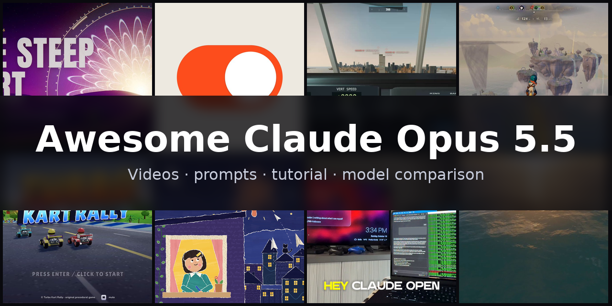](https://www.sandbase.ai/lab/ai-videos/opus-5-5?utm_source=github&utm_medium=readme&utm_campaign=awesome-opus-5.5&utm_content=banner)

A curated list of **Claude Opus 5.5 examples**: videos, prompts and demos made with Anthropic's flagship Claude 5 model. Motion design is its signature — one prompt, fifteen seconds of code-animated type and shapes — alongside walkable Three.js architecture, playable browser games, procedural 3D and launch films. Most pieces are a single HTML page the model wrote from a prompt, credited to the creator and linked to the original post.

**400 videos** from **250 creators** · **82** with the creator's prompt · synced daily from [SandBase Lab](https://www.sandbase.ai/lab/ai-videos/opus-5-5?utm_source=github&utm_medium=readme&utm_campaign=awesome-opus-5.5&utm_content=stats)

## Start here

| I want to… | Go to |
|---|---|
| Watch the videos | [Browse by category](#contents) below, or [play them full-size on SandBase Lab](https://www.sandbase.ai/lab/ai-videos/opus-5-5?utm_source=github&utm_medium=readme&utm_campaign=awesome-opus-5.5&utm_content=quickstart) |
| Copy a prompt | [Prompt index](docs/prompts.md): every video that comes with its prompt |
| Write your own prompt | [Prompt guide](docs/prompt-guide.md): 7 patterns and a fill-in template |
| Make a video | [Tutorial](docs/tutorial.md): prompt → HTML → MP4, with the API, the CLI and a recording script |
| Pick a model | [Claude Opus 5.5 vs. GPT-6 Astra, Fable 5.1, Gemini 4 Argon and DeepSeek V4.1 Flash](docs/model-comparison.md) |
| Try it now | [Run Claude Opus 5.5 in the Lab arena](https://www.sandbase.ai/lab/x/llm-arena?models=anthropic%2Fclaude-opus-5.5&utm_source=github&utm_medium=readme&utm_campaign=awesome-opus-5.5&utm_content=quickstart), next to other models |

<a id="contents"></a>

## Contents

- [Featured](#featured) (8)
- [3D scenes](#3d-scene) (91)
- [Motion graphics](#motion-graphics) (81)
- [Games](#game) (81)
- [Product UI](#ui-demo) (27)
- [Particles & shapes](#particles) (1)
- [Charts & diagrams](#data-viz) (2)
- [Kinetic type](#kinetic-type) (4)
- [Explainers](#explainer) (43)
- [Launch films](#launch-film) (15)
- [Tests & comparisons](#comparison) (55)
- [Recreate a video with Claude Opus 5.5](#recreate)
- [FAQ](#faq)
- [Suggest a video](#contribute)

Click a preview to play the video. Click a title for the post, the prompt and **Recreate** on SandBase Lab. **@handle** links to the creator's post on X.

<a id="featured"></a>

## Featured

<table>
<tr><td width="33%" valign="top"><a href="https://www.sandbase.ai/lab/media/x/opus-5-5/2102987981695132140/video.mp4">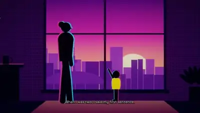</a><br><a href="https://www.sandbase.ai/lab/ai-videos/opus-5-5/2102987981695132140?utm_source=github&utm_medium=readme&utm_campaign=awesome-opus-5.5&utm_content=card"><b>A video predicting the next 50 years</b></a><br><sub><a href="https://x.com/andrewjiang/status/2102987981695132140">@andrewjiang</a> · 4:00</sub></td><td width="33%" valign="top"><a href="https://www.sandbase.ai/lab/media/x/opus-5-5/2104618175803609305/video.mp4"></a><br><a href="https://www.sandbase.ai/lab/ai-videos/opus-5-5/2104618175803609305?utm_source=github&utm_medium=readme&utm_campaign=awesome-opus-5.5&utm_content=card"><b>Motion design launch video created with three prompts</b></a><br><sub><a href="https://x.com/uxmiles/status/2104618175803609305">@uxmiles</a> · 0:15</sub></td><td width="33%" valign="top"><a href="https://www.sandbase.ai/lab/media/x/opus-5-5/2103821040174698674/video.mp4"></a><br><a href="https://www.sandbase.ai/lab/ai-videos/opus-5-5/2103821040174698674?utm_source=github&utm_medium=readme&utm_campaign=awesome-opus-5.5&utm_content=card"><b>Aeroplane simulator game built with Claude</b></a><br><sub><a href="https://x.com/karankendre/status/2103821040174698674">@karankendre</a> · 0:32</sub></td></tr>
<tr><td width="33%" valign="top"><a href="https://www.sandbase.ai/lab/media/x/opus-5-5/2116289885870981296/video.mp4">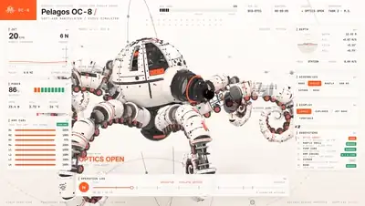</a><br><a href="https://www.sandbase.ai/lab/ai-videos/opus-5-5/2116289885870981296?utm_source=github&utm_medium=readme&utm_campaign=awesome-opus-5.5&utm_content=card"><b>A robotic octopus exploding in Three.js</b></a><br><sub><a href="https://x.com/0x_fokki/status/2116289885870981296">@0x_fokki</a> · 0:25</sub></td><td width="33%" valign="top"><a href="https://www.sandbase.ai/lab/media/x/opus-5-5/2106027834217259394/video.mp4"></a><br><a href="https://www.sandbase.ai/lab/ai-videos/opus-5-5/2106027834217259394?utm_source=github&utm_medium=readme&utm_campaign=awesome-opus-5.5&utm_content=card"><b>Music synced project built from single prompt</b></a><br><sub><a href="https://x.com/minchoi/status/2106027834217259394">@minchoi</a> · 4:30</sub></td><td width="33%" valign="top"><a href="https://www.sandbase.ai/lab/media/x/opus-5-5/2104215873120764032/video.mp4">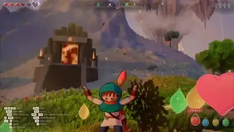</a><br><a href="https://www.sandbase.ai/lab/ai-videos/opus-5-5/2104215873120764032?utm_source=github&utm_medium=readme&utm_campaign=awesome-opus-5.5&utm_content=card"><b>Zelda inspired paintbrush adventure game</b></a><br><sub><a href="https://x.com/DannyLimanseta/status/2104215873120764032">@DannyLimanseta</a> · 1:44</sub></td></tr>
<tr><td width="33%" valign="top"><a href="https://www.sandbase.ai/lab/media/x/opus-5-5/2102437977435893771/video.mp4">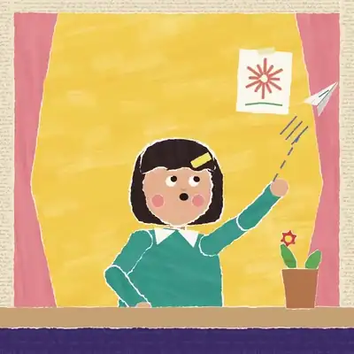</a><br><a href="https://www.sandbase.ai/lab/ai-videos/opus-5-5/2102437977435893771?utm_source=github&utm_medium=readme&utm_campaign=awesome-opus-5.5&utm_content=card"><b>JavaScript animated story about Claude and a question</b></a><br><sub><a href="https://x.com/kevin_t_ngo/status/2102437977435893771">@kevin_t_ngo</a> · 0:28</sub></td><td width="33%" valign="top"><a href="https://www.sandbase.ai/lab/media/x/opus-5-5/2111826236586570101/video.mp4">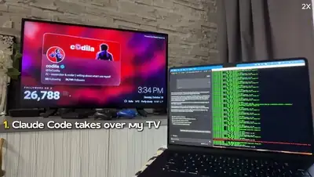</a><br><a href="https://www.sandbase.ai/lab/ai-videos/opus-5-5/2111826236586570101?utm_source=github&utm_medium=readme&utm_campaign=awesome-opus-5.5&utm_content=card"><b>Reverse engineering TV interface with Claude Opus</b></a><br><sub><a href="https://x.com/0xCodila/status/2111826236586570101">@0xCodila</a> · 0:23 · <a href="https://www.sandbase.ai/lab/ai-videos/opus-5-5/2111826236586570101?utm_source=github&utm_medium=readme&utm_campaign=awesome-opus-5.5&utm_content=card">prompt</a></sub></td></tr>
</table>

<a id="3d-scene"></a>

## 3D scenes

<table>
<tr><td width="33%" valign="top"><a href="https://www.sandbase.ai/lab/media/x/opus-5-5/2102441628661080384/video.mp4"></a><br><a href="https://www.sandbase.ai/lab/ai-videos/opus-5-5/2102441628661080384?utm_source=github&utm_medium=readme&utm_campaign=awesome-opus-5.5&utm_content=card"><b>Broken towers shader generated by Opus 5.5</b></a><br><sub><a href="https://x.com/emollick/status/2102441628661080384">@emollick</a> · 0:10</sub></td><td width="33%" valign="top"><a href="https://www.sandbase.ai/lab/media/x/opus-5-5/2102466523164274839/video.mp4"></a><br><a href="https://www.sandbase.ai/lab/ai-videos/opus-5-5/2102466523164274839?utm_source=github&utm_medium=readme&utm_campaign=awesome-opus-5.5&utm_content=card"><b>Pre-earthquake 1906 Market Street in Blender</b></a><br><sub><a href="https://x.com/alexalbert__/status/2102466523164274839">@alexalbert__</a> · 0:08</sub></td><td width="33%" valign="top"><a href="https://www.sandbase.ai/lab/media/x/opus-5-5/2102503719762018434/video.mp4">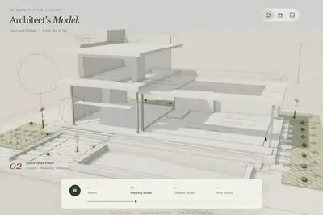</a><br><a href="https://www.sandbase.ai/lab/ai-videos/opus-5-5/2102503719762018434?utm_source=github&utm_medium=readme&utm_campaign=awesome-opus-5.5&utm_content=card"><b>Architectural evolution from sketch to 3D home</b></a><br><sub><a href="https://x.com/techartist_/status/2102503719762018434">@techartist_</a> · 0:19</sub></td></tr>
<tr><td width="33%" valign="top"><a href="https://www.sandbase.ai/lab/media/x/opus-5-5/2103008022369099992/video.mp4">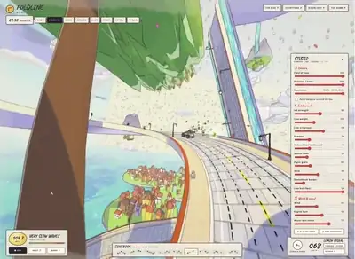</a><br><a href="https://www.sandbase.ai/lab/ai-videos/opus-5-5/2103008022369099992?utm_source=github&utm_medium=readme&utm_campaign=awesome-opus-5.5&utm_content=card"><b>Interactive 3D experience in Three.js</b></a><br><sub><a href="https://x.com/chetanankola/status/2103008022369099992">@chetanankola</a> · 0:28</sub></td><td width="33%" valign="top"><a href="https://www.sandbase.ai/lab/media/x/opus-5-5/2103305564973658114/video.mp4">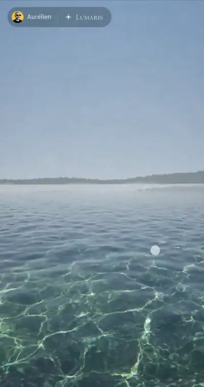</a><br><a href="https://www.sandbase.ai/lab/ai-videos/opus-5-5/2103305564973658114?utm_source=github&utm_medium=readme&utm_campaign=awesome-opus-5.5&utm_content=card"><b>A realistic 3D water simulation</b></a><br><sub><a href="https://x.com/Delroy715/status/2103305564973658114">@Delroy715</a> · 0:14</sub></td><td width="33%" valign="top"><a href="https://www.sandbase.ai/lab/media/x/opus-5-5/2103393323520299428/video.mp4">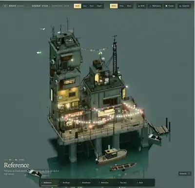</a><br><a href="https://www.sandbase.ai/lab/ai-videos/opus-5-5/2103393323520299428?utm_source=github&utm_medium=readme&utm_campaign=awesome-opus-5.5&utm_content=card"><b>Explorable 3D harbour town in Three.js</b></a><br><sub><a href="https://x.com/chetanankola/status/2103393323520299428">@chetanankola</a> · 0:25</sub></td></tr>
</table>

<details>
<summary><b>Show all 91</b></summary>

<table>
<tr><td width="33%" valign="top"><a href="https://www.sandbase.ai/lab/media/x/opus-5-5/2103724883301814408/video.mp4">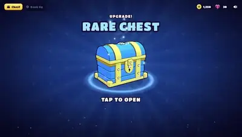</a><br><a href="https://www.sandbase.ai/lab/ai-videos/opus-5-5/2103724883301814408?utm_source=github&utm_medium=readme&utm_campaign=awesome-opus-5.5&utm_content=card"><b>Game settlement 3D chest animation</b></a><br><sub><a href="https://x.com/op7418/status/2103724883301814408">@op7418</a> · 0:15</sub></td><td width="33%" valign="top"><a href="https://www.sandbase.ai/lab/media/x/opus-5-5/2103738307033416132/video.mp4">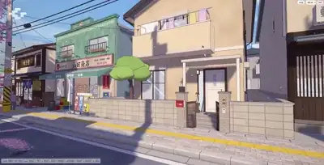</a><br><a href="https://www.sandbase.ai/lab/ai-videos/opus-5-5/2103738307033416132?utm_source=github&utm_medium=readme&utm_campaign=awesome-opus-5.5&utm_content=card"><b>Procedural cel-shaded Japanese scene in Three.js</b></a><br><sub><a href="https://x.com/Delroy715/status/2103738307033416132">@Delroy715</a> · 1:21</sub></td><td width="33%" valign="top"><a href="https://www.sandbase.ai/lab/media/x/opus-5-5/2103919236653428985/video.mp4">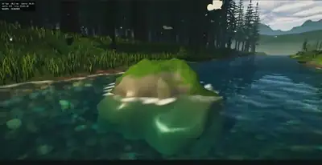</a><br><a href="https://www.sandbase.ai/lab/ai-videos/opus-5-5/2103919236653428985?utm_source=github&utm_medium=readme&utm_campaign=awesome-opus-5.5&utm_content=card"><b>A fully procedural 3D world in Three.js</b></a><br><sub><a href="https://x.com/AndreiProvkin/status/2103919236653428985">@AndreiProvkin</a> · 1:08</sub></td></tr>
<tr><td width="33%" valign="top"><a href="https://www.sandbase.ai/lab/media/x/opus-5-5/2104131601663930588/video.mp4">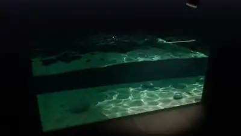</a><br><a href="https://www.sandbase.ai/lab/ai-videos/opus-5-5/2104131601663930588?utm_source=github&utm_medium=readme&utm_campaign=awesome-opus-5.5&utm_content=card"><b>Water and fluid simulation in Three.js</b></a><br><sub><a href="https://x.com/tetumemo/status/2104131601663930588">@tetumemo</a> · 1:12</sub></td><td width="33%" valign="top"><a href="https://www.sandbase.ai/lab/media/x/opus-5-5/2104147829589737806/video.mp4">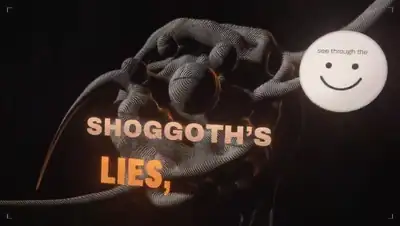</a><br><a href="https://www.sandbase.ai/lab/ai-videos/opus-5-5/2104147829589737806?utm_source=github&utm_medium=readme&utm_campaign=awesome-opus-5.5&utm_content=card"><b>A 3D music visualization rendered in Three.js</b></a><br><sub><a href="https://x.com/ricouii/status/2104147829589737806">@ricouii</a> · 2:37</sub></td><td width="33%" valign="top"><a href="https://www.sandbase.ai/lab/media/x/opus-5-5/2104548658171834749/video.mp4">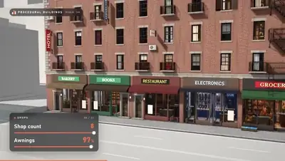</a><br><a href="https://www.sandbase.ai/lab/ai-videos/opus-5-5/2104548658171834749?utm_source=github&utm_medium=readme&utm_campaign=awesome-opus-5.5&utm_content=card"><b>Procedural buildings ported to Three.js web scene</b></a><br><sub><a href="https://x.com/chirovisuals/status/2104548658171834749">@chirovisuals</a> · 1:15</sub></td></tr>
<tr><td width="33%" valign="top"><a href="https://www.sandbase.ai/lab/media/x/opus-5-5/2104780688113455342/video.mp4">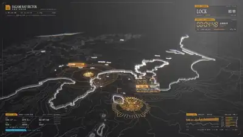</a><br><a href="https://www.sandbase.ai/lab/ai-videos/opus-5-5/2104780688113455342?utm_source=github&utm_medium=readme&utm_campaign=awesome-opus-5.5&utm_content=card"><b>Evangelion-inspired 3D WebGL scene</b></a><br><sub><a href="https://x.com/LuisBizarro/status/2104780688113455342">@LuisBizarro</a> · 0:22</sub></td><td width="33%" valign="top"><a href="https://www.sandbase.ai/lab/media/x/opus-5-5/2105216139647127750/video.mp4">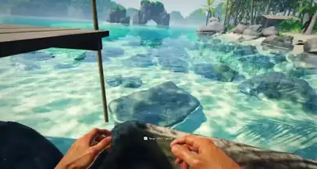</a><br><a href="https://www.sandbase.ai/lab/ai-videos/opus-5-5/2105216139647127750?utm_source=github&utm_medium=readme&utm_campaign=awesome-opus-5.5&utm_content=card"><b>Browser-based 3D open world in Three.js</b></a><br><sub><a href="https://x.com/maxt3chno/status/2105216139647127750">@maxt3chno</a> · 2:41</sub></td><td width="33%" valign="top"><a href="https://www.sandbase.ai/lab/media/x/opus-5-5/2105250266392224097/video.mp4"></a><br><a href="https://www.sandbase.ai/lab/ai-videos/opus-5-5/2105250266392224097?utm_source=github&utm_medium=readme&utm_campaign=awesome-opus-5.5&utm_content=card"><b>Interactive Chinese ink wash shrimps in WebGL</b></a><br><sub><a href="https://x.com/jshguo/status/2105250266392224097">@jshguo</a> · 0:10</sub></td></tr>
<tr><td width="33%" valign="top"><a href="https://www.sandbase.ai/lab/media/x/opus-5-5/2105304249060274631/video.mp4"></a><br><a href="https://www.sandbase.ai/lab/ai-videos/opus-5-5/2105304249060274631?utm_source=github&utm_medium=readme&utm_campaign=awesome-opus-5.5&utm_content=card"><b>3D animation and piano music rendered in Blender</b></a><br><sub><a href="https://x.com/kevin_t_ngo/status/2105304249060274631">@kevin_t_ngo</a> · 1:12</sub></td><td width="33%" valign="top"><a href="https://www.sandbase.ai/lab/media/x/opus-5-5/2105784343960629738/video.mp4">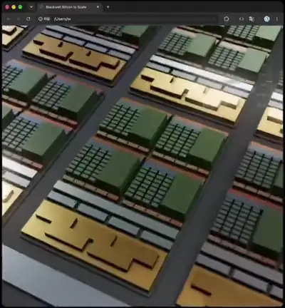</a><br><a href="https://www.sandbase.ai/lab/ai-videos/opus-5-5/2105784343960629738?utm_source=github&utm_medium=readme&utm_campaign=awesome-opus-5.5&utm_content=card"><b>Interactive 3D zoom of Nvidia Blackwell GPUs</b></a><br><sub><a href="https://x.com/bearlyai/status/2105784343960629738">@bearlyai</a> · 0:49</sub></td><td width="33%" valign="top"><a href="https://www.sandbase.ai/lab/media/x/opus-5-5/2106369769956065518/video.mp4">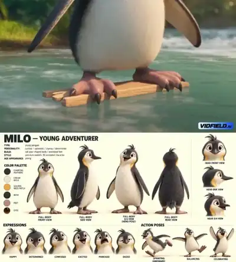</a><br><a href="https://www.sandbase.ai/lab/ai-videos/opus-5-5/2106369769956065518?utm_source=github&utm_medium=readme&utm_campaign=awesome-opus-5.5&utm_content=card"><b>Cinematic animated scene from a single prompt</b></a><br><sub><a href="https://x.com/HeyAbhishek/status/2106369769956065518">@HeyAbhishek</a> · 0:30 · <a href="https://www.sandbase.ai/lab/ai-videos/opus-5-5/2106369769956065518?utm_source=github&utm_medium=readme&utm_campaign=awesome-opus-5.5&utm_content=card">prompt</a></sub></td></tr>
<tr><td width="33%" valign="top"><a href="https://www.sandbase.ai/lab/media/x/opus-5-5/2106535398990377126/video.mp4">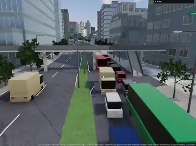</a><br><a href="https://www.sandbase.ai/lab/ai-videos/opus-5-5/2106535398990377126?utm_source=github&utm_medium=readme&utm_campaign=awesome-opus-5.5&utm_content=card"><b>A procedural 3D Tokyo simulation in Three.js</b></a><br><sub><a href="https://x.com/jeantimex/status/2106535398990377126">@jeantimex</a> · 3:04</sub></td><td width="33%" valign="top"><a href="https://www.sandbase.ai/lab/media/x/opus-5-5/2106763583250108511/video.mp4">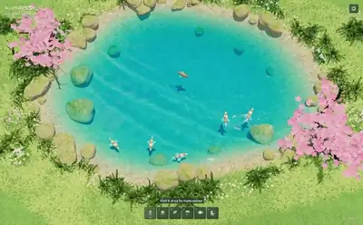</a><br><a href="https://www.sandbase.ai/lab/ai-videos/opus-5-5/2106763583250108511?utm_source=github&utm_medium=readme&utm_campaign=awesome-opus-5.5&utm_content=card"><b>Interactive water physics with fish and blossoms</b></a><br><sub><a href="https://x.com/buildwithsid/status/2106763583250108511">@buildwithsid</a> · 1:05</sub></td><td width="33%" valign="top"><a href="https://www.sandbase.ai/lab/media/x/opus-5-5/2106957256247902272/video.mp4">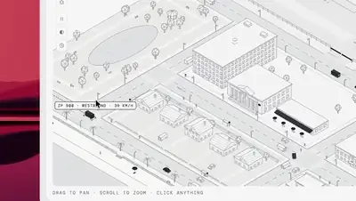</a><br><a href="https://www.sandbase.ai/lab/ai-videos/opus-5-5/2106957256247902272?utm_source=github&utm_medium=readme&utm_campaign=awesome-opus-5.5&utm_content=card"><b>Browser 3D scene built with WebGL and Three.js</b></a><br><sub><a href="https://x.com/KhalidDevLog/status/2106957256247902272">@KhalidDevLog</a> · 1:28</sub></td></tr>
<tr><td width="33%" valign="top"><a href="https://www.sandbase.ai/lab/media/x/opus-5-5/2107058718882103388/video.mp4">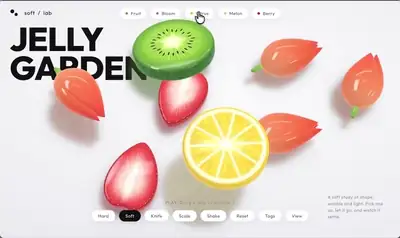</a><br><a href="https://www.sandbase.ai/lab/ai-videos/opus-5-5/2107058718882103388?utm_source=github&utm_medium=readme&utm_campaign=awesome-opus-5.5&utm_content=card"><b>Interactive slicing fruit in raw WebGL</b></a><br><sub><a href="https://x.com/viktoroddy/status/2107058718882103388">@viktoroddy</a> · 0:18</sub></td><td width="33%" valign="top"><a href="https://www.sandbase.ai/lab/media/x/opus-5-5/2107073547701289211/video.mp4"></a><br><a href="https://www.sandbase.ai/lab/ai-videos/opus-5-5/2107073547701289211?utm_source=github&utm_medium=readme&utm_campaign=awesome-opus-5.5&utm_content=card"><b>Flight through Van Gogh&#x27;s The Starry Night</b></a><br><sub><a href="https://x.com/EHuanglu/status/2107073547701289211">@EHuanglu</a> · 0:25 · <a href="https://www.sandbase.ai/lab/ai-videos/opus-5-5/2107073547701289211?utm_source=github&utm_medium=readme&utm_campaign=awesome-opus-5.5&utm_content=card">prompt</a></sub></td><td width="33%" valign="top"><a href="https://www.sandbase.ai/lab/media/x/opus-5-5/2107449104926482912/video.mp4">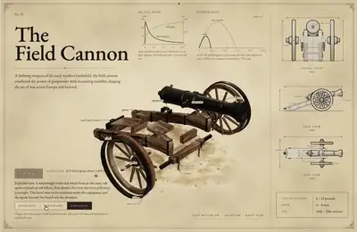</a><br><a href="https://www.sandbase.ai/lab/ai-videos/opus-5-5/2107449104926482912?utm_source=github&utm_medium=readme&utm_campaign=awesome-opus-5.5&utm_content=card"><b>Working 1857 Napoleon field cannon in Three.js</b></a><br><sub><a href="https://x.com/thebuggeddev/status/2107449104926482912">@thebuggeddev</a> · 0:51</sub></td></tr>
<tr><td width="33%" valign="top"><a href="https://www.sandbase.ai/lab/media/x/opus-5-5/2107458140279394589/video.mp4">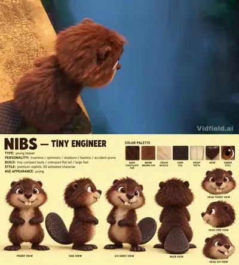</a><br><a href="https://www.sandbase.ai/lab/ai-videos/opus-5-5/2107458140279394589?utm_source=github&utm_medium=readme&utm_campaign=awesome-opus-5.5&utm_content=card"><b>3D animated scene created with Opus and Seedance</b></a><br><sub><a href="https://x.com/HeyAbhishek/status/2107458140279394589">@HeyAbhishek</a> · 0:30 · <a href="https://www.sandbase.ai/lab/ai-videos/opus-5-5/2107458140279394589?utm_source=github&utm_medium=readme&utm_campaign=awesome-opus-5.5&utm_content=card">prompt</a></sub></td><td width="33%" valign="top"><a href="https://www.sandbase.ai/lab/media/x/opus-5-5/2107572909086761325/video.mp4">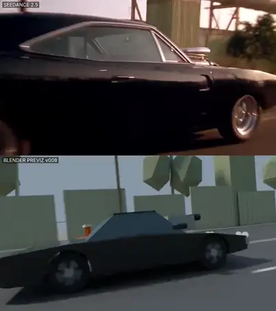</a><br><a href="https://www.sandbase.ai/lab/ai-videos/opus-5-5/2107572909086761325?utm_source=github&utm_medium=readme&utm_campaign=awesome-opus-5.5&utm_content=card"><b>Fast and the Furious scene rebuild in 3D</b></a><br><sub><a href="https://x.com/Ror_Fly/status/2107572909086761325">@Ror_Fly</a> · 0:25 · <a href="https://www.sandbase.ai/lab/ai-videos/opus-5-5/2107572909086761325?utm_source=github&utm_medium=readme&utm_campaign=awesome-opus-5.5&utm_content=card">prompt</a></sub></td><td width="33%" valign="top"><a href="https://www.sandbase.ai/lab/media/x/opus-5-5/2107696042053431360/video.mp4">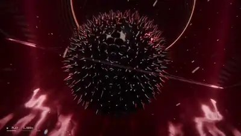</a><br><a href="https://www.sandbase.ai/lab/ai-videos/opus-5-5/2107696042053431360?utm_source=github&utm_medium=readme&utm_campaign=awesome-opus-5.5&utm_content=card"><b>Audio-reactive magma canyon animation rendered in Blender</b></a><br><sub><a href="https://x.com/kloss_xyz/status/2107696042053431360">@kloss_xyz</a> · 0:21 · <a href="https://www.sandbase.ai/lab/ai-videos/opus-5-5/2107696042053431360?utm_source=github&utm_medium=readme&utm_campaign=awesome-opus-5.5&utm_content=card">prompt</a></sub></td></tr>
<tr><td width="33%" valign="top"><a href="https://www.sandbase.ai/lab/media/x/opus-5-5/2108203997480063196/video.mp4">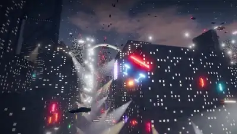</a><br><a href="https://www.sandbase.ai/lab/ai-videos/opus-5-5/2108203997480063196?utm_source=github&utm_medium=readme&utm_campaign=awesome-opus-5.5&utm_content=card"><b>Procedural endless city running in WebGPU</b></a><br><sub><a href="https://x.com/RyanSael/status/2108203997480063196">@RyanSael</a> · 0:52</sub></td><td width="33%" valign="top"><a href="https://www.sandbase.ai/lab/media/x/opus-5-5/2108845317122900188/video.mp4">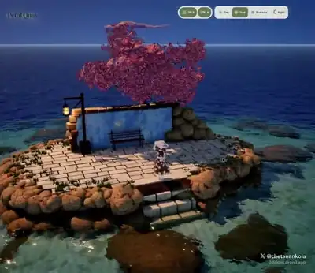</a><br><a href="https://www.sandbase.ai/lab/ai-videos/opus-5-5/2108845317122900188?utm_source=github&utm_medium=readme&utm_campaign=awesome-opus-5.5&utm_content=card"><b>Petal Quay 3D scene with anime character in Three.js</b></a><br><sub><a href="https://x.com/chetanankola/status/2108845317122900188">@chetanankola</a> · 0:38</sub></td><td width="33%" valign="top"><a href="https://www.sandbase.ai/lab/media/x/opus-5-5/2109175863761859011/video.mp4">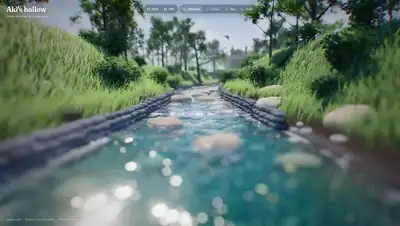</a><br><a href="https://www.sandbase.ai/lab/ai-videos/opus-5-5/2109175863761859011?utm_source=github&utm_medium=readme&utm_campaign=awesome-opus-5.5&utm_content=card"><b>A Three.js scene with Blender assets</b></a><br><sub><a href="https://x.com/anxuanng/status/2109175863761859011">@anxuanng</a> · 0:20</sub></td></tr>
<tr><td width="33%" valign="top"><a href="https://www.sandbase.ai/lab/media/x/opus-5-5/2109231561711427883/video.mp4">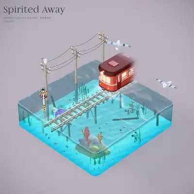</a><br><a href="https://www.sandbase.ai/lab/ai-videos/opus-5-5/2109231561711427883?utm_source=github&utm_medium=readme&utm_campaign=awesome-opus-5.5&utm_content=card"><b>Code-generated 3D sea train with sound effects</b></a><br><sub><a href="https://x.com/eviljer/status/2109231561711427883">@eviljer</a> · 1:12 · <a href="https://www.sandbase.ai/lab/ai-videos/opus-5-5/2109231561711427883?utm_source=github&utm_medium=readme&utm_campaign=awesome-opus-5.5&utm_content=card">prompt</a></sub></td><td width="33%" valign="top"><a href="https://www.sandbase.ai/lab/media/x/opus-5-5/2109257723246501895/video.mp4">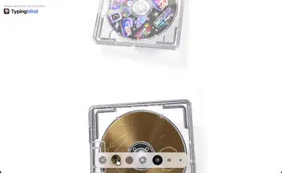</a><br><a href="https://www.sandbase.ai/lab/ai-videos/opus-5-5/2109257723246501895?utm_source=github&utm_medium=readme&utm_campaign=awesome-opus-5.5&utm_content=card"><b>Opening plastic CD case animated with Three.js shaders</b></a><br><sub><a href="https://x.com/ann_nnng/status/2109257723246501895">@ann_nnng</a> · 0:30</sub></td><td width="33%" valign="top"><a href="https://www.sandbase.ai/lab/media/x/opus-5-5/2109334686488990093/video.mp4">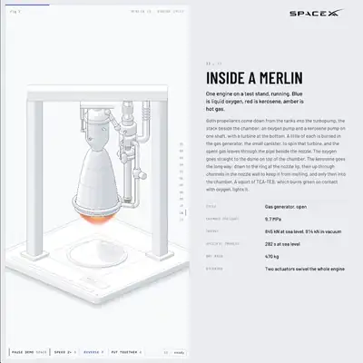</a><br><a href="https://www.sandbase.ai/lab/ai-videos/opus-5-5/2109334686488990093?utm_source=github&utm_medium=readme&utm_campaign=awesome-opus-5.5&utm_content=card"><b>Interactive isometric wireframes and WebGL shaders</b></a><br><sub><a href="https://x.com/0xMovez/status/2109334686488990093">@0xMovez</a> · 0:43</sub></td></tr>
<tr><td width="33%" valign="top"><a href="https://www.sandbase.ai/lab/media/x/opus-5-5/2109544637497298951/video.mp4">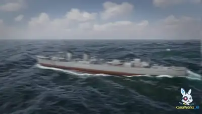</a><br><a href="https://www.sandbase.ai/lab/ai-videos/opus-5-5/2109544637497298951?utm_source=github&utm_medium=readme&utm_campaign=awesome-opus-5.5&utm_content=card"><b>Realistic ocean simulation in Godot</b></a><br><sub><a href="https://x.com/KanaWorks_AI/status/2109544637497298951">@KanaWorks_AI</a> · 0:55</sub></td><td width="33%" valign="top"><a href="https://www.sandbase.ai/lab/media/x/opus-5-5/2109568757001756710/video.mp4">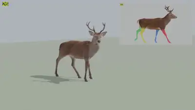</a><br><a href="https://www.sandbase.ai/lab/ai-videos/opus-5-5/2109568757001756710?utm_source=github&utm_medium=readme&utm_campaign=awesome-opus-5.5&utm_content=card"><b>Video to 3D animal walk animation workflow</b></a><br><sub><a href="https://x.com/Stefan_3D_AI/status/2109568757001756710">@Stefan_3D_AI</a> · 0:13</sub></td><td width="33%" valign="top"><a href="https://www.sandbase.ai/lab/media/x/opus-5-5/2109718931409699043/video.mp4">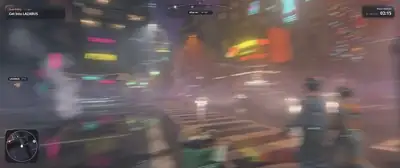</a><br><a href="https://www.sandbase.ai/lab/ai-videos/opus-5-5/2109718931409699043?utm_source=github&utm_medium=readme&utm_campaign=awesome-opus-5.5&utm_content=card"><b>An interactive 3D world with a nightclub</b></a><br><sub><a href="https://x.com/Ainthropos/status/2109718931409699043">@Ainthropos</a> · 0:56</sub></td></tr>
<tr><td width="33%" valign="top"><a href="https://www.sandbase.ai/lab/media/x/opus-5-5/2109984169845821651/video.mp4">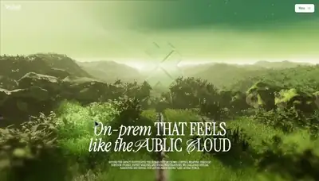</a><br><a href="https://www.sandbase.ai/lab/ai-videos/opus-5-5/2109984169845821651?utm_source=github&utm_medium=readme&utm_campaign=awesome-opus-5.5&utm_content=card"><b>Opening Ground Interactive 3D Scene</b></a><br><sub><a href="https://x.com/viktoroddy/status/2109984169845821651">@viktoroddy</a> · 0:22 · <a href="https://www.sandbase.ai/lab/ai-videos/opus-5-5/2109984169845821651?utm_source=github&utm_medium=readme&utm_campaign=awesome-opus-5.5&utm_content=card">prompt</a></sub></td><td width="33%" valign="top"><a href="https://www.sandbase.ai/lab/media/x/opus-5-5/2109993586951663626/video.mp4">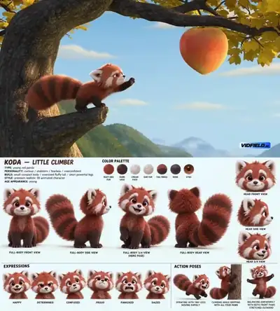</a><br><a href="https://www.sandbase.ai/lab/ai-videos/opus-5-5/2109993586951663626?utm_source=github&utm_medium=readme&utm_campaign=awesome-opus-5.5&utm_content=card"><b>Cinematic 3D animated adventure video</b></a><br><sub><a href="https://x.com/HeyAbhishek/status/2109993586951663626">@HeyAbhishek</a> · 0:29 · <a href="https://www.sandbase.ai/lab/ai-videos/opus-5-5/2109993586951663626?utm_source=github&utm_medium=readme&utm_campaign=awesome-opus-5.5&utm_content=card">prompt</a></sub></td><td width="33%" valign="top"><a href="https://www.sandbase.ai/lab/media/x/opus-5-5/2110010240825737683/video.mp4"></a><br><a href="https://www.sandbase.ai/lab/ai-videos/opus-5-5/2110010240825737683?utm_source=github&utm_medium=readme&utm_campaign=awesome-opus-5.5&utm_content=card"><b>3D animation made using Python and Blender</b></a><br><sub><a href="https://x.com/kevin_t_ngo/status/2110010240825737683">@kevin_t_ngo</a> · 0:28</sub></td></tr>
<tr><td width="33%" valign="top"><a href="https://www.sandbase.ai/lab/media/x/opus-5-5/2110036224320884998/video.mp4">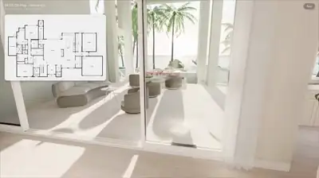</a><br><a href="https://www.sandbase.ai/lab/ai-videos/opus-5-5/2110036224320884998?utm_source=github&utm_medium=readme&utm_campaign=awesome-opus-5.5&utm_content=card"><b>Walkable 3D house generated from floor plan</b></a><br><sub><a href="https://x.com/everestchris6/status/2110036224320884998">@everestchris6</a> · 0:14 · <a href="https://www.sandbase.ai/lab/ai-videos/opus-5-5/2110036224320884998?utm_source=github&utm_medium=readme&utm_campaign=awesome-opus-5.5&utm_content=card">prompt</a></sub></td><td width="33%" valign="top"><a href="https://www.sandbase.ai/lab/media/x/opus-5-5/2110275826658967896/video.mp4">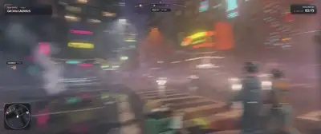</a><br><a href="https://www.sandbase.ai/lab/ai-videos/opus-5-5/2110275826658967896?utm_source=github&utm_medium=readme&utm_campaign=awesome-opus-5.5&utm_content=card"><b>Interactive 3D city in Three.js</b></a><br><sub><a href="https://x.com/jiangjiangling/status/2110275826658967896">@jiangjiangling</a> · 0:56</sub></td><td width="33%" valign="top"><a href="https://www.sandbase.ai/lab/media/x/opus-5-5/2110450567956811893/video.mp4">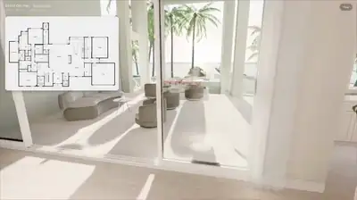</a><br><a href="https://www.sandbase.ai/lab/ai-videos/opus-5-5/2110450567956811893?utm_source=github&utm_medium=readme&utm_campaign=awesome-opus-5.5&utm_content=card"><b>Walkable 3D house generated from floor plans</b></a><br><sub><a href="https://x.com/AHSeslami/status/2110450567956811893">@AHSeslami</a> · 0:14</sub></td></tr>
<tr><td width="33%" valign="top"><a href="https://www.sandbase.ai/lab/media/x/opus-5-5/2110453070236922090/video.mp4">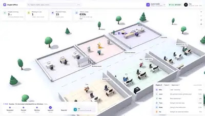</a><br><a href="https://www.sandbase.ai/lab/ai-videos/opus-5-5/2110453070236922090?utm_source=github&utm_medium=readme&utm_campaign=awesome-opus-5.5&utm_content=card"><b>Interactive 3D office for AI workers in Three.js</b></a><br><sub><a href="https://x.com/anxuanng/status/2110453070236922090">@anxuanng</a> · 0:30</sub></td><td width="33%" valign="top"><a href="https://www.sandbase.ai/lab/media/x/opus-5-5/2111035753035612364/video.mp4">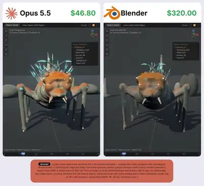</a><br><a href="https://www.sandbase.ai/lab/ai-videos/opus-5-5/2111035753035612364?utm_source=github&utm_medium=readme&utm_campaign=awesome-opus-5.5&utm_content=card"><b>Automated Blender asset pipeline with Opus</b></a><br><sub><a href="https://x.com/0xWast3/status/2111035753035612364">@0xWast3</a> · 0:30</sub></td><td width="33%" valign="top"><a href="https://www.sandbase.ai/lab/media/x/opus-5-5/2111120760660254842/video.mp4">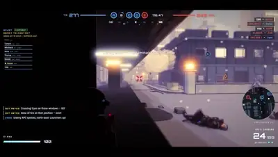</a><br><a href="https://www.sandbase.ai/lab/ai-videos/opus-5-5/2111120760660254842?utm_source=github&utm_medium=readme&utm_campaign=awesome-opus-5.5&utm_content=card"><b>Three.js 3D scene coded with Claude Opus</b></a><br><sub><a href="https://x.com/Belbizaz/status/2111120760660254842">@Belbizaz</a> · 0:30</sub></td></tr>
<tr><td width="33%" valign="top"><a href="https://www.sandbase.ai/lab/media/x/opus-5-5/2111306207239557288/video.mp4"></a><br><a href="https://www.sandbase.ai/lab/ai-videos/opus-5-5/2111306207239557288?utm_source=github&utm_medium=readme&utm_campaign=awesome-opus-5.5&utm_content=card"><b>Real-time ocean rendered with WebGPU</b></a><br><sub><a href="https://x.com/jurlycat/status/2111306207239557288">@jurlycat</a> · 0:32</sub></td><td width="33%" valign="top"><a href="https://www.sandbase.ai/lab/media/x/opus-5-5/2111393368097849615/video.mp4">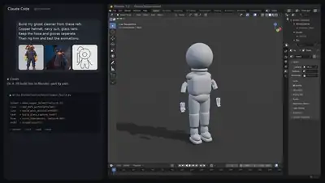</a><br><a href="https://www.sandbase.ai/lab/ai-videos/opus-5-5/2111393368097849615?utm_source=github&utm_medium=readme&utm_campaign=awesome-opus-5.5&utm_content=card"><b>Making game models with Claude Opus and Blender</b></a><br><sub><a href="https://x.com/rewind02/status/2111393368097849615">@rewind02</a> · 0:16</sub></td><td width="33%" valign="top"><a href="https://www.sandbase.ai/lab/media/x/opus-5-5/2111435045109903540/video.mp4">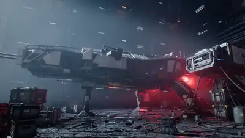</a><br><a href="https://www.sandbase.ai/lab/ai-videos/opus-5-5/2111435045109903540?utm_source=github&utm_medium=readme&utm_campaign=awesome-opus-5.5&utm_content=card"><b>Complex volumetric Houdini scene created with Claude</b></a><br><sub><a href="https://x.com/hectorVFX/status/2111435045109903540">@hectorVFX</a> · 0:15</sub></td></tr>
<tr><td width="33%" valign="top"><a href="https://www.sandbase.ai/lab/media/x/opus-5-5/2111920496208204235/video.mp4">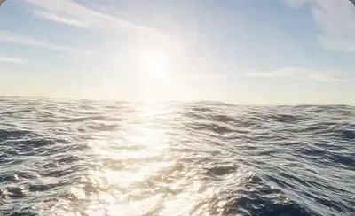</a><br><a href="https://www.sandbase.ai/lab/ai-videos/opus-5-5/2111920496208204235?utm_source=github&utm_medium=readme&utm_campaign=awesome-opus-5.5&utm_content=card"><b>Procedural ocean simulation in a lightweight file</b></a><br><sub><a href="https://x.com/AmirMushich/status/2111920496208204235">@AmirMushich</a> · 0:19 · <a href="https://www.sandbase.ai/lab/ai-videos/opus-5-5/2111920496208204235?utm_source=github&utm_medium=readme&utm_campaign=awesome-opus-5.5&utm_content=card">prompt</a></sub></td><td width="33%" valign="top"><a href="https://www.sandbase.ai/lab/media/x/opus-5-5/2112514570078372079/video.mp4">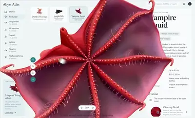</a><br><a href="https://www.sandbase.ai/lab/ai-videos/opus-5-5/2112514570078372079?utm_source=github&utm_medium=readme&utm_campaign=awesome-opus-5.5&utm_content=card"><b>Interactive 3D scary website generated from a prompt</b></a><br><sub><a href="https://x.com/viktoroddy/status/2112514570078372079">@viktoroddy</a> · 0:25</sub></td><td width="33%" valign="top"><a href="https://www.sandbase.ai/lab/media/x/opus-5-5/2112931493043687763/video.mp4">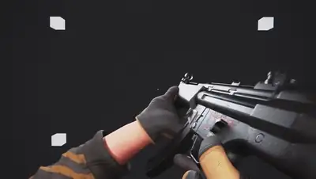</a><br><a href="https://www.sandbase.ai/lab/ai-videos/opus-5-5/2112931493043687763?utm_source=github&utm_medium=readme&utm_campaign=awesome-opus-5.5&utm_content=card"><b>First-person weapon created and animated in Blender</b></a><br><sub><a href="https://x.com/Octoberry/status/2112931493043687763">@Octoberry</a> · 0:44</sub></td></tr>
<tr><td width="33%" valign="top"><a href="https://www.sandbase.ai/lab/media/x/opus-5-5/2112989996366102944/video.mp4"></a><br><a href="https://www.sandbase.ai/lab/ai-videos/opus-5-5/2112989996366102944?utm_source=github&utm_medium=readme&utm_campaign=awesome-opus-5.5&utm_content=card"><b>Pixel-art basketball court diorama</b></a><br><sub><a href="https://x.com/vib3coded/status/2112989996366102944">@vib3coded</a> · 0:18</sub></td><td width="33%" valign="top"><a href="https://www.sandbase.ai/lab/media/x/opus-5-5/2113306254647120334/video.mp4"></a><br><a href="https://www.sandbase.ai/lab/ai-videos/opus-5-5/2113306254647120334?utm_source=github&utm_medium=readme&utm_campaign=awesome-opus-5.5&utm_content=card"><b>A driving preparation simulation in Three.js</b></a><br><sub><a href="https://x.com/RyanSael/status/2113306254647120334">@RyanSael</a> · 0:30</sub></td><td width="33%" valign="top"><a href="https://www.sandbase.ai/lab/media/x/opus-5-5/2114004943996846516/video.mp4"></a><br><a href="https://www.sandbase.ai/lab/ai-videos/opus-5-5/2114004943996846516?utm_source=github&utm_medium=readme&utm_campaign=awesome-opus-5.5&utm_content=card"><b>Cyberpunk city with flying cars in Three.js</b></a><br><sub><a href="https://x.com/buildwithsid/status/2114004943996846516">@buildwithsid</a> · 0:46 · <a href="https://www.sandbase.ai/lab/ai-videos/opus-5-5/2114004943996846516?utm_source=github&utm_medium=readme&utm_campaign=awesome-opus-5.5&utm_content=card">prompt</a></sub></td></tr>
<tr><td width="33%" valign="top"><a href="https://www.sandbase.ai/lab/media/x/opus-5-5/2114030630887641448/video.mp4"></a><br><a href="https://www.sandbase.ai/lab/ai-videos/opus-5-5/2114030630887641448?utm_source=github&utm_medium=readme&utm_campaign=awesome-opus-5.5&utm_content=card"><b>Dynamic ink wash story in Three.js</b></a><br><sub><a href="https://x.com/thtbee_/status/2114030630887641448">@thtbee_</a> · 0:32</sub></td><td width="33%" valign="top"><a href="https://www.sandbase.ai/lab/media/x/opus-5-5/2114035463153742180/video.mp4"></a><br><a href="https://www.sandbase.ai/lab/ai-videos/opus-5-5/2114035463153742180?utm_source=github&utm_medium=readme&utm_campaign=awesome-opus-5.5&utm_content=card"><b>Interactive 3D book lessons on energy</b></a><br><sub><a href="https://x.com/techartist_/status/2114035463153742180">@techartist_</a> · 0:30</sub></td><td width="33%" valign="top"><a href="https://www.sandbase.ai/lab/media/x/opus-5-5/2114546079618257104/video.mp4"></a><br><a href="https://www.sandbase.ai/lab/ai-videos/opus-5-5/2114546079618257104?utm_source=github&utm_medium=readme&utm_campaign=awesome-opus-5.5&utm_content=card"><b>Scroll-driven 2D to 3D architectural transitions</b></a><br><sub><a href="https://x.com/SammmAing/status/2114546079618257104">@SammmAing</a> · 2:00</sub></td></tr>
<tr><td width="33%" valign="top"><a href="https://www.sandbase.ai/lab/media/x/opus-5-5/2114728296034226583/video.mp4"></a><br><a href="https://www.sandbase.ai/lab/ai-videos/opus-5-5/2114728296034226583?utm_source=github&utm_medium=readme&utm_campaign=awesome-opus-5.5&utm_content=card"><b>Procedural 3D human eye in Three.js</b></a><br><sub><a href="https://x.com/__rockbiter/status/2114728296034226583">@__rockbiter</a> · 1:18</sub></td><td width="33%" valign="top"><a href="https://www.sandbase.ai/lab/media/x/opus-5-5/2114752456915665236/video.mp4"></a><br><a href="https://www.sandbase.ai/lab/ai-videos/opus-5-5/2114752456915665236?utm_source=github&utm_medium=readme&utm_campaign=awesome-opus-5.5&utm_content=card"><b>A procedural sandworm coded in Opus 5.5</b></a><br><sub><a href="https://x.com/0x_fokki/status/2114752456915665236">@0x_fokki</a> · 0:20</sub></td><td width="33%" valign="top"><a href="https://www.sandbase.ai/lab/media/x/opus-5-5/2115482577712590977/video.mp4"></a><br><a href="https://www.sandbase.ai/lab/ai-videos/opus-5-5/2115482577712590977?utm_source=github&utm_medium=readme&utm_campaign=awesome-opus-5.5&utm_content=card"><b>A procedural city generated in Blender using nodes</b></a><br><sub><a href="https://x.com/0xWast3/status/2115482577712590977">@0xWast3</a> · 0:23</sub></td></tr>
<tr><td width="33%" valign="top"><a href="https://www.sandbase.ai/lab/media/x/opus-5-5/2115818348772553107/video.mp4"></a><br><a href="https://www.sandbase.ai/lab/ai-videos/opus-5-5/2115818348772553107?utm_source=github&utm_medium=readme&utm_campaign=awesome-opus-5.5&utm_content=card"><b>Unreal Engine Scene Built with Opus and Tripo</b></a><br><sub><a href="https://x.com/Octoberry/status/2115818348772553107">@Octoberry</a> · 1:04</sub></td><td width="33%" valign="top"><a href="https://www.sandbase.ai/lab/media/x/opus-5-5/2115862732637458763/video.mp4"></a><br><a href="https://www.sandbase.ai/lab/ai-videos/opus-5-5/2115862732637458763?utm_source=github&utm_medium=readme&utm_campaign=awesome-opus-5.5&utm_content=card"><b>Realistic water shader in Three.js</b></a><br><sub><a href="https://x.com/maxt3chno/status/2115862732637458763">@maxt3chno</a> · 1:32</sub></td><td width="33%" valign="top"><a href="https://www.sandbase.ai/lab/media/x/opus-5-5/2115878504067915826/video.mp4"></a><br><a href="https://www.sandbase.ai/lab/ai-videos/opus-5-5/2115878504067915826?utm_source=github&utm_medium=readme&utm_campaign=awesome-opus-5.5&utm_content=card"><b>A 3D scene built in Three.js</b></a><br><sub><a href="https://x.com/Belbizaz/status/2115878504067915826">@Belbizaz</a> · 0:34</sub></td></tr>
<tr><td width="33%" valign="top"><a href="https://www.sandbase.ai/lab/media/x/opus-5-5/2115882221319958984/video.mp4"></a><br><a href="https://www.sandbase.ai/lab/ai-videos/opus-5-5/2115882221319958984?utm_source=github&utm_medium=readme&utm_campaign=awesome-opus-5.5&utm_content=card"><b>Interactive 3D simulation of a V8 engine</b></a><br><sub><a href="https://x.com/elvar_official/status/2115882221319958984">@elvar_official</a> · 0:26 · <a href="https://www.sandbase.ai/lab/ai-videos/opus-5-5/2115882221319958984?utm_source=github&utm_medium=readme&utm_campaign=awesome-opus-5.5&utm_content=card">prompt</a></sub></td><td width="33%" valign="top"><a href="https://www.sandbase.ai/lab/media/x/opus-5-5/2116149863935078885/video.mp4"></a><br><a href="https://www.sandbase.ai/lab/ai-videos/opus-5-5/2116149863935078885?utm_source=github&utm_medium=readme&utm_campaign=awesome-opus-5.5&utm_content=card"><b>Automating 3D scene animation in Blender</b></a><br><sub><a href="https://x.com/sorenxet/status/2116149863935078885">@sorenxet</a> · 0:47</sub></td><td width="33%" valign="top"><a href="https://www.sandbase.ai/lab/media/x/opus-5-5/2116192984299344372/video.mp4"></a><br><a href="https://www.sandbase.ai/lab/ai-videos/opus-5-5/2116192984299344372?utm_source=github&utm_medium=readme&utm_campaign=awesome-opus-5.5&utm_content=card"><b>Mechanical model teardown simulated in Three.js</b></a><br><sub><a href="https://x.com/elvar_official/status/2116192984299344372">@elvar_official</a> · 0:24 · <a href="https://www.sandbase.ai/lab/ai-videos/opus-5-5/2116192984299344372?utm_source=github&utm_medium=readme&utm_campaign=awesome-opus-5.5&utm_content=card">prompt</a></sub></td></tr>
<tr><td width="33%" valign="top"><a href="https://www.sandbase.ai/lab/media/x/opus-5-5/2116277601794724232/video.mp4"></a><br><a href="https://www.sandbase.ai/lab/ai-videos/opus-5-5/2116277601794724232?utm_source=github&utm_medium=readme&utm_campaign=awesome-opus-5.5&utm_content=card"><b>Interactive 3D robot scorpion simulation with disassembly</b></a><br><sub><a href="https://x.com/Nyxera0x/status/2116277601794724232">@Nyxera0x</a> · 0:26</sub></td><td width="33%" valign="top"><a href="https://www.sandbase.ai/lab/media/x/opus-5-5/2116289885870981296/video.mp4"></a><br><a href="https://www.sandbase.ai/lab/ai-videos/opus-5-5/2116289885870981296?utm_source=github&utm_medium=readme&utm_campaign=awesome-opus-5.5&utm_content=card"><b>A robotic octopus exploding in Three.js</b></a><br><sub><a href="https://x.com/0x_fokki/status/2116289885870981296">@0x_fokki</a> · 0:25</sub></td><td width="33%" valign="top"><a href="https://www.sandbase.ai/lab/media/x/opus-5-5/2116503955119255977/video.mp4"></a><br><a href="https://www.sandbase.ai/lab/ai-videos/opus-5-5/2116503955119255977?utm_source=github&utm_medium=readme&utm_campaign=awesome-opus-5.5&utm_content=card"><b>Tiny oil rig in a storm with Godzilla</b></a><br><sub><a href="https://x.com/Guronnimo/status/2116503955119255977">@Guronnimo</a> · 0:24 · <a href="https://www.sandbase.ai/lab/ai-videos/opus-5-5/2116503955119255977?utm_source=github&utm_medium=readme&utm_campaign=awesome-opus-5.5&utm_content=card">prompt</a></sub></td></tr>
<tr><td width="33%" valign="top"><a href="https://www.sandbase.ai/lab/media/x/opus-5-5/2116668827207364645/video.mp4"></a><br><a href="https://www.sandbase.ai/lab/ai-videos/opus-5-5/2116668827207364645?utm_source=github&utm_medium=readme&utm_campaign=awesome-opus-5.5&utm_content=card"><b>Pipeline Converting Images to 3D Game Characters</b></a><br><sub><a href="https://x.com/bonsaixbt/status/2116668827207364645">@bonsaixbt</a> · 0:25</sub></td><td width="33%" valign="top"><a href="https://www.sandbase.ai/lab/media/x/opus-5-5/2116887799274299512/video.mp4"></a><br><a href="https://www.sandbase.ai/lab/ai-videos/opus-5-5/2116887799274299512?utm_source=github&utm_medium=readme&utm_campaign=awesome-opus-5.5&utm_content=card"><b>A knitted island generated in Three.js</b></a><br><sub><a href="https://x.com/krisyangdev/status/2116887799274299512">@krisyangdev</a> · 0:15</sub></td><td width="33%" valign="top"><a href="https://www.sandbase.ai/lab/media/x/opus-5-5/2116974743005913262/video.mp4"></a><br><a href="https://www.sandbase.ai/lab/ai-videos/opus-5-5/2116974743005913262?utm_source=github&utm_medium=readme&utm_campaign=awesome-opus-5.5&utm_content=card"><b>Earth simulator landscape of snowy Chamonix</b></a><br><sub><a href="https://x.com/RiadEtm/status/2116974743005913262">@RiadEtm</a> · 0:50</sub></td></tr>
<tr><td width="33%" valign="top"><a href="https://www.sandbase.ai/lab/media/x/opus-5-5/2117062532439671028/video.mp4"></a><br><a href="https://www.sandbase.ai/lab/ai-videos/opus-5-5/2117062532439671028?utm_source=github&utm_medium=readme&utm_campaign=awesome-opus-5.5&utm_content=card"><b>Two billion triangles rendered in Three.js browser</b></a><br><sub><a href="https://x.com/sara_kumodeck/status/2117062532439671028">@sara_kumodeck</a> · 0:10</sub></td><td width="33%" valign="top"><a href="https://www.sandbase.ai/lab/media/x/opus-5-5/2117230395406364857/video.mp4"></a><br><a href="https://www.sandbase.ai/lab/ai-videos/opus-5-5/2117230395406364857?utm_source=github&utm_medium=readme&utm_campaign=awesome-opus-5.5&utm_content=card"><b>Three.js visual scene with audio</b></a><br><sub><a href="https://x.com/LexnLin/status/2117230395406364857">@LexnLin</a> · 0:45</sub></td><td width="33%" valign="top"><a href="https://www.sandbase.ai/lab/media/x/opus-5-5/2117301700369543553/video.mp4"></a><br><a href="https://www.sandbase.ai/lab/ai-videos/opus-5-5/2117301700369543553?utm_source=github&utm_medium=readme&utm_campaign=awesome-opus-5.5&utm_content=card"><b>Interactive fisherman scene in Three.js</b></a><br><sub><a href="https://x.com/Guronnimo/status/2117301700369543553">@Guronnimo</a> · 0:34</sub></td></tr>
<tr><td width="33%" valign="top"><a href="https://www.sandbase.ai/lab/media/x/opus-5-5/2117404840678641954/video.mp4"></a><br><a href="https://www.sandbase.ai/lab/ai-videos/opus-5-5/2117404840678641954?utm_source=github&utm_medium=readme&utm_campaign=awesome-opus-5.5&utm_content=card"><b>Soft 3D animation with sentimental counters</b></a><br><sub><a href="https://x.com/Vynqorxe/status/2117404840678641954">@Vynqorxe</a> · 1:11</sub></td><td width="33%" valign="top"><a href="https://www.sandbase.ai/lab/media/x/opus-5-5/2117947953897762899/video.mp4"></a><br><a href="https://www.sandbase.ai/lab/ai-videos/opus-5-5/2117947953897762899?utm_source=github&utm_medium=readme&utm_campaign=awesome-opus-5.5&utm_content=card"><b>Stylized 3D cartoon animation replication test</b></a><br><sub><a href="https://x.com/kristerssulckis/status/2117947953897762899">@kristerssulckis</a> · 1:00</sub></td><td width="33%" valign="top"><a href="https://www.sandbase.ai/lab/media/x/opus-5-5/2118072394753376410/video.mp4"></a><br><a href="https://www.sandbase.ai/lab/ai-videos/opus-5-5/2118072394753376410?utm_source=github&utm_medium=readme&utm_campaign=awesome-opus-5.5&utm_content=card"><b>Ray-traced 3D documentary scene in Tesseract</b></a><br><sub><a href="https://x.com/igus_ai/status/2118072394753376410">@igus_ai</a> · 0:26</sub></td></tr>
<tr><td width="33%" valign="top"><a href="https://www.sandbase.ai/lab/media/x/opus-5-5/2118357912624005300/video.mp4"></a><br><a href="https://www.sandbase.ai/lab/ai-videos/opus-5-5/2118357912624005300?utm_source=github&utm_medium=readme&utm_campaign=awesome-opus-5.5&utm_content=card"><b>Vertical animated cartoon short in Three.js</b></a><br><sub><a href="https://x.com/treyscalez/status/2118357912624005300">@treyscalez</a> · 0:34 · <a href="https://www.sandbase.ai/lab/ai-videos/opus-5-5/2118357912624005300?utm_source=github&utm_medium=readme&utm_campaign=awesome-opus-5.5&utm_content=card">prompt</a></sub></td><td width="33%" valign="top"><a href="https://www.sandbase.ai/lab/media/x/opus-5-5/2118360273614524779/video.mp4"></a><br><a href="https://www.sandbase.ai/lab/ai-videos/opus-5-5/2118360273614524779?utm_source=github&utm_medium=readme&utm_campaign=awesome-opus-5.5&utm_content=card"><b>Interactive 3D electronics workbench in browser</b></a><br><sub><a href="https://x.com/0xKapri/status/2118360273614524779">@0xKapri</a> · 0:57</sub></td><td width="33%" valign="top"><a href="https://www.sandbase.ai/lab/media/x/opus-5-5/2118582485412131107/video.mp4"></a><br><a href="https://www.sandbase.ai/lab/ai-videos/opus-5-5/2118582485412131107?utm_source=github&utm_medium=readme&utm_campaign=awesome-opus-5.5&utm_content=card"><b>3D modeling and procedural shader test in Blender</b></a><br><sub><a href="https://x.com/arafune/status/2118582485412131107">@arafune</a> · 0:36</sub></td></tr>
<tr><td width="33%" valign="top"><a href="https://www.sandbase.ai/lab/media/x/opus-5-5/2118631658979250631/video.mp4"></a><br><a href="https://www.sandbase.ai/lab/ai-videos/opus-5-5/2118631658979250631?utm_source=github&utm_medium=readme&utm_campaign=awesome-opus-5.5&utm_content=card"><b>Updated fog system in Three.js and Blender</b></a><br><sub><a href="https://x.com/chetanankola/status/2118631658979250631">@chetanankola</a> · 0:23</sub></td><td width="33%" valign="top"><a href="https://www.sandbase.ai/lab/media/x/opus-5-5/2119024722516029898/video.mp4"></a><br><a href="https://www.sandbase.ai/lab/ai-videos/opus-5-5/2119024722516029898?utm_source=github&utm_medium=readme&utm_campaign=awesome-opus-5.5&utm_content=card"><b>Recreating 3D animation in Blender</b></a><br><sub><a href="https://x.com/maxt3chno/status/2119024722516029898">@maxt3chno</a> · 0:16</sub></td><td width="33%" valign="top"><a href="https://www.sandbase.ai/lab/media/x/opus-5-5/2119103146974957675/video.mp4"></a><br><a href="https://www.sandbase.ai/lab/ai-videos/opus-5-5/2119103146974957675?utm_source=github&utm_medium=readme&utm_campaign=awesome-opus-5.5&utm_content=card"><b>Recreating a bedroom in Three.js</b></a><br><sub><a href="https://x.com/MengTo/status/2119103146974957675">@MengTo</a> · 0:24</sub></td></tr>
<tr><td width="33%" valign="top"><a href="https://www.sandbase.ai/lab/media/x/opus-5-5/2119371334878744648/video.mp4"></a><br><a href="https://www.sandbase.ai/lab/ai-videos/opus-5-5/2119371334878744648?utm_source=github&utm_medium=readme&utm_campaign=awesome-opus-5.5&utm_content=card"><b>Three.js scenes generated with GPT-6.2 Sol</b></a><br><sub><a href="https://x.com/TokenGremlin/status/2119371334878744648">@TokenGremlin</a> · 0:05</sub></td><td width="33%" valign="top"><a href="https://www.sandbase.ai/lab/media/x/opus-5-5/2119395930805879165/video.mp4"></a><br><a href="https://www.sandbase.ai/lab/ai-videos/opus-5-5/2119395930805879165?utm_source=github&utm_medium=readme&utm_campaign=awesome-opus-5.5&utm_content=card"><b>A 3D black hole in Three.js</b></a><br><sub><a href="https://x.com/TokenGremlin/status/2119395930805879165">@TokenGremlin</a> · 0:06</sub></td><td width="33%" valign="top"><a href="https://www.sandbase.ai/lab/media/x/opus-5-5/2119423600692166703/video.mp4"></a><br><a href="https://www.sandbase.ai/lab/ai-videos/opus-5-5/2119423600692166703?utm_source=github&utm_medium=readme&utm_campaign=awesome-opus-5.5&utm_content=card"><b>GPT-6.2 Sol 3D and Three.js capabilities</b></a><br><sub><a href="https://x.com/TokenGremlin/status/2119423600692166703">@TokenGremlin</a> · 0:10</sub></td></tr>
<tr><td width="33%" valign="top"><a href="https://www.sandbase.ai/lab/media/x/opus-5-5/2119522734598471987/video.mp4"></a><br><a href="https://www.sandbase.ai/lab/ai-videos/opus-5-5/2119522734598471987?utm_source=github&utm_medium=readme&utm_campaign=awesome-opus-5.5&utm_content=card"><b>Three.js visual experiment with Claude Opus</b></a><br><sub><a href="https://x.com/chetaslua/status/2119522734598471987">@chetaslua</a> · 0:13</sub></td><td width="33%" valign="top"><a href="https://www.sandbase.ai/lab/media/x/opus-5-5/2119746949121495303/video.mp4"></a><br><a href="https://www.sandbase.ai/lab/ai-videos/opus-5-5/2119746949121495303?utm_source=github&utm_medium=readme&utm_campaign=awesome-opus-5.5&utm_content=card"><b>Interactive apartment tour built in Three.js</b></a><br><sub><a href="https://x.com/MengTo/status/2119746949121495303">@MengTo</a> · 1:00</sub></td><td width="33%" valign="top"><a href="https://www.sandbase.ai/lab/media/x/opus-5-5/2119915615351693483/video.mp4"></a><br><a href="https://www.sandbase.ai/lab/ai-videos/opus-5-5/2119915615351693483?utm_source=github&utm_medium=readme&utm_campaign=awesome-opus-5.5&utm_content=card"><b>Browser-based 3D poolrooms experience in Three.js</b></a><br><sub><a href="https://x.com/Ben__Springer/status/2119915615351693483">@Ben__Springer</a> · 0:56</sub></td></tr>
<tr><td width="33%" valign="top"><a href="https://www.sandbase.ai/lab/media/x/opus-5-5/2120087191887970536/video.mp4"></a><br><a href="https://www.sandbase.ai/lab/ai-videos/opus-5-5/2120087191887970536?utm_source=github&utm_medium=readme&utm_campaign=awesome-opus-5.5&utm_content=card"><b>Claude Opus designed visual scene</b></a><br><sub><a href="https://x.com/kevserctk/status/2120087191887970536">@kevserctk</a> · 0:08</sub></td></tr>
</table>

</details>

<a id="motion-graphics"></a>

## Motion graphics

<table>
<tr><td width="33%" valign="top"><a href="https://www.sandbase.ai/lab/media/x/opus-5-5/2102437977435893771/video.mp4"></a><br><a href="https://www.sandbase.ai/lab/ai-videos/opus-5-5/2102437977435893771?utm_source=github&utm_medium=readme&utm_campaign=awesome-opus-5.5&utm_content=card"><b>JavaScript animated story about Claude and a question</b></a><br><sub><a href="https://x.com/kevin_t_ngo/status/2102437977435893771">@kevin_t_ngo</a> · 0:28</sub></td><td width="33%" valign="top"><a href="https://www.sandbase.ai/lab/media/x/opus-5-5/2102476258948927543/video.mp4"></a><br><a href="https://www.sandbase.ai/lab/ai-videos/opus-5-5/2102476258948927543?utm_source=github&utm_medium=readme&utm_campaign=awesome-opus-5.5&utm_content=card"><b>Animated pixel art wizard in pure code</b></a><br><sub><a href="https://x.com/majidmanzarpour/status/2102476258948927543">@majidmanzarpour</a> · 0:11 · <a href="https://www.sandbase.ai/lab/ai-videos/opus-5-5/2102476258948927543?utm_source=github&utm_medium=readme&utm_campaign=awesome-opus-5.5&utm_content=card">prompt</a></sub></td><td width="33%" valign="top"><a href="https://www.sandbase.ai/lab/media/x/opus-5-5/2102495989194236158/video.mp4"></a><br><a href="https://www.sandbase.ai/lab/ai-videos/opus-5-5/2102495989194236158?utm_source=github&utm_medium=readme&utm_campaign=awesome-opus-5.5&utm_content=card"><b>Animated life journey rendered frame by frame in JavaScript</b></a><br><sub><a href="https://x.com/shfred0/status/2102495989194236158">@shfred0</a> · 0:30</sub></td></tr>
<tr><td width="33%" valign="top"><a href="https://www.sandbase.ai/lab/media/x/opus-5-5/2102531681450119426/video.mp4"></a><br><a href="https://www.sandbase.ai/lab/ai-videos/opus-5-5/2102531681450119426?utm_source=github&utm_medium=readme&utm_campaign=awesome-opus-5.5&utm_content=card"><b>Code-generated animated story Small Print</b></a><br><sub><a href="https://x.com/Voxyz_ai/status/2102531681450119426">@Voxyz_ai</a> · 0:29</sub></td><td width="33%" valign="top"><a href="https://www.sandbase.ai/lab/media/x/opus-5-5/2102592355165782312/video.mp4"></a><br><a href="https://www.sandbase.ai/lab/ai-videos/opus-5-5/2102592355165782312?utm_source=github&utm_medium=readme&utm_campaign=awesome-opus-5.5&utm_content=card"><b>Sand art animation generated by Opus 5.5</b></a><br><sub><a href="https://x.com/Michaelzsguo/status/2102592355165782312">@Michaelzsguo</a> · 2:00 · <a href="https://www.sandbase.ai/lab/ai-videos/opus-5-5/2102592355165782312?utm_source=github&utm_medium=readme&utm_campaign=awesome-opus-5.5&utm_content=card">prompt</a></sub></td><td width="33%" valign="top"><a href="https://www.sandbase.ai/lab/media/x/opus-5-5/2102645793828036643/video.mp4"></a><br><a href="https://www.sandbase.ai/lab/ai-videos/opus-5-5/2102645793828036643?utm_source=github&utm_medium=readme&utm_campaign=awesome-opus-5.5&utm_content=card"><b>Animated film rendered in Canvas 2D</b></a><br><sub><a href="https://x.com/jurlycat/status/2102645793828036643">@jurlycat</a> · 1:18</sub></td></tr>
</table>

<details>
<summary><b>Show all 81</b></summary>

<table>
<tr><td width="33%" valign="top"><a href="https://www.sandbase.ai/lab/media/x/opus-5-5/2102707412704919910/video.mp4"></a><br><a href="https://www.sandbase.ai/lab/ai-videos/opus-5-5/2102707412704919910?utm_source=github&utm_medium=readme&utm_campaign=awesome-opus-5.5&utm_content=card"><b>Procedural galloping horse drawn in Canvas 2D</b></a><br><sub><a href="https://x.com/victormustar/status/2102707412704919910">@victormustar</a> · 0:10</sub></td><td width="33%" valign="top"><a href="https://www.sandbase.ai/lab/media/x/opus-5-5/2102712897701097828/video.mp4"></a><br><a href="https://www.sandbase.ai/lab/ai-videos/opus-5-5/2102712897701097828?utm_source=github&utm_medium=readme&utm_campaign=awesome-opus-5.5&utm_content=card"><b>Graphic post and animation generated from one prompt</b></a><br><sub><a href="https://x.com/nazmijavierl/status/2102712897701097828">@nazmijavierl</a> · 0:16</sub></td><td width="33%" valign="top"><a href="https://www.sandbase.ai/lab/media/x/opus-5-5/2102733714845491558/video.mp4"></a><br><a href="https://www.sandbase.ai/lab/ai-videos/opus-5-5/2102733714845491558?utm_source=github&utm_medium=readme&utm_campaign=awesome-opus-5.5&utm_content=card"><b>Long-form AI video with sound</b></a><br><sub><a href="https://x.com/dhruvalgolakiya/status/2102733714845491558">@dhruvalgolakiya</a> · 2:04</sub></td></tr>
<tr><td width="33%" valign="top"><a href="https://www.sandbase.ai/lab/media/x/opus-5-5/2102801274173587569/video.mp4"></a><br><a href="https://www.sandbase.ai/lab/ai-videos/opus-5-5/2102801274173587569?utm_source=github&utm_medium=readme&utm_campaign=awesome-opus-5.5&utm_content=card"><b>Project generated from a single voice prompt</b></a><br><sub><a href="https://x.com/donaldjewkes/status/2102801274173587569">@donaldjewkes</a> · 2:22 · <a href="https://www.sandbase.ai/lab/ai-videos/opus-5-5/2102801274173587569?utm_source=github&utm_medium=readme&utm_campaign=awesome-opus-5.5&utm_content=card">prompt</a></sub></td><td width="33%" valign="top"><a href="https://www.sandbase.ai/lab/media/x/opus-5-5/2102853258582880547/video.mp4"></a><br><a href="https://www.sandbase.ai/lab/ai-videos/opus-5-5/2102853258582880547?utm_source=github&utm_medium=readme&utm_campaign=awesome-opus-5.5&utm_content=card"><b>Recipe motion graphic rendered in HTML</b></a><br><sub><a href="https://x.com/Ror_Fly/status/2102853258582880547">@Ror_Fly</a> · 0:30 · <a href="https://www.sandbase.ai/lab/ai-videos/opus-5-5/2102853258582880547?utm_source=github&utm_medium=readme&utm_campaign=awesome-opus-5.5&utm_content=card">prompt</a></sub></td><td width="33%" valign="top"><a href="https://www.sandbase.ai/lab/media/x/opus-5-5/2103082510607610023/video.mp4"></a><br><a href="https://www.sandbase.ai/lab/ai-videos/opus-5-5/2103082510607610023?utm_source=github&utm_medium=readme&utm_campaign=awesome-opus-5.5&utm_content=card"><b>Testing workflow limits with Opus</b></a><br><sub><a href="https://x.com/pleometric/status/2103082510607610023">@pleometric</a> · 2:37</sub></td></tr>
<tr><td width="33%" valign="top"><a href="https://www.sandbase.ai/lab/media/x/opus-5-5/2103129343253778767/video.mp4"></a><br><a href="https://www.sandbase.ai/lab/ai-videos/opus-5-5/2103129343253778767?utm_source=github&utm_medium=readme&utm_campaign=awesome-opus-5.5&utm_content=card"><b>Motion animation generated with Opus 5.5</b></a><br><sub><a href="https://x.com/koldo2k/status/2103129343253778767">@koldo2k</a> · 0:20 · <a href="https://www.sandbase.ai/lab/ai-videos/opus-5-5/2103129343253778767?utm_source=github&utm_medium=readme&utm_campaign=awesome-opus-5.5&utm_content=card">prompt</a></sub></td><td width="33%" valign="top"><a href="https://www.sandbase.ai/lab/media/x/opus-5-5/2103315922098470926/video.mp4"></a><br><a href="https://www.sandbase.ai/lab/ai-videos/opus-5-5/2103315922098470926?utm_source=github&utm_medium=readme&utm_campaign=awesome-opus-5.5&utm_content=card"><b>A dynamic motion graphics showreel generated from code</b></a><br><sub><a href="https://x.com/stephanlivera/status/2103315922098470926">@stephanlivera</a> · 0:15 · <a href="https://www.sandbase.ai/lab/ai-videos/opus-5-5/2103315922098470926?utm_source=github&utm_medium=readme&utm_campaign=awesome-opus-5.5&utm_content=card">prompt</a></sub></td><td width="33%" valign="top"><a href="https://www.sandbase.ai/lab/media/x/opus-5-5/2103337314021937232/video.mp4"></a><br><a href="https://www.sandbase.ai/lab/ai-videos/opus-5-5/2103337314021937232?utm_source=github&utm_medium=readme&utm_campaign=awesome-opus-5.5&utm_content=card"><b>Motion graphics video generated from a single prompt</b></a><br><sub><a href="https://x.com/kenn/status/2103337314021937232">@kenn</a> · 0:15</sub></td></tr>
<tr><td width="33%" valign="top"><a href="https://www.sandbase.ai/lab/media/x/opus-5-5/2103449416325890146/video.mp4"></a><br><a href="https://www.sandbase.ai/lab/ai-videos/opus-5-5/2103449416325890146?utm_source=github&utm_medium=readme&utm_campaign=awesome-opus-5.5&utm_content=card"><b>A dynamic fifteen second motion graphics showreel</b></a><br><sub><a href="https://x.com/ajith_io/status/2103449416325890146">@ajith_io</a> · 0:15 · <a href="https://www.sandbase.ai/lab/ai-videos/opus-5-5/2103449416325890146?utm_source=github&utm_medium=readme&utm_campaign=awesome-opus-5.5&utm_content=card">prompt</a></sub></td><td width="33%" valign="top"><a href="https://www.sandbase.ai/lab/media/x/opus-5-5/2103482164193165711/video.mp4"></a><br><a href="https://www.sandbase.ai/lab/ai-videos/opus-5-5/2103482164193165711?utm_source=github&utm_medium=readme&utm_campaign=awesome-opus-5.5&utm_content=card"><b>JavaScript animation with composed piano music</b></a><br><sub><a href="https://x.com/kevin_t_ngo/status/2103482164193165711">@kevin_t_ngo</a> · 0:45</sub></td><td width="33%" valign="top"><a href="https://www.sandbase.ai/lab/media/x/opus-5-5/2103495232637882858/video.mp4"></a><br><a href="https://www.sandbase.ai/lab/ai-videos/opus-5-5/2103495232637882858?utm_source=github&utm_medium=readme&utm_campaign=awesome-opus-5.5&utm_content=card"><b>A dynamic motion graphics showreel</b></a><br><sub><a href="https://x.com/himanshutwtxs/status/2103495232637882858">@himanshutwtxs</a> · 0:15 · <a href="https://www.sandbase.ai/lab/ai-videos/opus-5-5/2103495232637882858?utm_source=github&utm_medium=readme&utm_campaign=awesome-opus-5.5&utm_content=card">prompt</a></sub></td></tr>
<tr><td width="33%" valign="top"><a href="https://www.sandbase.ai/lab/media/x/opus-5-5/2103497319899693327/video.mp4"></a><br><a href="https://www.sandbase.ai/lab/ai-videos/opus-5-5/2103497319899693327?utm_source=github&utm_medium=readme&utm_campaign=awesome-opus-5.5&utm_content=card"><b>HTML and code promotional video</b></a><br><sub><a href="https://x.com/Majin_AppSheet/status/2103497319899693327">@Majin_AppSheet</a> · 0:10</sub></td><td width="33%" valign="top"><a href="https://www.sandbase.ai/lab/media/x/opus-5-5/2103505435802341449/video.mp4"></a><br><a href="https://www.sandbase.ai/lab/ai-videos/opus-5-5/2103505435802341449?utm_source=github&utm_medium=readme&utm_campaign=awesome-opus-5.5&utm_content=card"><b>Motion graphics created with Opus 5.5</b></a><br><sub><a href="https://x.com/YarHmm/status/2103505435802341449">@YarHmm</a> · 0:56</sub></td><td width="33%" valign="top"><a href="https://www.sandbase.ai/lab/media/x/opus-5-5/2103530750767206626/video.mp4"></a><br><a href="https://www.sandbase.ai/lab/ai-videos/opus-5-5/2103530750767206626?utm_source=github&utm_medium=readme&utm_campaign=awesome-opus-5.5&utm_content=card"><b>Video made entirely with code by Claude Opus</b></a><br><sub><a href="https://x.com/bridgemindai/status/2103530750767206626">@bridgemindai</a> · 1:00</sub></td></tr>
<tr><td width="33%" valign="top"><a href="https://www.sandbase.ai/lab/media/x/opus-5-5/2103576084499358051/video.mp4"></a><br><a href="https://www.sandbase.ai/lab/ai-videos/opus-5-5/2103576084499358051?utm_source=github&utm_medium=readme&utm_campaign=awesome-opus-5.5&utm_content=card"><b>Motion design animation generated by Opus 5.5</b></a><br><sub><a href="https://x.com/leonabboud/status/2103576084499358051">@leonabboud</a> · 0:15 · <a href="https://www.sandbase.ai/lab/ai-videos/opus-5-5/2103576084499358051?utm_source=github&utm_medium=readme&utm_campaign=awesome-opus-5.5&utm_content=card">prompt</a></sub></td><td width="33%" valign="top"><a href="https://www.sandbase.ai/lab/media/x/opus-5-5/2103704250329301409/video.mp4"></a><br><a href="https://www.sandbase.ai/lab/ai-videos/opus-5-5/2103704250329301409?utm_source=github&utm_medium=readme&utm_campaign=awesome-opus-5.5&utm_content=card"><b>Slow reveal transition of the TypingMind logo</b></a><br><sub><a href="https://x.com/tdinh_me/status/2103704250329301409">@tdinh_me</a> · 0:21 · <a href="https://www.sandbase.ai/lab/ai-videos/opus-5-5/2103704250329301409?utm_source=github&utm_medium=readme&utm_campaign=awesome-opus-5.5&utm_content=card">prompt</a></sub></td><td width="33%" valign="top"><a href="https://www.sandbase.ai/lab/media/x/opus-5-5/2103723183899852885/video.mp4"></a><br><a href="https://www.sandbase.ai/lab/ai-videos/opus-5-5/2103723183899852885?utm_source=github&utm_medium=readme&utm_campaign=awesome-opus-5.5&utm_content=card"><b>Motion graphic generated with Claude Opus 5.5</b></a><br><sub><a href="https://x.com/ann_nnng/status/2103723183899852885">@ann_nnng</a> · 0:15</sub></td></tr>
<tr><td width="33%" valign="top"><a href="https://www.sandbase.ai/lab/media/x/opus-5-5/2103829638799618407/video.mp4"></a><br><a href="https://www.sandbase.ai/lab/ai-videos/opus-5-5/2103829638799618407?utm_source=github&utm_medium=readme&utm_campaign=awesome-opus-5.5&utm_content=card"><b>Motion graphics animation coded with Opus 5.5</b></a><br><sub><a href="https://x.com/vikktorrrre/status/2103829638799618407">@vikktorrrre</a> · 0:26</sub></td><td width="33%" valign="top"><a href="https://www.sandbase.ai/lab/media/x/opus-5-5/2103837519615774895/video.mp4"></a><br><a href="https://www.sandbase.ai/lab/ai-videos/opus-5-5/2103837519615774895?utm_source=github&utm_medium=readme&utm_campaign=awesome-opus-5.5&utm_content=card"><b>Live code-generated audio visual experiment</b></a><br><sub><a href="https://x.com/MiaAI_lab/status/2103837519615774895">@MiaAI_lab</a> · 1:37 · <a href="https://www.sandbase.ai/lab/ai-videos/opus-5-5/2103837519615774895?utm_source=github&utm_medium=readme&utm_campaign=awesome-opus-5.5&utm_content=card">prompt</a></sub></td><td width="33%" valign="top"><a href="https://www.sandbase.ai/lab/media/x/opus-5-5/2104013515623170390/video.mp4"></a><br><a href="https://www.sandbase.ai/lab/ai-videos/opus-5-5/2104013515623170390?utm_source=github&utm_medium=readme&utm_campaign=awesome-opus-5.5&utm_content=card"><b>Motion design video for ClimbX</b></a><br><sub><a href="https://x.com/DanielSmidstrup/status/2104013515623170390">@DanielSmidstrup</a> · 0:30</sub></td></tr>
<tr><td width="33%" valign="top"><a href="https://www.sandbase.ai/lab/media/x/opus-5-5/2104085484347818226/video.mp4"></a><br><a href="https://www.sandbase.ai/lab/ai-videos/opus-5-5/2104085484347818226?utm_source=github&utm_medium=readme&utm_campaign=awesome-opus-5.5&utm_content=card"><b>Game settlement and card draw animations</b></a><br><sub><a href="https://x.com/op7418/status/2104085484347818226">@op7418</a> · 0:18 · <a href="https://www.sandbase.ai/lab/ai-videos/opus-5-5/2104085484347818226?utm_source=github&utm_medium=readme&utm_campaign=awesome-opus-5.5&utm_content=card">prompt</a></sub></td><td width="33%" valign="top"><a href="https://www.sandbase.ai/lab/media/x/opus-5-5/2104163769224204376/video.mp4"></a><br><a href="https://www.sandbase.ai/lab/ai-videos/opus-5-5/2104163769224204376?utm_source=github&utm_medium=readme&utm_campaign=awesome-opus-5.5&utm_content=card"><b>Video generated by Opus 5.5 in twenty minutes</b></a><br><sub><a href="https://x.com/goatfishxyz/status/2104163769224204376">@goatfishxyz</a> · 0:30</sub></td><td width="33%" valign="top"><a href="https://www.sandbase.ai/lab/media/x/opus-5-5/2104168778112110764/video.mp4"></a><br><a href="https://www.sandbase.ai/lab/ai-videos/opus-5-5/2104168778112110764?utm_source=github&utm_medium=readme&utm_campaign=awesome-opus-5.5&utm_content=card"><b>Single-prompt project made with Opus 5.5</b></a><br><sub><a href="https://x.com/javiiarchive/status/2104168778112110764">@javiiarchive</a> · 0:14</sub></td></tr>
<tr><td width="33%" valign="top"><a href="https://www.sandbase.ai/lab/media/x/opus-5-5/2104401208958230764/video.mp4"></a><br><a href="https://www.sandbase.ai/lab/ai-videos/opus-5-5/2104401208958230764?utm_source=github&utm_medium=readme&utm_campaign=awesome-opus-5.5&utm_content=card"><b>Brand motion video rebuilt with Opus 5.5</b></a><br><sub><a href="https://x.com/notdwd/status/2104401208958230764">@notdwd</a> · 0:12 · <a href="https://www.sandbase.ai/lab/ai-videos/opus-5-5/2104401208958230764?utm_source=github&utm_medium=readme&utm_campaign=awesome-opus-5.5&utm_content=card">prompt</a></sub></td><td width="33%" valign="top"><a href="https://www.sandbase.ai/lab/media/x/opus-5-5/2104525735713206557/video.mp4"></a><br><a href="https://www.sandbase.ai/lab/ai-videos/opus-5-5/2104525735713206557?utm_source=github&utm_medium=readme&utm_campaign=awesome-opus-5.5&utm_content=card"><b>A video created entirely with code</b></a><br><sub><a href="https://x.com/pratyushrungta/status/2104525735713206557">@pratyushrungta</a> · 3:30</sub></td><td width="33%" valign="top"><a href="https://www.sandbase.ai/lab/media/x/opus-5-5/2104590706216206442/video.mp4"></a><br><a href="https://www.sandbase.ai/lab/ai-videos/opus-5-5/2104590706216206442?utm_source=github&utm_medium=readme&utm_campaign=awesome-opus-5.5&utm_content=card"><b>Product animation for ListMySaaS</b></a><br><sub><a href="https://x.com/s_chiriac/status/2104590706216206442">@s_chiriac</a> · 0:30</sub></td></tr>
<tr><td width="33%" valign="top"><a href="https://www.sandbase.ai/lab/media/x/opus-5-5/2104965415164399895/video.mp4"></a><br><a href="https://www.sandbase.ai/lab/ai-videos/opus-5-5/2104965415164399895?utm_source=github&utm_medium=readme&utm_campaign=awesome-opus-5.5&utm_content=card"><b>Prompt template for high-end motion videos</b></a><br><sub><a href="https://x.com/everestchris6/status/2104965415164399895">@everestchris6</a> · 0:40 · <a href="https://www.sandbase.ai/lab/ai-videos/opus-5-5/2104965415164399895?utm_source=github&utm_medium=readme&utm_campaign=awesome-opus-5.5&utm_content=card">prompt</a></sub></td><td width="33%" valign="top"><a href="https://www.sandbase.ai/lab/media/x/opus-5-5/2105270766996701686/video.mp4"></a><br><a href="https://www.sandbase.ai/lab/ai-videos/opus-5-5/2105270766996701686?utm_source=github&utm_medium=readme&utm_campaign=awesome-opus-5.5&utm_content=card"><b>A motion design video created with code</b></a><br><sub><a href="https://x.com/johncodunayo/status/2105270766996701686">@johncodunayo</a> · 0:24 · <a href="https://www.sandbase.ai/lab/ai-videos/opus-5-5/2105270766996701686?utm_source=github&utm_medium=readme&utm_campaign=awesome-opus-5.5&utm_content=card">prompt</a></sub></td><td width="33%" valign="top"><a href="https://www.sandbase.ai/lab/media/x/opus-5-5/2105814099833823497/video.mp4"></a><br><a href="https://www.sandbase.ai/lab/ai-videos/opus-5-5/2105814099833823497?utm_source=github&utm_medium=readme&utm_campaign=awesome-opus-5.5&utm_content=card"><b>Canvas character animation with voiceover</b></a><br><sub><a href="https://x.com/eternityspring/status/2105814099833823497">@eternityspring</a> · 0:09</sub></td></tr>
<tr><td width="33%" valign="top"><a href="https://www.sandbase.ai/lab/media/x/opus-5-5/2106027834217259394/video.mp4"></a><br><a href="https://www.sandbase.ai/lab/ai-videos/opus-5-5/2106027834217259394?utm_source=github&utm_medium=readme&utm_campaign=awesome-opus-5.5&utm_content=card"><b>Music synced project built from single prompt</b></a><br><sub><a href="https://x.com/minchoi/status/2106027834217259394">@minchoi</a> · 4:30</sub></td><td width="33%" valign="top"><a href="https://www.sandbase.ai/lab/media/x/opus-5-5/2107139305324122491/video.mp4"></a><br><a href="https://www.sandbase.ai/lab/ai-videos/opus-5-5/2107139305324122491?utm_source=github&utm_medium=readme&utm_campaign=awesome-opus-5.5&utm_content=card"><b>Self-directed motion video by Claude Opus 5.5</b></a><br><sub><a href="https://x.com/HBCoop_/status/2107139305324122491">@HBCoop_</a> · 0:29 · <a href="https://www.sandbase.ai/lab/ai-videos/opus-5-5/2107139305324122491?utm_source=github&utm_medium=readme&utm_campaign=awesome-opus-5.5&utm_content=card">prompt</a></sub></td><td width="33%" valign="top"><a href="https://www.sandbase.ai/lab/media/x/opus-5-5/2107488996490166538/video.mp4"></a><br><a href="https://www.sandbase.ai/lab/ai-videos/opus-5-5/2107488996490166538?utm_source=github&utm_medium=readme&utm_campaign=awesome-opus-5.5&utm_content=card"><b>Claude takes a day off</b></a><br><sub><a href="https://x.com/ishuagra02/status/2107488996490166538">@ishuagra02</a> · 1:09</sub></td></tr>
<tr><td width="33%" valign="top"><a href="https://www.sandbase.ai/lab/media/x/opus-5-5/2108199183983497433/video.mp4"></a><br><a href="https://www.sandbase.ai/lab/ai-videos/opus-5-5/2108199183983497433?utm_source=github&utm_medium=readme&utm_campaign=awesome-opus-5.5&utm_content=card"><b>Motion design story about Opus and Haiku</b></a><br><sub><a href="https://x.com/kelanoo/status/2108199183983497433">@kelanoo</a> · 0:20 · <a href="https://www.sandbase.ai/lab/ai-videos/opus-5-5/2108199183983497433?utm_source=github&utm_medium=readme&utm_campaign=awesome-opus-5.5&utm_content=card">prompt</a></sub></td><td width="33%" valign="top"><a href="https://www.sandbase.ai/lab/media/x/opus-5-5/2108520767092597182/video.mp4"></a><br><a href="https://www.sandbase.ai/lab/ai-videos/opus-5-5/2108520767092597182?utm_source=github&utm_medium=readme&utm_campaign=awesome-opus-5.5&utm_content=card"><b>Three coded animations from Claude models</b></a><br><sub><a href="https://x.com/N01ennn/status/2108520767092597182">@N01ennn</a> · 0:53 · <a href="https://www.sandbase.ai/lab/ai-videos/opus-5-5/2108520767092597182?utm_source=github&utm_medium=readme&utm_campaign=awesome-opus-5.5&utm_content=card">prompt</a></sub></td><td width="33%" valign="top"><a href="https://www.sandbase.ai/lab/media/x/opus-5-5/2108865799674876154/video.mp4"></a><br><a href="https://www.sandbase.ai/lab/ai-videos/opus-5-5/2108865799674876154?utm_source=github&utm_medium=readme&utm_campaign=awesome-opus-5.5&utm_content=card"><b>Animated Airbus A380 SVG model</b></a><br><sub><a href="https://x.com/chazza/status/2108865799674876154">@chazza</a> · 1:47</sub></td></tr>
<tr><td width="33%" valign="top"><a href="https://www.sandbase.ai/lab/media/x/opus-5-5/2108935657334702300/video.mp4"></a><br><a href="https://www.sandbase.ai/lab/ai-videos/opus-5-5/2108935657334702300?utm_source=github&utm_medium=readme&utm_campaign=awesome-opus-5.5&utm_content=card"><b>A 2D motion design film with orange dot</b></a><br><sub><a href="https://x.com/ultimaxbt/status/2108935657334702300">@ultimaxbt</a> · 0:15 · <a href="https://www.sandbase.ai/lab/ai-videos/opus-5-5/2108935657334702300?utm_source=github&utm_medium=readme&utm_campaign=awesome-opus-5.5&utm_content=card">prompt</a></sub></td><td width="33%" valign="top"><a href="https://www.sandbase.ai/lab/media/x/opus-5-5/2108949263187079574/video.mp4"></a><br><a href="https://www.sandbase.ai/lab/ai-videos/opus-5-5/2108949263187079574?utm_source=github&utm_medium=readme&utm_campaign=awesome-opus-5.5&utm_content=card"><b>Atmospheric film created using code and Opus 5.5</b></a><br><sub><a href="https://x.com/sarpstar/status/2108949263187079574">@sarpstar</a> · 3:34</sub></td><td width="33%" valign="top"><a href="https://www.sandbase.ai/lab/media/x/opus-5-5/2108953385189732416/video.mp4"></a><br><a href="https://www.sandbase.ai/lab/ai-videos/opus-5-5/2108953385189732416?utm_source=github&utm_medium=readme&utm_campaign=awesome-opus-5.5&utm_content=card"><b>Motion design guide and animation techniques</b></a><br><sub><a href="https://x.com/beamnxw/status/2108953385189732416">@beamnxw</a> · 0:20</sub></td></tr>
<tr><td width="33%" valign="top"><a href="https://www.sandbase.ai/lab/media/x/opus-5-5/2109290983896818132/video.mp4"></a><br><a href="https://www.sandbase.ai/lab/ai-videos/opus-5-5/2109290983896818132?utm_source=github&utm_medium=readme&utm_campaign=awesome-opus-5.5&utm_content=card"><b>Fully coded animation generated on Claude Next</b></a><br><sub><a href="https://x.com/chetaslua/status/2109290983896818132">@chetaslua</a> · 0:22</sub></td><td width="33%" valign="top"><a href="https://www.sandbase.ai/lab/media/x/opus-5-5/2109690569563746755/video.mp4"></a><br><a href="https://www.sandbase.ai/lab/ai-videos/opus-5-5/2109690569563746755?utm_source=github&utm_medium=readme&utm_campaign=awesome-opus-5.5&utm_content=card"><b>Code-generated animations in thirty-five art styles</b></a><br><sub><a href="https://x.com/Voxyz_ai/status/2109690569563746755">@Voxyz_ai</a> · 0:41</sub></td><td width="33%" valign="top"><a href="https://www.sandbase.ai/lab/media/x/opus-5-5/2110119492076404869/video.mp4"></a><br><a href="https://www.sandbase.ai/lab/ai-videos/opus-5-5/2110119492076404869?utm_source=github&utm_medium=readme&utm_campaign=awesome-opus-5.5&utm_content=card"><b>Anime opening sequence cut to music in code</b></a><br><sub><a href="https://x.com/aimikoda/status/2110119492076404869">@aimikoda</a> · 0:32 · <a href="https://www.sandbase.ai/lab/ai-videos/opus-5-5/2110119492076404869?utm_source=github&utm_medium=readme&utm_campaign=awesome-opus-5.5&utm_content=card">prompt</a></sub></td></tr>
<tr><td width="33%" valign="top"><a href="https://www.sandbase.ai/lab/media/x/opus-5-5/2110131745094029472/video.mp4"></a><br><a href="https://www.sandbase.ai/lab/ai-videos/opus-5-5/2110131745094029472?utm_source=github&utm_medium=readme&utm_campaign=awesome-opus-5.5&utm_content=card"><b>Apartment living in the Mac menu bar</b></a><br><sub><a href="https://x.com/0xProbabillity/status/2110131745094029472">@0xProbabillity</a> · 0:49</sub></td><td width="33%" valign="top"><a href="https://www.sandbase.ai/lab/media/x/opus-5-5/2110394800411185404/video.mp4"></a><br><a href="https://www.sandbase.ai/lab/ai-videos/opus-5-5/2110394800411185404?utm_source=github&utm_medium=readme&utm_campaign=awesome-opus-5.5&utm_content=card"><b>Flash-cut motion design test in After Effects</b></a><br><sub><a href="https://x.com/AmirMushich/status/2110394800411185404">@AmirMushich</a> · 0:16</sub></td><td width="33%" valign="top"><a href="https://www.sandbase.ai/lab/media/x/opus-5-5/2111024434958275063/video.mp4"></a><br><a href="https://www.sandbase.ai/lab/ai-videos/opus-5-5/2111024434958275063?utm_source=github&utm_medium=readme&utm_campaign=awesome-opus-5.5&utm_content=card"><b>DeepSeek v4.1 Flash with OpenDesign Motion</b></a><br><sub><a href="https://x.com/OpenDesignHQ/status/2111024434958275063">@OpenDesignHQ</a> · 0:16</sub></td></tr>
<tr><td width="33%" valign="top"><a href="https://www.sandbase.ai/lab/media/x/opus-5-5/2111816574780706975/video.mp4"></a><br><a href="https://www.sandbase.ai/lab/ai-videos/opus-5-5/2111816574780706975?utm_source=github&utm_medium=readme&utm_campaign=awesome-opus-5.5&utm_content=card"><b>Code-generated video with Opus 5.5</b></a><br><sub><a href="https://x.com/sarpstar/status/2111816574780706975">@sarpstar</a> · 4:59</sub></td><td width="33%" valign="top"><a href="https://www.sandbase.ai/lab/media/x/opus-5-5/2111925755215040779/video.mp4"></a><br><a href="https://www.sandbase.ai/lab/ai-videos/opus-5-5/2111925755215040779?utm_source=github&utm_medium=readme&utm_campaign=awesome-opus-5.5&utm_content=card"><b>Automated video editing and 3D animation</b></a><br><sub><a href="https://x.com/rileybrown/status/2111925755215040779">@rileybrown</a> · 1:37</sub></td><td width="33%" valign="top"><a href="https://www.sandbase.ai/lab/media/x/opus-5-5/2112180280110776797/video.mp4"></a><br><a href="https://www.sandbase.ai/lab/ai-videos/opus-5-5/2112180280110776797?utm_source=github&utm_medium=readme&utm_campaign=awesome-opus-5.5&utm_content=card"><b>Motion design workflow with editable controls in Remotion</b></a><br><sub><a href="https://x.com/beamnxw/status/2112180280110776797">@beamnxw</a> · 0:15</sub></td></tr>
<tr><td width="33%" valign="top"><a href="https://www.sandbase.ai/lab/media/x/opus-5-5/2112536814393454735/video.mp4"></a><br><a href="https://www.sandbase.ai/lab/ai-videos/opus-5-5/2112536814393454735?utm_source=github&utm_medium=readme&utm_campaign=awesome-opus-5.5&utm_content=card"><b>Seamless looping SVG animation with GSAP</b></a><br><sub><a href="https://x.com/OdinLovis/status/2112536814393454735">@OdinLovis</a> · 0:35</sub></td><td width="33%" valign="top"><a href="https://www.sandbase.ai/lab/media/x/opus-5-5/2113025231732224063/video.mp4"></a><br><a href="https://www.sandbase.ai/lab/ai-videos/opus-5-5/2113025231732224063?utm_source=github&utm_medium=readme&utm_campaign=awesome-opus-5.5&utm_content=card"><b>Pure JavaScript paper-cut fox animation</b></a><br><sub><a href="https://x.com/LexnLin/status/2113025231732224063">@LexnLin</a> · 1:00</sub></td><td width="33%" valign="top"><a href="https://www.sandbase.ai/lab/media/x/opus-5-5/2113284244026048966/video.mp4"></a><br><a href="https://www.sandbase.ai/lab/ai-videos/opus-5-5/2113284244026048966?utm_source=github&utm_medium=readme&utm_campaign=awesome-opus-5.5&utm_content=card"><b>Pixel art sprites animated with code</b></a><br><sub><a href="https://x.com/GrilliotTodd/status/2113284244026048966">@GrilliotTodd</a> · 0:08</sub></td></tr>
<tr><td width="33%" valign="top"><a href="https://www.sandbase.ai/lab/media/x/opus-5-5/2113535202098372655/video.mp4"></a><br><a href="https://www.sandbase.ai/lab/ai-videos/opus-5-5/2113535202098372655?utm_source=github&utm_medium=readme&utm_campaign=awesome-opus-5.5&utm_content=card"><b>Animated food delivery app spec commercial</b></a><br><sub><a href="https://x.com/DesignSorceress/status/2113535202098372655">@DesignSorceress</a> · 0:24</sub></td><td width="33%" valign="top"><a href="https://www.sandbase.ai/lab/media/x/opus-5-5/2114007429146964169/video.mp4"></a><br><a href="https://www.sandbase.ai/lab/ai-videos/opus-5-5/2114007429146964169?utm_source=github&utm_medium=readme&utm_campaign=awesome-opus-5.5&utm_content=card"><b>A gunslinger with slow motion effects</b></a><br><sub><a href="https://x.com/aimikoda/status/2114007429146964169">@aimikoda</a> · 0:32 · <a href="https://www.sandbase.ai/lab/ai-videos/opus-5-5/2114007429146964169?utm_source=github&utm_medium=readme&utm_campaign=awesome-opus-5.5&utm_content=card">prompt</a></sub></td><td width="33%" valign="top"><a href="https://www.sandbase.ai/lab/media/x/opus-5-5/2114039309305327716/video.mp4"></a><br><a href="https://www.sandbase.ai/lab/ai-videos/opus-5-5/2114039309305327716?utm_source=github&utm_medium=readme&utm_campaign=awesome-opus-5.5&utm_content=card"><b>Collection of videos made with Claude Opus 5.5</b></a><br><sub><a href="https://x.com/tivollem/status/2114039309305327716">@tivollem</a> · 0:32 · <a href="https://www.sandbase.ai/lab/ai-videos/opus-5-5/2114039309305327716?utm_source=github&utm_medium=readme&utm_campaign=awesome-opus-5.5&utm_content=card">prompt</a></sub></td></tr>
<tr><td width="33%" valign="top"><a href="https://www.sandbase.ai/lab/media/x/opus-5-5/2114167098284839305/video.mp4"></a><br><a href="https://www.sandbase.ai/lab/ai-videos/opus-5-5/2114167098284839305?utm_source=github&utm_medium=readme&utm_campaign=awesome-opus-5.5&utm_content=card"><b>A poster grid effect music video</b></a><br><sub><a href="https://x.com/aimikoda/status/2114167098284839305">@aimikoda</a> · 0:39 · <a href="https://www.sandbase.ai/lab/ai-videos/opus-5-5/2114167098284839305?utm_source=github&utm_medium=readme&utm_campaign=awesome-opus-5.5&utm_content=card">prompt</a></sub></td><td width="33%" valign="top"><a href="https://www.sandbase.ai/lab/media/x/opus-5-5/2114177518819315897/video.mp4"></a><br><a href="https://www.sandbase.ai/lab/ai-videos/opus-5-5/2114177518819315897?utm_source=github&utm_medium=readme&utm_campaign=awesome-opus-5.5&utm_content=card"><b>Drawing and animating on reMarkable with Opus</b></a><br><sub><a href="https://x.com/phyronnaz/status/2114177518819315897">@phyronnaz</a> · 0:43</sub></td><td width="33%" valign="top"><a href="https://www.sandbase.ai/lab/media/x/opus-5-5/2114445900131013003/video.mp4"></a><br><a href="https://www.sandbase.ai/lab/ai-videos/opus-5-5/2114445900131013003?utm_source=github&utm_medium=readme&utm_campaign=awesome-opus-5.5&utm_content=card"><b>Motion studio repos for Opus 5.5</b></a><br><sub><a href="https://x.com/e1genqq/status/2114445900131013003">@e1genqq</a> · 0:36</sub></td></tr>
<tr><td width="33%" valign="top"><a href="https://www.sandbase.ai/lab/media/x/opus-5-5/2114942260353868116/video.mp4"></a><br><a href="https://www.sandbase.ai/lab/ai-videos/opus-5-5/2114942260353868116?utm_source=github&utm_medium=readme&utm_campaign=awesome-opus-5.5&utm_content=card"><b>The Little Prince paper cutout animation</b></a><br><sub><a href="https://x.com/Saccc_c/status/2114942260353868116">@Saccc_c</a> · 1:14</sub></td><td width="33%" valign="top"><a href="https://www.sandbase.ai/lab/media/x/opus-5-5/2115056349235052776/video.mp4"></a><br><a href="https://www.sandbase.ai/lab/ai-videos/opus-5-5/2115056349235052776?utm_source=github&utm_medium=readme&utm_campaign=awesome-opus-5.5&utm_content=card"><b>Motion graphics animation generated with AI</b></a><br><sub><a href="https://x.com/seeconvm/status/2115056349235052776">@seeconvm</a> · 0:14</sub></td><td width="33%" valign="top"><a href="https://www.sandbase.ai/lab/media/x/opus-5-5/2115062744466534702/video.mp4"></a><br><a href="https://www.sandbase.ai/lab/ai-videos/opus-5-5/2115062744466534702?utm_source=github&utm_medium=readme&utm_campaign=awesome-opus-5.5&utm_content=card"><b>Lo-fi pixel art looping animation</b></a><br><sub><a href="https://x.com/minosdevs/status/2115062744466534702">@minosdevs</a> · 0:12 · <a href="https://www.sandbase.ai/lab/ai-videos/opus-5-5/2115062744466534702?utm_source=github&utm_medium=readme&utm_campaign=awesome-opus-5.5&utm_content=card">prompt</a></sub></td></tr>
<tr><td width="33%" valign="top"><a href="https://www.sandbase.ai/lab/media/x/opus-5-5/2115083589977026714/video.mp4"></a><br><a href="https://www.sandbase.ai/lab/ai-videos/opus-5-5/2115083589977026714?utm_source=github&utm_medium=readme&utm_campaign=awesome-opus-5.5&utm_content=card"><b>Automated code-generated viral video test</b></a><br><sub><a href="https://x.com/finnardley/status/2115083589977026714">@finnardley</a> · 1:31</sub></td><td width="33%" valign="top"><a href="https://www.sandbase.ai/lab/media/x/opus-5-5/2115785376292102495/video.mp4"></a><br><a href="https://www.sandbase.ai/lab/ai-videos/opus-5-5/2115785376292102495?utm_source=github&utm_medium=readme&utm_campaign=awesome-opus-5.5&utm_content=card"><b>Motion design created with Opus 5.5</b></a><br><sub><a href="https://x.com/0xnicc0/status/2115785376292102495">@0xnicc0</a> · 0:14</sub></td><td width="33%" valign="top"><a href="https://www.sandbase.ai/lab/media/x/opus-5-5/2115786060231770351/video.mp4"></a><br><a href="https://www.sandbase.ai/lab/ai-videos/opus-5-5/2115786060231770351?utm_source=github&utm_medium=readme&utm_campaign=awesome-opus-5.5&utm_content=card"><b>Stickman thriller animated entirely with code</b></a><br><sub><a href="https://x.com/finnardley/status/2115786060231770351">@finnardley</a> · 1:23 · <a href="https://www.sandbase.ai/lab/ai-videos/opus-5-5/2115786060231770351?utm_source=github&utm_medium=readme&utm_campaign=awesome-opus-5.5&utm_content=card">prompt</a></sub></td></tr>
<tr><td width="33%" valign="top"><a href="https://www.sandbase.ai/lab/media/x/opus-5-5/2115933646645567876/video.mp4"></a><br><a href="https://www.sandbase.ai/lab/ai-videos/opus-5-5/2115933646645567876?utm_source=github&utm_medium=readme&utm_campaign=awesome-opus-5.5&utm_content=card"><b>Stick Figure Gym Progress Animation Comparison</b></a><br><sub><a href="https://x.com/Vynqorxe/status/2115933646645567876">@Vynqorxe</a> · 0:16</sub></td><td width="33%" valign="top"><a href="https://www.sandbase.ai/lab/media/x/opus-5-5/2116062680121540611/video.mp4"></a><br><a href="https://www.sandbase.ai/lab/ai-videos/opus-5-5/2116062680121540611?utm_source=github&utm_medium=readme&utm_campaign=awesome-opus-5.5&utm_content=card"><b>Pixel art effects generated with Opus 5.5</b></a><br><sub><a href="https://x.com/rehan_shei/status/2116062680121540611">@rehan_shei</a> · 0:40</sub></td><td width="33%" valign="top"><a href="https://www.sandbase.ai/lab/media/x/opus-5-5/2116341413755453670/video.mp4"></a><br><a href="https://www.sandbase.ai/lab/ai-videos/opus-5-5/2116341413755453670?utm_source=github&utm_medium=readme&utm_campaign=awesome-opus-5.5&utm_content=card"><b>Automated 2.5D Animated Short Creation Pipeline</b></a><br><sub><a href="https://x.com/Y0urDumble/status/2116341413755453670">@Y0urDumble</a> · 0:22</sub></td></tr>
<tr><td width="33%" valign="top"><a href="https://www.sandbase.ai/lab/media/x/opus-5-5/2116528121138586015/video.mp4"></a><br><a href="https://www.sandbase.ai/lab/ai-videos/opus-5-5/2116528121138586015?utm_source=github&utm_medium=readme&utm_campaign=awesome-opus-5.5&utm_content=card"><b>Code-based motion graphics stack using Opus 5.5</b></a><br><sub><a href="https://x.com/rincyXIII/status/2116528121138586015">@rincyXIII</a> · 0:10</sub></td><td width="33%" valign="top"><a href="https://www.sandbase.ai/lab/media/x/opus-5-5/2116832762912973220/video.mp4"></a><br><a href="https://www.sandbase.ai/lab/ai-videos/opus-5-5/2116832762912973220?utm_source=github&utm_medium=readme&utm_campaign=awesome-opus-5.5&utm_content=card"><b>Animated pixel art Halloween diorama in TypeScript</b></a><br><sub><a href="https://x.com/zer0point_eth/status/2116832762912973220">@zer0point_eth</a> · 0:13 · <a href="https://www.sandbase.ai/lab/ai-videos/opus-5-5/2116832762912973220?utm_source=github&utm_medium=readme&utm_campaign=awesome-opus-5.5&utm_content=card">prompt</a></sub></td><td width="33%" valign="top"><a href="https://www.sandbase.ai/lab/media/x/opus-5-5/2116893154322284929/video.mp4"></a><br><a href="https://www.sandbase.ai/lab/ai-videos/opus-5-5/2116893154322284929?utm_source=github&utm_medium=readme&utm_campaign=awesome-opus-5.5&utm_content=card"><b>Same character rendered in twelve distinct styles</b></a><br><sub><a href="https://x.com/m4lkxx/status/2116893154322284929">@m4lkxx</a> · 0:18 · <a href="https://www.sandbase.ai/lab/ai-videos/opus-5-5/2116893154322284929?utm_source=github&utm_medium=readme&utm_campaign=awesome-opus-5.5&utm_content=card">prompt</a></sub></td></tr>
<tr><td width="33%" valign="top"><a href="https://www.sandbase.ai/lab/media/x/opus-5-5/2117169796290916732/video.mp4"></a><br><a href="https://www.sandbase.ai/lab/ai-videos/opus-5-5/2117169796290916732?utm_source=github&utm_medium=readme&utm_campaign=awesome-opus-5.5&utm_content=card"><b>Pure code animation generated with Fable 5.5</b></a><br><sub><a href="https://x.com/chetaslua/status/2117169796290916732">@chetaslua</a> · 1:21</sub></td><td width="33%" valign="top"><a href="https://www.sandbase.ai/lab/media/x/opus-5-5/2118839791165067330/video.mp4"></a><br><a href="https://www.sandbase.ai/lab/ai-videos/opus-5-5/2118839791165067330?utm_source=github&utm_medium=readme&utm_campaign=awesome-opus-5.5&utm_content=card"><b>Roblox story video made with Claude Opus</b></a><br><sub><a href="https://x.com/traqscales/status/2118839791165067330">@traqscales</a> · 0:50</sub></td><td width="33%" valign="top"><a href="https://www.sandbase.ai/lab/media/x/opus-5-5/2118990234482511939/video.mp4"></a><br><a href="https://www.sandbase.ai/lab/ai-videos/opus-5-5/2118990234482511939?utm_source=github&utm_medium=readme&utm_campaign=awesome-opus-5.5&utm_content=card"><b>Kurzgesagt style animation generated with Claude Opus</b></a><br><sub><a href="https://x.com/cole_workflows/status/2118990234482511939">@cole_workflows</a> · 0:39</sub></td></tr>
<tr><td width="33%" valign="top"><a href="https://www.sandbase.ai/lab/media/x/opus-5-5/2119100579855147181/video.mp4"></a><br><a href="https://www.sandbase.ai/lab/ai-videos/opus-5-5/2119100579855147181?utm_source=github&utm_medium=readme&utm_campaign=awesome-opus-5.5&utm_content=card"><b>Automated viral video editing with Claude Opus</b></a><br><sub><a href="https://x.com/benyuls/status/2119100579855147181">@benyuls</a> · 1:00</sub></td><td width="33%" valign="top"><a href="https://www.sandbase.ai/lab/media/x/opus-5-5/2119327911521984639/video.mp4"></a><br><a href="https://www.sandbase.ai/lab/ai-videos/opus-5-5/2119327911521984639?utm_source=github&utm_medium=readme&utm_campaign=awesome-opus-5.5&utm_content=card"><b>Collection of motion videos made with Claude Opus</b></a><br><sub><a href="https://x.com/tivollem/status/2119327911521984639">@tivollem</a> · 0:32 · <a href="https://www.sandbase.ai/lab/ai-videos/opus-5-5/2119327911521984639?utm_source=github&utm_medium=readme&utm_campaign=awesome-opus-5.5&utm_content=card">prompt</a></sub></td><td width="33%" valign="top"><a href="https://www.sandbase.ai/lab/media/x/opus-5-5/2120429993755099515/video.mp4"></a><br><a href="https://www.sandbase.ai/lab/ai-videos/opus-5-5/2120429993755099515?utm_source=github&utm_medium=readme&utm_campaign=awesome-opus-5.5&utm_content=card"><b>An AI music video created with multiple tools</b></a><br><sub><a href="https://x.com/jasondainter/status/2120429993755099515">@jasondainter</a> · 3:37</sub></td></tr>
</table>

</details>

<a id="game"></a>

## Games

<table>
<tr><td width="33%" valign="top"><a href="https://www.sandbase.ai/lab/media/x/opus-5-5/2102451997395866021/video.mp4"></a><br><a href="https://www.sandbase.ai/lab/ai-videos/opus-5-5/2102451997395866021?utm_source=github&utm_medium=readme&utm_campaign=awesome-opus-5.5&utm_content=card"><b>Playable Mario Kart game recreation</b></a><br><sub><a href="https://x.com/bridgemindai/status/2102451997395866021">@bridgemindai</a> · 0:52</sub></td><td width="33%" valign="top"><a href="https://www.sandbase.ai/lab/media/x/opus-5-5/2102463453176979794/video.mp4"></a><br><a href="https://www.sandbase.ai/lab/ai-videos/opus-5-5/2102463453176979794?utm_source=github&utm_medium=readme&utm_campaign=awesome-opus-5.5&utm_content=card"><b>Procedural game inspired by the Antikythera mechanism</b></a><br><sub><a href="https://x.com/edwinarbus/status/2102463453176979794">@edwinarbus</a> · 1:00</sub></td><td width="33%" valign="top"><a href="https://www.sandbase.ai/lab/media/x/opus-5-5/2102487879809126834/video.mp4"></a><br><a href="https://www.sandbase.ai/lab/ai-videos/opus-5-5/2102487879809126834?utm_source=github&utm_medium=readme&utm_campaign=awesome-opus-5.5&utm_content=card"><b>Roblox anime fighting game built with Opus</b></a><br><sub><a href="https://x.com/WoahWurdz/status/2102487879809126834">@WoahWurdz</a> · 2:13</sub></td></tr>
<tr><td width="33%" valign="top"><a href="https://www.sandbase.ai/lab/media/x/opus-5-5/2102490803503264062/video.mp4"></a><br><a href="https://www.sandbase.ai/lab/ai-videos/opus-5-5/2102490803503264062?utm_source=github&utm_medium=readme&utm_campaign=awesome-opus-5.5&utm_content=card"><b>A game created with Claude Opus 5.5</b></a><br><sub><a href="https://x.com/Dr_Singularity/status/2102490803503264062">@Dr_Singularity</a> · 2:11</sub></td><td width="33%" valign="top"><a href="https://www.sandbase.ai/lab/media/x/opus-5-5/2102502712621531543/video.mp4"></a><br><a href="https://www.sandbase.ai/lab/ai-videos/opus-5-5/2102502712621531543?utm_source=github&utm_medium=readme&utm_campaign=awesome-opus-5.5&utm_content=card"><b>Game generated in one shot by Opus 5.5</b></a><br><sub><a href="https://x.com/inlovewithgo/status/2102502712621531543">@inlovewithgo</a> · 0:17</sub></td><td width="33%" valign="top"><a href="https://www.sandbase.ai/lab/media/x/opus-5-5/2102760783344189761/video.mp4"></a><br><a href="https://www.sandbase.ai/lab/ai-videos/opus-5-5/2102760783344189761?utm_source=github&utm_medium=readme&utm_campaign=awesome-opus-5.5&utm_content=card"><b>Playable boat scene through Japanese landscapes in Three.js</b></a><br><sub><a href="https://x.com/MengTo/status/2102760783344189761">@MengTo</a> · 1:00</sub></td></tr>
</table>

<details>
<summary><b>Show all 81</b></summary>

<table>
<tr><td width="33%" valign="top"><a href="https://www.sandbase.ai/lab/media/x/opus-5-5/2102834362530079093/video.mp4"></a><br><a href="https://www.sandbase.ai/lab/ai-videos/opus-5-5/2102834362530079093?utm_source=github&utm_medium=readme&utm_campaign=awesome-opus-5.5&utm_content=card"><b>Trailer for an in-browser open-world game</b></a><br><sub><a href="https://x.com/LexnLin/status/2102834362530079093">@LexnLin</a> · 3:02</sub></td><td width="33%" valign="top"><a href="https://www.sandbase.ai/lab/media/x/opus-5-5/2102855299413516678/video.mp4"></a><br><a href="https://www.sandbase.ai/lab/ai-videos/opus-5-5/2102855299413516678?utm_source=github&utm_medium=readme&utm_campaign=awesome-opus-5.5&utm_content=card"><b>A reskinned version of the Chrome Dino game</b></a><br><sub><a href="https://x.com/danmana/status/2102855299413516678">@danmana</a> · 0:34</sub></td><td width="33%" valign="top"><a href="https://www.sandbase.ai/lab/media/x/opus-5-5/2102874271316078841/video.mp4"></a><br><a href="https://www.sandbase.ai/lab/ai-videos/opus-5-5/2102874271316078841?utm_source=github&utm_medium=readme&utm_campaign=awesome-opus-5.5&utm_content=card"><b>Multiplayer open-world NYC game in browser</b></a><br><sub><a href="https://x.com/mattshumer_/status/2102874271316078841">@mattshumer_</a> · 1:18</sub></td></tr>
<tr><td width="33%" valign="top"><a href="https://www.sandbase.ai/lab/media/x/opus-5-5/2102932763750084797/video.mp4"></a><br><a href="https://www.sandbase.ai/lab/ai-videos/opus-5-5/2102932763750084797?utm_source=github&utm_medium=readme&utm_campaign=awesome-opus-5.5&utm_content=card"><b>Symbiote suit gameplay mechanics in Three.js and Blender</b></a><br><sub><a href="https://x.com/xikhar/status/2102932763750084797">@xikhar</a> · 2:10</sub></td><td width="33%" valign="top"><a href="https://www.sandbase.ai/lab/media/x/opus-5-5/2102991290568954264/video.mp4"></a><br><a href="https://www.sandbase.ai/lab/ai-videos/opus-5-5/2102991290568954264?utm_source=github&utm_medium=readme&utm_campaign=awesome-opus-5.5&utm_content=card"><b>Dynasty Warriors style action game in Three.js</b></a><br><sub><a href="https://x.com/BubuStd/status/2102991290568954264">@BubuStd</a> · 0:19</sub></td><td width="33%" valign="top"><a href="https://www.sandbase.ai/lab/media/x/opus-5-5/2103198490746900830/video.mp4"></a><br><a href="https://www.sandbase.ai/lab/ai-videos/opus-5-5/2103198490746900830?utm_source=github&utm_medium=readme&utm_campaign=awesome-opus-5.5&utm_content=card"><b>A Japanese style boating game in browser</b></a><br><sub><a href="https://x.com/buildwithsid/status/2103198490746900830">@buildwithsid</a> · 1:11</sub></td></tr>
<tr><td width="33%" valign="top"><a href="https://www.sandbase.ai/lab/media/x/opus-5-5/2103282610948464811/video.mp4"></a><br><a href="https://www.sandbase.ai/lab/ai-videos/opus-5-5/2103282610948464811?utm_source=github&utm_medium=readme&utm_campaign=awesome-opus-5.5&utm_content=card"><b>Zelda Ocarina of Time scratch built recreation</b></a><br><sub><a href="https://x.com/LexnLin/status/2103282610948464811">@LexnLin</a> · 0:37</sub></td><td width="33%" valign="top"><a href="https://www.sandbase.ai/lab/media/x/opus-5-5/2103437168731636090/video.mp4"></a><br><a href="https://www.sandbase.ai/lab/ai-videos/opus-5-5/2103437168731636090?utm_source=github&utm_medium=readme&utm_campaign=awesome-opus-5.5&utm_content=card"><b>Splatoon style game gameplay demo</b></a><br><sub><a href="https://x.com/k2sbhai/status/2103437168731636090">@k2sbhai</a> · 1:55</sub></td><td width="33%" valign="top"><a href="https://www.sandbase.ai/lab/media/x/opus-5-5/2103456630679773669/video.mp4"></a><br><a href="https://www.sandbase.ai/lab/ai-videos/opus-5-5/2103456630679773669?utm_source=github&utm_medium=readme&utm_campaign=awesome-opus-5.5&utm_content=card"><b>A 3D shooting game built with Claude</b></a><br><sub><a href="https://x.com/karankendre/status/2103456630679773669">@karankendre</a> · 0:22</sub></td></tr>
<tr><td width="33%" valign="top"><a href="https://www.sandbase.ai/lab/media/x/opus-5-5/2103755997533839416/video.mp4"></a><br><a href="https://www.sandbase.ai/lab/ai-videos/opus-5-5/2103755997533839416?utm_source=github&utm_medium=readme&utm_campaign=awesome-opus-5.5&utm_content=card"><b>Multi-character gameplay demo video</b></a><br><sub><a href="https://x.com/rehan_shei/status/2103755997533839416">@rehan_shei</a> · 0:30</sub></td><td width="33%" valign="top"><a href="https://www.sandbase.ai/lab/media/x/opus-5-5/2103789882309234711/video.mp4"></a><br><a href="https://www.sandbase.ai/lab/ai-videos/opus-5-5/2103789882309234711?utm_source=github&utm_medium=readme&utm_campaign=awesome-opus-5.5&utm_content=card"><b>Sunset metal detector game demo</b></a><br><sub><a href="https://x.com/zacxbt/status/2103789882309234711">@zacxbt</a> · 0:25</sub></td><td width="33%" valign="top"><a href="https://www.sandbase.ai/lab/media/x/opus-5-5/2103821040174698674/video.mp4"></a><br><a href="https://www.sandbase.ai/lab/ai-videos/opus-5-5/2103821040174698674?utm_source=github&utm_medium=readme&utm_campaign=awesome-opus-5.5&utm_content=card"><b>Aeroplane simulator game built with Claude</b></a><br><sub><a href="https://x.com/karankendre/status/2103821040174698674">@karankendre</a> · 0:32</sub></td></tr>
<tr><td width="33%" valign="top"><a href="https://www.sandbase.ai/lab/media/x/opus-5-5/2103911086541951003/video.mp4"></a><br><a href="https://www.sandbase.ai/lab/ai-videos/opus-5-5/2103911086541951003?utm_source=github&utm_medium=readme&utm_campaign=awesome-opus-5.5&utm_content=card"><b>A small fishing game made in Unity</b></a><br><sub><a href="https://x.com/ForkedPush/status/2103911086541951003">@ForkedPush</a> · 1:41</sub></td><td width="33%" valign="top"><a href="https://www.sandbase.ai/lab/media/x/opus-5-5/2103966645588984183/video.mp4"></a><br><a href="https://www.sandbase.ai/lab/ai-videos/opus-5-5/2103966645588984183?utm_source=github&utm_medium=readme&utm_campaign=awesome-opus-5.5&utm_content=card"><b>A video game built with Opus 5.5</b></a><br><sub><a href="https://x.com/jorge_coder/status/2103966645588984183">@jorge_coder</a> · 2:36</sub></td><td width="33%" valign="top"><a href="https://www.sandbase.ai/lab/media/x/opus-5-5/2104001664793600012/video.mp4"></a><br><a href="https://www.sandbase.ai/lab/ai-videos/opus-5-5/2104001664793600012?utm_source=github&utm_medium=readme&utm_campaign=awesome-opus-5.5&utm_content=card"><b>Browser game scene made with Three.js and Blender</b></a><br><sub><a href="https://x.com/xikhar/status/2104001664793600012">@xikhar</a> · 2:21</sub></td></tr>
<tr><td width="33%" valign="top"><a href="https://www.sandbase.ai/lab/media/x/opus-5-5/2104002281641542008/video.mp4"></a><br><a href="https://www.sandbase.ai/lab/ai-videos/opus-5-5/2104002281641542008?utm_source=github&utm_medium=readme&utm_campaign=awesome-opus-5.5&utm_content=card"><b>Procedural 3D scene Willowmere in Three.js</b></a><br><sub><a href="https://x.com/jurlycat/status/2104002281641542008">@jurlycat</a> · 1:01</sub></td><td width="33%" valign="top"><a href="https://www.sandbase.ai/lab/media/x/opus-5-5/2104109918894580091/video.mp4"></a><br><a href="https://www.sandbase.ai/lab/ai-videos/opus-5-5/2104109918894580091?utm_source=github&utm_medium=readme&utm_campaign=awesome-opus-5.5&utm_content=card"><b>WoW-style game built with Opus 5.5</b></a><br><sub><a href="https://x.com/Stefan_3D_AI/status/2104109918894580091">@Stefan_3D_AI</a> · 1:17</sub></td><td width="33%" valign="top"><a href="https://www.sandbase.ai/lab/media/x/opus-5-5/2104215873120764032/video.mp4"></a><br><a href="https://www.sandbase.ai/lab/ai-videos/opus-5-5/2104215873120764032?utm_source=github&utm_medium=readme&utm_campaign=awesome-opus-5.5&utm_content=card"><b>Zelda inspired paintbrush adventure game</b></a><br><sub><a href="https://x.com/DannyLimanseta/status/2104215873120764032">@DannyLimanseta</a> · 1:44</sub></td></tr>
<tr><td width="33%" valign="top"><a href="https://www.sandbase.ai/lab/media/x/opus-5-5/2104253584737230926/video.mp4"></a><br><a href="https://www.sandbase.ai/lab/ai-videos/opus-5-5/2104253584737230926?utm_source=github&utm_medium=readme&utm_campaign=awesome-opus-5.5&utm_content=card"><b>Seamless space exploration game in Three.js</b></a><br><sub><a href="https://x.com/Rubzem/status/2104253584737230926">@Rubzem</a> · 4:30</sub></td><td width="33%" valign="top"><a href="https://www.sandbase.ai/lab/media/x/opus-5-5/2104283163413606580/video.mp4"></a><br><a href="https://www.sandbase.ai/lab/ai-videos/opus-5-5/2104283163413606580?utm_source=github&utm_medium=readme&utm_campaign=awesome-opus-5.5&utm_content=card"><b>Three.js 3D game made with Opus 5.5</b></a><br><sub><a href="https://x.com/maxt3chno/status/2104283163413606580">@maxt3chno</a> · 3:09</sub></td><td width="33%" valign="top"><a href="https://www.sandbase.ai/lab/media/x/opus-5-5/2104435752637710723/video.mp4"></a><br><a href="https://www.sandbase.ai/lab/ai-videos/opus-5-5/2104435752637710723?utm_source=github&utm_medium=readme&utm_campaign=awesome-opus-5.5&utm_content=card"><b>One shot 3D game demo</b></a><br><sub><a href="https://x.com/t31kx/status/2104435752637710723">@t31kx</a> · 1:00</sub></td></tr>
<tr><td width="33%" valign="top"><a href="https://www.sandbase.ai/lab/media/x/opus-5-5/2104871105752391780/video.mp4"></a><br><a href="https://www.sandbase.ai/lab/ai-videos/opus-5-5/2104871105752391780?utm_source=github&utm_medium=readme&utm_campaign=awesome-opus-5.5&utm_content=card"><b>Roblox game generated in one shot with Claude Opus</b></a><br><sub><a href="https://x.com/bletDemonJH/status/2104871105752391780">@bletDemonJH</a> · 1:29</sub></td><td width="33%" valign="top"><a href="https://www.sandbase.ai/lab/media/x/opus-5-5/2104923213394575365/video.mp4"></a><br><a href="https://www.sandbase.ai/lab/ai-videos/opus-5-5/2104923213394575365?utm_source=github&utm_medium=readme&utm_campaign=awesome-opus-5.5&utm_content=card"><b>In-browser space exploration game inspired by No Man&#x27;s Sky</b></a><br><sub><a href="https://x.com/ai_growth_avii/status/2104923213394575365">@ai_growth_avii</a> · 1:19</sub></td><td width="33%" valign="top"><a href="https://www.sandbase.ai/lab/media/x/opus-5-5/2104941391272956125/video.mp4"></a><br><a href="https://www.sandbase.ai/lab/ai-videos/opus-5-5/2104941391272956125?utm_source=github&utm_medium=readme&utm_campaign=awesome-opus-5.5&utm_content=card"><b>Browser-based open-world game built by Perplexity Computer</b></a><br><sub><a href="https://x.com/AravSrinivas/status/2104941391272956125">@AravSrinivas</a> · 1:28</sub></td></tr>
<tr><td width="33%" valign="top"><a href="https://www.sandbase.ai/lab/media/x/opus-5-5/2105065901972173054/video.mp4"></a><br><a href="https://www.sandbase.ai/lab/ai-videos/opus-5-5/2105065901972173054?utm_source=github&utm_medium=readme&utm_campaign=awesome-opus-5.5&utm_content=card"><b>Spider-Man fan game trailer</b></a><br><sub><a href="https://x.com/KalraIshaan11/status/2105065901972173054">@KalraIshaan11</a> · 1:27</sub></td><td width="33%" valign="top"><a href="https://www.sandbase.ai/lab/media/x/opus-5-5/2106149214380040667/video.mp4"></a><br><a href="https://www.sandbase.ai/lab/ai-videos/opus-5-5/2106149214380040667?utm_source=github&utm_medium=readme&utm_campaign=awesome-opus-5.5&utm_content=card"><b>Fighting game ported to Three.js</b></a><br><sub><a href="https://x.com/GamefxAI/status/2106149214380040667">@GamefxAI</a> · 3:00</sub></td><td width="33%" valign="top"><a href="https://www.sandbase.ai/lab/media/x/opus-5-5/2106387548486738010/video.mp4"></a><br><a href="https://www.sandbase.ai/lab/ai-videos/opus-5-5/2106387548486738010?utm_source=github&utm_medium=readme&utm_campaign=awesome-opus-5.5&utm_content=card"><b>League of Legends and Dragonball FighterZ combined game</b></a><br><sub><a href="https://x.com/GamefxAI/status/2106387548486738010">@GamefxAI</a> · 1:43</sub></td></tr>
<tr><td width="33%" valign="top"><a href="https://www.sandbase.ai/lab/media/x/opus-5-5/2106834027332411885/video.mp4"></a><br><a href="https://www.sandbase.ai/lab/ai-videos/opus-5-5/2106834027332411885?utm_source=github&utm_medium=readme&utm_campaign=awesome-opus-5.5&utm_content=card"><b>Minecraft recreated in a single HTML file</b></a><br><sub><a href="https://x.com/dummerspast39/status/2106834027332411885">@dummerspast39</a> · 1:10</sub></td><td width="33%" valign="top"><a href="https://www.sandbase.ai/lab/media/x/opus-5-5/2106925689190354989/video.mp4"></a><br><a href="https://www.sandbase.ai/lab/ai-videos/opus-5-5/2106925689190354989?utm_source=github&utm_medium=readme&utm_campaign=awesome-opus-5.5&utm_content=card"><b>Boba Fett modded into Red Dead Redemption 2</b></a><br><sub><a href="https://x.com/ChrisGPT/status/2106925689190354989">@ChrisGPT</a> · 0:46</sub></td><td width="33%" valign="top"><a href="https://www.sandbase.ai/lab/media/x/opus-5-5/2107062652656869444/video.mp4"></a><br><a href="https://www.sandbase.ai/lab/ai-videos/opus-5-5/2107062652656869444?utm_source=github&utm_medium=readme&utm_campaign=awesome-opus-5.5&utm_content=card"><b>A 3D game built by Opus 5.5</b></a><br><sub><a href="https://x.com/TheCherno/status/2107062652656869444">@TheCherno</a> · 0:38</sub></td></tr>
<tr><td width="33%" valign="top"><a href="https://www.sandbase.ai/lab/media/x/opus-5-5/2107080145165037869/video.mp4"></a><br><a href="https://www.sandbase.ai/lab/ai-videos/opus-5-5/2107080145165037869?utm_source=github&utm_medium=readme&utm_campaign=awesome-opus-5.5&utm_content=card"><b>Playable 3D world built with Blender and Unity</b></a><br><sub><a href="https://x.com/hakimieiqbal/status/2107080145165037869">@hakimieiqbal</a> · 0:53</sub></td><td width="33%" valign="top"><a href="https://www.sandbase.ai/lab/media/x/opus-5-5/2107505970809336071/video.mp4"></a><br><a href="https://www.sandbase.ai/lab/ai-videos/opus-5-5/2107505970809336071?utm_source=github&utm_medium=readme&utm_campaign=awesome-opus-5.5&utm_content=card"><b>An atmospheric action puzzle RPG in Three.js</b></a><br><sub><a href="https://x.com/DannyLimanseta/status/2107505970809336071">@DannyLimanseta</a> · 1:04</sub></td><td width="33%" valign="top"><a href="https://www.sandbase.ai/lab/media/x/opus-5-5/2107713497224130638/video.mp4"></a><br><a href="https://www.sandbase.ai/lab/ai-videos/opus-5-5/2107713497224130638?utm_source=github&utm_medium=readme&utm_campaign=awesome-opus-5.5&utm_content=card"><b>RISC-V emulator running Doom in VRChat shader</b></a><br><sub><a href="https://x.com/Michael_Moroz_/status/2107713497224130638">@Michael_Moroz_</a> · 3:11</sub></td></tr>
<tr><td width="33%" valign="top"><a href="https://www.sandbase.ai/lab/media/x/opus-5-5/2107804983416467598/video.mp4"></a><br><a href="https://www.sandbase.ai/lab/ai-videos/opus-5-5/2107804983416467598?utm_source=github&utm_medium=readme&utm_campaign=awesome-opus-5.5&utm_content=card"><b>HD-2D pixel art game in code</b></a><br><sub><a href="https://x.com/hakimieiqbal/status/2107804983416467598">@hakimieiqbal</a> · 1:20</sub></td><td width="33%" valign="top"><a href="https://www.sandbase.ai/lab/media/x/opus-5-5/2107949345312018897/video.mp4"></a><br><a href="https://www.sandbase.ai/lab/ai-videos/opus-5-5/2107949345312018897?utm_source=github&utm_medium=readme&utm_campaign=awesome-opus-5.5&utm_content=card"><b>Browser-based 3D recreation of Valorant</b></a><br><sub><a href="https://x.com/GamefxAI/status/2107949345312018897">@GamefxAI</a> · 2:49</sub></td><td width="33%" valign="top"><a href="https://www.sandbase.ai/lab/media/x/opus-5-5/2108369354991759658/video.mp4"></a><br><a href="https://www.sandbase.ai/lab/ai-videos/opus-5-5/2108369354991759658?utm_source=github&utm_medium=readme&utm_campaign=awesome-opus-5.5&utm_content=card"><b>Flying a plane through a hurricane in Three.js</b></a><br><sub><a href="https://x.com/techartist_/status/2108369354991759658">@techartist_</a> · 0:21</sub></td></tr>
<tr><td width="33%" valign="top"><a href="https://www.sandbase.ai/lab/media/x/opus-5-5/2108618648763896141/video.mp4"></a><br><a href="https://www.sandbase.ai/lab/ai-videos/opus-5-5/2108618648763896141?utm_source=github&utm_medium=readme&utm_campaign=awesome-opus-5.5&utm_content=card"><b>Minecraft content loader integrated into GTA 5</b></a><br><sub><a href="https://x.com/Roxx_0x/status/2108618648763896141">@Roxx_0x</a> · 1:11</sub></td><td width="33%" valign="top"><a href="https://www.sandbase.ai/lab/media/x/opus-5-5/2108793548954845313/video.mp4"></a><br><a href="https://www.sandbase.ai/lab/ai-videos/opus-5-5/2108793548954845313?utm_source=github&utm_medium=readme&utm_campaign=awesome-opus-5.5&utm_content=card"><b>Prototype game built with Three.js</b></a><br><sub><a href="https://x.com/willstrk/status/2108793548954845313">@willstrk</a> · 0:59</sub></td><td width="33%" valign="top"><a href="https://www.sandbase.ai/lab/media/x/opus-5-5/2108860261897584940/video.mp4"></a><br><a href="https://www.sandbase.ai/lab/ai-videos/opus-5-5/2108860261897584940?utm_source=github&utm_medium=readme&utm_campaign=awesome-opus-5.5&utm_content=card"><b>Island game built with Blender and Unity</b></a><br><sub><a href="https://x.com/rewind02/status/2108860261897584940">@rewind02</a> · 0:53</sub></td></tr>
<tr><td width="33%" valign="top"><a href="https://www.sandbase.ai/lab/media/x/opus-5-5/2108931642542698801/video.mp4"></a><br><a href="https://www.sandbase.ai/lab/ai-videos/opus-5-5/2108931642542698801?utm_source=github&utm_medium=readme&utm_campaign=awesome-opus-5.5&utm_content=card"><b>Browser flight game with procedural floating mountains</b></a><br><sub><a href="https://x.com/0xRhinoX/status/2108931642542698801">@0xRhinoX</a> · 0:28</sub></td><td width="33%" valign="top"><a href="https://www.sandbase.ai/lab/media/x/opus-5-5/2109034305968336929/video.mp4"></a><br><a href="https://www.sandbase.ai/lab/ai-videos/opus-5-5/2109034305968336929?utm_source=github&utm_medium=readme&utm_campaign=awesome-opus-5.5&utm_content=card"><b>Rainy night convenience store game in Three.js</b></a><br><sub><a href="https://x.com/NFT_Chen/status/2109034305968336929">@NFT_Chen</a> · 0:47</sub></td><td width="33%" valign="top"><a href="https://www.sandbase.ai/lab/media/x/opus-5-5/2109267022865732000/video.mp4"></a><br><a href="https://www.sandbase.ai/lab/ai-videos/opus-5-5/2109267022865732000?utm_source=github&utm_medium=readme&utm_campaign=awesome-opus-5.5&utm_content=card"><b>Cozy hex tile island building game</b></a><br><sub><a href="https://x.com/hakimieiqbal/status/2109267022865732000">@hakimieiqbal</a> · 3:21</sub></td></tr>
<tr><td width="33%" valign="top"><a href="https://www.sandbase.ai/lab/media/x/opus-5-5/2109296959236592127/video.mp4"></a><br><a href="https://www.sandbase.ai/lab/ai-videos/opus-5-5/2109296959236592127?utm_source=github&utm_medium=readme&utm_campaign=awesome-opus-5.5&utm_content=card"><b>Drone racing game in Three.js</b></a><br><sub><a href="https://x.com/ai_growth_avii/status/2109296959236592127">@ai_growth_avii</a> · 0:30</sub></td><td width="33%" valign="top"><a href="https://www.sandbase.ai/lab/media/x/opus-5-5/2109585491280453986/video.mp4"></a><br><a href="https://www.sandbase.ai/lab/ai-videos/opus-5-5/2109585491280453986?utm_source=github&utm_medium=readme&utm_campaign=awesome-opus-5.5&utm_content=card"><b>Cozy fishing game made with Claude Opus and Unity</b></a><br><sub><a href="https://x.com/rewind02/status/2109585491280453986">@rewind02</a> · 0:27</sub></td><td width="33%" valign="top"><a href="https://www.sandbase.ai/lab/media/x/opus-5-5/2109647747607412834/video.mp4"></a><br><a href="https://www.sandbase.ai/lab/ai-videos/opus-5-5/2109647747607412834?utm_source=github&utm_medium=readme&utm_campaign=awesome-opus-5.5&utm_content=card"><b>A retro top-down car chase game</b></a><br><sub><a href="https://x.com/RisingSunInt_/status/2109647747607412834">@RisingSunInt_</a> · 3:34</sub></td></tr>
<tr><td width="33%" valign="top"><a href="https://www.sandbase.ai/lab/media/x/opus-5-5/2109760948093522051/video.mp4"></a><br><a href="https://www.sandbase.ai/lab/ai-videos/opus-5-5/2109760948093522051?utm_source=github&utm_medium=readme&utm_campaign=awesome-opus-5.5&utm_content=card"><b>Comparison of 3D game demos across models</b></a><br><sub><a href="https://x.com/ChrisGPT/status/2109760948093522051">@ChrisGPT</a> · 0:19</sub></td><td width="33%" valign="top"><a href="https://www.sandbase.ai/lab/media/x/opus-5-5/2109920822068654290/video.mp4"></a><br><a href="https://www.sandbase.ai/lab/ai-videos/opus-5-5/2109920822068654290?utm_source=github&utm_medium=readme&utm_campaign=awesome-opus-5.5&utm_content=card"><b>Beach update for Business Empire Tycoon game</b></a><br><sub><a href="https://x.com/alexcooldev/status/2109920822068654290">@alexcooldev</a> · 0:27</sub></td><td width="33%" valign="top"><a href="https://www.sandbase.ai/lab/media/x/opus-5-5/2109952769171800391/video.mp4"></a><br><a href="https://www.sandbase.ai/lab/ai-videos/opus-5-5/2109952769171800391?utm_source=github&utm_medium=readme&utm_campaign=awesome-opus-5.5&utm_content=card"><b>A 3D MMORPG prototype in Three.js</b></a><br><sub><a href="https://x.com/PawelJLisowski/status/2109952769171800391">@PawelJLisowski</a> · 0:53</sub></td></tr>
<tr><td width="33%" valign="top"><a href="https://www.sandbase.ai/lab/media/x/opus-5-5/2110001876330512855/video.mp4"></a><br><a href="https://www.sandbase.ai/lab/ai-videos/opus-5-5/2110001876330512855?utm_source=github&utm_medium=readme&utm_campaign=awesome-opus-5.5&utm_content=card"><b>Workflow for building a cozy fishing game</b></a><br><sub><a href="https://x.com/rewind02/status/2110001876330512855">@rewind02</a> · 0:14</sub></td><td width="33%" valign="top"><a href="https://www.sandbase.ai/lab/media/x/opus-5-5/2110352122575274388/video.mp4"></a><br><a href="https://www.sandbase.ai/lab/ai-videos/opus-5-5/2110352122575274388?utm_source=github&utm_medium=readme&utm_campaign=awesome-opus-5.5&utm_content=card"><b>Business simulation game with dynamic weather cycles</b></a><br><sub><a href="https://x.com/alexcooldev/status/2110352122575274388">@alexcooldev</a> · 2:06</sub></td><td width="33%" valign="top"><a href="https://www.sandbase.ai/lab/media/x/opus-5-5/2110433923436052799/video.mp4"></a><br><a href="https://www.sandbase.ai/lab/ai-videos/opus-5-5/2110433923436052799?utm_source=github&utm_medium=readme&utm_campaign=awesome-opus-5.5&utm_content=card"><b>Sonic running through Los Santos in GTA 5</b></a><br><sub><a href="https://x.com/0xDeniAi/status/2110433923436052799">@0xDeniAi</a> · 0:29</sub></td></tr>
<tr><td width="33%" valign="top"><a href="https://www.sandbase.ai/lab/media/x/opus-5-5/2110460775722852744/video.mp4"></a><br><a href="https://www.sandbase.ai/lab/ai-videos/opus-5-5/2110460775722852744?utm_source=github&utm_medium=readme&utm_campaign=awesome-opus-5.5&utm_content=card"><b>Airport ramp strategy game in Three.js</b></a><br><sub><a href="https://x.com/anxuanng/status/2110460775722852744">@anxuanng</a> · 0:30</sub></td><td width="33%" valign="top"><a href="https://www.sandbase.ai/lab/media/x/opus-5-5/2110773148081606775/video.mp4"></a><br><a href="https://www.sandbase.ai/lab/ai-videos/opus-5-5/2110773148081606775?utm_source=github&utm_medium=readme&utm_campaign=awesome-opus-5.5&utm_content=card"><b>Building a cozy farm game in Unity 6</b></a><br><sub><a href="https://x.com/Mnilax/status/2110773148081606775">@Mnilax</a> · 0:15</sub></td><td width="33%" valign="top"><a href="https://www.sandbase.ai/lab/media/x/opus-5-5/2111290504491258080/video.mp4"></a><br><a href="https://www.sandbase.ai/lab/ai-videos/opus-5-5/2111290504491258080?utm_source=github&utm_medium=readme&utm_campaign=awesome-opus-5.5&utm_content=card"><b>Game world built with Opus 5.5 and Unreal</b></a><br><sub><a href="https://x.com/xikhar/status/2111290504491258080">@xikhar</a> · 1:36</sub></td></tr>
<tr><td width="33%" valign="top"><a href="https://www.sandbase.ai/lab/media/x/opus-5-5/2111428789272019234/video.mp4"></a><br><a href="https://www.sandbase.ai/lab/ai-videos/opus-5-5/2111428789272019234?utm_source=github&utm_medium=readme&utm_campaign=awesome-opus-5.5&utm_content=card"><b>Turning concept art into a playable 3D world</b></a><br><sub><a href="https://x.com/hakimieiqbal/status/2111428789272019234">@hakimieiqbal</a> · 0:18</sub></td><td width="33%" valign="top"><a href="https://www.sandbase.ai/lab/media/x/opus-5-5/2111583999294398792/video.mp4"></a><br><a href="https://www.sandbase.ai/lab/ai-videos/opus-5-5/2111583999294398792?utm_source=github&utm_medium=readme&utm_campaign=awesome-opus-5.5&utm_content=card"><b>Fishing game built with Unity and Opus</b></a><br><sub><a href="https://x.com/sorenxet/status/2111583999294398792">@sorenxet</a> · 1:03</sub></td><td width="33%" valign="top"><a href="https://www.sandbase.ai/lab/media/x/opus-5-5/2111807938914361770/video.mp4"></a><br><a href="https://www.sandbase.ai/lab/ai-videos/opus-5-5/2111807938914361770?utm_source=github&utm_medium=readme&utm_campaign=awesome-opus-5.5&utm_content=card"><b>A cozy farm game built in Unity</b></a><br><sub><a href="https://x.com/Mnilax/status/2111807938914361770">@Mnilax</a> · 0:22</sub></td></tr>
<tr><td width="33%" valign="top"><a href="https://www.sandbase.ai/lab/media/x/opus-5-5/2111892085444092101/video.mp4"></a><br><a href="https://www.sandbase.ai/lab/ai-videos/opus-5-5/2111892085444092101?utm_source=github&utm_medium=readme&utm_campaign=awesome-opus-5.5&utm_content=card"><b>A cozy fishing game built with Unity</b></a><br><sub><a href="https://x.com/sorenxet/status/2111892085444092101">@sorenxet</a> · 0:14</sub></td><td width="33%" valign="top"><a href="https://www.sandbase.ai/lab/media/x/opus-5-5/2111904848530555303/video.mp4"></a><br><a href="https://www.sandbase.ai/lab/ai-videos/opus-5-5/2111904848530555303?utm_source=github&utm_medium=readme&utm_campaign=awesome-opus-5.5&utm_content=card"><b>Fortnite running inside Minecraft and GTA 5</b></a><br><sub><a href="https://x.com/Roxx_0x/status/2111904848530555303">@Roxx_0x</a> · 1:51</sub></td><td width="33%" valign="top"><a href="https://www.sandbase.ai/lab/media/x/opus-5-5/2111987727067652561/video.mp4"></a><br><a href="https://www.sandbase.ai/lab/ai-videos/opus-5-5/2111987727067652561?utm_source=github&utm_medium=readme&utm_campaign=awesome-opus-5.5&utm_content=card"><b>Tesla Roadster flip game in Three.js</b></a><br><sub><a href="https://x.com/aniketjart/status/2111987727067652561">@aniketjart</a> · 0:23</sub></td></tr>
<tr><td width="33%" valign="top"><a href="https://www.sandbase.ai/lab/media/x/opus-5-5/2113605583173533890/video.mp4"></a><br><a href="https://www.sandbase.ai/lab/ai-videos/opus-5-5/2113605583173533890?utm_source=github&utm_medium=readme&utm_campaign=awesome-opus-5.5&utm_content=card"><b>Pixel-art indie game animation pipeline workflow</b></a><br><sub><a href="https://x.com/zer0point_eth/status/2113605583173533890">@zer0point_eth</a> · 0:14</sub></td><td width="33%" valign="top"><a href="https://www.sandbase.ai/lab/media/x/opus-5-5/2113630143961022629/video.mp4"></a><br><a href="https://www.sandbase.ai/lab/ai-videos/opus-5-5/2113630143961022629?utm_source=github&utm_medium=readme&utm_campaign=awesome-opus-5.5&utm_content=card"><b>A Dragon Ball browser runner in Three.js</b></a><br><sub><a href="https://x.com/ai_growth_avii/status/2113630143961022629">@ai_growth_avii</a> · 0:58</sub></td><td width="33%" valign="top"><a href="https://www.sandbase.ai/lab/media/x/opus-5-5/2113674457210556568/video.mp4"></a><br><a href="https://www.sandbase.ai/lab/ai-videos/opus-5-5/2113674457210556568?utm_source=github&utm_medium=readme&utm_campaign=awesome-opus-5.5&utm_content=card"><b>A game built with Three.js</b></a><br><sub><a href="https://x.com/Belbizaz/status/2113674457210556568">@Belbizaz</a> · 2:03</sub></td></tr>
<tr><td width="33%" valign="top"><a href="https://www.sandbase.ai/lab/media/x/opus-5-5/2114303409449021452/video.mp4"></a><br><a href="https://www.sandbase.ai/lab/ai-videos/opus-5-5/2114303409449021452?utm_source=github&utm_medium=readme&utm_campaign=awesome-opus-5.5&utm_content=card"><b>Photorealistic FPS game made in Godot</b></a><br><sub><a href="https://x.com/samamiku4/status/2114303409449021452">@samamiku4</a> · 1:00</sub></td><td width="33%" valign="top"><a href="https://www.sandbase.ai/lab/media/x/opus-5-5/2115106296794104086/video.mp4"></a><br><a href="https://www.sandbase.ai/lab/ai-videos/opus-5-5/2115106296794104086?utm_source=github&utm_medium=readme&utm_campaign=awesome-opus-5.5&utm_content=card"><b>Playable game built with Blender and Unreal</b></a><br><sub><a href="https://x.com/dhruvalgolakiya/status/2115106296794104086">@dhruvalgolakiya</a> · 1:22</sub></td><td width="33%" valign="top"><a href="https://www.sandbase.ai/lab/media/x/opus-5-5/2115442722660037110/video.mp4"></a><br><a href="https://www.sandbase.ai/lab/ai-videos/opus-5-5/2115442722660037110?utm_source=github&utm_medium=readme&utm_campaign=awesome-opus-5.5&utm_content=card"><b>Simulated mobile fruit slicing game</b></a><br><sub><a href="https://x.com/ErnestoSOFTWARE/status/2115442722660037110">@ErnestoSOFTWARE</a> · 0:30</sub></td></tr>
<tr><td width="33%" valign="top"><a href="https://www.sandbase.ai/lab/media/x/opus-5-5/2116404959277433240/video.mp4"></a><br><a href="https://www.sandbase.ai/lab/ai-videos/opus-5-5/2116404959277433240?utm_source=github&utm_medium=readme&utm_campaign=awesome-opus-5.5&utm_content=card"><b>Gameplay Trailer Built with Three.js and Opus</b></a><br><sub><a href="https://x.com/MengTo/status/2116404959277433240">@MengTo</a> · 1:00</sub></td><td width="33%" valign="top"><a href="https://www.sandbase.ai/lab/media/x/opus-5-5/2116509069477621819/video.mp4"></a><br><a href="https://www.sandbase.ai/lab/ai-videos/opus-5-5/2116509069477621819?utm_source=github&utm_medium=readme&utm_campaign=awesome-opus-5.5&utm_content=card"><b>3D Pixel Game Built with Claude Opus</b></a><br><sub><a href="https://x.com/AmirMushich/status/2116509069477621819">@AmirMushich</a> · 0:29</sub></td><td width="33%" valign="top"><a href="https://www.sandbase.ai/lab/media/x/opus-5-5/2116914502390480919/video.mp4"></a><br><a href="https://www.sandbase.ai/lab/ai-videos/opus-5-5/2116914502390480919?utm_source=github&utm_medium=readme&utm_campaign=awesome-opus-5.5&utm_content=card"><b>Glass breaking game with synthesized procedural audio</b></a><br><sub><a href="https://x.com/prasenx/status/2116914502390480919">@prasenx</a> · 0:27</sub></td></tr>
<tr><td width="33%" valign="top"><a href="https://www.sandbase.ai/lab/media/x/opus-5-5/2117776295534997818/video.mp4"></a><br><a href="https://www.sandbase.ai/lab/ai-videos/opus-5-5/2117776295534997818?utm_source=github&utm_medium=readme&utm_campaign=awesome-opus-5.5&utm_content=card"><b>A full original game built in 24 hours</b></a><br><sub><a href="https://x.com/xikhar/status/2117776295534997818">@xikhar</a> · 1:37 · <a href="https://www.sandbase.ai/lab/ai-videos/opus-5-5/2117776295534997818?utm_source=github&utm_medium=readme&utm_campaign=awesome-opus-5.5&utm_content=card">prompt</a></sub></td><td width="33%" valign="top"><a href="https://www.sandbase.ai/lab/media/x/opus-5-5/2118343870450954318/video.mp4"></a><br><a href="https://www.sandbase.ai/lab/ai-videos/opus-5-5/2118343870450954318?utm_source=github&utm_medium=readme&utm_campaign=awesome-opus-5.5&utm_content=card"><b>Sci-fi first-person shooter game demo</b></a><br><sub><a href="https://x.com/Rubzem/status/2118343870450954318">@Rubzem</a> · 3:03</sub></td><td width="33%" valign="top"><a href="https://www.sandbase.ai/lab/media/x/opus-5-5/2118521562261528849/video.mp4"></a><br><a href="https://www.sandbase.ai/lab/ai-videos/opus-5-5/2118521562261528849?utm_source=github&utm_medium=readme&utm_campaign=awesome-opus-5.5&utm_content=card"><b>Playable game built in 24 hours with AI</b></a><br><sub><a href="https://x.com/NicoleOfCringe/status/2118521562261528849">@NicoleOfCringe</a> · 1:15 · <a href="https://www.sandbase.ai/lab/ai-videos/opus-5-5/2118521562261528849?utm_source=github&utm_medium=readme&utm_campaign=awesome-opus-5.5&utm_content=card">prompt</a></sub></td></tr>
<tr><td width="33%" valign="top"><a href="https://www.sandbase.ai/lab/media/x/opus-5-5/2118847014071120179/video.mp4"></a><br><a href="https://www.sandbase.ai/lab/ai-videos/opus-5-5/2118847014071120179?utm_source=github&utm_medium=readme&utm_campaign=awesome-opus-5.5&utm_content=card"><b>Infinite self-evolving browser Backrooms game</b></a><br><sub><a href="https://x.com/apekshik/status/2118847014071120179">@apekshik</a> · 1:40</sub></td><td width="33%" valign="top"><a href="https://www.sandbase.ai/lab/media/x/opus-5-5/2119278569314779339/video.mp4"></a><br><a href="https://www.sandbase.ai/lab/ai-videos/opus-5-5/2119278569314779339?utm_source=github&utm_medium=readme&utm_campaign=awesome-opus-5.5&utm_content=card"><b>Open world game prototype in Three.js</b></a><br><sub><a href="https://x.com/bei351009016/status/2119278569314779339">@bei351009016</a> · 1:40</sub></td><td width="33%" valign="top"><a href="https://www.sandbase.ai/lab/media/x/opus-5-5/2119538130470457833/video.mp4"></a><br><a href="https://www.sandbase.ai/lab/ai-videos/opus-5-5/2119538130470457833?utm_source=github&utm_medium=readme&utm_campaign=awesome-opus-5.5&utm_content=card"><b>Cozy fishing game built in Unity 6</b></a><br><sub><a href="https://x.com/neviannn/status/2119538130470457833">@neviannn</a> · 0:27</sub></td></tr>
</table>

</details>

<a id="ui-demo"></a>

## Product UI

<table>
<tr><td width="33%" valign="top"><a href="https://www.sandbase.ai/lab/media/x/opus-5-5/2102554209166000267/video.mp4"></a><br><a href="https://www.sandbase.ai/lab/ai-videos/opus-5-5/2102554209166000267?utm_source=github&utm_medium=readme&utm_campaign=awesome-opus-5.5&utm_content=card"><b>Code-generated beat-synced product video</b></a><br><sub><a href="https://x.com/twoclipping/status/2102554209166000267">@twoclipping</a> · 0:20 · <a href="https://www.sandbase.ai/lab/ai-videos/opus-5-5/2102554209166000267?utm_source=github&utm_medium=readme&utm_campaign=awesome-opus-5.5&utm_content=card">prompt</a></sub></td><td width="33%" valign="top"><a href="https://www.sandbase.ai/lab/media/x/opus-5-5/2102808261389058079/video.mp4"></a><br><a href="https://www.sandbase.ai/lab/ai-videos/opus-5-5/2102808261389058079?utm_source=github&utm_medium=readme&utm_campaign=awesome-opus-5.5&utm_content=card"><b>Dashboard created with one prompt using Claude Opus 5.5</b></a><br><sub><a href="https://x.com/sparkpxldesign/status/2102808261389058079">@sparkpxldesign</a> · 0:34</sub></td><td width="33%" valign="top"><a href="https://www.sandbase.ai/lab/media/x/opus-5-5/2102893439159251247/video.mp4"></a><br><a href="https://www.sandbase.ai/lab/ai-videos/opus-5-5/2102893439159251247?utm_source=github&utm_medium=readme&utm_campaign=awesome-opus-5.5&utm_content=card"><b>Expense management app promotional video</b></a><br><sub><a href="https://x.com/gonahmias/status/2102893439159251247">@gonahmias</a> · 0:38</sub></td></tr>
<tr><td width="33%" valign="top"><a href="https://www.sandbase.ai/lab/media/x/opus-5-5/2103273003555402193/video.mp4"></a><br><a href="https://www.sandbase.ai/lab/ai-videos/opus-5-5/2103273003555402193?utm_source=github&utm_medium=readme&utm_campaign=awesome-opus-5.5&utm_content=card"><b>Coded motion design showing multiple UI states</b></a><br><sub><a href="https://x.com/twoclipping/status/2103273003555402193">@twoclipping</a> · 0:14 · <a href="https://www.sandbase.ai/lab/ai-videos/opus-5-5/2103273003555402193?utm_source=github&utm_medium=readme&utm_campaign=awesome-opus-5.5&utm_content=card">prompt</a></sub></td><td width="33%" valign="top"><a href="https://www.sandbase.ai/lab/media/x/opus-5-5/2104138101102621133/video.mp4"></a><br><a href="https://www.sandbase.ai/lab/ai-videos/opus-5-5/2104138101102621133?utm_source=github&utm_medium=readme&utm_campaign=awesome-opus-5.5&utm_content=card"><b>Meme landing page with sound and motion</b></a><br><sub><a href="https://x.com/notdwd/status/2104138101102621133">@notdwd</a> · 0:08 · <a href="https://www.sandbase.ai/lab/ai-videos/opus-5-5/2104138101102621133?utm_source=github&utm_medium=readme&utm_campaign=awesome-opus-5.5&utm_content=card">prompt</a></sub></td><td width="33%" valign="top"><a href="https://www.sandbase.ai/lab/media/x/opus-5-5/2104206095313215591/video.mp4"></a><br><a href="https://www.sandbase.ai/lab/ai-videos/opus-5-5/2104206095313215591?utm_source=github&utm_medium=readme&utm_campaign=awesome-opus-5.5&utm_content=card"><b>An animation explaining UX design decisions</b></a><br><sub><a href="https://x.com/moguzbulbul/status/2104206095313215591">@moguzbulbul</a> · 0:42</sub></td></tr>
</table>

<details>
<summary><b>Show all 27</b></summary>

<table>
<tr><td width="33%" valign="top"><a href="https://www.sandbase.ai/lab/media/x/opus-5-5/2104262648519156094/video.mp4"></a><br><a href="https://www.sandbase.ai/lab/ai-videos/opus-5-5/2104262648519156094?utm_source=github&utm_medium=readme&utm_campaign=awesome-opus-5.5&utm_content=card"><b>Calorie tracker app prototype with voice and music</b></a><br><sub><a href="https://x.com/anshuc/status/2104262648519156094">@anshuc</a> · 0:38 · <a href="https://www.sandbase.ai/lab/ai-videos/opus-5-5/2104262648519156094?utm_source=github&utm_medium=readme&utm_campaign=awesome-opus-5.5&utm_content=card">prompt</a></sub></td><td width="33%" valign="top"><a href="https://www.sandbase.ai/lab/media/x/opus-5-5/2106426962738880879/video.mp4"></a><br><a href="https://www.sandbase.ai/lab/ai-videos/opus-5-5/2106426962738880879?utm_source=github&utm_medium=readme&utm_campaign=awesome-opus-5.5&utm_content=card"><b>Strategy game style warehouse management software</b></a><br><sub><a href="https://x.com/DilumSanjaya/status/2106426962738880879">@DilumSanjaya</a> · 1:12</sub></td><td width="33%" valign="top"><a href="https://www.sandbase.ai/lab/media/x/opus-5-5/2109221315769221401/video.mp4"></a><br><a href="https://www.sandbase.ai/lab/ai-videos/opus-5-5/2109221315769221401?utm_source=github&utm_medium=readme&utm_campaign=awesome-opus-5.5&utm_content=card"><b>A macOS app for remapping mouse buttons</b></a><br><sub><a href="https://x.com/marclou/status/2109221315769221401">@marclou</a> · 0:24</sub></td></tr>
<tr><td width="33%" valign="top"><a href="https://www.sandbase.ai/lab/media/x/opus-5-5/2109688787068731568/video.mp4"></a><br><a href="https://www.sandbase.ai/lab/ai-videos/opus-5-5/2109688787068731568?utm_source=github&utm_medium=readme&utm_campaign=awesome-opus-5.5&utm_content=card"><b>Interactive game user interface concept</b></a><br><sub><a href="https://x.com/DilumSanjaya/status/2109688787068731568">@DilumSanjaya</a> · 0:56</sub></td><td width="33%" valign="top"><a href="https://www.sandbase.ai/lab/media/x/opus-5-5/2111083580524822707/video.mp4"></a><br><a href="https://www.sandbase.ai/lab/ai-videos/opus-5-5/2111083580524822707?utm_source=github&utm_medium=readme&utm_campaign=awesome-opus-5.5&utm_content=card"><b>App feature reconstruction workflow demo</b></a><br><sub><a href="https://x.com/ArchiveExplorer/status/2111083580524822707">@ArchiveExplorer</a> · 0:20</sub></td><td width="33%" valign="top"><a href="https://www.sandbase.ai/lab/media/x/opus-5-5/2111826236586570101/video.mp4"></a><br><a href="https://www.sandbase.ai/lab/ai-videos/opus-5-5/2111826236586570101?utm_source=github&utm_medium=readme&utm_campaign=awesome-opus-5.5&utm_content=card"><b>Reverse engineering TV interface with Claude Opus</b></a><br><sub><a href="https://x.com/0xCodila/status/2111826236586570101">@0xCodila</a> · 0:23 · <a href="https://www.sandbase.ai/lab/ai-videos/opus-5-5/2111826236586570101?utm_source=github&utm_medium=readme&utm_campaign=awesome-opus-5.5&utm_content=card">prompt</a></sub></td></tr>
<tr><td width="33%" valign="top"><a href="https://www.sandbase.ai/lab/media/x/opus-5-5/2111875629473743224/video.mp4"></a><br><a href="https://www.sandbase.ai/lab/ai-videos/opus-5-5/2111875629473743224?utm_source=github&utm_medium=readme&utm_campaign=awesome-opus-5.5&utm_content=card"><b>CarPlay control workflow using Claude Opus</b></a><br><sub><a href="https://x.com/0xCodez/status/2111875629473743224">@0xCodez</a> · 0:39 · <a href="https://www.sandbase.ai/lab/ai-videos/opus-5-5/2111875629473743224?utm_source=github&utm_medium=readme&utm_campaign=awesome-opus-5.5&utm_content=card">prompt</a></sub></td><td width="33%" valign="top"><a href="https://www.sandbase.ai/lab/media/x/opus-5-5/2112170914192195947/video.mp4"></a><br><a href="https://www.sandbase.ai/lab/ai-videos/opus-5-5/2112170914192195947?utm_source=github&utm_medium=readme&utm_campaign=awesome-opus-5.5&utm_content=card"><b>Running Claude Code agents on CarPlay dashboard</b></a><br><sub><a href="https://x.com/0xCodez/status/2112170914192195947">@0xCodez</a> · 0:10 · <a href="https://www.sandbase.ai/lab/ai-videos/opus-5-5/2112170914192195947?utm_source=github&utm_medium=readme&utm_campaign=awesome-opus-5.5&utm_content=card">prompt</a></sub></td><td width="33%" valign="top"><a href="https://www.sandbase.ai/lab/media/x/opus-5-5/2112650985386463298/video.mp4"></a><br><a href="https://www.sandbase.ai/lab/ai-videos/opus-5-5/2112650985386463298?utm_source=github&utm_medium=readme&utm_campaign=awesome-opus-5.5&utm_content=card"><b>Multi-agent AI automated workflow execution</b></a><br><sub><a href="https://x.com/razeden0/status/2112650985386463298">@razeden0</a> · 0:20</sub></td></tr>
<tr><td width="33%" valign="top"><a href="https://www.sandbase.ai/lab/media/x/opus-5-5/2112934592374018526/video.mp4"></a><br><a href="https://www.sandbase.ai/lab/ai-videos/opus-5-5/2112934592374018526?utm_source=github&utm_medium=readme&utm_campaign=awesome-opus-5.5&utm_content=card"><b>Detecting iPhone spyware using Claude Code terminal</b></a><br><sub><a href="https://x.com/razeden0/status/2112934592374018526">@razeden0</a> · 0:16</sub></td><td width="33%" valign="top"><a href="https://www.sandbase.ai/lab/media/x/opus-5-5/2113270979476545573/video.mp4"></a><br><a href="https://www.sandbase.ai/lab/ai-videos/opus-5-5/2113270979476545573?utm_source=github&utm_medium=readme&utm_campaign=awesome-opus-5.5&utm_content=card"><b>Voice-controlled smart TV interface demo</b></a><br><sub><a href="https://x.com/0xCodez/status/2113270979476545573">@0xCodez</a> · 0:15 · <a href="https://www.sandbase.ai/lab/ai-videos/opus-5-5/2113270979476545573?utm_source=github&utm_medium=readme&utm_campaign=awesome-opus-5.5&utm_content=card">prompt</a></sub></td><td width="33%" valign="top"><a href="https://www.sandbase.ai/lab/media/x/opus-5-5/2113339047967920186/video.mp4"></a><br><a href="https://www.sandbase.ai/lab/ai-videos/opus-5-5/2113339047967920186?utm_source=github&utm_medium=readme&utm_campaign=awesome-opus-5.5&utm_content=card"><b>Interactive 3D Arduino simulator in the browser</b></a><br><sub><a href="https://x.com/0xKapri/status/2113339047967920186">@0xKapri</a> · 1:01</sub></td></tr>
<tr><td width="33%" valign="top"><a href="https://www.sandbase.ai/lab/media/x/opus-5-5/2113353404470964375/video.mp4"></a><br><a href="https://www.sandbase.ai/lab/ai-videos/opus-5-5/2113353404470964375?utm_source=github&utm_medium=readme&utm_campaign=awesome-opus-5.5&utm_content=card"><b>Home network device management with Claude Code</b></a><br><sub><a href="https://x.com/0xCodila/status/2113353404470964375">@0xCodila</a> · 0:19 · <a href="https://www.sandbase.ai/lab/ai-videos/opus-5-5/2113353404470964375?utm_source=github&utm_medium=readme&utm_campaign=awesome-opus-5.5&utm_content=card">prompt</a></sub></td><td width="33%" valign="top"><a href="https://www.sandbase.ai/lab/media/x/opus-5-5/2113710699298066772/video.mp4"></a><br><a href="https://www.sandbase.ai/lab/ai-videos/opus-5-5/2113710699298066772?utm_source=github&utm_medium=readme&utm_campaign=awesome-opus-5.5&utm_content=card"><b>Interactive browser lab for ESP32</b></a><br><sub><a href="https://x.com/0xKapri/status/2113710699298066772">@0xKapri</a> · 1:06</sub></td><td width="33%" valign="top"><a href="https://www.sandbase.ai/lab/media/x/opus-5-5/2114070418394927499/video.mp4"></a><br><a href="https://www.sandbase.ai/lab/ai-videos/opus-5-5/2114070418394927499?utm_source=github&utm_medium=readme&utm_campaign=awesome-opus-5.5&utm_content=card"><b>Hands-free Android agent controlled by voice</b></a><br><sub><a href="https://x.com/N01ennn/status/2114070418394927499">@N01ennn</a> · 0:17</sub></td></tr>
<tr><td width="33%" valign="top"><a href="https://www.sandbase.ai/lab/media/x/opus-5-5/2114762819371680110/video.mp4"></a><br><a href="https://www.sandbase.ai/lab/ai-videos/opus-5-5/2114762819371680110?utm_source=github&utm_medium=readme&utm_campaign=awesome-opus-5.5&utm_content=card"><b>Home security drone app demo with DJI</b></a><br><sub><a href="https://x.com/0xCodez/status/2114762819371680110">@0xCodez</a> · 0:27 · <a href="https://www.sandbase.ai/lab/ai-videos/opus-5-5/2114762819371680110?utm_source=github&utm_medium=readme&utm_campaign=awesome-opus-5.5&utm_content=card">prompt</a></sub></td><td width="33%" valign="top"><a href="https://www.sandbase.ai/lab/media/x/opus-5-5/2115870373300326503/video.mp4"></a><br><a href="https://www.sandbase.ai/lab/ai-videos/opus-5-5/2115870373300326503?utm_source=github&utm_medium=readme&utm_campaign=awesome-opus-5.5&utm_content=card"><b>System cleaner app interface with shader background</b></a><br><sub><a href="https://x.com/0xMovez/status/2115870373300326503">@0xMovez</a> · 0:35</sub></td><td width="33%" valign="top"><a href="https://www.sandbase.ai/lab/media/x/opus-5-5/2116538107017212194/video.mp4"></a><br><a href="https://www.sandbase.ai/lab/ai-videos/opus-5-5/2116538107017212194?utm_source=github&utm_medium=readme&utm_campaign=awesome-opus-5.5&utm_content=card"><b>Cross-Platform Screen Sharing System Built with Opus</b></a><br><sub><a href="https://x.com/0xMovez/status/2116538107017212194">@0xMovez</a> · 0:43</sub></td></tr>
<tr><td width="33%" valign="top"><a href="https://www.sandbase.ai/lab/media/x/opus-5-5/2117615318713381127/video.mp4"></a><br><a href="https://www.sandbase.ai/lab/ai-videos/opus-5-5/2117615318713381127?utm_source=github&utm_medium=readme&utm_campaign=awesome-opus-5.5&utm_content=card"><b>Automated video editing pipeline using open source tools</b></a><br><sub><a href="https://x.com/rincyXIII/status/2117615318713381127">@rincyXIII</a> · 0:19</sub></td><td width="33%" valign="top"><a href="https://www.sandbase.ai/lab/media/x/opus-5-5/2118010863038746652/video.mp4"></a><br><a href="https://www.sandbase.ai/lab/ai-videos/opus-5-5/2118010863038746652?utm_source=github&utm_medium=readme&utm_campaign=awesome-opus-5.5&utm_content=card"><b>Autonomous research agent workflow with Opus</b></a><br><sub><a href="https://x.com/HoodieFade_/status/2118010863038746652">@HoodieFade_</a> · 0:15 · <a href="https://www.sandbase.ai/lab/ai-videos/opus-5-5/2118010863038746652?utm_source=github&utm_medium=readme&utm_campaign=awesome-opus-5.5&utm_content=card">prompt</a></sub></td><td width="33%" valign="top"><a href="https://www.sandbase.ai/lab/media/x/opus-5-5/2118386115170496855/video.mp4"></a><br><a href="https://www.sandbase.ai/lab/ai-videos/opus-5-5/2118386115170496855?utm_source=github&utm_medium=readme&utm_campaign=awesome-opus-5.5&utm_content=card"><b>Local speech transcription and refinement engine</b></a><br><sub><a href="https://x.com/elliotarledge/status/2118386115170496855">@elliotarledge</a> · 0:54</sub></td></tr>
</table>

</details>

<a id="particles"></a>

## Particles & shapes

<table>
<tr><td width="33%" valign="top"><a href="https://www.sandbase.ai/lab/media/x/opus-5-5/2111907592129671505/video.mp4"></a><br><a href="https://www.sandbase.ai/lab/ai-videos/opus-5-5/2111907592129671505?utm_source=github&utm_medium=readme&utm_campaign=awesome-opus-5.5&utm_content=card"><b>A video recreated as a GLSL fragment shader</b></a><br><sub><a href="https://x.com/gokayfem/status/2111907592129671505">@gokayfem</a> · 0:52</sub></td></tr>
</table>

<a id="data-viz"></a>

## Charts & diagrams

<table>
<tr><td width="33%" valign="top"><a href="https://www.sandbase.ai/lab/media/x/opus-5-5/2105309987983745060/video.mp4"></a><br><a href="https://www.sandbase.ai/lab/ai-videos/opus-5-5/2105309987983745060?utm_source=github&utm_medium=readme&utm_campaign=awesome-opus-5.5&utm_content=card"><b>Interactive zoomable canvas visualising app architecture</b></a><br><sub><a href="https://x.com/robinebers/status/2105309987983745060">@robinebers</a> · 0:12 · <a href="https://www.sandbase.ai/lab/ai-videos/opus-5-5/2105309987983745060?utm_source=github&utm_medium=readme&utm_campaign=awesome-opus-5.5&utm_content=card">prompt</a></sub></td><td width="33%" valign="top"><a href="https://www.sandbase.ai/lab/media/x/opus-5-5/2109693904136405364/video.mp4"></a><br><a href="https://www.sandbase.ai/lab/ai-videos/opus-5-5/2109693904136405364?utm_source=github&utm_medium=readme&utm_campaign=awesome-opus-5.5&utm_content=card"><b>Coast to coast USA route mapped for game</b></a><br><sub><a href="https://x.com/jonpaul/status/2109693904136405364">@jonpaul</a> · 0:18</sub></td></tr>
</table>

<a id="kinetic-type"></a>

## Kinetic type

<table>
<tr><td width="33%" valign="top"><a href="https://www.sandbase.ai/lab/media/x/opus-5-5/2107794785188864070/video.mp4"></a><br><a href="https://www.sandbase.ai/lab/ai-videos/opus-5-5/2107794785188864070?utm_source=github&utm_medium=readme&utm_campaign=awesome-opus-5.5&utm_content=card"><b>Narrated kinetic typography test in HTML and Three.js</b></a><br><sub><a href="https://x.com/aicreataro/status/2107794785188864070">@aicreataro</a> · 1:26</sub></td><td width="33%" valign="top"><a href="https://www.sandbase.ai/lab/media/x/opus-5-5/2107903382216188292/video.mp4"></a><br><a href="https://www.sandbase.ai/lab/ai-videos/opus-5-5/2107903382216188292?utm_source=github&utm_medium=readme&utm_campaign=awesome-opus-5.5&utm_content=card"><b>Automated UGC video editing with animated text</b></a><br><sub><a href="https://x.com/silvanrec/status/2107903382216188292">@silvanrec</a> · 0:50</sub></td><td width="33%" valign="top"><a href="https://www.sandbase.ai/lab/media/x/opus-5-5/2109423417870954979/video.mp4"></a><br><a href="https://www.sandbase.ai/lab/ai-videos/opus-5-5/2109423417870954979?utm_source=github&utm_medium=readme&utm_campaign=awesome-opus-5.5&utm_content=card"><b>Visual reading of a Karpathy tweet</b></a><br><sub><a href="https://x.com/rileybrown/status/2109423417870954979">@rileybrown</a> · 3:44</sub></td></tr>
<tr><td width="33%" valign="top"><a href="https://www.sandbase.ai/lab/media/x/opus-5-5/2110689292737749146/video.mp4"></a><br><a href="https://www.sandbase.ai/lab/ai-videos/opus-5-5/2110689292737749146?utm_source=github&utm_medium=readme&utm_campaign=awesome-opus-5.5&utm_content=card"><b>Animated 3D typography in Three.js</b></a><br><sub><a href="https://x.com/aicreataro/status/2110689292737749146">@aicreataro</a> · 1:11</sub></td></tr>
</table>

<a id="explainer"></a>

## Explainers

<table>
<tr><td width="33%" valign="top"><a href="https://www.sandbase.ai/lab/media/x/opus-5-5/2102722719502704941/video.mp4"></a><br><a href="https://www.sandbase.ai/lab/ai-videos/opus-5-5/2102722719502704941?utm_source=github&utm_medium=readme&utm_campaign=awesome-opus-5.5&utm_content=card"><b>An explainer animation on special relativity</b></a><br><sub><a href="https://x.com/masahirochaen/status/2102722719502704941">@masahirochaen</a> · 0:46</sub></td><td width="33%" valign="top"><a href="https://www.sandbase.ai/lab/media/x/opus-5-5/2102743212922384673/video.mp4"></a><br><a href="https://www.sandbase.ai/lab/ai-videos/opus-5-5/2102743212922384673?utm_source=github&utm_medium=readme&utm_campaign=awesome-opus-5.5&utm_content=card"><b>The story of human history to AI creation</b></a><br><sub><a href="https://x.com/songkeys/status/2102743212922384673">@songkeys</a> · 1:48</sub></td><td width="33%" valign="top"><a href="https://www.sandbase.ai/lab/media/x/opus-5-5/2102844654169575547/video.mp4"></a><br><a href="https://www.sandbase.ai/lab/ai-videos/opus-5-5/2102844654169575547?utm_source=github&utm_medium=readme&utm_campaign=awesome-opus-5.5&utm_content=card"><b>Code rendered animated film on AI history</b></a><br><sub><a href="https://x.com/kimmonismus/status/2102844654169575547">@kimmonismus</a> · 3:00</sub></td></tr>
<tr><td width="33%" valign="top"><a href="https://www.sandbase.ai/lab/media/x/opus-5-5/2102922211539763610/video.mp4"></a><br><a href="https://www.sandbase.ai/lab/ai-videos/opus-5-5/2102922211539763610?utm_source=github&utm_medium=readme&utm_campaign=awesome-opus-5.5&utm_content=card"><b>Animated short film titled What is the Purpose of Life</b></a><br><sub><a href="https://x.com/RoundtableSpace/status/2102922211539763610">@RoundtableSpace</a> · 1:00 · <a href="https://www.sandbase.ai/lab/ai-videos/opus-5-5/2102922211539763610?utm_source=github&utm_medium=readme&utm_campaign=awesome-opus-5.5&utm_content=card">prompt</a></sub></td><td width="33%" valign="top"><a href="https://www.sandbase.ai/lab/media/x/opus-5-5/2102987981695132140/video.mp4"></a><br><a href="https://www.sandbase.ai/lab/ai-videos/opus-5-5/2102987981695132140?utm_source=github&utm_medium=readme&utm_campaign=awesome-opus-5.5&utm_content=card"><b>A video predicting the next 50 years</b></a><br><sub><a href="https://x.com/andrewjiang/status/2102987981695132140">@andrewjiang</a> · 4:00</sub></td><td width="33%" valign="top"><a href="https://www.sandbase.ai/lab/media/x/opus-5-5/2103117246860345550/video.mp4"></a><br><a href="https://www.sandbase.ai/lab/ai-videos/opus-5-5/2103117246860345550?utm_source=github&utm_medium=readme&utm_campaign=awesome-opus-5.5&utm_content=card"><b>Interactive black hole gravitational lensing lab</b></a><br><sub><a href="https://x.com/Voxyz_ai/status/2103117246860345550">@Voxyz_ai</a> · 0:22</sub></td></tr>
</table>

<details>
<summary><b>Show all 43</b></summary>

<table>
<tr><td width="33%" valign="top"><a href="https://www.sandbase.ai/lab/media/x/opus-5-5/2103457566978162901/video.mp4"></a><br><a href="https://www.sandbase.ai/lab/ai-videos/opus-5-5/2103457566978162901?utm_source=github&utm_medium=readme&utm_campaign=awesome-opus-5.5&utm_content=card"><b>Post-apocalyptic 2076 story animation coded in JavaScript</b></a><br><sub><a href="https://x.com/Hesamation/status/2103457566978162901">@Hesamation</a> · 1:28</sub></td><td width="33%" valign="top"><a href="https://www.sandbase.ai/lab/media/x/opus-5-5/2103499977632997524/video.mp4"></a><br><a href="https://www.sandbase.ai/lab/ai-videos/opus-5-5/2103499977632997524?utm_source=github&utm_medium=readme&utm_campaign=awesome-opus-5.5&utm_content=card"><b>A 30-second business explainer video</b></a><br><sub><a href="https://x.com/alex_prompter/status/2103499977632997524">@alex_prompter</a> · 0:34 · <a href="https://www.sandbase.ai/lab/ai-videos/opus-5-5/2103499977632997524?utm_source=github&utm_medium=readme&utm_campaign=awesome-opus-5.5&utm_content=card">prompt</a></sub></td><td width="33%" valign="top"><a href="https://www.sandbase.ai/lab/media/x/opus-5-5/2103574428475154635/video.mp4"></a><br><a href="https://www.sandbase.ai/lab/ai-videos/opus-5-5/2103574428475154635?utm_source=github&utm_medium=readme&utm_campaign=awesome-opus-5.5&utm_content=card"><b>Cinematic explanation of a 4-bit ALU</b></a><br><sub><a href="https://x.com/mustafaakin/status/2103574428475154635">@mustafaakin</a> · 1:10</sub></td></tr>
<tr><td width="33%" valign="top"><a href="https://www.sandbase.ai/lab/media/x/opus-5-5/2103688362960019567/video.mp4"></a><br><a href="https://www.sandbase.ai/lab/ai-videos/opus-5-5/2103688362960019567?utm_source=github&utm_medium=readme&utm_campaign=awesome-opus-5.5&utm_content=card"><b>Multi-genre video explaining recursion</b></a><br><sub><a href="https://x.com/emollick/status/2103688362960019567">@emollick</a> · 1:15 · <a href="https://www.sandbase.ai/lab/ai-videos/opus-5-5/2103688362960019567?utm_source=github&utm_medium=readme&utm_campaign=awesome-opus-5.5&utm_content=card">prompt</a></sub></td><td width="33%" valign="top"><a href="https://www.sandbase.ai/lab/media/x/opus-5-5/2103850664007028964/video.mp4"></a><br><a href="https://www.sandbase.ai/lab/ai-videos/opus-5-5/2103850664007028964?utm_source=github&utm_medium=readme&utm_campaign=awesome-opus-5.5&utm_content=card"><b>Video on Indian civilization by Claude Opus 5.5</b></a><br><sub><a href="https://x.com/rashem48/status/2103850664007028964">@rashem48</a> · 1:16</sub></td><td width="33%" valign="top"><a href="https://www.sandbase.ai/lab/media/x/opus-5-5/2103895476319969685/video.mp4"></a><br><a href="https://www.sandbase.ai/lab/ai-videos/opus-5-5/2103895476319969685?utm_source=github&utm_medium=readme&utm_campaign=awesome-opus-5.5&utm_content=card"><b>Three-minute explainer video on the history of Bitcoin</b></a><br><sub><a href="https://x.com/intangiblecoins/status/2103895476319969685">@intangiblecoins</a> · 3:35</sub></td></tr>
<tr><td width="33%" valign="top"><a href="https://www.sandbase.ai/lab/media/x/opus-5-5/2104094723887501736/video.mp4"></a><br><a href="https://www.sandbase.ai/lab/ai-videos/opus-5-5/2104094723887501736?utm_source=github&utm_medium=readme&utm_campaign=awesome-opus-5.5&utm_content=card"><b>Interactive 3D rocket engine explainer in browser</b></a><br><sub><a href="https://x.com/konstantinsaifo/status/2104094723887501736">@konstantinsaifo</a> · 0:35</sub></td><td width="33%" valign="top"><a href="https://www.sandbase.ai/lab/media/x/opus-5-5/2104096029847277687/video.mp4"></a><br><a href="https://www.sandbase.ai/lab/ai-videos/opus-5-5/2104096029847277687?utm_source=github&utm_medium=readme&utm_campaign=awesome-opus-5.5&utm_content=card"><b>A music video explaining CUDA kernel optimization</b></a><br><sub><a href="https://x.com/elliotarledge/status/2104096029847277687">@elliotarledge</a> · 3:10</sub></td><td width="33%" valign="top"><a href="https://www.sandbase.ai/lab/media/x/opus-5-5/2104216976801587629/video.mp4"></a><br><a href="https://www.sandbase.ai/lab/ai-videos/opus-5-5/2104216976801587629?utm_source=github&utm_medium=readme&utm_campaign=awesome-opus-5.5&utm_content=card"><b>Interactive 3D fusion reactor in browser</b></a><br><sub><a href="https://x.com/konstantinsaifo/status/2104216976801587629">@konstantinsaifo</a> · 0:43</sub></td></tr>
<tr><td width="33%" valign="top"><a href="https://www.sandbase.ai/lab/media/x/opus-5-5/2104676565829505527/video.mp4"></a><br><a href="https://www.sandbase.ai/lab/ai-videos/opus-5-5/2104676565829505527?utm_source=github&utm_medium=readme&utm_campaign=awesome-opus-5.5&utm_content=card"><b>Explainer video on the history of ice cream</b></a><br><sub><a href="https://x.com/notiansans/status/2104676565829505527">@notiansans</a> · 1:00 · <a href="https://www.sandbase.ai/lab/ai-videos/opus-5-5/2104676565829505527?utm_source=github&utm_medium=readme&utm_campaign=awesome-opus-5.5&utm_content=card">prompt</a></sub></td><td width="33%" valign="top"><a href="https://www.sandbase.ai/lab/media/x/opus-5-5/2104898184442962277/video.mp4"></a><br><a href="https://www.sandbase.ai/lab/ai-videos/opus-5-5/2104898184442962277?utm_source=github&utm_medium=readme&utm_campaign=awesome-opus-5.5&utm_content=card"><b>History of the printing press explainer video</b></a><br><sub><a href="https://x.com/maxescu/status/2104898184442962277">@maxescu</a> · 1:00 · <a href="https://www.sandbase.ai/lab/ai-videos/opus-5-5/2104898184442962277?utm_source=github&utm_medium=readme&utm_campaign=awesome-opus-5.5&utm_content=card">prompt</a></sub></td><td width="33%" valign="top"><a href="https://www.sandbase.ai/lab/media/x/opus-5-5/2106568339917324296/video.mp4"></a><br><a href="https://www.sandbase.ai/lab/ai-videos/opus-5-5/2106568339917324296?utm_source=github&utm_medium=readme&utm_campaign=awesome-opus-5.5&utm_content=card"><b>Biological cell courseware built with Three.js</b></a><br><sub><a href="https://x.com/akokoi1/status/2106568339917324296">@akokoi1</a> · 0:37</sub></td></tr>
<tr><td width="33%" valign="top"><a href="https://www.sandbase.ai/lab/media/x/opus-5-5/2108285651850604810/video.mp4"></a><br><a href="https://www.sandbase.ai/lab/ai-videos/opus-5-5/2108285651850604810?utm_source=github&utm_medium=readme&utm_campaign=awesome-opus-5.5&utm_content=card"><b>Animated folktale film breakdown</b></a><br><sub><a href="https://x.com/joshua_cleopas/status/2108285651850604810">@joshua_cleopas</a> · 2:34</sub></td><td width="33%" valign="top"><a href="https://www.sandbase.ai/lab/media/x/opus-5-5/2108532134696903162/video.mp4"></a><br><a href="https://www.sandbase.ai/lab/ai-videos/opus-5-5/2108532134696903162?utm_source=github&utm_medium=readme&utm_campaign=awesome-opus-5.5&utm_content=card"><b>A video exploring whether AI is conscious</b></a><br><sub><a href="https://x.com/AiBreakfast/status/2108532134696903162">@AiBreakfast</a> · 3:53</sub></td><td width="33%" valign="top"><a href="https://www.sandbase.ai/lab/media/x/opus-5-5/2109150752945881582/video.mp4"></a><br><a href="https://www.sandbase.ai/lab/ai-videos/opus-5-5/2109150752945881582?utm_source=github&utm_medium=readme&utm_campaign=awesome-opus-5.5&utm_content=card"><b>Interactive animated Airbus A380 in SVG</b></a><br><sub><a href="https://x.com/RoundtableSpace/status/2109150752945881582">@RoundtableSpace</a> · 1:47</sub></td></tr>
<tr><td width="33%" valign="top"><a href="https://www.sandbase.ai/lab/media/x/opus-5-5/2110472847084650726/video.mp4"></a><br><a href="https://www.sandbase.ai/lab/ai-videos/opus-5-5/2110472847084650726?utm_source=github&utm_medium=readme&utm_campaign=awesome-opus-5.5&utm_content=card"><b>Orchestrating Claude Code subagents with a planning script</b></a><br><sub><a href="https://x.com/thedelost/status/2110472847084650726">@thedelost</a> · 0:32</sub></td><td width="33%" valign="top"><a href="https://www.sandbase.ai/lab/media/x/opus-5-5/2111442747999789204/video.mp4"></a><br><a href="https://www.sandbase.ai/lab/ai-videos/opus-5-5/2111442747999789204?utm_source=github&utm_medium=readme&utm_campaign=awesome-opus-5.5&utm_content=card"><b>Tutorial video on integrating the OpenDesign API</b></a><br><sub><a href="https://x.com/tuturetom/status/2111442747999789204">@tuturetom</a> · 1:07</sub></td><td width="33%" valign="top"><a href="https://www.sandbase.ai/lab/media/x/opus-5-5/2111861401425691132/video.mp4"></a><br><a href="https://www.sandbase.ai/lab/ai-videos/opus-5-5/2111861401425691132?utm_source=github&utm_medium=readme&utm_campaign=awesome-opus-5.5&utm_content=card"><b>Designing a multi-agent system with Claude Opus</b></a><br><sub><a href="https://x.com/soniacuts/status/2111861401425691132">@soniacuts</a> · 0:24 · <a href="https://www.sandbase.ai/lab/ai-videos/opus-5-5/2111861401425691132?utm_source=github&utm_medium=readme&utm_campaign=awesome-opus-5.5&utm_content=card">prompt</a></sub></td></tr>
<tr><td width="33%" valign="top"><a href="https://www.sandbase.ai/lab/media/x/opus-5-5/2112255405002801347/video.mp4"></a><br><a href="https://www.sandbase.ai/lab/ai-videos/opus-5-5/2112255405002801347?utm_source=github&utm_medium=readme&utm_campaign=awesome-opus-5.5&utm_content=card"><b>Turning a TV box into a Linux agent server</b></a><br><sub><a href="https://x.com/0xCodila/status/2112255405002801347">@0xCodila</a> · 0:27 · <a href="https://www.sandbase.ai/lab/ai-videos/opus-5-5/2112255405002801347?utm_source=github&utm_medium=readme&utm_campaign=awesome-opus-5.5&utm_content=card">prompt</a></sub></td><td width="33%" valign="top"><a href="https://www.sandbase.ai/lab/media/x/opus-5-5/2113275303808160226/video.mp4"></a><br><a href="https://www.sandbase.ai/lab/ai-videos/opus-5-5/2113275303808160226?utm_source=github&utm_medium=readme&utm_campaign=awesome-opus-5.5&utm_content=card"><b>Character animation workflow with Blender and Claude</b></a><br><sub><a href="https://x.com/beamnxw/status/2113275303808160226">@beamnxw</a> · 0:16</sub></td><td width="33%" valign="top"><a href="https://www.sandbase.ai/lab/media/x/opus-5-5/2113310927093436587/video.mp4"></a><br><a href="https://www.sandbase.ai/lab/ai-videos/opus-5-5/2113310927093436587?utm_source=github&utm_medium=readme&utm_campaign=awesome-opus-5.5&utm_content=card"><b>Interactive 3D educational book about energy in Three.js</b></a><br><sub><a href="https://x.com/techartist_/status/2113310927093436587">@techartist_</a> · 0:28</sub></td></tr>
<tr><td width="33%" valign="top"><a href="https://www.sandbase.ai/lab/media/x/opus-5-5/2113580735319658994/video.mp4"></a><br><a href="https://www.sandbase.ai/lab/ai-videos/opus-5-5/2113580735319658994?utm_source=github&utm_medium=readme&utm_campaign=awesome-opus-5.5&utm_content=card"><b>Detecting phone spyware with Claude Code</b></a><br><sub><a href="https://x.com/razeden0/status/2113580735319658994">@razeden0</a> · 0:14</sub></td><td width="33%" valign="top"><a href="https://www.sandbase.ai/lab/media/x/opus-5-5/2114061218352615609/video.mp4"></a><br><a href="https://www.sandbase.ai/lab/ai-videos/opus-5-5/2114061218352615609?utm_source=github&utm_medium=readme&utm_campaign=awesome-opus-5.5&utm_content=card"><b>Recovering permanently deleted iPhone photos</b></a><br><sub><a href="https://x.com/0xDeniAi/status/2114061218352615609">@0xDeniAi</a> · 0:49</sub></td><td width="33%" valign="top"><a href="https://www.sandbase.ai/lab/media/x/opus-5-5/2114064355729740136/video.mp4"></a><br><a href="https://www.sandbase.ai/lab/ai-videos/opus-5-5/2114064355729740136?utm_source=github&utm_medium=readme&utm_campaign=awesome-opus-5.5&utm_content=card"><b>Multi-agent autonomous AI workflow ecosystem</b></a><br><sub><a href="https://x.com/Bober_smart/status/2114064355729740136">@Bober_smart</a> · 0:20</sub></td></tr>
<tr><td width="33%" valign="top"><a href="https://www.sandbase.ai/lab/media/x/opus-5-5/2114397357316178028/video.mp4"></a><br><a href="https://www.sandbase.ai/lab/ai-videos/opus-5-5/2114397357316178028?utm_source=github&utm_medium=readme&utm_campaign=awesome-opus-5.5&utm_content=card"><b>Automated multi-agent AI workflow ecosystem</b></a><br><sub><a href="https://x.com/ch3nweiii/status/2114397357316178028">@ch3nweiii</a> · 0:20</sub></td><td width="33%" valign="top"><a href="https://www.sandbase.ai/lab/media/x/opus-5-5/2114424126400073746/video.mp4"></a><br><a href="https://www.sandbase.ai/lab/ai-videos/opus-5-5/2114424126400073746?utm_source=github&utm_medium=readme&utm_campaign=awesome-opus-5.5&utm_content=card"><b>Anatomy video created with Claude Opus 5.5</b></a><br><sub><a href="https://x.com/Deserclaude/status/2114424126400073746">@Deserclaude</a> · 0:30</sub></td><td width="33%" valign="top"><a href="https://www.sandbase.ai/lab/media/x/opus-5-5/2114506454451229033/video.mp4"></a><br><a href="https://www.sandbase.ai/lab/ai-videos/opus-5-5/2114506454451229033?utm_source=github&utm_medium=readme&utm_campaign=awesome-opus-5.5&utm_content=card"><b>Interactive 3D browser physics book</b></a><br><sub><a href="https://x.com/0xKapri/status/2114506454451229033">@0xKapri</a> · 0:34</sub></td></tr>
<tr><td width="33%" valign="top"><a href="https://www.sandbase.ai/lab/media/x/opus-5-5/2114776375412363288/video.mp4"></a><br><a href="https://www.sandbase.ai/lab/ai-videos/opus-5-5/2114776375412363288?utm_source=github&utm_medium=readme&utm_campaign=awesome-opus-5.5&utm_content=card"><b>AI chess cheat glasses using Meta Ray-Bans</b></a><br><sub><a href="https://x.com/0xMovez/status/2114776375412363288">@0xMovez</a> · 2:16</sub></td><td width="33%" valign="top"><a href="https://www.sandbase.ai/lab/media/x/opus-5-5/2115166136212111369/video.mp4"></a><br><a href="https://www.sandbase.ai/lab/ai-videos/opus-5-5/2115166136212111369?utm_source=github&utm_medium=readme&utm_campaign=awesome-opus-5.5&utm_content=card"><b>One-minute animated explainer video</b></a><br><sub><a href="https://x.com/Aygramm_/status/2115166136212111369">@Aygramm_</a> · 0:55</sub></td><td width="33%" valign="top"><a href="https://www.sandbase.ai/lab/media/x/opus-5-5/2115632086707225085/video.mp4"></a><br><a href="https://www.sandbase.ai/lab/ai-videos/opus-5-5/2115632086707225085?utm_source=github&utm_medium=readme&utm_campaign=awesome-opus-5.5&utm_content=card"><b>Interactive 3D biology explainer for oxygen transport</b></a><br><sub><a href="https://x.com/slashui/status/2115632086707225085">@slashui</a> · 0:30</sub></td></tr>
<tr><td width="33%" valign="top"><a href="https://www.sandbase.ai/lab/media/x/opus-5-5/2116339908822319428/video.mp4"></a><br><a href="https://www.sandbase.ai/lab/ai-videos/opus-5-5/2116339908822319428?utm_source=github&utm_medium=readme&utm_campaign=awesome-opus-5.5&utm_content=card"><b>Setting Up Self-Hosted Photo Storage with Opus</b></a><br><sub><a href="https://x.com/0xCodila/status/2116339908822319428">@0xCodila</a> · 0:25 · <a href="https://www.sandbase.ai/lab/ai-videos/opus-5-5/2116339908822319428?utm_source=github&utm_medium=readme&utm_campaign=awesome-opus-5.5&utm_content=card">prompt</a></sub></td><td width="33%" valign="top"><a href="https://www.sandbase.ai/lab/media/x/opus-5-5/2116382505440067968/video.mp4"></a><br><a href="https://www.sandbase.ai/lab/ai-videos/opus-5-5/2116382505440067968?utm_source=github&utm_medium=readme&utm_campaign=awesome-opus-5.5&utm_content=card"><b>Explainer Video of Sleep Issues from Medical Scans</b></a><br><sub><a href="https://x.com/gabriel1/status/2116382505440067968">@gabriel1</a> · 1:42</sub></td><td width="33%" valign="top"><a href="https://www.sandbase.ai/lab/media/x/opus-5-5/2117240315069276186/video.mp4"></a><br><a href="https://www.sandbase.ai/lab/ai-videos/opus-5-5/2117240315069276186?utm_source=github&utm_medium=readme&utm_campaign=awesome-opus-5.5&utm_content=card"><b>Automated video editing pipeline using open-source tools</b></a><br><sub><a href="https://x.com/0xwhrrari/status/2117240315069276186">@0xwhrrari</a> · 0:19</sub></td></tr>
<tr><td width="33%" valign="top"><a href="https://www.sandbase.ai/lab/media/x/opus-5-5/2117313324576821613/video.mp4"></a><br><a href="https://www.sandbase.ai/lab/ai-videos/opus-5-5/2117313324576821613?utm_source=github&utm_medium=readme&utm_campaign=awesome-opus-5.5&utm_content=card"><b>Documentary reel about Beethoven going deaf</b></a><br><sub><a href="https://x.com/naometzger/status/2117313324576821613">@naometzger</a> · 0:28 · <a href="https://www.sandbase.ai/lab/ai-videos/opus-5-5/2117313324576821613?utm_source=github&utm_medium=readme&utm_campaign=awesome-opus-5.5&utm_content=card">prompt</a></sub></td><td width="33%" valign="top"><a href="https://www.sandbase.ai/lab/media/x/opus-5-5/2119386456607031460/video.mp4"></a><br><a href="https://www.sandbase.ai/lab/ai-videos/opus-5-5/2119386456607031460?utm_source=github&utm_medium=readme&utm_campaign=awesome-opus-5.5&utm_content=card"><b>Interactive 3D crank pencil sharpener in Three.js</b></a><br><sub><a href="https://x.com/Nyxera0x/status/2119386456607031460">@Nyxera0x</a> · 0:24 · <a href="https://www.sandbase.ai/lab/ai-videos/opus-5-5/2119386456607031460?utm_source=github&utm_medium=readme&utm_campaign=awesome-opus-5.5&utm_content=card">prompt</a></sub></td><td width="33%" valign="top"><a href="https://www.sandbase.ai/lab/media/x/opus-5-5/2119489762134295014/video.mp4"></a><br><a href="https://www.sandbase.ai/lab/ai-videos/opus-5-5/2119489762134295014?utm_source=github&utm_medium=readme&utm_campaign=awesome-opus-5.5&utm_content=card"><b>Kurzgesagt-style space explainer animation in code</b></a><br><sub><a href="https://x.com/treyscalez/status/2119489762134295014">@treyscalez</a> · 1:07 · <a href="https://www.sandbase.ai/lab/ai-videos/opus-5-5/2119489762134295014?utm_source=github&utm_medium=readme&utm_campaign=awesome-opus-5.5&utm_content=card">prompt</a></sub></td></tr>
<tr><td width="33%" valign="top"><a href="https://www.sandbase.ai/lab/media/x/opus-5-5/2120050837347258451/video.mp4"></a><br><a href="https://www.sandbase.ai/lab/ai-videos/opus-5-5/2120050837347258451?utm_source=github&utm_medium=readme&utm_campaign=awesome-opus-5.5&utm_content=card"><b>Children English learning animation skill demo</b></a><br><sub><a href="https://x.com/linxiaobei888/status/2120050837347258451">@linxiaobei888</a> · 2:19 · <a href="https://www.sandbase.ai/lab/ai-videos/opus-5-5/2120050837347258451?utm_source=github&utm_medium=readme&utm_campaign=awesome-opus-5.5&utm_content=card">prompt</a></sub></td></tr>
</table>

</details>

<a id="launch-film"></a>

## Launch films

<table>
<tr><td width="33%" valign="top"><a href="https://www.sandbase.ai/lab/media/x/opus-5-5/2102441708395041170/video.mp4"></a><br><a href="https://www.sandbase.ai/lab/ai-videos/opus-5-5/2102441708395041170?utm_source=github&utm_medium=readme&utm_campaign=awesome-opus-5.5&utm_content=card"><b>Launch video for Shotbase app</b></a><br><sub><a href="https://x.com/Miguel07Code/status/2102441708395041170">@Miguel07Code</a> · 0:58</sub></td><td width="33%" valign="top"><a href="https://www.sandbase.ai/lab/media/x/opus-5-5/2102462889160286423/video.mp4"></a><br><a href="https://www.sandbase.ai/lab/ai-videos/opus-5-5/2102462889160286423?utm_source=github&utm_medium=readme&utm_campaign=awesome-opus-5.5&utm_content=card"><b>Merch launch video for BridgeMind</b></a><br><sub><a href="https://x.com/bridgemindai/status/2102462889160286423">@bridgemindai</a> · 0:30</sub></td><td width="33%" valign="top"><a href="https://www.sandbase.ai/lab/media/x/opus-5-5/2102787937482252537/video.mp4"></a><br><a href="https://www.sandbase.ai/lab/ai-videos/opus-5-5/2102787937482252537?utm_source=github&utm_medium=readme&utm_campaign=awesome-opus-5.5&utm_content=card"><b>Launch video for an AI inference startup</b></a><br><sub><a href="https://x.com/deedydas/status/2102787937482252537">@deedydas</a> · 0:26</sub></td></tr>
<tr><td width="33%" valign="top"><a href="https://www.sandbase.ai/lab/media/x/opus-5-5/2103066071838466494/video.mp4"></a><br><a href="https://www.sandbase.ai/lab/ai-videos/opus-5-5/2103066071838466494?utm_source=github&utm_medium=readme&utm_campaign=awesome-opus-5.5&utm_content=card"><b>SaaS product launch video created with Opus 5.5</b></a><br><sub><a href="https://x.com/moritzkremb/status/2103066071838466494">@moritzkremb</a> · 0:46 · <a href="https://www.sandbase.ai/lab/ai-videos/opus-5-5/2103066071838466494?utm_source=github&utm_medium=readme&utm_campaign=awesome-opus-5.5&utm_content=card">prompt</a></sub></td><td width="33%" valign="top"><a href="https://www.sandbase.ai/lab/media/x/opus-5-5/2103469807375208546/video.mp4"></a><br><a href="https://www.sandbase.ai/lab/ai-videos/opus-5-5/2103469807375208546?utm_source=github&utm_medium=readme&utm_campaign=awesome-opus-5.5&utm_content=card"><b>Dynamic motion graphics video for Distilbook</b></a><br><sub><a href="https://x.com/ajith_io/status/2103469807375208546">@ajith_io</a> · 0:40 · <a href="https://www.sandbase.ai/lab/ai-videos/opus-5-5/2103469807375208546?utm_source=github&utm_medium=readme&utm_campaign=awesome-opus-5.5&utm_content=card">prompt</a></sub></td><td width="33%" valign="top"><a href="https://www.sandbase.ai/lab/media/x/opus-5-5/2103625902211088880/video.mp4"></a><br><a href="https://www.sandbase.ai/lab/ai-videos/opus-5-5/2103625902211088880?utm_source=github&utm_medium=readme&utm_campaign=awesome-opus-5.5&utm_content=card"><b>Promo video for Dub created with Opus 5.5</b></a><br><sub><a href="https://x.com/steventey/status/2103625902211088880">@steventey</a> · 0:15</sub></td></tr>
</table>

<details>
<summary><b>Show all 15</b></summary>

<table>
<tr><td width="33%" valign="top"><a href="https://www.sandbase.ai/lab/media/x/opus-5-5/2103835273813496100/video.mp4"></a><br><a href="https://www.sandbase.ai/lab/ai-videos/opus-5-5/2103835273813496100?utm_source=github&utm_medium=readme&utm_campaign=awesome-opus-5.5&utm_content=card"><b>A launch video created with pure code</b></a><br><sub><a href="https://x.com/twoclipping/status/2103835273813496100">@twoclipping</a> · 0:29 · <a href="https://www.sandbase.ai/lab/ai-videos/opus-5-5/2103835273813496100?utm_source=github&utm_medium=readme&utm_campaign=awesome-opus-5.5&utm_content=card">prompt</a></sub></td><td width="33%" valign="top"><a href="https://www.sandbase.ai/lab/media/x/opus-5-5/2104093497561436573/video.mp4"></a><br><a href="https://www.sandbase.ai/lab/ai-videos/opus-5-5/2104093497561436573?utm_source=github&utm_medium=readme&utm_campaign=awesome-opus-5.5&utm_content=card"><b>Promo video for a 3D printable PCB enclosure</b></a><br><sub><a href="https://x.com/VectorCrossProd/status/2104093497561436573">@VectorCrossProd</a> · 0:10</sub></td><td width="33%" valign="top"><a href="https://www.sandbase.ai/lab/media/x/opus-5-5/2104370091672711402/video.mp4"></a><br><a href="https://www.sandbase.ai/lab/ai-videos/opus-5-5/2104370091672711402?utm_source=github&utm_medium=readme&utm_campaign=awesome-opus-5.5&utm_content=card"><b>Motion design launch video created by Ultracode</b></a><br><sub><a href="https://x.com/gauravsbuilding/status/2104370091672711402">@gauravsbuilding</a> · 0:15</sub></td></tr>
<tr><td width="33%" valign="top"><a href="https://www.sandbase.ai/lab/media/x/opus-5-5/2104618175803609305/video.mp4"></a><br><a href="https://www.sandbase.ai/lab/ai-videos/opus-5-5/2104618175803609305?utm_source=github&utm_medium=readme&utm_campaign=awesome-opus-5.5&utm_content=card"><b>Motion design launch video created with three prompts</b></a><br><sub><a href="https://x.com/uxmiles/status/2104618175803609305">@uxmiles</a> · 0:15</sub></td><td width="33%" valign="top"><a href="https://www.sandbase.ai/lab/media/x/opus-5-5/2108210884799549714/video.mp4"></a><br><a href="https://www.sandbase.ai/lab/ai-videos/opus-5-5/2108210884799549714?utm_source=github&utm_medium=readme&utm_campaign=awesome-opus-5.5&utm_content=card"><b>Continuous take food product launch film</b></a><br><sub><a href="https://x.com/ultimaxbt/status/2108210884799549714">@ultimaxbt</a> · 0:16 · <a href="https://www.sandbase.ai/lab/ai-videos/opus-5-5/2108210884799549714?utm_source=github&utm_medium=readme&utm_campaign=awesome-opus-5.5&utm_content=card">prompt</a></sub></td><td width="33%" valign="top"><a href="https://www.sandbase.ai/lab/media/x/opus-5-5/2109722135291744578/video.mp4"></a><br><a href="https://www.sandbase.ai/lab/ai-videos/opus-5-5/2109722135291744578?utm_source=github&utm_medium=readme&utm_campaign=awesome-opus-5.5&utm_content=card"><b>Product launch clip workflow with Opus 5.5</b></a><br><sub><a href="https://x.com/beamnxw/status/2109722135291744578">@beamnxw</a> · 0:29</sub></td></tr>
<tr><td width="33%" valign="top"><a href="https://www.sandbase.ai/lab/media/x/opus-5-5/2111029430080725196/video.mp4"></a><br><a href="https://www.sandbase.ai/lab/ai-videos/opus-5-5/2111029430080725196?utm_source=github&utm_medium=readme&utm_campaign=awesome-opus-5.5&utm_content=card"><b>Launch video created by OpenDesign Motion</b></a><br><sub><a href="https://x.com/OpenDesignHQ/status/2111029430080725196">@OpenDesignHQ</a> · 0:38</sub></td><td width="33%" valign="top"><a href="https://www.sandbase.ai/lab/media/x/opus-5-5/2117045423378665704/video.mp4"></a><br><a href="https://www.sandbase.ai/lab/ai-videos/opus-5-5/2117045423378665704?utm_source=github&utm_medium=readme&utm_campaign=awesome-opus-5.5&utm_content=card"><b>Three.js and GLSL promo film recreation</b></a><br><sub><a href="https://x.com/GaoYipeng/status/2117045423378665704">@GaoYipeng</a> · 0:30</sub></td><td width="33%" valign="top"><a href="https://www.sandbase.ai/lab/media/x/opus-5-5/2119651130963537996/video.mp4"></a><br><a href="https://www.sandbase.ai/lab/ai-videos/opus-5-5/2119651130963537996?utm_source=github&utm_medium=readme&utm_campaign=awesome-opus-5.5&utm_content=card"><b>App launch video created with Blender workflow</b></a><br><sub><a href="https://x.com/rileybrown/status/2119651130963537996">@rileybrown</a> · 0:37 · <a href="https://www.sandbase.ai/lab/ai-videos/opus-5-5/2119651130963537996?utm_source=github&utm_medium=readme&utm_campaign=awesome-opus-5.5&utm_content=card">prompt</a></sub></td></tr>
</table>

</details>

<a id="comparison"></a>

## Tests & comparisons

<table>
<tr><td width="33%" valign="top"><a href="https://www.sandbase.ai/lab/media/x/opus-5-5/2102471841046786153/video.mp4"></a><br><a href="https://www.sandbase.ai/lab/ai-videos/opus-5-5/2102471841046786153?utm_source=github&utm_medium=readme&utm_campaign=awesome-opus-5.5&utm_content=card"><b>Procedural 3D scene comparison in Blender</b></a><br><sub><a href="https://x.com/Stefan_3D_AI/status/2102471841046786153">@Stefan_3D_AI</a> · 0:46</sub></td><td width="33%" valign="top"><a href="https://www.sandbase.ai/lab/media/x/opus-5-5/2102795814355763277/video.mp4"></a><br><a href="https://www.sandbase.ai/lab/ai-videos/opus-5-5/2102795814355763277?utm_source=github&utm_medium=readme&utm_campaign=awesome-opus-5.5&utm_content=card"><b>Eiffel Tower in Three.js built across multiple models</b></a><br><sub><a href="https://x.com/Bhavani_00007/status/2102795814355763277">@Bhavani_00007</a> · 0:30</sub></td><td width="33%" valign="top"><a href="https://www.sandbase.ai/lab/media/x/opus-5-5/2103137597631701188/video.mp4"></a><br><a href="https://www.sandbase.ai/lab/ai-videos/opus-5-5/2103137597631701188?utm_source=github&utm_medium=readme&utm_campaign=awesome-opus-5.5&utm_content=card"><b>Drawing Dario in Canva: Opus 5.5 versus GPT-6 Sol</b></a><br><sub><a href="https://x.com/ego_agent/status/2103137597631701188">@ego_agent</a> · 0:32</sub></td></tr>
<tr><td width="33%" valign="top"><a href="https://www.sandbase.ai/lab/media/x/opus-5-5/2103145510081052909/video.mp4"></a><br><a href="https://www.sandbase.ai/lab/ai-videos/opus-5-5/2103145510081052909?utm_source=github&utm_medium=readme&utm_campaign=awesome-opus-5.5&utm_content=card"><b>Claude Opus 5.5 vs GPT-6 Sol game development</b></a><br><sub><a href="https://x.com/quadcode_ai/status/2103145510081052909">@quadcode_ai</a> · 0:30</sub></td><td width="33%" valign="top"><a href="https://www.sandbase.ai/lab/media/x/opus-5-5/2103151003272962130/video.mp4"></a><br><a href="https://www.sandbase.ai/lab/ai-videos/opus-5-5/2103151003272962130?utm_source=github&utm_medium=readme&utm_campaign=awesome-opus-5.5&utm_content=card"><b>Comparing motion graphics showreels across two AI models</b></a><br><sub><a href="https://x.com/shneural/status/2103151003272962130">@shneural</a> · 0:32 · <a href="https://www.sandbase.ai/lab/ai-videos/opus-5-5/2103151003272962130?utm_source=github&utm_medium=readme&utm_campaign=awesome-opus-5.5&utm_content=card">prompt</a></sub></td><td width="33%" valign="top"><a href="https://www.sandbase.ai/lab/media/x/opus-5-5/2103493431238570124/video.mp4"></a><br><a href="https://www.sandbase.ai/lab/ai-videos/opus-5-5/2103493431238570124?utm_source=github&utm_medium=readme&utm_campaign=awesome-opus-5.5&utm_content=card"><b>Comparing games built by Opus 5.5 and GPT-6</b></a><br><sub><a href="https://x.com/quadcode_ai/status/2103493431238570124">@quadcode_ai</a> · 0:25</sub></td></tr>
</table>

<details>
<summary><b>Show all 55</b></summary>

<table>
<tr><td width="33%" valign="top"><a href="https://www.sandbase.ai/lab/media/x/opus-5-5/2103594719544525016/video.mp4"></a><br><a href="https://www.sandbase.ai/lab/ai-videos/opus-5-5/2103594719544525016?utm_source=github&utm_medium=readme&utm_campaign=awesome-opus-5.5&utm_content=card"><b>Video generated with code using Astra</b></a><br><sub><a href="https://x.com/bridgemindai/status/2103594719544525016">@bridgemindai</a> · 1:00</sub></td><td width="33%" valign="top"><a href="https://www.sandbase.ai/lab/media/x/opus-5-5/2104947452017340546/video.mp4"></a><br><a href="https://www.sandbase.ai/lab/ai-videos/opus-5-5/2104947452017340546?utm_source=github&utm_medium=readme&utm_campaign=awesome-opus-5.5&utm_content=card"><b>3D steampunk whale in Three.js comparison</b></a><br><sub><a href="https://x.com/jurlycat/status/2104947452017340546">@jurlycat</a> · 0:25</sub></td><td width="33%" valign="top"><a href="https://www.sandbase.ai/lab/media/x/opus-5-5/2105771088374288692/video.mp4"></a><br><a href="https://www.sandbase.ai/lab/ai-videos/opus-5-5/2105771088374288692?utm_source=github&utm_medium=readme&utm_campaign=awesome-opus-5.5&utm_content=card"><b>Comparing release videos generated by two models</b></a><br><sub><a href="https://x.com/mesmerlord/status/2105771088374288692">@mesmerlord</a> · 1:20</sub></td></tr>
<tr><td width="33%" valign="top"><a href="https://www.sandbase.ai/lab/media/x/opus-5-5/2106781795882807317/video.mp4"></a><br><a href="https://www.sandbase.ai/lab/ai-videos/opus-5-5/2106781795882807317?utm_source=github&utm_medium=readme&utm_campaign=awesome-opus-5.5&utm_content=card"><b>Luxury real-estate landing page with 3D parallax</b></a><br><sub><a href="https://x.com/viktoroddy/status/2106781795882807317">@viktoroddy</a> · 0:08</sub></td><td width="33%" valign="top"><a href="https://www.sandbase.ai/lab/media/x/opus-5-5/2107175794145386838/video.mp4"></a><br><a href="https://www.sandbase.ai/lab/ai-videos/opus-5-5/2107175794145386838?utm_source=github&utm_medium=readme&utm_campaign=awesome-opus-5.5&utm_content=card"><b>3D animation explaining an electric motor</b></a><br><sub><a href="https://x.com/rubenssoto_ai/status/2107175794145386838">@rubenssoto_ai</a> · 0:40</sub></td><td width="33%" valign="top"><a href="https://www.sandbase.ai/lab/media/x/opus-5-5/2107507518817878117/video.mp4"></a><br><a href="https://www.sandbase.ai/lab/ai-videos/opus-5-5/2107507518817878117?utm_source=github&utm_medium=readme&utm_campaign=awesome-opus-5.5&utm_content=card"><b>Comparison of product launch videos from Opus 5.5</b></a><br><sub><a href="https://x.com/motion_so/status/2107507518817878117">@motion_so</a> · 0:20 · <a href="https://www.sandbase.ai/lab/ai-videos/opus-5-5/2107507518817878117?utm_source=github&utm_medium=readme&utm_campaign=awesome-opus-5.5&utm_content=card">prompt</a></sub></td></tr>
<tr><td width="33%" valign="top"><a href="https://www.sandbase.ai/lab/media/x/opus-5-5/2107516529608700383/video.mp4"></a><br><a href="https://www.sandbase.ai/lab/ai-videos/opus-5-5/2107516529608700383?utm_source=github&utm_medium=readme&utm_campaign=awesome-opus-5.5&utm_content=card"><b>Multi-model remake comparison of launch clip</b></a><br><sub><a href="https://x.com/atomic_chat_hq/status/2107516529608700383">@atomic_chat_hq</a> · 1:00</sub></td><td width="33%" valign="top"><a href="https://www.sandbase.ai/lab/media/x/opus-5-5/2107686101729055121/video.mp4"></a><br><a href="https://www.sandbase.ai/lab/ai-videos/opus-5-5/2107686101729055121?utm_source=github&utm_medium=readme&utm_campaign=awesome-opus-5.5&utm_content=card"><b>Motion design harness comparison test</b></a><br><sub><a href="https://x.com/RoundtableSpace/status/2107686101729055121">@RoundtableSpace</a> · 0:20</sub></td><td width="33%" valign="top"><a href="https://www.sandbase.ai/lab/media/x/opus-5-5/2108007410522890319/video.mp4"></a><br><a href="https://www.sandbase.ai/lab/ai-videos/opus-5-5/2108007410522890319?utm_source=github&utm_medium=readme&utm_campaign=awesome-opus-5.5&utm_content=card"><b>A comparison of animated text and backgrounds</b></a><br><sub><a href="https://x.com/K1sqttPHfC41982/status/2108007410522890319">@K1sqttPHfC41982</a> · 1:30</sub></td></tr>
<tr><td width="33%" valign="top"><a href="https://www.sandbase.ai/lab/media/x/opus-5-5/2108241529726984328/video.mp4"></a><br><a href="https://www.sandbase.ai/lab/ai-videos/opus-5-5/2108241529726984328?utm_source=github&utm_medium=readme&utm_campaign=awesome-opus-5.5&utm_content=card"><b>Motion design videos about Claude across models</b></a><br><sub><a href="https://x.com/motion_so/status/2108241529726984328">@motion_so</a> · 0:22</sub></td><td width="33%" valign="top"><a href="https://www.sandbase.ai/lab/media/x/opus-5-5/2108537908583919966/video.mp4"></a><br><a href="https://www.sandbase.ai/lab/ai-videos/opus-5-5/2108537908583919966?utm_source=github&utm_medium=readme&utm_campaign=awesome-opus-5.5&utm_content=card"><b>Side by side AI video lighting comparison</b></a><br><sub><a href="https://x.com/kinderlayer/status/2108537908583919966">@kinderlayer</a> · 0:20</sub></td><td width="33%" valign="top"><a href="https://www.sandbase.ai/lab/media/x/opus-5-5/2109896130188177563/video.mp4"></a><br><a href="https://www.sandbase.ai/lab/ai-videos/opus-5-5/2109896130188177563?utm_source=github&utm_medium=readme&utm_campaign=awesome-opus-5.5&utm_content=card"><b>An animated Popeye website comparison</b></a><br><sub><a href="https://x.com/exploraX_/status/2109896130188177563">@exploraX_</a> · 0:59</sub></td></tr>
<tr><td width="33%" valign="top"><a href="https://www.sandbase.ai/lab/media/x/opus-5-5/2110065587279798719/video.mp4"></a><br><a href="https://www.sandbase.ai/lab/ai-videos/opus-5-5/2110065587279798719?utm_source=github&utm_medium=readme&utm_campaign=awesome-opus-5.5&utm_content=card"><b>Cinematic 3D animation explaining electric motor operation</b></a><br><sub><a href="https://x.com/rubenssoto_ai/status/2110065587279798719">@rubenssoto_ai</a> · 0:40</sub></td><td width="33%" valign="top"><a href="https://www.sandbase.ai/lab/media/x/opus-5-5/2110078803297055212/video.mp4"></a><br><a href="https://www.sandbase.ai/lab/ai-videos/opus-5-5/2110078803297055212?utm_source=github&utm_medium=readme&utm_campaign=awesome-opus-5.5&utm_content=card"><b>Comparing 3D whale breaching scenes across models</b></a><br><sub><a href="https://x.com/Bhavani_00007/status/2110078803297055212">@Bhavani_00007</a> · 0:20</sub></td><td width="33%" valign="top"><a href="https://www.sandbase.ai/lab/media/x/opus-5-5/2110131790136401989/video.mp4"></a><br><a href="https://www.sandbase.ai/lab/ai-videos/opus-5-5/2110131790136401989?utm_source=github&utm_medium=readme&utm_campaign=awesome-opus-5.5&utm_content=card"><b>Gummy bears physics simulation comparison</b></a><br><sub><a href="https://x.com/semichenkko/status/2110131790136401989">@semichenkko</a> · 0:13</sub></td></tr>
<tr><td width="33%" valign="top"><a href="https://www.sandbase.ai/lab/media/x/opus-5-5/2110234900616126769/video.mp4"></a><br><a href="https://www.sandbase.ai/lab/ai-videos/opus-5-5/2110234900616126769?utm_source=github&utm_medium=readme&utm_campaign=awesome-opus-5.5&utm_content=card"><b>Testing margarita sloshing effect across AI models</b></a><br><sub><a href="https://x.com/ann_nnng/status/2110234900616126769">@ann_nnng</a> · 0:19</sub></td><td width="33%" valign="top"><a href="https://www.sandbase.ai/lab/media/x/opus-5-5/2110357629159854196/video.mp4"></a><br><a href="https://www.sandbase.ai/lab/ai-videos/opus-5-5/2110357629159854196?utm_source=github&utm_medium=readme&utm_campaign=awesome-opus-5.5&utm_content=card"><b>Opus 5.5 compared to Gemini 4 Argon</b></a><br><sub><a href="https://x.com/anxuanng/status/2110357629159854196">@anxuanng</a> · 0:24</sub></td><td width="33%" valign="top"><a href="https://www.sandbase.ai/lab/media/x/opus-5-5/2111513156589629941/video.mp4"></a><br><a href="https://www.sandbase.ai/lab/ai-videos/opus-5-5/2111513156589629941?utm_source=github&utm_medium=readme&utm_campaign=awesome-opus-5.5&utm_content=card"><b>Electric motor animation comparison between Opus and DeepSeek</b></a><br><sub><a href="https://x.com/rubenssoto_ai/status/2111513156589629941">@rubenssoto_ai</a> · 0:40 · <a href="https://www.sandbase.ai/lab/ai-videos/opus-5-5/2111513156589629941?utm_source=github&utm_medium=readme&utm_campaign=awesome-opus-5.5&utm_content=card">prompt</a></sub></td></tr>
<tr><td width="33%" valign="top"><a href="https://www.sandbase.ai/lab/media/x/opus-5-5/2111708680735318314/video.mp4"></a><br><a href="https://www.sandbase.ai/lab/ai-videos/opus-5-5/2111708680735318314?utm_source=github&utm_medium=readme&utm_campaign=awesome-opus-5.5&utm_content=card"><b>DeepSeek V4.1 versus Claude Opus 5.5 comparison</b></a><br><sub><a href="https://x.com/whydeso/status/2111708680735318314">@whydeso</a> · 0:46</sub></td><td width="33%" valign="top"><a href="https://www.sandbase.ai/lab/media/x/opus-5-5/2111861310619029557/video.mp4"></a><br><a href="https://www.sandbase.ai/lab/ai-videos/opus-5-5/2111861310619029557?utm_source=github&utm_medium=readme&utm_campaign=awesome-opus-5.5&utm_content=card"><b>Recreating 1996 Paris via code across four models</b></a><br><sub><a href="https://x.com/RafaCrackYT/status/2111861310619029557">@RafaCrackYT</a> · 0:30</sub></td><td width="33%" valign="top"><a href="https://www.sandbase.ai/lab/media/x/opus-5-5/2112171076184584469/video.mp4"></a><br><a href="https://www.sandbase.ai/lab/ai-videos/opus-5-5/2112171076184584469?utm_source=github&utm_medium=readme&utm_campaign=awesome-opus-5.5&utm_content=card"><b>Comparison of DeepSeek and Opus mock launch videos</b></a><br><sub><a href="https://x.com/whydeso/status/2112171076184584469">@whydeso</a> · 0:46</sub></td></tr>
<tr><td width="33%" valign="top"><a href="https://www.sandbase.ai/lab/media/x/opus-5-5/2112485463097266584/video.mp4"></a><br><a href="https://www.sandbase.ai/lab/ai-videos/opus-5-5/2112485463097266584?utm_source=github&utm_medium=readme&utm_campaign=awesome-opus-5.5&utm_content=card"><b>Automated 3D product modeling and rendering in Blender</b></a><br><sub><a href="https://x.com/0xWast3/status/2112485463097266584">@0xWast3</a> · 0:30</sub></td><td width="33%" valign="top"><a href="https://www.sandbase.ai/lab/media/x/opus-5-5/2112671240964219290/video.mp4"></a><br><a href="https://www.sandbase.ai/lab/ai-videos/opus-5-5/2112671240964219290?utm_source=github&utm_medium=readme&utm_campaign=awesome-opus-5.5&utm_content=card"><b>Claude Opus 5.5 versus Sonnet 5.5 animation comparison</b></a><br><sub><a href="https://x.com/MrTacticalX/status/2112671240964219290">@MrTacticalX</a> · 0:24</sub></td><td width="33%" valign="top"><a href="https://www.sandbase.ai/lab/media/x/opus-5-5/2112756630203011516/video.mp4"></a><br><a href="https://www.sandbase.ai/lab/ai-videos/opus-5-5/2112756630203011516?utm_source=github&utm_medium=readme&utm_campaign=awesome-opus-5.5&utm_content=card"><b>Low versus Extra High effort haunted house in Blender</b></a><br><sub><a href="https://x.com/MrTacticalX/status/2112756630203011516">@MrTacticalX</a> · 0:46</sub></td></tr>
<tr><td width="33%" valign="top"><a href="https://www.sandbase.ai/lab/media/x/opus-5-5/2112818481557123186/video.mp4"></a><br><a href="https://www.sandbase.ai/lab/ai-videos/opus-5-5/2112818481557123186?utm_source=github&utm_medium=readme&utm_campaign=awesome-opus-5.5&utm_content=card"><b>Opus 5.5 before vs now comparison</b></a><br><sub><a href="https://x.com/Haleeeemahh/status/2112818481557123186">@Haleeeemahh</a> · 0:15</sub></td><td width="33%" valign="top"><a href="https://www.sandbase.ai/lab/media/x/opus-5-5/2112912588027650182/video.mp4"></a><br><a href="https://www.sandbase.ai/lab/ai-videos/opus-5-5/2112912588027650182?utm_source=github&utm_medium=readme&utm_campaign=awesome-opus-5.5&utm_content=card"><b>Opus 5.5 launch vs now comparison</b></a><br><sub><a href="https://x.com/Mr_Salio/status/2112912588027650182">@Mr_Salio</a> · 0:45</sub></td><td width="33%" valign="top"><a href="https://www.sandbase.ai/lab/media/x/opus-5-5/2113184121883435047/video.mp4"></a><br><a href="https://www.sandbase.ai/lab/ai-videos/opus-5-5/2113184121883435047?utm_source=github&utm_medium=readme&utm_campaign=awesome-opus-5.5&utm_content=card"><b>Gemini 4 Carbon versus Opus 5.5 Three.js comparison</b></a><br><sub><a href="https://x.com/AI_Screening/status/2113184121883435047">@AI_Screening</a> · 0:15</sub></td></tr>
<tr><td width="33%" valign="top"><a href="https://www.sandbase.ai/lab/media/x/opus-5-5/2113291372837089566/video.mp4"></a><br><a href="https://www.sandbase.ai/lab/ai-videos/opus-5-5/2113291372837089566?utm_source=github&utm_medium=readme&utm_campaign=awesome-opus-5.5&utm_content=card"><b>Testing Opus 5.5 performance over time</b></a><br><sub><a href="https://x.com/EnvolDev/status/2113291372837089566">@EnvolDev</a> · 0:20</sub></td><td width="33%" valign="top"><a href="https://www.sandbase.ai/lab/media/x/opus-5-5/2113581118339662139/video.mp4"></a><br><a href="https://www.sandbase.ai/lab/ai-videos/opus-5-5/2113581118339662139?utm_source=github&utm_medium=readme&utm_campaign=awesome-opus-5.5&utm_content=card"><b>Floating castle Three.js scene comparison</b></a><br><sub><a href="https://x.com/sakatayasha/status/2113581118339662139">@sakatayasha</a> · 0:29</sub></td><td width="33%" valign="top"><a href="https://www.sandbase.ai/lab/media/x/opus-5-5/2113688082474221830/video.mp4"></a><br><a href="https://www.sandbase.ai/lab/ai-videos/opus-5-5/2113688082474221830?utm_source=github&utm_medium=readme&utm_campaign=awesome-opus-5.5&utm_content=card"><b>Three.js generation comparison across frontier models</b></a><br><sub><a href="https://x.com/AI_Screening/status/2113688082474221830">@AI_Screening</a> · 0:14</sub></td></tr>
<tr><td width="33%" valign="top"><a href="https://www.sandbase.ai/lab/media/x/opus-5-5/2113699800847929483/video.mp4"></a><br><a href="https://www.sandbase.ai/lab/ai-videos/opus-5-5/2113699800847929483?utm_source=github&utm_medium=readme&utm_campaign=awesome-opus-5.5&utm_content=card"><b>Rocket scene benchmark between Kimi and Opus</b></a><br><sub><a href="https://x.com/Bhavani_00007/status/2113699800847929483">@Bhavani_00007</a> · 0:25</sub></td><td width="33%" valign="top"><a href="https://www.sandbase.ai/lab/media/x/opus-5-5/2113700709506113948/video.mp4"></a><br><a href="https://www.sandbase.ai/lab/ai-videos/opus-5-5/2113700709506113948?utm_source=github&utm_medium=readme&utm_campaign=awesome-opus-5.5&utm_content=card"><b>SpongeBob agent team benchmark comparison</b></a><br><sub><a href="https://x.com/atomic_chat_hq/status/2113700709506113948">@atomic_chat_hq</a> · 0:40</sub></td><td width="33%" valign="top"><a href="https://www.sandbase.ai/lab/media/x/opus-5-5/2113937338938150958/video.mp4"></a><br><a href="https://www.sandbase.ai/lab/ai-videos/opus-5-5/2113937338938150958?utm_source=github&utm_medium=readme&utm_campaign=awesome-opus-5.5&utm_content=card"><b>Four AI models generating a water pump</b></a><br><sub><a href="https://x.com/kinderlayer/status/2113937338938150958">@kinderlayer</a> · 0:13</sub></td></tr>
<tr><td width="33%" valign="top"><a href="https://www.sandbase.ai/lab/media/x/opus-5-5/2114059647233495351/video.mp4"></a><br><a href="https://www.sandbase.ai/lab/ai-videos/opus-5-5/2114059647233495351?utm_source=github&utm_medium=readme&utm_campaign=awesome-opus-5.5&utm_content=card"><b>Rainbow jelly simulation comparison</b></a><br><sub><a href="https://x.com/0xRhinoX/status/2114059647233495351">@0xRhinoX</a> · 0:28 · <a href="https://www.sandbase.ai/lab/ai-videos/opus-5-5/2114059647233495351?utm_source=github&utm_medium=readme&utm_campaign=awesome-opus-5.5&utm_content=card">prompt</a></sub></td><td width="33%" valign="top"><a href="https://www.sandbase.ai/lab/media/x/opus-5-5/2114834080122761701/video.mp4"></a><br><a href="https://www.sandbase.ai/lab/ai-videos/opus-5-5/2114834080122761701?utm_source=github&utm_medium=readme&utm_campaign=awesome-opus-5.5&utm_content=card"><b>Opus 5.5 vs GPT-6.1 Sol vs Terra benchmark</b></a><br><sub><a href="https://x.com/EnvolDev/status/2114834080122761701">@EnvolDev</a> · 0:25</sub></td><td width="33%" valign="top"><a href="https://www.sandbase.ai/lab/media/x/opus-5-5/2115193601458151552/video.mp4"></a><br><a href="https://www.sandbase.ai/lab/ai-videos/opus-5-5/2115193601458151552?utm_source=github&utm_medium=readme&utm_campaign=awesome-opus-5.5&utm_content=card"><b>Comparison between human and AI animated shorts</b></a><br><sub><a href="https://x.com/Y0urDumble/status/2115193601458151552">@Y0urDumble</a> · 0:44</sub></td></tr>
<tr><td width="33%" valign="top"><a href="https://www.sandbase.ai/lab/media/x/opus-5-5/2115891194383200515/video.mp4"></a><br><a href="https://www.sandbase.ai/lab/ai-videos/opus-5-5/2115891194383200515?utm_source=github&utm_medium=readme&utm_campaign=awesome-opus-5.5&utm_content=card"><b>Rainbow Jelly Comparison in Gemini and Opus</b></a><br><sub><a href="https://x.com/0xRhinoX/status/2115891194383200515">@0xRhinoX</a> · 0:23 · <a href="https://www.sandbase.ai/lab/ai-videos/opus-5-5/2115891194383200515?utm_source=github&utm_medium=readme&utm_campaign=awesome-opus-5.5&utm_content=card">prompt</a></sub></td><td width="33%" valign="top"><a href="https://www.sandbase.ai/lab/media/x/opus-5-5/2115953941808550313/video.mp4"></a><br><a href="https://www.sandbase.ai/lab/ai-videos/opus-5-5/2115953941808550313?utm_source=github&utm_medium=readme&utm_campaign=awesome-opus-5.5&utm_content=card"><b>Comparing AI models coding Chrome Dino</b></a><br><sub><a href="https://x.com/noclipepe/status/2115953941808550313">@noclipepe</a> · 0:27</sub></td><td width="33%" valign="top"><a href="https://www.sandbase.ai/lab/media/x/opus-5-5/2116893197939224714/video.mp4"></a><br><a href="https://www.sandbase.ai/lab/ai-videos/opus-5-5/2116893197939224714?utm_source=github&utm_medium=readme&utm_campaign=awesome-opus-5.5&utm_content=card"><b>Fable 5.5 Versus Opus 5.5 Comparison</b></a><br><sub><a href="https://x.com/notjazii/status/2116893197939224714">@notjazii</a> · 0:36</sub></td></tr>
<tr><td width="33%" valign="top"><a href="https://www.sandbase.ai/lab/media/x/opus-5-5/2117391948348817828/video.mp4"></a><br><a href="https://www.sandbase.ai/lab/ai-videos/opus-5-5/2117391948348817828?utm_source=github&utm_medium=readme&utm_campaign=awesome-opus-5.5&utm_content=card"><b>Vox-style reels side-by-side comparison</b></a><br><sub><a href="https://x.com/naometzger/status/2117391948348817828">@naometzger</a> · 0:28</sub></td><td width="33%" valign="top"><a href="https://www.sandbase.ai/lab/media/x/opus-5-5/2117682945116774562/video.mp4"></a><br><a href="https://www.sandbase.ai/lab/ai-videos/opus-5-5/2117682945116774562?utm_source=github&utm_medium=readme&utm_campaign=awesome-opus-5.5&utm_content=card"><b>Jelly screensaver comparison between Gemini and Claude</b></a><br><sub><a href="https://x.com/0xRhinoX/status/2117682945116774562">@0xRhinoX</a> · 0:25 · <a href="https://www.sandbase.ai/lab/ai-videos/opus-5-5/2117682945116774562?utm_source=github&utm_medium=readme&utm_campaign=awesome-opus-5.5&utm_content=card">prompt</a></sub></td><td width="33%" valign="top"><a href="https://www.sandbase.ai/lab/media/x/opus-5-5/2117729666576302187/video.mp4"></a><br><a href="https://www.sandbase.ai/lab/ai-videos/opus-5-5/2117729666576302187?utm_source=github&utm_medium=readme&utm_campaign=awesome-opus-5.5&utm_content=card"><b>Childhood rug racing game Fable versus Opus</b></a><br><sub><a href="https://x.com/noclipepe/status/2117729666576302187">@noclipepe</a> · 1:07</sub></td></tr>
<tr><td width="33%" valign="top"><a href="https://www.sandbase.ai/lab/media/x/opus-5-5/2117847600892465212/video.mp4"></a><br><a href="https://www.sandbase.ai/lab/ai-videos/opus-5-5/2117847600892465212?utm_source=github&utm_medium=readme&utm_campaign=awesome-opus-5.5&utm_content=card"><b>Comparing Opus 3 and Opus 5.5 writing</b></a><br><sub><a href="https://x.com/ishuagra02/status/2117847600892465212">@ishuagra02</a> · 0:23 · <a href="https://www.sandbase.ai/lab/ai-videos/opus-5-5/2117847600892465212?utm_source=github&utm_medium=readme&utm_campaign=awesome-opus-5.5&utm_content=card">prompt</a></sub></td><td width="33%" valign="top"><a href="https://www.sandbase.ai/lab/media/x/opus-5-5/2118742203371573615/video.mp4"></a><br><a href="https://www.sandbase.ai/lab/ai-videos/opus-5-5/2118742203371573615?utm_source=github&utm_medium=readme&utm_campaign=awesome-opus-5.5&utm_content=card"><b>Claude Opus 5.5 effort tiers comparison</b></a><br><sub><a href="https://x.com/EnvolDev/status/2118742203371573615">@EnvolDev</a> · 0:25</sub></td><td width="33%" valign="top"><a href="https://www.sandbase.ai/lab/media/x/opus-5-5/2119038154053480543/video.mp4"></a><br><a href="https://www.sandbase.ai/lab/ai-videos/opus-5-5/2119038154053480543?utm_source=github&utm_medium=readme&utm_campaign=awesome-opus-5.5&utm_content=card"><b>AI models competing in a sailing game</b></a><br><sub><a href="https://x.com/Pirat_Nation/status/2119038154053480543">@Pirat_Nation</a> · 0:38</sub></td></tr>
<tr><td width="33%" valign="top"><a href="https://www.sandbase.ai/lab/media/x/opus-5-5/2119373785904148487/video.mp4"></a><br><a href="https://www.sandbase.ai/lab/ai-videos/opus-5-5/2119373785904148487?utm_source=github&utm_medium=readme&utm_campaign=awesome-opus-5.5&utm_content=card"><b>Claude Opus 5.5 output quality comparison over time</b></a><br><sub><a href="https://x.com/AIMind_Ai/status/2119373785904148487">@AIMind_Ai</a> · 0:10</sub></td><td width="33%" valign="top"><a href="https://www.sandbase.ai/lab/media/x/opus-5-5/2119473712751649201/video.mp4"></a><br><a href="https://www.sandbase.ai/lab/ai-videos/opus-5-5/2119473712751649201?utm_source=github&utm_medium=readme&utm_campaign=awesome-opus-5.5&utm_content=card"><b>GPT-6.2 Sol versus Opus 5.5 animation test</b></a><br><sub><a href="https://x.com/vikktorrrre/status/2119473712751649201">@vikktorrrre</a> · 0:35</sub></td><td width="33%" valign="top"><a href="https://www.sandbase.ai/lab/media/x/opus-5-5/2119792716934721869/video.mp4"></a><br><a href="https://www.sandbase.ai/lab/ai-videos/opus-5-5/2119792716934721869?utm_source=github&utm_medium=readme&utm_campaign=awesome-opus-5.5&utm_content=card"><b>Video compared with Opus 5.5 after ten iterations</b></a><br><sub><a href="https://x.com/dhruvalgolakiya/status/2119792716934721869">@dhruvalgolakiya</a> · 0:10</sub></td></tr>
<tr><td width="33%" valign="top"><a href="https://www.sandbase.ai/lab/media/x/opus-5-5/2119907318729245180/video.mp4"></a><br><a href="https://www.sandbase.ai/lab/ai-videos/opus-5-5/2119907318729245180?utm_source=github&utm_medium=readme&utm_campaign=awesome-opus-5.5&utm_content=card"><b>Cathedral of Ice generation benchmark comparison</b></a><br><sub><a href="https://x.com/EnvolDev/status/2119907318729245180">@EnvolDev</a> · 0:25 · <a href="https://www.sandbase.ai/lab/ai-videos/opus-5-5/2119907318729245180?utm_source=github&utm_medium=readme&utm_campaign=awesome-opus-5.5&utm_content=card">prompt</a></sub></td></tr>
</table>

</details>

**[See all 400 on SandBase Lab →](https://www.sandbase.ai/lab/ai-videos/opus-5-5?utm_source=github&utm_medium=readme&utm_campaign=awesome-opus-5.5&utm_content=section)**

<a id="recreate"></a>

## Recreate a video with Claude Opus 5.5

Every video page on [SandBase Lab](https://www.sandbase.ai/lab/ai-videos/opus-5-5?utm_source=github&utm_medium=readme&utm_campaign=awesome-opus-5.5&utm_content=recreate) has a **Recreate** button: it sends the post to Opus 5.5 in the Lab text arena and returns the code, ready to play in the browser.

With the API, Claude Opus 5.5 is `anthropic/claude-opus-5.5` on SandBase (OpenAI-compatible). Put a prompt in `prompt.txt`, create a key in the [console](https://www.sandbase.ai/console/keys?utm_source=github&utm_medium=readme&utm_campaign=awesome-opus-5.5), and run:

```bash
jq -n --rawfile prompt prompt.txt \
  '{model: "anthropic/claude-opus-5.5", max_tokens: 128000, messages: [{role: "user", content: $prompt}]}' |
curl -sS --max-time 900 https://api.sandbase.ai/v1/chat/completions \
  -H "Authorization: Bearer $SANDBASE_API_KEY" \
  -H "Content-Type: application/json" \
  -d @- | jq -r '.choices[0].message.content' | sed '/^```/d' > opus.html
```

Open `opus.html` in a browser, or run it in a [SandBase Sandbox](https://www.sandbase.ai/landing/sandbox?utm_source=github&utm_medium=readme&utm_campaign=awesome-opus-5.5) to keep generated code isolated. Opus 5.5 reasons before it answers, and those hidden tokens count toward `max_tokens`, so the call above asks for 128,000. Full walkthrough: [tutorial](docs/tutorial.md). Pricing: [model page](https://www.sandbase.ai/model/anthropic/claude-opus-5.5?utm_source=github&utm_medium=readme&utm_campaign=awesome-opus-5.5).

<a id="faq"></a>

## FAQ

### What is Claude Opus 5.5?

Claude Opus 5.5 is Anthropic's flagship model in the Claude 5 family: a 1,000,000-token context window, up to 128,000 output tokens, and reasoning support, priced at $4 per million input tokens and $20 per million output tokens on SandBase. The earliest creations in this collection were posted on 2026-09-22. On SandBase it is `anthropic/claude-opus-5.5`. Sources: `sandbase inspect anthropic/claude-opus-5.5` and the collection's own posts.

### How are these videos made?

The model doesn't render video. It writes a web page — HTML with Three.js, Canvas, SVG or WebGL — and the creator records the page playing. Some creators compose in Remotion or HyperFrames and let Opus drive the timeline. The result is resolution-independent and editable, which is why motion designers use it for showreels and launch films. See the [tutorial](docs/tutorial.md).

### Where do I find the prompt for a video?

Videos tagged **prompt** come with the creator's prompt on their Lab page. The [prompt index](docs/prompts.md) lists all of them.

### How do I write a good Claude Opus 5.5 prompt?

Ask for one self-contained HTML file, name the renderer, describe the sequence beat by beat, and set a creative bar ("like your showreel"). Supply inputs (states, photos, a BPM track) instead of pasting content, and forbid external assets so the page runs offline. Details and a template: [prompt guide](docs/prompt-guide.md).

### How do I use the Claude Opus 5.5 API?

On SandBase the model id is `anthropic/claude-opus-5.5` on the OpenAI-compatible `/v1/chat/completions` endpoint. One key works for every model. See [Recreate](#recreate) and the [model page](https://www.sandbase.ai/model/anthropic/claude-opus-5.5?utm_source=github&utm_medium=readme&utm_campaign=awesome-opus-5.5).

### Is Claude Opus 5.5 better than GPT-6 Astra, Fable 5.1, Gemini 4 Argon or DeepSeek V4.1 Flash?

Two evidence classes. **Measured:** on the Lab [Evals boards](https://www.sandbase.ai/lab/evals?utm_source=github&utm_medium=readme&utm_campaign=awesome-opus-5.5) (Artificial Analysis snapshot 2026-10-19) Opus 5.5 ranks **#1 of 695** on the Intelligence Index at 57.6; the coding and agentic boards have no row for it yet; its blended cost of $5.982 per million tokens ranks #188 of 190 and its 97.79 tokens per second ranks #187 of 371. On the Lab [Pelican Test](https://www.sandbase.ai/lab/pelican-test?utm_source=github&utm_medium=readme&utm_campaign=awesome-opus-5.5) it scores 3.46, rank 4 of 22, at about $0.199 a drawing — the most expensive of the top five. **Reported:** creators split against GPT-6 Astra — some prefer Opus for taste and detail, others Astra for jelly-like material or deck detail — while several say it beats Fable 5.1 outright. Details and links: [model comparison](docs/model-comparison.md).

### How much does one video cost?

Creators report a $2 one-minute launch video, $8.95 for a Three.js Eiffel Tower (10 minutes), $13.3 for a 35-minute Blender scene (199.6k output tokens), and $60–$68 for multi-hour pieces at 56M–130M tokens. SandBase list price is $4 per million input tokens and $20 per million output tokens; reasoning tokens bill as output.

### Can I reuse these videos?

No, not by default. They belong to their creators. See [MEDIA-RIGHTS](MEDIA-RIGHTS.md).

<a id="contribute"></a>

## Suggest a video

Know a Claude Opus 5.5 creation that should be here? [Open a submission](https://github.com/sandbase-lab/awesome-opus-5.5/issues/new?template=submit-video.yml) with the original X post. Accepted posts are added on SandBase Lab and show up here on the next daily sync. If this list helped you, a ⭐ helps others find it.

## Credits & rights

Every video, prompt and post belongs to its creator. Cards credit the author and link to the original post. The MIT license covers this repository's scripts only. To correct a credit or remove a video, see [MEDIA-RIGHTS](MEDIA-RIGHTS.md).

Not affiliated with or endorsed by Anthropic.

---

Maintained by [SandBase Lab](https://www.sandbase.ai/lab/?utm_source=github&utm_medium=readme&utm_campaign=awesome-opus-5.5) · [All AI video collections](https://www.sandbase.ai/lab/ai-videos?utm_source=github&utm_medium=readme&utm_campaign=awesome-opus-5.5)
