# Awesome Claude Opus 5.5

[English](README.md) · 简体中文

[](https://awesome.re) [](#contents) [](docs/zh-CN/prompts.md) [](https://github.com/sandbase-lab/awesome-opus-5.5/actions/workflows/sync.yml) [](https://www.sandbase.ai/model/anthropic/claude-opus-5.5?utm_source=github&utm_medium=readme&utm_campaign=awesome-opus-5.5)

[](https://www.sandbase.ai/lab/ai-videos/opus-5-5?lang=zh-CN&utm_source=github&utm_medium=readme&utm_campaign=awesome-opus-5.5&utm_content=banner)

精选 **Claude Opus 5.5 案例**合集：用 Anthropic Claude 5 系列旗舰模型做出的视频、提示词和演示。最出彩的是动效设计——一句提示词、十五秒纯代码动画；也有可以走进去的 Three.js 建筑、浏览器里能玩的游戏、程序化 3D 和发布片。大多是模型按提示词写出的单个 HTML 页面，均注明作者并链接原帖。

共 **400 条视频**，来自 **268 位创作者** · **93 条**附作者提示词 · 每天从 [SandBase Lab](https://www.sandbase.ai/lab/ai-videos/opus-5-5?lang=zh-CN&utm_source=github&utm_medium=readme&utm_campaign=awesome-opus-5.5&utm_content=stats) 同步

## 从这里开始

| 我想… | 去这里 |
|---|---|
| 看视频 | 在下方 [按分类浏览](#contents)，或 [在 SandBase Lab 大屏播放](https://www.sandbase.ai/lab/ai-videos/opus-5-5?lang=zh-CN&utm_source=github&utm_medium=readme&utm_campaign=awesome-opus-5.5&utm_content=quickstart) |
| 复制提示词 | [提示词索引](docs/zh-CN/prompts.md)：所有附带提示词的视频 |
| 自己写提示词 | [提示词写法](docs/zh-CN/prompt-guide.md)：7 条写法和一个填空模板 |
| 做一个视频 | [教程](docs/zh-CN/tutorial.md)：提示词 → HTML → MP4，含 API、CLI 调用和录屏脚本 |
| 选模型 | [Claude Opus 5.5 对比 GPT-6 Astra、Fable 5.1、Gemini 4 Argon 和 DeepSeek V4.1 Flash](docs/zh-CN/model-comparison.md) |
| 马上试试 | [在 Lab 竞技场运行 Claude Opus 5.5](https://www.sandbase.ai/lab/x/llm-arena?models=anthropic%2Fclaude-opus-5.5&lang=zh-CN&utm_source=github&utm_medium=readme&utm_campaign=awesome-opus-5.5&utm_content=quickstart)，和其他模型并排对比 |

<a id="contents"></a>

## 目录

- [精选](#featured) (8)
- [3D 场景](#3d-scene) (81)
- [动效](#motion-graphics) (100)
- [游戏](#game) (87)
- [产品界面](#ui-demo) (22)
- [粒子与形状](#particles) (5)
- [图表图解](#data-viz) (3)
- [文字动效](#kinetic-type) (4)
- [讲解](#explainer) (35)
- [发布片](#launch-film) (18)
- [测试对比](#comparison) (45)
- [用 Claude Opus 5.5 复刻视频](#recreate)
- [常见问题](#faq)
- [推荐作品](#contribute)

点击预览图播放视频；点击标题前往 SandBase Lab 查看原帖、提示词，并一键 **复刻**；**@作者** 链接到 X 原帖。

<a id="featured"></a>

## 精选

<table>
<tr><td width="33%" valign="top"><a href="https://www.sandbase.ai/lab/media/x/opus-5-5/2102987981695132140/video.mp4"></a><br><a href="https://www.sandbase.ai/lab/ai-videos/opus-5-5/2102987981695132140?lang=zh-CN&utm_source=github&utm_medium=readme&utm_campaign=awesome-opus-5.5&utm_content=card"><b>预测未来五十年的视频展示</b></a><br><sub><a href="https://x.com/andrewjiang/status/2102987981695132140">@andrewjiang</a> · 4:00</sub></td><td width="33%" valign="top"><a href="https://www.sandbase.ai/lab/media/x/opus-5-5/2104618175803609305/video.mp4"></a><br><a href="https://www.sandbase.ai/lab/ai-videos/opus-5-5/2104618175803609305?lang=zh-CN&utm_source=github&utm_medium=readme&utm_campaign=awesome-opus-5.5&utm_content=card"><b>三次提示词生成的动态设计产品发布视频</b></a><br><sub><a href="https://x.com/uxmiles/status/2104618175803609305">@uxmiles</a> · 0:15</sub></td><td width="33%" valign="top"><a href="https://www.sandbase.ai/lab/media/x/opus-5-5/2103821040174698674/video.mp4"></a><br><a href="https://www.sandbase.ai/lab/ai-videos/opus-5-5/2103821040174698674?lang=zh-CN&utm_source=github&utm_medium=readme&utm_campaign=awesome-opus-5.5&utm_content=card"><b>使用Claude构建的飞机模拟器游戏</b></a><br><sub><a href="https://x.com/karankendre/status/2103821040174698674">@karankendre</a> · 0:32</sub></td></tr>
<tr><td width="33%" valign="top"><a href="https://www.sandbase.ai/lab/media/x/opus-5-5/2104215873120764032/video.mp4"></a><br><a href="https://www.sandbase.ai/lab/ai-videos/opus-5-5/2104215873120764032?lang=zh-CN&utm_source=github&utm_medium=readme&utm_campaign=awesome-opus-5.5&utm_content=card"><b>受塞尔达启发的画笔武器冒险游戏</b></a><br><sub><a href="https://x.com/DannyLimanseta/status/2104215873120764032">@DannyLimanseta</a> · 1:44</sub></td><td width="33%" valign="top"><a href="https://www.sandbase.ai/lab/media/x/opus-5-5/2106027834217259394/video.mp4"></a><br><a href="https://www.sandbase.ai/lab/ai-videos/opus-5-5/2106027834217259394?lang=zh-CN&utm_source=github&utm_medium=readme&utm_campaign=awesome-opus-5.5&utm_content=card"><b>基于单条提示词与配乐生成的动画演示</b></a><br><sub><a href="https://x.com/minchoi/status/2106027834217259394">@minchoi</a> · 4:30</sub></td><td width="33%" valign="top"><a href="https://www.sandbase.ai/lab/media/x/opus-5-5/2102437977435893771/video.mp4"></a><br><a href="https://www.sandbase.ai/lab/ai-videos/opus-5-5/2102437977435893771?lang=zh-CN&utm_source=github&utm_medium=readme&utm_campaign=awesome-opus-5.5&utm_content=card"><b>JavaScript绘制的动画故事短片</b></a><br><sub><a href="https://x.com/kevin_t_ngo/status/2102437977435893771">@kevin_t_ngo</a> · 0:28</sub></td></tr>
<tr><td width="33%" valign="top"><a href="https://www.sandbase.ai/lab/media/x/opus-5-5/2111826236586570101/video.mp4"></a><br><a href="https://www.sandbase.ai/lab/ai-videos/opus-5-5/2111826236586570101?lang=zh-CN&utm_source=github&utm_medium=readme&utm_campaign=awesome-opus-5.5&utm_content=card"><b>使用Claude Opus逆向工程电视界面</b></a><br><sub><a href="https://x.com/0xCodila/status/2111826236586570101">@0xCodila</a> · 0:23 · <a href="https://www.sandbase.ai/lab/ai-videos/opus-5-5/2111826236586570101?lang=zh-CN&utm_source=github&utm_medium=readme&utm_campaign=awesome-opus-5.5&utm_content=card">提示词</a></sub></td><td width="33%" valign="top"><a href="https://www.sandbase.ai/lab/media/x/opus-5-5/2111306207239557288/video.mp4"></a><br><a href="https://www.sandbase.ai/lab/ai-videos/opus-5-5/2111306207239557288?lang=zh-CN&utm_source=github&utm_medium=readme&utm_campaign=awesome-opus-5.5&utm_content=card"><b>使用 WebGPU 渲染的实时海洋场景</b></a><br><sub><a href="https://x.com/jurlycat/status/2111306207239557288">@jurlycat</a> · 0:32</sub></td></tr>
</table>

<a id="3d-scene"></a>

## 3D 场景

<table>
<tr><td width="33%" valign="top"><a href="https://www.sandbase.ai/lab/media/x/opus-5-5/2102441628661080384/video.mp4"></a><br><a href="https://www.sandbase.ai/lab/ai-videos/opus-5-5/2102441628661080384?lang=zh-CN&utm_source=github&utm_medium=readme&utm_campaign=awesome-opus-5.5&utm_content=card"><b>Opus 5.5生成的残损高塔着色器效果</b></a><br><sub><a href="https://x.com/emollick/status/2102441628661080384">@emollick</a> · 0:10</sub></td><td width="33%" valign="top"><a href="https://www.sandbase.ai/lab/media/x/opus-5-5/2102466523164274839/video.mp4"></a><br><a href="https://www.sandbase.ai/lab/ai-videos/opus-5-5/2102466523164274839?lang=zh-CN&utm_source=github&utm_medium=readme&utm_campaign=awesome-opus-5.5&utm_content=card"><b>Blender 还原 1906 年震前旧金山市场街</b></a><br><sub><a href="https://x.com/alexalbert__/status/2102466523164274839">@alexalbert__</a> · 0:08</sub></td><td width="33%" valign="top"><a href="https://www.sandbase.ai/lab/media/x/opus-5-5/2102503719762018434/video.mp4"></a><br><a href="https://www.sandbase.ai/lab/ai-videos/opus-5-5/2102503719762018434?lang=zh-CN&utm_source=github&utm_medium=readme&utm_campaign=awesome-opus-5.5&utm_content=card"><b>从草图到三维房屋的建筑演变过程</b></a><br><sub><a href="https://x.com/techartist_/status/2102503719762018434">@techartist_</a> · 0:19</sub></td></tr>
<tr><td width="33%" valign="top"><a href="https://www.sandbase.ai/lab/media/x/opus-5-5/2103008022369099992/video.mp4"></a><br><a href="https://www.sandbase.ai/lab/ai-videos/opus-5-5/2103008022369099992?lang=zh-CN&utm_source=github&utm_medium=readme&utm_campaign=awesome-opus-5.5&utm_content=card"><b>Three.js打造的交互式3D体验</b></a><br><sub><a href="https://x.com/chetanankola/status/2103008022369099992">@chetanankola</a> · 0:28</sub></td><td width="33%" valign="top"><a href="https://www.sandbase.ai/lab/media/x/opus-5-5/2103115767206281272/video.mp4">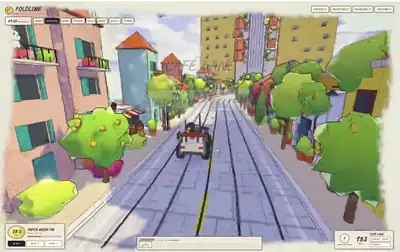</a><br><a href="https://www.sandbase.ai/lab/ai-videos/opus-5-5/2103115767206281272?lang=zh-CN&utm_source=github&utm_medium=readme&utm_campaign=awesome-opus-5.5&utm_content=card"><b>Three.js 中化作五线谱的超现实折叠道路</b></a><br><sub><a href="https://x.com/mdaman010/status/2103115767206281272">@mdaman010</a> · 0:52</sub></td><td width="33%" valign="top"><a href="https://www.sandbase.ai/lab/media/x/opus-5-5/2103194052850241739/video.mp4"></a><br><a href="https://www.sandbase.ai/lab/ai-videos/opus-5-5/2103194052850241739?lang=zh-CN&utm_source=github&utm_medium=readme&utm_campaign=awesome-opus-5.5&utm_content=card"><b>生成式高细节3D世界场景</b></a><br><sub><a href="https://x.com/LexnLin/status/2103194052850241739">@LexnLin</a> · 1:24 · <a href="https://www.sandbase.ai/lab/ai-videos/opus-5-5/2103194052850241739?lang=zh-CN&utm_source=github&utm_medium=readme&utm_campaign=awesome-opus-5.5&utm_content=card">提示词</a></sub></td></tr>
</table>

<details>
<summary><b>展开全部 81 条</b></summary>

<table>
<tr><td width="33%" valign="top"><a href="https://www.sandbase.ai/lab/media/x/opus-5-5/2103232621669220827/video.mp4"></a><br><a href="https://www.sandbase.ai/lab/ai-videos/opus-5-5/2103232621669220827?lang=zh-CN&utm_source=github&utm_medium=readme&utm_campaign=awesome-opus-5.5&utm_content=card"><b>浏览器端程序化3D骑行场景</b></a><br><sub><a href="https://x.com/0x0SojalSec/status/2103232621669220827">@0x0SojalSec</a> · 3:23</sub></td><td width="33%" valign="top"><a href="https://www.sandbase.ai/lab/media/x/opus-5-5/2103305564973658114/video.mp4"></a><br><a href="https://www.sandbase.ai/lab/ai-videos/opus-5-5/2103305564973658114?lang=zh-CN&utm_source=github&utm_medium=readme&utm_campaign=awesome-opus-5.5&utm_content=card"><b>逼真3D水流模拟演示</b></a><br><sub><a href="https://x.com/Delroy715/status/2103305564973658114">@Delroy715</a> · 0:14</sub></td><td width="33%" valign="top"><a href="https://www.sandbase.ai/lab/media/x/opus-5-5/2103393323520299428/video.mp4"></a><br><a href="https://www.sandbase.ai/lab/ai-videos/opus-5-5/2103393323520299428?lang=zh-CN&utm_source=github&utm_medium=readme&utm_campaign=awesome-opus-5.5&utm_content=card"><b>基于Three.js的可探索港口小镇三维场景</b></a><br><sub><a href="https://x.com/chetanankola/status/2103393323520299428">@chetanankola</a> · 0:25</sub></td></tr>
<tr><td width="33%" valign="top"><a href="https://www.sandbase.ai/lab/media/x/opus-5-5/2103499771206156628/video.mp4">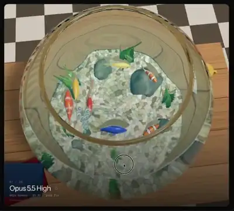</a><br><a href="https://www.sandbase.ai/lab/ai-videos/opus-5-5/2103499771206156628?lang=zh-CN&utm_source=github&utm_medium=readme&utm_campaign=awesome-opus-5.5&utm_content=card"><b>Three.js鱼缸反射折射与焦散着色器</b></a><br><sub><a href="https://x.com/NicolaManzini/status/2103499771206156628">@NicolaManzini</a> · 0:35 · <a href="https://www.sandbase.ai/lab/ai-videos/opus-5-5/2103499771206156628?lang=zh-CN&utm_source=github&utm_medium=readme&utm_campaign=awesome-opus-5.5&utm_content=card">提示词</a></sub></td><td width="33%" valign="top"><a href="https://www.sandbase.ai/lab/media/x/opus-5-5/2103512732519854263/video.mp4">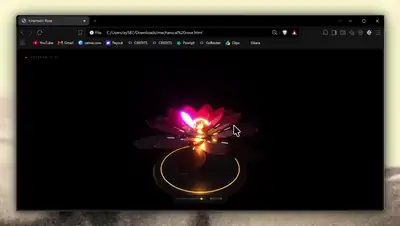</a><br><a href="https://www.sandbase.ai/lab/ai-videos/opus-5-5/2103512732519854263?lang=zh-CN&utm_source=github&utm_medium=readme&utm_campaign=awesome-opus-5.5&utm_content=card"><b>Three.js 构建的机械花</b></a><br><sub><a href="https://x.com/alannnfx/status/2103512732519854263">@alannnfx</a> · 0:14 · <a href="https://www.sandbase.ai/lab/ai-videos/opus-5-5/2103512732519854263?lang=zh-CN&utm_source=github&utm_medium=readme&utm_campaign=awesome-opus-5.5&utm_content=card">提示词</a></sub></td><td width="33%" valign="top"><a href="https://www.sandbase.ai/lab/media/x/opus-5-5/2103724883301814408/video.mp4"></a><br><a href="https://www.sandbase.ai/lab/ai-videos/opus-5-5/2103724883301814408?lang=zh-CN&utm_source=github&utm_medium=readme&utm_campaign=awesome-opus-5.5&utm_content=card"><b>游戏结算宝箱3D动画效果</b></a><br><sub><a href="https://x.com/op7418/status/2103724883301814408">@op7418</a> · 0:15</sub></td></tr>
<tr><td width="33%" valign="top"><a href="https://www.sandbase.ai/lab/media/x/opus-5-5/2103738307033416132/video.mp4"></a><br><a href="https://www.sandbase.ai/lab/ai-videos/opus-5-5/2103738307033416132?lang=zh-CN&utm_source=github&utm_medium=readme&utm_campaign=awesome-opus-5.5&utm_content=card"><b>Three.js程序化日式非真实感渲染场景</b></a><br><sub><a href="https://x.com/Delroy715/status/2103738307033416132">@Delroy715</a> · 1:21</sub></td><td width="33%" valign="top"><a href="https://www.sandbase.ai/lab/media/x/opus-5-5/2103759350330544254/video.mp4"></a><br><a href="https://www.sandbase.ai/lab/ai-videos/opus-5-5/2103759350330544254?lang=zh-CN&utm_source=github&utm_medium=readme&utm_campaign=awesome-opus-5.5&utm_content=card"><b>Remotion与Three.js制作的M3E Canvas视频</b></a><br><sub><a href="https://x.com/lnkiai/status/2103759350330544254">@lnkiai</a> · 0:32</sub></td><td width="33%" valign="top"><a href="https://www.sandbase.ai/lab/media/x/opus-5-5/2103788160031592572/video.mp4"></a><br><a href="https://www.sandbase.ai/lab/ai-videos/opus-5-5/2103788160031592572?lang=zh-CN&utm_source=github&utm_medium=readme&utm_campaign=awesome-opus-5.5&utm_content=card"><b>英伟达Blackwell GPU微观3D拆解动画</b></a><br><sub><a href="https://x.com/mdaman010/status/2103788160031592572">@mdaman010</a> · 0:49</sub></td></tr>
<tr><td width="33%" valign="top"><a href="https://www.sandbase.ai/lab/media/x/opus-5-5/2103792451551113363/video.mp4"></a><br><a href="https://www.sandbase.ai/lab/ai-videos/opus-5-5/2103792451551113363?lang=zh-CN&utm_source=github&utm_medium=readme&utm_campaign=awesome-opus-5.5&utm_content=card"><b>从数据中心深入至硅原子的3D缩放动画</b></a><br><sub><a href="https://x.com/ai_ba_reza/status/2103792451551113363">@ai_ba_reza</a> · 0:49</sub></td><td width="33%" valign="top"><a href="https://www.sandbase.ai/lab/media/x/opus-5-5/2103866429741400535/video.mp4"></a><br><a href="https://www.sandbase.ai/lab/ai-videos/opus-5-5/2103866429741400535?lang=zh-CN&utm_source=github&utm_medium=readme&utm_campaign=awesome-opus-5.5&utm_content=card"><b>纯代码与数学构建的程序化猎豹</b></a><br><sub><a href="https://x.com/majidmanzarpour/status/2103866429741400535">@majidmanzarpour</a> · 0:50</sub></td><td width="33%" valign="top"><a href="https://www.sandbase.ai/lab/media/x/opus-5-5/2103914892109517008/video.mp4"></a><br><a href="https://www.sandbase.ai/lab/ai-videos/opus-5-5/2103914892109517008?lang=zh-CN&utm_source=github&utm_medium=readme&utm_campaign=awesome-opus-5.5&utm_content=card"><b>全代码程序化生成的3D开放世界</b></a><br><sub><a href="https://x.com/AndreiProvkin/status/2103914892109517008">@AndreiProvkin</a> · 1:39</sub></td></tr>
<tr><td width="33%" valign="top"><a href="https://www.sandbase.ai/lab/media/x/opus-5-5/2103919236653428985/video.mp4"></a><br><a href="https://www.sandbase.ai/lab/ai-videos/opus-5-5/2103919236653428985?lang=zh-CN&utm_source=github&utm_medium=readme&utm_campaign=awesome-opus-5.5&utm_content=card"><b>Three.js全程序化生成的3D世界</b></a><br><sub><a href="https://x.com/AndreiProvkin/status/2103919236653428985">@AndreiProvkin</a> · 1:08</sub></td><td width="33%" valign="top"><a href="https://www.sandbase.ai/lab/media/x/opus-5-5/2104101736562467235/video.mp4"></a><br><a href="https://www.sandbase.ai/lab/ai-videos/opus-5-5/2104101736562467235?lang=zh-CN&utm_source=github&utm_medium=readme&utm_campaign=awesome-opus-5.5&utm_content=card"><b>带传送门的程序化水晶洞穴场景</b></a><br><sub><a href="https://x.com/AndreiProvkin/status/2104101736562467235">@AndreiProvkin</a> · 0:38</sub></td><td width="33%" valign="top"><a href="https://www.sandbase.ai/lab/media/x/opus-5-5/2104131601663930588/video.mp4"></a><br><a href="https://www.sandbase.ai/lab/ai-videos/opus-5-5/2104131601663930588?lang=zh-CN&utm_source=github&utm_medium=readme&utm_campaign=awesome-opus-5.5&utm_content=card"><b>Three.js水流体模拟动态效果</b></a><br><sub><a href="https://x.com/tetumemo/status/2104131601663930588">@tetumemo</a> · 1:12</sub></td></tr>
<tr><td width="33%" valign="top"><a href="https://www.sandbase.ai/lab/media/x/opus-5-5/2104147829589737806/video.mp4"></a><br><a href="https://www.sandbase.ai/lab/ai-videos/opus-5-5/2104147829589737806?lang=zh-CN&utm_source=github&utm_medium=readme&utm_campaign=awesome-opus-5.5&utm_content=card"><b>Three.js 渲染的 3D 音乐可视化画面</b></a><br><sub><a href="https://x.com/ricouii/status/2104147829589737806">@ricouii</a> · 2:37</sub></td><td width="33%" valign="top"><a href="https://www.sandbase.ai/lab/media/x/opus-5-5/2104548658171834749/video.mp4"></a><br><a href="https://www.sandbase.ai/lab/ai-videos/opus-5-5/2104548658171834749?lang=zh-CN&utm_source=github&utm_medium=readme&utm_campaign=awesome-opus-5.5&utm_content=card"><b>移植到Three.js网页的程序化建筑与城市</b></a><br><sub><a href="https://x.com/chirovisuals/status/2104548658171834749">@chirovisuals</a> · 1:15</sub></td><td width="33%" valign="top"><a href="https://www.sandbase.ai/lab/media/x/opus-5-5/2104780688113455342/video.mp4"></a><br><a href="https://www.sandbase.ai/lab/ai-videos/opus-5-5/2104780688113455342?lang=zh-CN&utm_source=github&utm_medium=readme&utm_campaign=awesome-opus-5.5&utm_content=card"><b>基于EVA风格的Three.js WebGL场景</b></a><br><sub><a href="https://x.com/LuisBizarro/status/2104780688113455342">@LuisBizarro</a> · 0:22</sub></td></tr>
<tr><td width="33%" valign="top"><a href="https://www.sandbase.ai/lab/media/x/opus-5-5/2105216139647127750/video.mp4"></a><br><a href="https://www.sandbase.ai/lab/ai-videos/opus-5-5/2105216139647127750?lang=zh-CN&utm_source=github&utm_medium=readme&utm_campaign=awesome-opus-5.5&utm_content=card"><b>基于Three.js在浏览器中运行的三维开放世界</b></a><br><sub><a href="https://x.com/maxt3chno/status/2105216139647127750">@maxt3chno</a> · 2:41</sub></td><td width="33%" valign="top"><a href="https://www.sandbase.ai/lab/media/x/opus-5-5/2105250266392224097/video.mp4"></a><br><a href="https://www.sandbase.ai/lab/ai-videos/opus-5-5/2105250266392224097?lang=zh-CN&utm_source=github&utm_medium=readme&utm_campaign=awesome-opus-5.5&utm_content=card"><b>WebGL实现的交互式齐白石水墨虾着色器</b></a><br><sub><a href="https://x.com/jshguo/status/2105250266392224097">@jshguo</a> · 0:10</sub></td><td width="33%" valign="top"><a href="https://www.sandbase.ai/lab/media/x/opus-5-5/2105304249060274631/video.mp4"></a><br><a href="https://www.sandbase.ai/lab/ai-videos/opus-5-5/2105304249060274631?lang=zh-CN&utm_source=github&utm_medium=readme&utm_campaign=awesome-opus-5.5&utm_content=card"><b>Python编曲并于Blender渲染的3D动画</b></a><br><sub><a href="https://x.com/kevin_t_ngo/status/2105304249060274631">@kevin_t_ngo</a> · 1:12</sub></td></tr>
<tr><td width="33%" valign="top"><a href="https://www.sandbase.ai/lab/media/x/opus-5-5/2105350783416021472/video.mp4"></a><br><a href="https://www.sandbase.ai/lab/ai-videos/opus-5-5/2105350783416021472?lang=zh-CN&utm_source=github&utm_medium=readme&utm_campaign=awesome-opus-5.5&utm_content=card"><b>WebGPU打造的透视交互式3D房屋</b></a><br><sub><a href="https://x.com/techartist_/status/2105350783416021472">@techartist_</a> · 0:37</sub></td><td width="33%" valign="top"><a href="https://www.sandbase.ai/lab/media/x/opus-5-5/2105723245722812598/video.mp4"></a><br><a href="https://www.sandbase.ai/lab/ai-videos/opus-5-5/2105723245722812598?lang=zh-CN&utm_source=github&utm_medium=readme&utm_campaign=awesome-opus-5.5&utm_content=card"><b>Three.js纯代码程序化动物动画</b></a><br><sub><a href="https://x.com/majidmanzarpour/status/2105723245722812598">@majidmanzarpour</a> · 1:56</sub></td><td width="33%" valign="top"><a href="https://www.sandbase.ai/lab/media/x/opus-5-5/2105784343960629738/video.mp4"></a><br><a href="https://www.sandbase.ai/lab/ai-videos/opus-5-5/2105784343960629738?lang=zh-CN&utm_source=github&utm_medium=readme&utm_campaign=awesome-opus-5.5&utm_content=card"><b>英伟达Blackwell架构GPU微观3D缩放动画</b></a><br><sub><a href="https://x.com/bearlyai/status/2105784343960629738">@bearlyai</a> · 0:49</sub></td></tr>
<tr><td width="33%" valign="top"><a href="https://www.sandbase.ai/lab/media/x/opus-5-5/2105952457637699880/video.mp4"></a><br><a href="https://www.sandbase.ai/lab/ai-videos/opus-5-5/2105952457637699880?lang=zh-CN&utm_source=github&utm_medium=readme&utm_campaign=awesome-opus-5.5&utm_content=card"><b>Three.js打造的网页端夜景城市</b></a><br><sub><a href="https://x.com/ai_growth_avii/status/2105952457637699880">@ai_growth_avii</a> · 1:13</sub></td><td width="33%" valign="top"><a href="https://www.sandbase.ai/lab/media/x/opus-5-5/2106064200535859685/video.mp4"></a><br><a href="https://www.sandbase.ai/lab/ai-videos/opus-5-5/2106064200535859685?lang=zh-CN&utm_source=github&utm_medium=readme&utm_campaign=awesome-opus-5.5&utm_content=card"><b>Three.js制作的喷气发动机交互式3D模型</b></a><br><sub><a href="https://x.com/techartist_/status/2106064200535859685">@techartist_</a> · 0:24</sub></td><td width="33%" valign="top"><a href="https://www.sandbase.ai/lab/media/x/opus-5-5/2106369769956065518/video.mp4"></a><br><a href="https://www.sandbase.ai/lab/ai-videos/opus-5-5/2106369769956065518?lang=zh-CN&utm_source=github&utm_medium=readme&utm_campaign=awesome-opus-5.5&utm_content=card"><b>单提示词生成的电影感动画场景</b></a><br><sub><a href="https://x.com/HeyAbhishek/status/2106369769956065518">@HeyAbhishek</a> · 0:30 · <a href="https://www.sandbase.ai/lab/ai-videos/opus-5-5/2106369769956065518?lang=zh-CN&utm_source=github&utm_medium=readme&utm_campaign=awesome-opus-5.5&utm_content=card">提示词</a></sub></td></tr>
<tr><td width="33%" valign="top"><a href="https://www.sandbase.ai/lab/media/x/opus-5-5/2106535398990377126/video.mp4"></a><br><a href="https://www.sandbase.ai/lab/ai-videos/opus-5-5/2106535398990377126?lang=zh-CN&utm_source=github&utm_medium=readme&utm_campaign=awesome-opus-5.5&utm_content=card"><b>Three.js网页端东京3D城市漫游模拟</b></a><br><sub><a href="https://x.com/jeantimex/status/2106535398990377126">@jeantimex</a> · 3:04</sub></td><td width="33%" valign="top"><a href="https://www.sandbase.ai/lab/media/x/opus-5-5/2106714104689828066/video.mp4">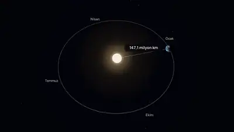</a><br><a href="https://www.sandbase.ai/lab/ai-videos/opus-5-5/2106714104689828066?lang=zh-CN&utm_source=github&utm_medium=readme&utm_campaign=awesome-opus-5.5&utm_content=card"><b>使用 Three.js 生成三维动画</b></a><br><sub><a href="https://x.com/AIMevzulari/status/2106714104689828066">@AIMevzulari</a> · 2:23</sub></td><td width="33%" valign="top"><a href="https://www.sandbase.ai/lab/media/x/opus-5-5/2106763583250108511/video.mp4"></a><br><a href="https://www.sandbase.ai/lab/ai-videos/opus-5-5/2106763583250108511?lang=zh-CN&utm_source=github&utm_medium=readme&utm_campaign=awesome-opus-5.5&utm_content=card"><b>包含游鱼与花瓣的交互式水体物理效果</b></a><br><sub><a href="https://x.com/buildwithsid/status/2106763583250108511">@buildwithsid</a> · 1:05</sub></td></tr>
<tr><td width="33%" valign="top"><a href="https://www.sandbase.ai/lab/media/x/opus-5-5/2106957256247902272/video.mp4"></a><br><a href="https://www.sandbase.ai/lab/ai-videos/opus-5-5/2106957256247902272?lang=zh-CN&utm_source=github&utm_medium=readme&utm_campaign=awesome-opus-5.5&utm_content=card"><b>WebGL与Three.js构建的浏览器3D场景</b></a><br><sub><a href="https://x.com/KhalidDevLog/status/2106957256247902272">@KhalidDevLog</a> · 1:28</sub></td><td width="33%" valign="top"><a href="https://www.sandbase.ai/lab/media/x/opus-5-5/2107013497813172593/video.mp4"></a><br><a href="https://www.sandbase.ai/lab/ai-videos/opus-5-5/2107013497813172593?lang=zh-CN&utm_source=github&utm_medium=readme&utm_campaign=awesome-opus-5.5&utm_content=card"><b>五分钟生成的等轴测设计</b></a><br><sub><a href="https://x.com/itsnotryan/status/2107013497813172593">@itsnotryan</a> · 0:07</sub></td><td width="33%" valign="top"><a href="https://www.sandbase.ai/lab/media/x/opus-5-5/2107058718882103388/video.mp4"></a><br><a href="https://www.sandbase.ai/lab/ai-videos/opus-5-5/2107058718882103388?lang=zh-CN&utm_source=github&utm_medium=readme&utm_campaign=awesome-opus-5.5&utm_content=card"><b>原生WebGL打造的可交互切水果演示</b></a><br><sub><a href="https://x.com/viktoroddy/status/2107058718882103388">@viktoroddy</a> · 0:18</sub></td></tr>
<tr><td width="33%" valign="top"><a href="https://www.sandbase.ai/lab/media/x/opus-5-5/2107063284230701075/video.mp4">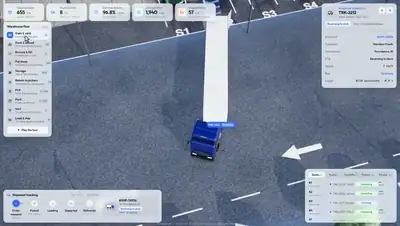</a><br><a href="https://www.sandbase.ai/lab/ai-videos/opus-5-5/2107063284230701075?lang=zh-CN&utm_source=github&utm_medium=readme&utm_campaign=awesome-opus-5.5&utm_content=card"><b>使用Claude Opus制作的仓库模拟场景</b></a><br><sub><a href="https://x.com/Jomolos/status/2107063284230701075">@Jomolos</a> · 1:03</sub></td><td width="33%" valign="top"><a href="https://www.sandbase.ai/lab/media/x/opus-5-5/2107073547701289211/video.mp4"></a><br><a href="https://www.sandbase.ai/lab/ai-videos/opus-5-5/2107073547701289211?lang=zh-CN&utm_source=github&utm_medium=readme&utm_campaign=awesome-opus-5.5&utm_content=card"><b>穿越梵高《星月夜》的飞行漫游</b></a><br><sub><a href="https://x.com/EHuanglu/status/2107073547701289211">@EHuanglu</a> · 0:25 · <a href="https://www.sandbase.ai/lab/ai-videos/opus-5-5/2107073547701289211?lang=zh-CN&utm_source=github&utm_medium=readme&utm_campaign=awesome-opus-5.5&utm_content=card">提示词</a></sub></td><td width="33%" valign="top"><a href="https://www.sandbase.ai/lab/media/x/opus-5-5/2107449104926482912/video.mp4"></a><br><a href="https://www.sandbase.ai/lab/ai-videos/opus-5-5/2107449104926482912?lang=zh-CN&utm_source=github&utm_medium=readme&utm_campaign=awesome-opus-5.5&utm_content=card"><b>Three.js实时渲染的1857拿破仑野战炮</b></a><br><sub><a href="https://x.com/thebuggeddev/status/2107449104926482912">@thebuggeddev</a> · 0:51</sub></td></tr>
<tr><td width="33%" valign="top"><a href="https://www.sandbase.ai/lab/media/x/opus-5-5/2107458140279394589/video.mp4"></a><br><a href="https://www.sandbase.ai/lab/ai-videos/opus-5-5/2107458140279394589?lang=zh-CN&utm_source=github&utm_medium=readme&utm_campaign=awesome-opus-5.5&utm_content=card"><b>Opus与Seedance生成的3D动画场景</b></a><br><sub><a href="https://x.com/HeyAbhishek/status/2107458140279394589">@HeyAbhishek</a> · 0:30 · <a href="https://www.sandbase.ai/lab/ai-videos/opus-5-5/2107458140279394589?lang=zh-CN&utm_source=github&utm_medium=readme&utm_campaign=awesome-opus-5.5&utm_content=card">提示词</a></sub></td><td width="33%" valign="top"><a href="https://www.sandbase.ai/lab/media/x/opus-5-5/2107572909086761325/video.mp4"></a><br><a href="https://www.sandbase.ai/lab/ai-videos/opus-5-5/2107572909086761325?lang=zh-CN&utm_source=github&utm_medium=readme&utm_campaign=awesome-opus-5.5&utm_content=card"><b>3D重构速度与激情车祸场景</b></a><br><sub><a href="https://x.com/Ror_Fly/status/2107572909086761325">@Ror_Fly</a> · 0:25 · <a href="https://www.sandbase.ai/lab/ai-videos/opus-5-5/2107572909086761325?lang=zh-CN&utm_source=github&utm_medium=readme&utm_campaign=awesome-opus-5.5&utm_content=card">提示词</a></sub></td><td width="33%" valign="top"><a href="https://www.sandbase.ai/lab/media/x/opus-5-5/2107653604144562177/video.mp4"></a><br><a href="https://www.sandbase.ai/lab/ai-videos/opus-5-5/2107653604144562177?lang=zh-CN&utm_source=github&utm_medium=readme&utm_campaign=awesome-opus-5.5&utm_content=card"><b>基于4D重建的MuJoCo物理仿真实验</b></a><br><sub><a href="https://x.com/s1ddok/status/2107653604144562177">@s1ddok</a> · 0:21</sub></td></tr>
<tr><td width="33%" valign="top"><a href="https://www.sandbase.ai/lab/media/x/opus-5-5/2107696042053431360/video.mp4"></a><br><a href="https://www.sandbase.ai/lab/ai-videos/opus-5-5/2107696042053431360?lang=zh-CN&utm_source=github&utm_medium=readme&utm_campaign=awesome-opus-5.5&utm_content=card"><b>Blender渲染的音频驱动岩浆峡谷动画</b></a><br><sub><a href="https://x.com/kloss_xyz/status/2107696042053431360">@kloss_xyz</a> · 0:21 · <a href="https://www.sandbase.ai/lab/ai-videos/opus-5-5/2107696042053431360?lang=zh-CN&utm_source=github&utm_medium=readme&utm_campaign=awesome-opus-5.5&utm_content=card">提示词</a></sub></td><td width="33%" valign="top"><a href="https://www.sandbase.ai/lab/media/x/opus-5-5/2107870449593909592/video.mp4"></a><br><a href="https://www.sandbase.ai/lab/ai-videos/opus-5-5/2107870449593909592?lang=zh-CN&utm_source=github&utm_medium=readme&utm_campaign=awesome-opus-5.5&utm_content=card"><b>Three.js实时模拟的火车旅程场景</b></a><br><sub><a href="https://x.com/KhalidDevLog/status/2107870449593909592">@KhalidDevLog</a> · 2:12</sub></td><td width="33%" valign="top"><a href="https://www.sandbase.ai/lab/media/x/opus-5-5/2108013423401353577/video.mp4"></a><br><a href="https://www.sandbase.ai/lab/ai-videos/opus-5-5/2108013423401353577?lang=zh-CN&utm_source=github&utm_medium=readme&utm_campaign=awesome-opus-5.5&utm_content=card"><b>莫奈风格实时3D渲染场景</b></a><br><sub><a href="https://x.com/gruberbuilds/status/2108013423401353577">@gruberbuilds</a> · 1:31</sub></td></tr>
<tr><td width="33%" valign="top"><a href="https://www.sandbase.ai/lab/media/x/opus-5-5/2108203997480063196/video.mp4"></a><br><a href="https://www.sandbase.ai/lab/ai-videos/opus-5-5/2108203997480063196?lang=zh-CN&utm_source=github&utm_medium=readme&utm_campaign=awesome-opus-5.5&utm_content=card"><b>WebGPU在浏览器中运行的程序化无尽城市</b></a><br><sub><a href="https://x.com/RyanSael/status/2108203997480063196">@RyanSael</a> · 0:52</sub></td><td width="33%" valign="top"><a href="https://www.sandbase.ai/lab/media/x/opus-5-5/2108284501394706447/video.mp4"></a><br><a href="https://www.sandbase.ai/lab/ai-videos/opus-5-5/2108284501394706447?lang=zh-CN&utm_source=github&utm_medium=readme&utm_campaign=awesome-opus-5.5&utm_content=card"><b>浏览器中实时生成的无尽城市</b></a><br><sub><a href="https://x.com/_Chain_Duck_/status/2108284501394706447">@_Chain_Duck_</a> · 0:39</sub></td><td width="33%" valign="top"><a href="https://www.sandbase.ai/lab/media/x/opus-5-5/2108845317122900188/video.mp4"></a><br><a href="https://www.sandbase.ai/lab/ai-videos/opus-5-5/2108845317122900188?lang=zh-CN&utm_source=github&utm_medium=readme&utm_campaign=awesome-opus-5.5&utm_content=card"><b>Three.js网页3D场景Petal Quay与动漫角色</b></a><br><sub><a href="https://x.com/chetanankola/status/2108845317122900188">@chetanankola</a> · 0:38</sub></td></tr>
<tr><td width="33%" valign="top"><a href="https://www.sandbase.ai/lab/media/x/opus-5-5/2108929451811557694/video.mp4"></a><br><a href="https://www.sandbase.ai/lab/ai-videos/opus-5-5/2108929451811557694?lang=zh-CN&utm_source=github&utm_medium=readme&utm_campaign=awesome-opus-5.5&utm_content=card"><b>由 GitHub 议题生成的交互式 3D 模型</b></a><br><sub><a href="https://x.com/0xWast3/status/2108929451811557694">@0xWast3</a> · 0:36</sub></td><td width="33%" valign="top"><a href="https://www.sandbase.ai/lab/media/x/opus-5-5/2109175863761859011/video.mp4"></a><br><a href="https://www.sandbase.ai/lab/ai-videos/opus-5-5/2109175863761859011?lang=zh-CN&utm_source=github&utm_medium=readme&utm_campaign=awesome-opus-5.5&utm_content=card"><b>使用Blender资产构建的Three.js场景</b></a><br><sub><a href="https://x.com/anxuanng/status/2109175863761859011">@anxuanng</a> · 0:20</sub></td><td width="33%" valign="top"><a href="https://www.sandbase.ai/lab/media/x/opus-5-5/2109231561711427883/video.mp4"></a><br><a href="https://www.sandbase.ai/lab/ai-videos/opus-5-5/2109231561711427883?lang=zh-CN&utm_source=github&utm_medium=readme&utm_campaign=awesome-opus-5.5&utm_content=card"><b>纯代码生成的海上小火车与合成场景音效</b></a><br><sub><a href="https://x.com/eviljer/status/2109231561711427883">@eviljer</a> · 1:12 · <a href="https://www.sandbase.ai/lab/ai-videos/opus-5-5/2109231561711427883?lang=zh-CN&utm_source=github&utm_medium=readme&utm_campaign=awesome-opus-5.5&utm_content=card">提示词</a></sub></td></tr>
<tr><td width="33%" valign="top"><a href="https://www.sandbase.ai/lab/media/x/opus-5-5/2109257723246501895/video.mp4"></a><br><a href="https://www.sandbase.ai/lab/ai-videos/opus-5-5/2109257723246501895?lang=zh-CN&utm_source=github&utm_medium=readme&utm_campaign=awesome-opus-5.5&utm_content=card"><b>Three.js着色器实现的开盖CD塑料盒效果</b></a><br><sub><a href="https://x.com/ann_nnng/status/2109257723246501895">@ann_nnng</a> · 0:30</sub></td><td width="33%" valign="top"><a href="https://www.sandbase.ai/lab/media/x/opus-5-5/2109334686488990093/video.mp4"></a><br><a href="https://www.sandbase.ai/lab/ai-videos/opus-5-5/2109334686488990093?lang=zh-CN&utm_source=github&utm_medium=readme&utm_campaign=awesome-opus-5.5&utm_content=card"><b>可交互等轴线框与 WebGL 着色器效果</b></a><br><sub><a href="https://x.com/0xMovez/status/2109334686488990093">@0xMovez</a> · 0:43</sub></td><td width="33%" valign="top"><a href="https://www.sandbase.ai/lab/media/x/opus-5-5/2109343932681171125/video.mp4"></a><br><a href="https://www.sandbase.ai/lab/ai-videos/opus-5-5/2109343932681171125?lang=zh-CN&utm_source=github&utm_medium=readme&utm_campaign=awesome-opus-5.5&utm_content=card"><b>Blender月球高程与光影模拟演示</b></a><br><sub><a href="https://x.com/0xWast3/status/2109343932681171125">@0xWast3</a> · 0:26</sub></td></tr>
<tr><td width="33%" valign="top"><a href="https://www.sandbase.ai/lab/media/x/opus-5-5/2109352431939383376/video.mp4">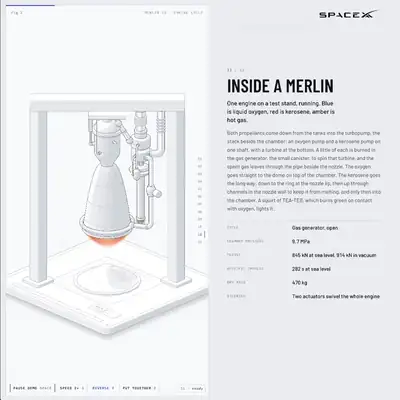</a><br><a href="https://www.sandbase.ai/lab/ai-videos/opus-5-5/2109352431939383376?lang=zh-CN&utm_source=github&utm_medium=readme&utm_campaign=awesome-opus-5.5&utm_content=card"><b>交互式等距线框模型与WebGL图形效果</b></a><br><sub><a href="https://x.com/Yarad_ai/status/2109352431939383376">@Yarad_ai</a> · 0:43</sub></td><td width="33%" valign="top"><a href="https://www.sandbase.ai/lab/media/x/opus-5-5/2109399139280716281/video.mp4">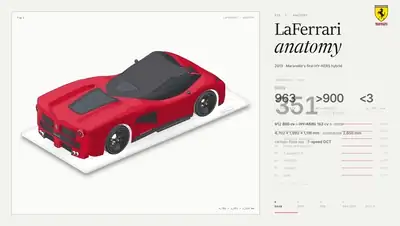</a><br><a href="https://www.sandbase.ai/lab/ai-videos/opus-5-5/2109399139280716281?lang=zh-CN&utm_source=github&utm_medium=readme&utm_campaign=awesome-opus-5.5&utm_content=card"><b>WebGL 跑车三维爆炸图与解构</b></a><br><sub><a href="https://x.com/0xCarnagee/status/2109399139280716281">@0xCarnagee</a> · 0:20</sub></td><td width="33%" valign="top"><a href="https://www.sandbase.ai/lab/media/x/opus-5-5/2109420193399357665/video.mp4"></a><br><a href="https://www.sandbase.ai/lab/ai-videos/opus-5-5/2109420193399357665?lang=zh-CN&utm_source=github&utm_medium=readme&utm_campaign=awesome-opus-5.5&utm_content=card"><b>雨夜日式便利店微缩三维场景</b></a><br><sub><a href="https://x.com/NFT_Chen/status/2109420193399357665">@NFT_Chen</a> · 1:53 · <a href="https://www.sandbase.ai/lab/ai-videos/opus-5-5/2109420193399357665?lang=zh-CN&utm_source=github&utm_medium=readme&utm_campaign=awesome-opus-5.5&utm_content=card">提示词</a></sub></td></tr>
<tr><td width="33%" valign="top"><a href="https://www.sandbase.ai/lab/media/x/opus-5-5/2109523901105500260/video.mp4"></a><br><a href="https://www.sandbase.ai/lab/ai-videos/opus-5-5/2109523901105500260?lang=zh-CN&utm_source=github&utm_medium=readme&utm_campaign=awesome-opus-5.5&utm_content=card"><b>Three.js天堂海岛3D场景</b></a><br><sub><a href="https://x.com/badboyfoxy/status/2109523901105500260">@badboyfoxy</a> · 2:07</sub></td><td width="33%" valign="top"><a href="https://www.sandbase.ai/lab/media/x/opus-5-5/2109544637497298951/video.mp4"></a><br><a href="https://www.sandbase.ai/lab/ai-videos/opus-5-5/2109544637497298951?lang=zh-CN&utm_source=github&utm_medium=readme&utm_campaign=awesome-opus-5.5&utm_content=card"><b>Godot引擎打造的写实海洋模拟</b></a><br><sub><a href="https://x.com/KanaWorks_AI/status/2109544637497298951">@KanaWorks_AI</a> · 0:55</sub></td><td width="33%" valign="top"><a href="https://www.sandbase.ai/lab/media/x/opus-5-5/2109568757001756710/video.mp4"></a><br><a href="https://www.sandbase.ai/lab/ai-videos/opus-5-5/2109568757001756710?lang=zh-CN&utm_source=github&utm_medium=readme&utm_campaign=awesome-opus-5.5&utm_content=card"><b>视频转3D动物行走动画工作流</b></a><br><sub><a href="https://x.com/Stefan_3D_AI/status/2109568757001756710">@Stefan_3D_AI</a> · 0:13</sub></td></tr>
<tr><td width="33%" valign="top"><a href="https://www.sandbase.ai/lab/media/x/opus-5-5/2109702766671417760/video.mp4"></a><br><a href="https://www.sandbase.ai/lab/ai-videos/opus-5-5/2109702766671417760?lang=zh-CN&utm_source=github&utm_medium=readme&utm_campaign=awesome-opus-5.5&utm_content=card"><b>Blender中的程序化3D场景构建</b></a><br><sub><a href="https://x.com/0xCodio/status/2109702766671417760">@0xCodio</a> · 0:24</sub></td><td width="33%" valign="top"><a href="https://www.sandbase.ai/lab/media/x/opus-5-5/2109718931409699043/video.mp4"></a><br><a href="https://www.sandbase.ai/lab/ai-videos/opus-5-5/2109718931409699043?lang=zh-CN&utm_source=github&utm_medium=readme&utm_campaign=awesome-opus-5.5&utm_content=card"><b>包含夜总会的可交互三维世界</b></a><br><sub><a href="https://x.com/Ainthropos/status/2109718931409699043">@Ainthropos</a> · 0:56</sub></td><td width="33%" valign="top"><a href="https://www.sandbase.ai/lab/media/x/opus-5-5/2109750382113243351/video.mp4">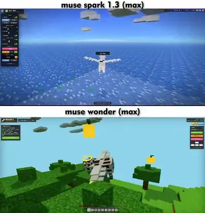</a><br><a href="https://www.sandbase.ai/lab/ai-videos/opus-5-5/2109750382113243351?lang=zh-CN&utm_source=github&utm_medium=readme&utm_campaign=awesome-opus-5.5&utm_content=card"><b>Three.js 中在 Minecraft 世界飞行的带翼奶牛</b></a><br><sub><a href="https://x.com/TimJayas/status/2109750382113243351">@TimJayas</a> · 0:27 · <a href="https://www.sandbase.ai/lab/ai-videos/opus-5-5/2109750382113243351?lang=zh-CN&utm_source=github&utm_medium=readme&utm_campaign=awesome-opus-5.5&utm_content=card">提示词</a></sub></td></tr>
<tr><td width="33%" valign="top"><a href="https://www.sandbase.ai/lab/media/x/opus-5-5/2109984169845821651/video.mp4"></a><br><a href="https://www.sandbase.ai/lab/ai-videos/opus-5-5/2109984169845821651?lang=zh-CN&utm_source=github&utm_medium=readme&utm_campaign=awesome-opus-5.5&utm_content=card"><b>滚动展开地面的三维场景</b></a><br><sub><a href="https://x.com/viktoroddy/status/2109984169845821651">@viktoroddy</a> · 0:22 · <a href="https://www.sandbase.ai/lab/ai-videos/opus-5-5/2109984169845821651?lang=zh-CN&utm_source=github&utm_medium=readme&utm_campaign=awesome-opus-5.5&utm_content=card">提示词</a></sub></td><td width="33%" valign="top"><a href="https://www.sandbase.ai/lab/media/x/opus-5-5/2109993586951663626/video.mp4"></a><br><a href="https://www.sandbase.ai/lab/ai-videos/opus-5-5/2109993586951663626?lang=zh-CN&utm_source=github&utm_medium=readme&utm_campaign=awesome-opus-5.5&utm_content=card"><b>电影质感3D动画冒险短片</b></a><br><sub><a href="https://x.com/HeyAbhishek/status/2109993586951663626">@HeyAbhishek</a> · 0:29 · <a href="https://www.sandbase.ai/lab/ai-videos/opus-5-5/2109993586951663626?lang=zh-CN&utm_source=github&utm_medium=readme&utm_campaign=awesome-opus-5.5&utm_content=card">提示词</a></sub></td><td width="33%" valign="top"><a href="https://www.sandbase.ai/lab/media/x/opus-5-5/2110010240825737683/video.mp4"></a><br><a href="https://www.sandbase.ai/lab/ai-videos/opus-5-5/2110010240825737683?lang=zh-CN&utm_source=github&utm_medium=readme&utm_campaign=awesome-opus-5.5&utm_content=card"><b>利用 Python 和 Blender 制作的 3D 动画</b></a><br><sub><a href="https://x.com/kevin_t_ngo/status/2110010240825737683">@kevin_t_ngo</a> · 0:28</sub></td></tr>
<tr><td width="33%" valign="top"><a href="https://www.sandbase.ai/lab/media/x/opus-5-5/2110036224320884998/video.mp4"></a><br><a href="https://www.sandbase.ai/lab/ai-videos/opus-5-5/2110036224320884998?lang=zh-CN&utm_source=github&utm_medium=readme&utm_campaign=awesome-opus-5.5&utm_content=card"><b>从户型图生成的Three.js可漫步3D房屋</b></a><br><sub><a href="https://x.com/everestchris6/status/2110036224320884998">@everestchris6</a> · 0:14 · <a href="https://www.sandbase.ai/lab/ai-videos/opus-5-5/2110036224320884998?lang=zh-CN&utm_source=github&utm_medium=readme&utm_campaign=awesome-opus-5.5&utm_content=card">提示词</a></sub></td><td width="33%" valign="top"><a href="https://www.sandbase.ai/lab/media/x/opus-5-5/2110275826658967896/video.mp4"></a><br><a href="https://www.sandbase.ai/lab/ai-videos/opus-5-5/2110275826658967896?lang=zh-CN&utm_source=github&utm_medium=readme&utm_campaign=awesome-opus-5.5&utm_content=card"><b>Three.js制作的可交互3D城市</b></a><br><sub><a href="https://x.com/jiangjiangling/status/2110275826658967896">@jiangjiangling</a> · 0:56</sub></td><td width="33%" valign="top"><a href="https://www.sandbase.ai/lab/media/x/opus-5-5/2110450567956811893/video.mp4"></a><br><a href="https://www.sandbase.ai/lab/ai-videos/opus-5-5/2110450567956811893?lang=zh-CN&utm_source=github&utm_medium=readme&utm_campaign=awesome-opus-5.5&utm_content=card"><b>由平面图生成的3D可漫游房屋</b></a><br><sub><a href="https://x.com/AHSeslami/status/2110450567956811893">@AHSeslami</a> · 0:14</sub></td></tr>
<tr><td width="33%" valign="top"><a href="https://www.sandbase.ai/lab/media/x/opus-5-5/2110453070236922090/video.mp4"></a><br><a href="https://www.sandbase.ai/lab/ai-videos/opus-5-5/2110453070236922090?lang=zh-CN&utm_source=github&utm_medium=readme&utm_campaign=awesome-opus-5.5&utm_content=card"><b>Three.js运行的AI员工3D办公室场景</b></a><br><sub><a href="https://x.com/anxuanng/status/2110453070236922090">@anxuanng</a> · 0:30</sub></td><td width="33%" valign="top"><a href="https://www.sandbase.ai/lab/media/x/opus-5-5/2111035753035612364/video.mp4"></a><br><a href="https://www.sandbase.ai/lab/ai-videos/opus-5-5/2111035753035612364?lang=zh-CN&utm_source=github&utm_medium=readme&utm_campaign=awesome-opus-5.5&utm_content=card"><b>使用Opus自动化的Blender资产管线</b></a><br><sub><a href="https://x.com/0xWast3/status/2111035753035612364">@0xWast3</a> · 0:30</sub></td><td width="33%" valign="top"><a href="https://www.sandbase.ai/lab/media/x/opus-5-5/2111120760660254842/video.mp4"></a><br><a href="https://www.sandbase.ai/lab/ai-videos/opus-5-5/2111120760660254842?lang=zh-CN&utm_source=github&utm_medium=readme&utm_campaign=awesome-opus-5.5&utm_content=card"><b>通过Claude Opus编写的Three.js三维场景</b></a><br><sub><a href="https://x.com/Belbizaz/status/2111120760660254842">@Belbizaz</a> · 0:30</sub></td></tr>
<tr><td width="33%" valign="top"><a href="https://www.sandbase.ai/lab/media/x/opus-5-5/2111306207239557288/video.mp4"></a><br><a href="https://www.sandbase.ai/lab/ai-videos/opus-5-5/2111306207239557288?lang=zh-CN&utm_source=github&utm_medium=readme&utm_campaign=awesome-opus-5.5&utm_content=card"><b>使用 WebGPU 渲染的实时海洋场景</b></a><br><sub><a href="https://x.com/jurlycat/status/2111306207239557288">@jurlycat</a> · 0:32</sub></td><td width="33%" valign="top"><a href="https://www.sandbase.ai/lab/media/x/opus-5-5/2111393368097849615/video.mp4"></a><br><a href="https://www.sandbase.ai/lab/ai-videos/opus-5-5/2111393368097849615?lang=zh-CN&utm_source=github&utm_medium=readme&utm_campaign=awesome-opus-5.5&utm_content=card"><b>利用 Claude Opus 和 Blender 制作游戏模型</b></a><br><sub><a href="https://x.com/rewind02/status/2111393368097849615">@rewind02</a> · 0:16</sub></td><td width="33%" valign="top"><a href="https://www.sandbase.ai/lab/media/x/opus-5-5/2111435045109903540/video.mp4"></a><br><a href="https://www.sandbase.ai/lab/ai-videos/opus-5-5/2111435045109903540?lang=zh-CN&utm_source=github&utm_medium=readme&utm_campaign=awesome-opus-5.5&utm_content=card"><b>通过Claude构建的复杂Houdini体积场景</b></a><br><sub><a href="https://x.com/hectorVFX/status/2111435045109903540">@hectorVFX</a> · 0:15</sub></td></tr>
<tr><td width="33%" valign="top"><a href="https://www.sandbase.ai/lab/media/x/opus-5-5/2111880621954081240/video.mp4"></a><br><a href="https://www.sandbase.ai/lab/ai-videos/opus-5-5/2111880621954081240?lang=zh-CN&utm_source=github&utm_medium=readme&utm_campaign=awesome-opus-5.5&utm_content=card"><b>从网格绘制并升起 3D 公寓模型</b></a><br><sub><a href="https://x.com/Solvaix/status/2111880621954081240">@Solvaix</a> · 1:13</sub></td><td width="33%" valign="top"><a href="https://www.sandbase.ai/lab/media/x/opus-5-5/2111920496208204235/video.mp4"></a><br><a href="https://www.sandbase.ai/lab/ai-videos/opus-5-5/2111920496208204235?lang=zh-CN&utm_source=github&utm_medium=readme&utm_campaign=awesome-opus-5.5&utm_content=card"><b>超轻量级代码生成的海洋场景模拟</b></a><br><sub><a href="https://x.com/AmirMushich/status/2111920496208204235">@AmirMushich</a> · 0:19 · <a href="https://www.sandbase.ai/lab/ai-videos/opus-5-5/2111920496208204235?lang=zh-CN&utm_source=github&utm_medium=readme&utm_campaign=awesome-opus-5.5&utm_content=card">提示词</a></sub></td><td width="33%" valign="top"><a href="https://www.sandbase.ai/lab/media/x/opus-5-5/2112514570078372079/video.mp4"></a><br><a href="https://www.sandbase.ai/lab/ai-videos/opus-5-5/2112514570078372079?lang=zh-CN&utm_source=github&utm_medium=readme&utm_campaign=awesome-opus-5.5&utm_content=card"><b>提示词生成的交互式3D恐怖网站</b></a><br><sub><a href="https://x.com/viktoroddy/status/2112514570078372079">@viktoroddy</a> · 0:25</sub></td></tr>
</table>

</details>

<a id="motion-graphics"></a>

## 动效

<table>
<tr><td width="33%" valign="top"><a href="https://www.sandbase.ai/lab/media/x/opus-5-5/2102437977435893771/video.mp4"></a><br><a href="https://www.sandbase.ai/lab/ai-videos/opus-5-5/2102437977435893771?lang=zh-CN&utm_source=github&utm_medium=readme&utm_campaign=awesome-opus-5.5&utm_content=card"><b>JavaScript绘制的动画故事短片</b></a><br><sub><a href="https://x.com/kevin_t_ngo/status/2102437977435893771">@kevin_t_ngo</a> · 0:28</sub></td><td width="33%" valign="top"><a href="https://www.sandbase.ai/lab/media/x/opus-5-5/2102451375724499350/video.mp4"></a><br><a href="https://www.sandbase.ai/lab/ai-videos/opus-5-5/2102451375724499350?lang=zh-CN&utm_source=github&utm_medium=readme&utm_campaign=awesome-opus-5.5&utm_content=card"><b>任天堂Switch的SVG渲染展示</b></a><br><sub><a href="https://x.com/ishuagra02/status/2102451375724499350">@ishuagra02</a> · 0:07</sub></td><td width="33%" valign="top"><a href="https://www.sandbase.ai/lab/media/x/opus-5-5/2102476258948927543/video.mp4"></a><br><a href="https://www.sandbase.ai/lab/ai-videos/opus-5-5/2102476258948927543?lang=zh-CN&utm_source=github&utm_medium=readme&utm_campaign=awesome-opus-5.5&utm_content=card"><b>纯代码生成的像素风巫师动画</b></a><br><sub><a href="https://x.com/majidmanzarpour/status/2102476258948927543">@majidmanzarpour</a> · 0:11 · <a href="https://www.sandbase.ai/lab/ai-videos/opus-5-5/2102476258948927543?lang=zh-CN&utm_source=github&utm_medium=readme&utm_campaign=awesome-opus-5.5&utm_content=card">提示词</a></sub></td></tr>
<tr><td width="33%" valign="top"><a href="https://www.sandbase.ai/lab/media/x/opus-5-5/2102484620109644273/video.mp4"></a><br><a href="https://www.sandbase.ai/lab/ai-videos/opus-5-5/2102484620109644273?lang=zh-CN&utm_source=github&utm_medium=readme&utm_campaign=awesome-opus-5.5&utm_content=card"><b>AI生成的渐进式视频与音乐</b></a><br><sub><a href="https://x.com/dhruvalgolakiya/status/2102484620109644273">@dhruvalgolakiya</a> · 0:23</sub></td><td width="33%" valign="top"><a href="https://www.sandbase.ai/lab/media/x/opus-5-5/2102495989194236158/video.mp4"></a><br><a href="https://www.sandbase.ai/lab/ai-videos/opus-5-5/2102495989194236158?lang=zh-CN&utm_source=github&utm_medium=readme&utm_campaign=awesome-opus-5.5&utm_content=card"><b>JavaScript逐帧绘制笔触生成的生平动画</b></a><br><sub><a href="https://x.com/shfred0/status/2102495989194236158">@shfred0</a> · 0:30</sub></td><td width="33%" valign="top"><a href="https://www.sandbase.ai/lab/media/x/opus-5-5/2102531681450119426/video.mp4"></a><br><a href="https://www.sandbase.ai/lab/ai-videos/opus-5-5/2102531681450119426?lang=zh-CN&utm_source=github&utm_medium=readme&utm_campaign=awesome-opus-5.5&utm_content=card"><b>纯代码生成的动画故事《Small Print》</b></a><br><sub><a href="https://x.com/Voxyz_ai/status/2102531681450119426">@Voxyz_ai</a> · 0:29</sub></td></tr>
</table>

<details>
<summary><b>展开全部 100 条</b></summary>

<table>
<tr><td width="33%" valign="top"><a href="https://www.sandbase.ai/lab/media/x/opus-5-5/2102592355165782312/video.mp4"></a><br><a href="https://www.sandbase.ai/lab/ai-videos/opus-5-5/2102592355165782312?lang=zh-CN&utm_source=github&utm_medium=readme&utm_campaign=awesome-opus-5.5&utm_content=card"><b>Opus 5.5生成的沙画动画</b></a><br><sub><a href="https://x.com/Michaelzsguo/status/2102592355165782312">@Michaelzsguo</a> · 2:00 · <a href="https://www.sandbase.ai/lab/ai-videos/opus-5-5/2102592355165782312?lang=zh-CN&utm_source=github&utm_medium=readme&utm_campaign=awesome-opus-5.5&utm_content=card">提示词</a></sub></td><td width="33%" valign="top"><a href="https://www.sandbase.ai/lab/media/x/opus-5-5/2102645793828036643/video.mp4"></a><br><a href="https://www.sandbase.ai/lab/ai-videos/opus-5-5/2102645793828036643?lang=zh-CN&utm_source=github&utm_medium=readme&utm_campaign=awesome-opus-5.5&utm_content=card"><b>使用Canvas 2D实时渲染的动画短片</b></a><br><sub><a href="https://x.com/jurlycat/status/2102645793828036643">@jurlycat</a> · 1:18</sub></td><td width="33%" valign="top"><a href="https://www.sandbase.ai/lab/media/x/opus-5-5/2102707412704919910/video.mp4"></a><br><a href="https://www.sandbase.ai/lab/ai-videos/opus-5-5/2102707412704919910?lang=zh-CN&utm_source=github&utm_medium=readme&utm_campaign=awesome-opus-5.5&utm_content=card"><b>通过Canvas 2D程序化绘制的奔跑骏马</b></a><br><sub><a href="https://x.com/victormustar/status/2102707412704919910">@victormustar</a> · 0:10</sub></td></tr>
<tr><td width="33%" valign="top"><a href="https://www.sandbase.ai/lab/media/x/opus-5-5/2102712897701097828/video.mp4"></a><br><a href="https://www.sandbase.ai/lab/ai-videos/opus-5-5/2102712897701097828?lang=zh-CN&utm_source=github&utm_medium=readme&utm_campaign=awesome-opus-5.5&utm_content=card"><b>单条提示词生成的图形海报与动画</b></a><br><sub><a href="https://x.com/nazmijavierl/status/2102712897701097828">@nazmijavierl</a> · 0:16</sub></td><td width="33%" valign="top"><a href="https://www.sandbase.ai/lab/media/x/opus-5-5/2102724347446305104/video.mp4"></a><br><a href="https://www.sandbase.ai/lab/ai-videos/opus-5-5/2102724347446305104?lang=zh-CN&utm_source=github&utm_medium=readme&utm_campaign=awesome-opus-5.5&utm_content=card"><b>全程序化电影质感动态设计短片</b></a><br><sub><a href="https://x.com/leo_xiaolei/status/2102724347446305104">@leo_xiaolei</a> · 0:28 · <a href="https://www.sandbase.ai/lab/ai-videos/opus-5-5/2102724347446305104?lang=zh-CN&utm_source=github&utm_medium=readme&utm_campaign=awesome-opus-5.5&utm_content=card">提示词</a></sub></td><td width="33%" valign="top"><a href="https://www.sandbase.ai/lab/media/x/opus-5-5/2102732988262068440/video.mp4">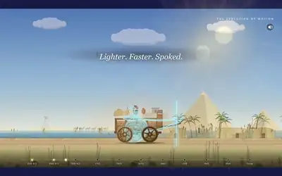</a><br><a href="https://www.sandbase.ai/lab/ai-videos/opus-5-5/2102732988262068440?lang=zh-CN&utm_source=github&utm_medium=readme&utm_campaign=awesome-opus-5.5&utm_content=card"><b>SVG绘制的交通工具演变历史动画</b></a><br><sub><a href="https://x.com/HarshithLucky3/status/2102732988262068440">@HarshithLucky3</a> · 1:52 · <a href="https://www.sandbase.ai/lab/ai-videos/opus-5-5/2102732988262068440?lang=zh-CN&utm_source=github&utm_medium=readme&utm_campaign=awesome-opus-5.5&utm_content=card">提示词</a></sub></td></tr>
<tr><td width="33%" valign="top"><a href="https://www.sandbase.ai/lab/media/x/opus-5-5/2102733714845491558/video.mp4"></a><br><a href="https://www.sandbase.ai/lab/ai-videos/opus-5-5/2102733714845491558?lang=zh-CN&utm_source=github&utm_medium=readme&utm_campaign=awesome-opus-5.5&utm_content=card"><b>Opus 5.5制作的带音效长视频</b></a><br><sub><a href="https://x.com/dhruvalgolakiya/status/2102733714845491558">@dhruvalgolakiya</a> · 2:04</sub></td><td width="33%" valign="top"><a href="https://www.sandbase.ai/lab/media/x/opus-5-5/2102801274173587569/video.mp4"></a><br><a href="https://www.sandbase.ai/lab/ai-videos/opus-5-5/2102801274173587569?lang=zh-CN&utm_source=github&utm_medium=readme&utm_campaign=awesome-opus-5.5&utm_content=card"><b>单条语音提示词生成的项目演示</b></a><br><sub><a href="https://x.com/donaldjewkes/status/2102801274173587569">@donaldjewkes</a> · 2:22 · <a href="https://www.sandbase.ai/lab/ai-videos/opus-5-5/2102801274173587569?lang=zh-CN&utm_source=github&utm_medium=readme&utm_campaign=awesome-opus-5.5&utm_content=card">提示词</a></sub></td><td width="33%" valign="top"><a href="https://www.sandbase.ai/lab/media/x/opus-5-5/2102853258582880547/video.mp4"></a><br><a href="https://www.sandbase.ai/lab/ai-videos/opus-5-5/2102853258582880547?lang=zh-CN&utm_source=github&utm_medium=readme&utm_campaign=awesome-opus-5.5&utm_content=card"><b>用HTML渲染的食谱动态图形动画</b></a><br><sub><a href="https://x.com/Ror_Fly/status/2102853258582880547">@Ror_Fly</a> · 0:30 · <a href="https://www.sandbase.ai/lab/ai-videos/opus-5-5/2102853258582880547?lang=zh-CN&utm_source=github&utm_medium=readme&utm_campaign=awesome-opus-5.5&utm_content=card">提示词</a></sub></td></tr>
<tr><td width="33%" valign="top"><a href="https://www.sandbase.ai/lab/media/x/opus-5-5/2103082510607610023/video.mp4"></a><br><a href="https://www.sandbase.ai/lab/ai-videos/opus-5-5/2103082510607610023?lang=zh-CN&utm_source=github&utm_medium=readme&utm_campaign=awesome-opus-5.5&utm_content=card"><b>测试工作流极限生成的演示视频</b></a><br><sub><a href="https://x.com/pleometric/status/2103082510607610023">@pleometric</a> · 2:37</sub></td><td width="33%" valign="top"><a href="https://www.sandbase.ai/lab/media/x/opus-5-5/2103107359727829318/video.mp4"></a><br><a href="https://www.sandbase.ai/lab/ai-videos/opus-5-5/2103107359727829318?lang=zh-CN&utm_source=github&utm_medium=readme&utm_campaign=awesome-opus-5.5&utm_content=card"><b>使用Remotion单次提示词生成的视频</b></a><br><sub><a href="https://x.com/thallisribeiro/status/2103107359727829318">@thallisribeiro</a> · 0:21</sub></td><td width="33%" valign="top"><a href="https://www.sandbase.ai/lab/media/x/opus-5-5/2103124033365762215/video.mp4"></a><br><a href="https://www.sandbase.ai/lab/ai-videos/opus-5-5/2103124033365762215?lang=zh-CN&utm_source=github&utm_medium=readme&utm_campaign=awesome-opus-5.5&utm_content=card"><b>纯代码生成的车窗外四季变换动画</b></a><br><sub><a href="https://x.com/itsolelehmann/status/2103124033365762215">@itsolelehmann</a> · 0:30 · <a href="https://www.sandbase.ai/lab/ai-videos/opus-5-5/2103124033365762215?lang=zh-CN&utm_source=github&utm_medium=readme&utm_campaign=awesome-opus-5.5&utm_content=card">提示词</a></sub></td></tr>
<tr><td width="33%" valign="top"><a href="https://www.sandbase.ai/lab/media/x/opus-5-5/2103129343253778767/video.mp4"></a><br><a href="https://www.sandbase.ai/lab/ai-videos/opus-5-5/2103129343253778767?lang=zh-CN&utm_source=github&utm_medium=readme&utm_campaign=awesome-opus-5.5&utm_content=card"><b>Opus 5.5制作的动画演示</b></a><br><sub><a href="https://x.com/koldo2k/status/2103129343253778767">@koldo2k</a> · 0:20 · <a href="https://www.sandbase.ai/lab/ai-videos/opus-5-5/2103129343253778767?lang=zh-CN&utm_source=github&utm_medium=readme&utm_campaign=awesome-opus-5.5&utm_content=card">提示词</a></sub></td><td width="33%" valign="top"><a href="https://www.sandbase.ai/lab/media/x/opus-5-5/2103144778481475686/video.mp4"></a><br><a href="https://www.sandbase.ai/lab/ai-videos/opus-5-5/2103144778481475686?lang=zh-CN&utm_source=github&utm_medium=readme&utm_campaign=awesome-opus-5.5&utm_content=card"><b>带字幕与动效的口播视频快剪</b></a><br><sub><a href="https://x.com/sab8a/status/2103144778481475686">@sab8a</a> · 0:37 · <a href="https://www.sandbase.ai/lab/ai-videos/opus-5-5/2103144778481475686?lang=zh-CN&utm_source=github&utm_medium=readme&utm_campaign=awesome-opus-5.5&utm_content=card">提示词</a></sub></td><td width="33%" valign="top"><a href="https://www.sandbase.ai/lab/media/x/opus-5-5/2103315922098470926/video.mp4"></a><br><a href="https://www.sandbase.ai/lab/ai-videos/opus-5-5/2103315922098470926?lang=zh-CN&utm_source=github&utm_medium=readme&utm_campaign=awesome-opus-5.5&utm_content=card"><b>代码生成的动态动态图形作品集展示</b></a><br><sub><a href="https://x.com/stephanlivera/status/2103315922098470926">@stephanlivera</a> · 0:15 · <a href="https://www.sandbase.ai/lab/ai-videos/opus-5-5/2103315922098470926?lang=zh-CN&utm_source=github&utm_medium=readme&utm_campaign=awesome-opus-5.5&utm_content=card">提示词</a></sub></td></tr>
<tr><td width="33%" valign="top"><a href="https://www.sandbase.ai/lab/media/x/opus-5-5/2103337314021937232/video.mp4"></a><br><a href="https://www.sandbase.ai/lab/ai-videos/opus-5-5/2103337314021937232?lang=zh-CN&utm_source=github&utm_medium=readme&utm_campaign=awesome-opus-5.5&utm_content=card"><b>单条提示词生成的动态设计视频</b></a><br><sub><a href="https://x.com/kenn/status/2103337314021937232">@kenn</a> · 0:15</sub></td><td width="33%" valign="top"><a href="https://www.sandbase.ai/lab/media/x/opus-5-5/2103386522510573967/video.mp4">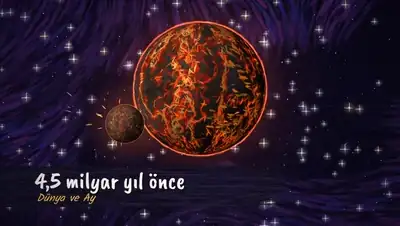</a><br><a href="https://www.sandbase.ai/lab/ai-videos/opus-5-5/2103386522510573967?lang=zh-CN&utm_source=github&utm_medium=readme&utm_campaign=awesome-opus-5.5&utm_content=card"><b>纯 Canvas 2D 绘制的宇宙演化历史动画</b></a><br><sub><a href="https://x.com/AIMevzulari/status/2103386522510573967">@AIMevzulari</a> · 0:50</sub></td><td width="33%" valign="top"><a href="https://www.sandbase.ai/lab/media/x/opus-5-5/2103411244468498547/video.mp4"></a><br><a href="https://www.sandbase.ai/lab/ai-videos/opus-5-5/2103411244468498547?lang=zh-CN&utm_source=github&utm_medium=readme&utm_campaign=awesome-opus-5.5&utm_content=card"><b>纯代码生成的动态设计作品</b></a><br><sub><a href="https://x.com/techhalla/status/2103411244468498547">@techhalla</a> · 0:20 · <a href="https://www.sandbase.ai/lab/ai-videos/opus-5-5/2103411244468498547?lang=zh-CN&utm_source=github&utm_medium=readme&utm_campaign=awesome-opus-5.5&utm_content=card">提示词</a></sub></td></tr>
<tr><td width="33%" valign="top"><a href="https://www.sandbase.ai/lab/media/x/opus-5-5/2103437700783038710/video.mp4"></a><br><a href="https://www.sandbase.ai/lab/ai-videos/opus-5-5/2103437700783038710?lang=zh-CN&utm_source=github&utm_medium=readme&utm_campaign=awesome-opus-5.5&utm_content=card"><b>设计机构介绍动态演示</b></a><br><sub><a href="https://x.com/baptistelcx/status/2103437700783038710">@baptistelcx</a> · 1:18</sub></td><td width="33%" valign="top"><a href="https://www.sandbase.ai/lab/media/x/opus-5-5/2103441222375268605/video.mp4"></a><br><a href="https://www.sandbase.ai/lab/ai-videos/opus-5-5/2103441222375268605?lang=zh-CN&utm_source=github&utm_medium=readme&utm_campaign=awesome-opus-5.5&utm_content=card"><b>测试 Claude Opus 的动画能力</b></a><br><sub><a href="https://x.com/tcballard/status/2103441222375268605">@tcballard</a> · 0:15 · <a href="https://www.sandbase.ai/lab/ai-videos/opus-5-5/2103441222375268605?lang=zh-CN&utm_source=github&utm_medium=readme&utm_campaign=awesome-opus-5.5&utm_content=card">提示词</a></sub></td><td width="33%" valign="top"><a href="https://www.sandbase.ai/lab/media/x/opus-5-5/2103449416325890146/video.mp4"></a><br><a href="https://www.sandbase.ai/lab/ai-videos/opus-5-5/2103449416325890146?lang=zh-CN&utm_source=github&utm_medium=readme&utm_campaign=awesome-opus-5.5&utm_content=card"><b>15秒动态图形设计师作品集展示</b></a><br><sub><a href="https://x.com/ajith_io/status/2103449416325890146">@ajith_io</a> · 0:15 · <a href="https://www.sandbase.ai/lab/ai-videos/opus-5-5/2103449416325890146?lang=zh-CN&utm_source=github&utm_medium=readme&utm_campaign=awesome-opus-5.5&utm_content=card">提示词</a></sub></td></tr>
<tr><td width="33%" valign="top"><a href="https://www.sandbase.ai/lab/media/x/opus-5-5/2103459971174130104/video.mp4"></a><br><a href="https://www.sandbase.ai/lab/ai-videos/opus-5-5/2103459971174130104?lang=zh-CN&utm_source=github&utm_medium=readme&utm_campaign=awesome-opus-5.5&utm_content=card"><b>单次提示词生成的Logo宣传视频</b></a><br><sub><a href="https://x.com/fire_ozgur/status/2103459971174130104">@fire_ozgur</a> · 0:15 · <a href="https://www.sandbase.ai/lab/ai-videos/opus-5-5/2103459971174130104?lang=zh-CN&utm_source=github&utm_medium=readme&utm_campaign=awesome-opus-5.5&utm_content=card">提示词</a></sub></td><td width="33%" valign="top"><a href="https://www.sandbase.ai/lab/media/x/opus-5-5/2103463886372696074/video.mp4">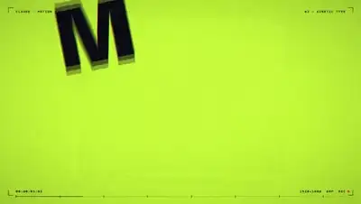</a><br><a href="https://www.sandbase.ai/lab/ai-videos/opus-5-5/2103463886372696074?lang=zh-CN&utm_source=github&utm_medium=readme&utm_campaign=awesome-opus-5.5&utm_content=card"><b>单一提示词生成的动态设计作品集</b></a><br><sub><a href="https://x.com/sudo_kiran/status/2103463886372696074">@sudo_kiran</a> · 0:15 · <a href="https://www.sandbase.ai/lab/ai-videos/opus-5-5/2103463886372696074?lang=zh-CN&utm_source=github&utm_medium=readme&utm_campaign=awesome-opus-5.5&utm_content=card">提示词</a></sub></td><td width="33%" valign="top"><a href="https://www.sandbase.ai/lab/media/x/opus-5-5/2103482164193165711/video.mp4"></a><br><a href="https://www.sandbase.ai/lab/ai-videos/opus-5-5/2103482164193165711?lang=zh-CN&utm_source=github&utm_medium=readme&utm_campaign=awesome-opus-5.5&utm_content=card"><b>带有钢琴配乐的 JavaScript 动画</b></a><br><sub><a href="https://x.com/kevin_t_ngo/status/2103482164193165711">@kevin_t_ngo</a> · 0:45</sub></td></tr>
<tr><td width="33%" valign="top"><a href="https://www.sandbase.ai/lab/media/x/opus-5-5/2103483957266268381/video.mp4"></a><br><a href="https://www.sandbase.ai/lab/ai-videos/opus-5-5/2103483957266268381?lang=zh-CN&utm_source=github&utm_medium=readme&utm_campaign=awesome-opus-5.5&utm_content=card"><b>纯代码生成的MakerMap产品动态演示</b></a><br><sub><a href="https://x.com/verbove/status/2103483957266268381">@verbove</a> · 0:20 · <a href="https://www.sandbase.ai/lab/ai-videos/opus-5-5/2103483957266268381?lang=zh-CN&utm_source=github&utm_medium=readme&utm_campaign=awesome-opus-5.5&utm_content=card">提示词</a></sub></td><td width="33%" valign="top"><a href="https://www.sandbase.ai/lab/media/x/opus-5-5/2103485566570369333/video.mp4"></a><br><a href="https://www.sandbase.ai/lab/ai-videos/opus-5-5/2103485566570369333?lang=zh-CN&utm_source=github&utm_medium=readme&utm_campaign=awesome-opus-5.5&utm_content=card"><b>Playwright渲染的多彩动画视频</b></a><br><sub><a href="https://x.com/__morse/status/2103485566570369333">@__morse</a> · 0:15</sub></td><td width="33%" valign="top"><a href="https://www.sandbase.ai/lab/media/x/opus-5-5/2103495232637882858/video.mp4"></a><br><a href="https://www.sandbase.ai/lab/ai-videos/opus-5-5/2103495232637882858?lang=zh-CN&utm_source=github&utm_medium=readme&utm_campaign=awesome-opus-5.5&utm_content=card"><b>单条提示词生成的动态设计作品秀</b></a><br><sub><a href="https://x.com/himanshutwtxs/status/2103495232637882858">@himanshutwtxs</a> · 0:15 · <a href="https://www.sandbase.ai/lab/ai-videos/opus-5-5/2103495232637882858?lang=zh-CN&utm_source=github&utm_medium=readme&utm_campaign=awesome-opus-5.5&utm_content=card">提示词</a></sub></td></tr>
<tr><td width="33%" valign="top"><a href="https://www.sandbase.ai/lab/media/x/opus-5-5/2103497319899693327/video.mp4"></a><br><a href="https://www.sandbase.ai/lab/ai-videos/opus-5-5/2103497319899693327?lang=zh-CN&utm_source=github&utm_medium=readme&utm_campaign=awesome-opus-5.5&utm_content=card"><b>纯代码逐帧渲染制作的PV视频</b></a><br><sub><a href="https://x.com/Majin_AppSheet/status/2103497319899693327">@Majin_AppSheet</a> · 0:10</sub></td><td width="33%" valign="top"><a href="https://www.sandbase.ai/lab/media/x/opus-5-5/2103505435802341449/video.mp4"></a><br><a href="https://www.sandbase.ai/lab/ai-videos/opus-5-5/2103505435802341449?lang=zh-CN&utm_source=github&utm_medium=readme&utm_campaign=awesome-opus-5.5&utm_content=card"><b>使用Opus 5.5制作的动态图形演示</b></a><br><sub><a href="https://x.com/YarHmm/status/2103505435802341449">@YarHmm</a> · 0:56</sub></td><td width="33%" valign="top"><a href="https://www.sandbase.ai/lab/media/x/opus-5-5/2103517930424332386/video.mp4"></a><br><a href="https://www.sandbase.ai/lab/ai-videos/opus-5-5/2103517930424332386?lang=zh-CN&utm_source=github&utm_medium=readme&utm_campaign=awesome-opus-5.5&utm_content=card"><b>Distilbook 动态图形宣传视频</b></a><br><sub><a href="https://x.com/itisRazak/status/2103517930424332386">@itisRazak</a> · 0:40 · <a href="https://www.sandbase.ai/lab/ai-videos/opus-5-5/2103517930424332386?lang=zh-CN&utm_source=github&utm_medium=readme&utm_campaign=awesome-opus-5.5&utm_content=card">提示词</a></sub></td></tr>
<tr><td width="33%" valign="top"><a href="https://www.sandbase.ai/lab/media/x/opus-5-5/2103530293634445592/video.mp4"></a><br><a href="https://www.sandbase.ai/lab/ai-videos/opus-5-5/2103530293634445592?lang=zh-CN&utm_source=github&utm_medium=readme&utm_campaign=awesome-opus-5.5&utm_content=card"><b>附带生成音频的单提示词动态设计测试</b></a><br><sub><a href="https://x.com/birdabo/status/2103530293634445592">@birdabo</a> · 0:15</sub></td><td width="33%" valign="top"><a href="https://www.sandbase.ai/lab/media/x/opus-5-5/2103530750767206626/video.mp4"></a><br><a href="https://www.sandbase.ai/lab/ai-videos/opus-5-5/2103530750767206626?lang=zh-CN&utm_source=github&utm_medium=readme&utm_campaign=awesome-opus-5.5&utm_content=card"><b>Claude Opus 完全用代码生成的视频</b></a><br><sub><a href="https://x.com/bridgemindai/status/2103530750767206626">@bridgemindai</a> · 1:00</sub></td><td width="33%" valign="top"><a href="https://www.sandbase.ai/lab/media/x/opus-5-5/2103538744695693512/video.mp4"></a><br><a href="https://www.sandbase.ai/lab/ai-videos/opus-5-5/2103538744695693512?lang=zh-CN&utm_source=github&utm_medium=readme&utm_campaign=awesome-opus-5.5&utm_content=card"><b>单提示词生成的动态设计与合成配乐</b></a><br><sub><a href="https://x.com/prasenx/status/2103538744695693512">@prasenx</a> · 0:15</sub></td></tr>
<tr><td width="33%" valign="top"><a href="https://www.sandbase.ai/lab/media/x/opus-5-5/2103552246927810680/video.mp4"></a><br><a href="https://www.sandbase.ai/lab/ai-videos/opus-5-5/2103552246927810680?lang=zh-CN&utm_source=github&utm_medium=readme&utm_campaign=awesome-opus-5.5&utm_content=card"><b>关于SWE 2的动态图形视频</b></a><br><sub><a href="https://x.com/notjazii/status/2103552246927810680">@notjazii</a> · 0:15</sub></td><td width="33%" valign="top"><a href="https://www.sandbase.ai/lab/media/x/opus-5-5/2103555549929566323/video.mp4"></a><br><a href="https://www.sandbase.ai/lab/ai-videos/opus-5-5/2103555549929566323?lang=zh-CN&utm_source=github&utm_medium=readme&utm_campaign=awesome-opus-5.5&utm_content=card"><b>复刻苹果精彩工具动态动画</b></a><br><sub><a href="https://x.com/DavidKPiano/status/2103555549929566323">@DavidKPiano</a> · 1:37</sub></td><td width="33%" valign="top"><a href="https://www.sandbase.ai/lab/media/x/opus-5-5/2103557735086428547/video.mp4">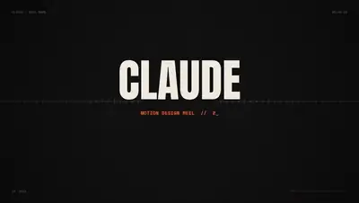</a><br><a href="https://www.sandbase.ai/lab/ai-videos/opus-5-5/2103557735086428547?lang=zh-CN&utm_source=github&utm_medium=readme&utm_campaign=awesome-opus-5.5&utm_content=card"><b>配有钢琴谱曲的动态设计演示</b></a><br><sub><a href="https://x.com/kloss_xyz/status/2103557735086428547">@kloss_xyz</a> · 1:30</sub></td></tr>
<tr><td width="33%" valign="top"><a href="https://www.sandbase.ai/lab/media/x/opus-5-5/2103576084499358051/video.mp4"></a><br><a href="https://www.sandbase.ai/lab/ai-videos/opus-5-5/2103576084499358051?lang=zh-CN&utm_source=github&utm_medium=readme&utm_campaign=awesome-opus-5.5&utm_content=card"><b>Opus 5.5单提示词生成的动效动画</b></a><br><sub><a href="https://x.com/leonabboud/status/2103576084499358051">@leonabboud</a> · 0:15 · <a href="https://www.sandbase.ai/lab/ai-videos/opus-5-5/2103576084499358051?lang=zh-CN&utm_source=github&utm_medium=readme&utm_campaign=awesome-opus-5.5&utm_content=card">提示词</a></sub></td><td width="33%" valign="top"><a href="https://www.sandbase.ai/lab/media/x/opus-5-5/2103638102333858193/video.mp4"></a><br><a href="https://www.sandbase.ai/lab/ai-videos/opus-5-5/2103638102333858193?lang=zh-CN&utm_source=github&utm_medium=readme&utm_campaign=awesome-opus-5.5&utm_content=card"><b>Opus 5.5单提示词生成的视频</b></a><br><sub><a href="https://x.com/kentcdodds/status/2103638102333858193">@kentcdodds</a> · 0:30 · <a href="https://www.sandbase.ai/lab/ai-videos/opus-5-5/2103638102333858193?lang=zh-CN&utm_source=github&utm_medium=readme&utm_campaign=awesome-opus-5.5&utm_content=card">提示词</a></sub></td><td width="33%" valign="top"><a href="https://www.sandbase.ai/lab/media/x/opus-5-5/2103663364958515541/video.mp4"></a><br><a href="https://www.sandbase.ai/lab/ai-videos/opus-5-5/2103663364958515541?lang=zh-CN&utm_source=github&utm_medium=readme&utm_campaign=awesome-opus-5.5&utm_content=card"><b>单提示词生成的动态图形作品集展示</b></a><br><sub><a href="https://x.com/jasonzhou1993/status/2103663364958515541">@jasonzhou1993</a> · 0:15 · <a href="https://www.sandbase.ai/lab/ai-videos/opus-5-5/2103663364958515541?lang=zh-CN&utm_source=github&utm_medium=readme&utm_campaign=awesome-opus-5.5&utm_content=card">提示词</a></sub></td></tr>
<tr><td width="33%" valign="top"><a href="https://www.sandbase.ai/lab/media/x/opus-5-5/2103697580421181894/video.mp4"></a><br><a href="https://www.sandbase.ai/lab/ai-videos/opus-5-5/2103697580421181894?lang=zh-CN&utm_source=github&utm_medium=readme&utm_campaign=awesome-opus-5.5&utm_content=card"><b>线性代数主题歌曲音乐视频</b></a><br><sub><a href="https://x.com/doubleunplussed/status/2103697580421181894">@doubleunplussed</a> · 4:22 · <a href="https://www.sandbase.ai/lab/ai-videos/opus-5-5/2103697580421181894?lang=zh-CN&utm_source=github&utm_medium=readme&utm_campaign=awesome-opus-5.5&utm_content=card">提示词</a></sub></td><td width="33%" valign="top"><a href="https://www.sandbase.ai/lab/media/x/opus-5-5/2103704250329301409/video.mp4"></a><br><a href="https://www.sandbase.ai/lab/ai-videos/opus-5-5/2103704250329301409?lang=zh-CN&utm_source=github&utm_medium=readme&utm_campaign=awesome-opus-5.5&utm_content=card"><b>TypingMind 标志缓慢显现转场动画</b></a><br><sub><a href="https://x.com/tdinh_me/status/2103704250329301409">@tdinh_me</a> · 0:21 · <a href="https://www.sandbase.ai/lab/ai-videos/opus-5-5/2103704250329301409?lang=zh-CN&utm_source=github&utm_medium=readme&utm_campaign=awesome-opus-5.5&utm_content=card">提示词</a></sub></td><td width="33%" valign="top"><a href="https://www.sandbase.ai/lab/media/x/opus-5-5/2103714680577638493/video.mp4">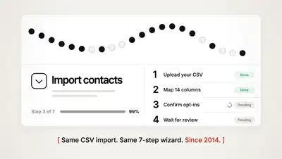</a><br><a href="https://www.sandbase.ai/lab/ai-videos/opus-5-5/2103714680577638493?lang=zh-CN&utm_source=github&utm_medium=readme&utm_campaign=awesome-opus-5.5&utm_content=card"><b>Lumail动态设计展示视频</b></a><br><sub><a href="https://x.com/melvynx/status/2103714680577638493">@melvynx</a> · 0:45 · <a href="https://www.sandbase.ai/lab/ai-videos/opus-5-5/2103714680577638493?lang=zh-CN&utm_source=github&utm_medium=readme&utm_campaign=awesome-opus-5.5&utm_content=card">提示词</a></sub></td></tr>
<tr><td width="33%" valign="top"><a href="https://www.sandbase.ai/lab/media/x/opus-5-5/2103723183899852885/video.mp4"></a><br><a href="https://www.sandbase.ai/lab/ai-videos/opus-5-5/2103723183899852885?lang=zh-CN&utm_source=github&utm_medium=readme&utm_campaign=awesome-opus-5.5&utm_content=card"><b>用Claude Opus 5.5生成的动态视频</b></a><br><sub><a href="https://x.com/ann_nnng/status/2103723183899852885">@ann_nnng</a> · 0:15</sub></td><td width="33%" valign="top"><a href="https://www.sandbase.ai/lab/media/x/opus-5-5/2103757371357229129/video.mp4"></a><br><a href="https://www.sandbase.ai/lab/ai-videos/opus-5-5/2103757371357229129?lang=zh-CN&utm_source=github&utm_medium=readme&utm_campaign=awesome-opus-5.5&utm_content=card"><b>同款提示词生成的10秒动态视频</b></a><br><sub><a href="https://x.com/mattiapomelli/status/2103757371357229129">@mattiapomelli</a> · 0:10</sub></td><td width="33%" valign="top"><a href="https://www.sandbase.ai/lab/media/x/opus-5-5/2103816261339910269/video.mp4"></a><br><a href="https://www.sandbase.ai/lab/ai-videos/opus-5-5/2103816261339910269?lang=zh-CN&utm_source=github&utm_medium=readme&utm_campaign=awesome-opus-5.5&utm_content=card"><b>将网站吉祥物融入的视频动画</b></a><br><sub><a href="https://x.com/gouthamjay8/status/2103816261339910269">@gouthamjay8</a> · 0:55 · <a href="https://www.sandbase.ai/lab/ai-videos/opus-5-5/2103816261339910269?lang=zh-CN&utm_source=github&utm_medium=readme&utm_campaign=awesome-opus-5.5&utm_content=card">提示词</a></sub></td></tr>
<tr><td width="33%" valign="top"><a href="https://www.sandbase.ai/lab/media/x/opus-5-5/2103829638799618407/video.mp4"></a><br><a href="https://www.sandbase.ai/lab/ai-videos/opus-5-5/2103829638799618407?lang=zh-CN&utm_source=github&utm_medium=readme&utm_campaign=awesome-opus-5.5&utm_content=card"><b>Opus 5.5在Claude Code中制作的动效</b></a><br><sub><a href="https://x.com/vikktorrrre/status/2103829638799618407">@vikktorrrre</a> · 0:26</sub></td><td width="33%" valign="top"><a href="https://www.sandbase.ai/lab/media/x/opus-5-5/2103837519615774895/video.mp4"></a><br><a href="https://www.sandbase.ai/lab/ai-videos/opus-5-5/2103837519615774895?lang=zh-CN&utm_source=github&utm_medium=readme&utm_campaign=awesome-opus-5.5&utm_content=card"><b>全代码实时生成的音画交互实验</b></a><br><sub><a href="https://x.com/MiaAI_lab/status/2103837519615774895">@MiaAI_lab</a> · 1:37 · <a href="https://www.sandbase.ai/lab/ai-videos/opus-5-5/2103837519615774895?lang=zh-CN&utm_source=github&utm_medium=readme&utm_campaign=awesome-opus-5.5&utm_content=card">提示词</a></sub></td><td width="33%" valign="top"><a href="https://www.sandbase.ai/lab/media/x/opus-5-5/2103845264649761062/video.mp4"></a><br><a href="https://www.sandbase.ai/lab/ai-videos/opus-5-5/2103845264649761062?lang=zh-CN&utm_source=github&utm_medium=readme&utm_campaign=awesome-opus-5.5&utm_content=card"><b>网站动态图形介绍展示视频</b></a><br><sub><a href="https://x.com/HO_BA/status/2103845264649761062">@HO_BA</a> · 0:30 · <a href="https://www.sandbase.ai/lab/ai-videos/opus-5-5/2103845264649761062?lang=zh-CN&utm_source=github&utm_medium=readme&utm_campaign=awesome-opus-5.5&utm_content=card">提示词</a></sub></td></tr>
<tr><td width="33%" valign="top"><a href="https://www.sandbase.ai/lab/media/x/opus-5-5/2104013515623170390/video.mp4"></a><br><a href="https://www.sandbase.ai/lab/ai-videos/opus-5-5/2104013515623170390?lang=zh-CN&utm_source=github&utm_medium=readme&utm_campaign=awesome-opus-5.5&utm_content=card"><b>为ClimbX制作的动态设计视频</b></a><br><sub><a href="https://x.com/DanielSmidstrup/status/2104013515623170390">@DanielSmidstrup</a> · 0:30</sub></td><td width="33%" valign="top"><a href="https://www.sandbase.ai/lab/media/x/opus-5-5/2104085484347818226/video.mp4"></a><br><a href="https://www.sandbase.ai/lab/ai-videos/opus-5-5/2104085484347818226?lang=zh-CN&utm_source=github&utm_medium=readme&utm_campaign=awesome-opus-5.5&utm_content=card"><b>游戏结算与抽卡动态效果演示</b></a><br><sub><a href="https://x.com/op7418/status/2104085484347818226">@op7418</a> · 0:18 · <a href="https://www.sandbase.ai/lab/ai-videos/opus-5-5/2104085484347818226?lang=zh-CN&utm_source=github&utm_medium=readme&utm_campaign=awesome-opus-5.5&utm_content=card">提示词</a></sub></td><td width="33%" valign="top"><a href="https://www.sandbase.ai/lab/media/x/opus-5-5/2104163769224204376/video.mp4"></a><br><a href="https://www.sandbase.ai/lab/ai-videos/opus-5-5/2104163769224204376?lang=zh-CN&utm_source=github&utm_medium=readme&utm_campaign=awesome-opus-5.5&utm_content=card"><b>由Opus 5.5在二十分钟内生成的视频</b></a><br><sub><a href="https://x.com/goatfishxyz/status/2104163769224204376">@goatfishxyz</a> · 0:30</sub></td></tr>
<tr><td width="33%" valign="top"><a href="https://www.sandbase.ai/lab/media/x/opus-5-5/2104168778112110764/video.mp4"></a><br><a href="https://www.sandbase.ai/lab/ai-videos/opus-5-5/2104168778112110764?lang=zh-CN&utm_source=github&utm_medium=readme&utm_campaign=awesome-opus-5.5&utm_content=card"><b>Opus 5.5单提示词生成项目展示</b></a><br><sub><a href="https://x.com/javiiarchive/status/2104168778112110764">@javiiarchive</a> · 0:14</sub></td><td width="33%" valign="top"><a href="https://www.sandbase.ai/lab/media/x/opus-5-5/2104194783178785203/video.mp4">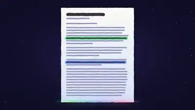</a><br><a href="https://www.sandbase.ai/lab/ai-videos/opus-5-5/2104194783178785203?lang=zh-CN&utm_source=github&utm_medium=readme&utm_campaign=awesome-opus-5.5&utm_content=card"><b>动态产品演示动态设计作品集</b></a><br><sub><a href="https://x.com/sudo_kiran/status/2104194783178785203">@sudo_kiran</a> · 0:30 · <a href="https://www.sandbase.ai/lab/ai-videos/opus-5-5/2104194783178785203?lang=zh-CN&utm_source=github&utm_medium=readme&utm_campaign=awesome-opus-5.5&utm_content=card">提示词</a></sub></td><td width="33%" valign="top"><a href="https://www.sandbase.ai/lab/media/x/opus-5-5/2104401208958230764/video.mp4"></a><br><a href="https://www.sandbase.ai/lab/ai-videos/opus-5-5/2104401208958230764?lang=zh-CN&utm_source=github&utm_medium=readme&utm_campaign=awesome-opus-5.5&utm_content=card"><b>使用Opus 5.5重制的品牌动效视频</b></a><br><sub><a href="https://x.com/notdwd/status/2104401208958230764">@notdwd</a> · 0:12 · <a href="https://www.sandbase.ai/lab/ai-videos/opus-5-5/2104401208958230764?lang=zh-CN&utm_source=github&utm_medium=readme&utm_campaign=awesome-opus-5.5&utm_content=card">提示词</a></sub></td></tr>
<tr><td width="33%" valign="top"><a href="https://www.sandbase.ai/lab/media/x/opus-5-5/2104525735713206557/video.mp4"></a><br><a href="https://www.sandbase.ai/lab/ai-videos/opus-5-5/2104525735713206557?lang=zh-CN&utm_source=github&utm_medium=readme&utm_campaign=awesome-opus-5.5&utm_content=card"><b>完全用代码生成的完整视频</b></a><br><sub><a href="https://x.com/pratyushrungta/status/2104525735713206557">@pratyushrungta</a> · 3:30</sub></td><td width="33%" valign="top"><a href="https://www.sandbase.ai/lab/media/x/opus-5-5/2104590706216206442/video.mp4"></a><br><a href="https://www.sandbase.ai/lab/ai-videos/opus-5-5/2104590706216206442?lang=zh-CN&utm_source=github&utm_medium=readme&utm_campaign=awesome-opus-5.5&utm_content=card"><b>ListMySaaS产品动画</b></a><br><sub><a href="https://x.com/s_chiriac/status/2104590706216206442">@s_chiriac</a> · 0:30</sub></td><td width="33%" valign="top"><a href="https://www.sandbase.ai/lab/media/x/opus-5-5/2104728379798827135/video.mp4"></a><br><a href="https://www.sandbase.ai/lab/ai-videos/opus-5-5/2104728379798827135?lang=zh-CN&utm_source=github&utm_medium=readme&utm_campaign=awesome-opus-5.5&utm_content=card"><b>使用 Hyperframes 单提示词生成的视频</b></a><br><sub><a href="https://x.com/leandroriviello/status/2104728379798827135">@leandroriviello</a> · 0:14</sub></td></tr>
<tr><td width="33%" valign="top"><a href="https://www.sandbase.ai/lab/media/x/opus-5-5/2104965415164399895/video.mp4"></a><br><a href="https://www.sandbase.ai/lab/ai-videos/opus-5-5/2104965415164399895?lang=zh-CN&utm_source=github&utm_medium=readme&utm_campaign=awesome-opus-5.5&utm_content=card"><b>用于生成高质量动效视频的提示词模板</b></a><br><sub><a href="https://x.com/everestchris6/status/2104965415164399895">@everestchris6</a> · 0:40 · <a href="https://www.sandbase.ai/lab/ai-videos/opus-5-5/2104965415164399895?lang=zh-CN&utm_source=github&utm_medium=readme&utm_campaign=awesome-opus-5.5&utm_content=card">提示词</a></sub></td><td width="33%" valign="top"><a href="https://www.sandbase.ai/lab/media/x/opus-5-5/2105270766996701686/video.mp4"></a><br><a href="https://www.sandbase.ai/lab/ai-videos/opus-5-5/2105270766996701686?lang=zh-CN&utm_source=github&utm_medium=readme&utm_campaign=awesome-opus-5.5&utm_content=card"><b>纯代码生成的动态设计视频</b></a><br><sub><a href="https://x.com/johncodunayo/status/2105270766996701686">@johncodunayo</a> · 0:24 · <a href="https://www.sandbase.ai/lab/ai-videos/opus-5-5/2105270766996701686?lang=zh-CN&utm_source=github&utm_medium=readme&utm_campaign=awesome-opus-5.5&utm_content=card">提示词</a></sub></td><td width="33%" valign="top"><a href="https://www.sandbase.ai/lab/media/x/opus-5-5/2105414480910069765/video.mp4"></a><br><a href="https://www.sandbase.ai/lab/ai-videos/opus-5-5/2105414480910069765?lang=zh-CN&utm_source=github&utm_medium=readme&utm_campaign=awesome-opus-5.5&utm_content=card"><b>浏览器插件产品动态展示视频</b></a><br><sub><a href="https://x.com/allodev/status/2105414480910069765">@allodev</a> · 0:25</sub></td></tr>
<tr><td width="33%" valign="top"><a href="https://www.sandbase.ai/lab/media/x/opus-5-5/2105580875299836388/video.mp4"></a><br><a href="https://www.sandbase.ai/lab/ai-videos/opus-5-5/2105580875299836388?lang=zh-CN&utm_source=github&utm_medium=readme&utm_campaign=awesome-opus-5.5&utm_content=card"><b>高细节动态设计作品演示</b></a><br><sub><a href="https://x.com/charliejhills/status/2105580875299836388">@charliejhills</a> · 0:57</sub></td><td width="33%" valign="top"><a href="https://www.sandbase.ai/lab/media/x/opus-5-5/2105814099833823497/video.mp4"></a><br><a href="https://www.sandbase.ai/lab/ai-videos/opus-5-5/2105814099833823497?lang=zh-CN&utm_source=github&utm_medium=readme&utm_campaign=awesome-opus-5.5&utm_content=card"><b>基于Canvas实现的角色动画与配音演示</b></a><br><sub><a href="https://x.com/eternityspring/status/2105814099833823497">@eternityspring</a> · 0:09</sub></td><td width="33%" valign="top"><a href="https://www.sandbase.ai/lab/media/x/opus-5-5/2105927781678747965/video.mp4"></a><br><a href="https://www.sandbase.ai/lab/ai-videos/opus-5-5/2105927781678747965?lang=zh-CN&utm_source=github&utm_medium=readme&utm_campaign=awesome-opus-5.5&utm_content=card"><b>纯代码生成的动态变形转场</b></a><br><sub><a href="https://x.com/twoclipping/status/2105927781678747965">@twoclipping</a> · 0:24 · <a href="https://www.sandbase.ai/lab/ai-videos/opus-5-5/2105927781678747965?lang=zh-CN&utm_source=github&utm_medium=readme&utm_campaign=awesome-opus-5.5&utm_content=card">提示词</a></sub></td></tr>
<tr><td width="33%" valign="top"><a href="https://www.sandbase.ai/lab/media/x/opus-5-5/2106027834217259394/video.mp4"></a><br><a href="https://www.sandbase.ai/lab/ai-videos/opus-5-5/2106027834217259394?lang=zh-CN&utm_source=github&utm_medium=readme&utm_campaign=awesome-opus-5.5&utm_content=card"><b>基于单条提示词与配乐生成的动画演示</b></a><br><sub><a href="https://x.com/minchoi/status/2106027834217259394">@minchoi</a> · 4:30</sub></td><td width="33%" valign="top"><a href="https://www.sandbase.ai/lab/media/x/opus-5-5/2106078367833591915/video.mp4"></a><br><a href="https://www.sandbase.ai/lab/ai-videos/opus-5-5/2106078367833591915?lang=zh-CN&utm_source=github&utm_medium=readme&utm_campaign=awesome-opus-5.5&utm_content=card"><b>带有声音设计的GrokBot动态动画</b></a><br><sub><a href="https://x.com/0xMovez/status/2106078367833591915">@0xMovez</a> · 2:12</sub></td><td width="33%" valign="top"><a href="https://www.sandbase.ai/lab/media/x/opus-5-5/2106140092750536984/video.mp4"></a><br><a href="https://www.sandbase.ai/lab/ai-videos/opus-5-5/2106140092750536984?lang=zh-CN&utm_source=github&utm_medium=readme&utm_campaign=awesome-opus-5.5&utm_content=card"><b>动态视频效果对比重制</b></a><br><sub><a href="https://x.com/notdwd/status/2106140092750536984">@notdwd</a> · 0:20 · <a href="https://www.sandbase.ai/lab/ai-videos/opus-5-5/2106140092750536984?lang=zh-CN&utm_source=github&utm_medium=readme&utm_campaign=awesome-opus-5.5&utm_content=card">提示词</a></sub></td></tr>
<tr><td width="33%" valign="top"><a href="https://www.sandbase.ai/lab/media/x/opus-5-5/2106323424473907257/video.mp4"></a><br><a href="https://www.sandbase.ai/lab/ai-videos/opus-5-5/2106323424473907257?lang=zh-CN&utm_source=github&utm_medium=readme&utm_campaign=awesome-opus-5.5&utm_content=card"><b>单次生成的网页动态图形测试</b></a><br><sub><a href="https://x.com/ItsmeAjayKV/status/2106323424473907257">@ItsmeAjayKV</a> · 0:25</sub></td><td width="33%" valign="top"><a href="https://www.sandbase.ai/lab/media/x/opus-5-5/2106395987996536913/video.mp4"></a><br><a href="https://www.sandbase.ai/lab/ai-videos/opus-5-5/2106395987996536913?lang=zh-CN&utm_source=github&utm_medium=readme&utm_campaign=awesome-opus-5.5&utm_content=card"><b>多工具协作的 AI 音乐与动态图形制作</b></a><br><sub><a href="https://x.com/maxescu/status/2106395987996536913">@maxescu</a> · 3:20</sub></td><td width="33%" valign="top"><a href="https://www.sandbase.ai/lab/media/x/opus-5-5/2107139305324122491/video.mp4"></a><br><a href="https://www.sandbase.ai/lab/ai-videos/opus-5-5/2107139305324122491?lang=zh-CN&utm_source=github&utm_medium=readme&utm_campaign=awesome-opus-5.5&utm_content=card"><b>Claude自主生成的动态展示视频</b></a><br><sub><a href="https://x.com/HBCoop_/status/2107139305324122491">@HBCoop_</a> · 0:29 · <a href="https://www.sandbase.ai/lab/ai-videos/opus-5-5/2107139305324122491?lang=zh-CN&utm_source=github&utm_medium=readme&utm_campaign=awesome-opus-5.5&utm_content=card">提示词</a></sub></td></tr>
<tr><td width="33%" valign="top"><a href="https://www.sandbase.ai/lab/media/x/opus-5-5/2107476975812296741/video.mp4"></a><br><a href="https://www.sandbase.ai/lab/ai-videos/opus-5-5/2107476975812296741?lang=zh-CN&utm_source=github&utm_medium=readme&utm_campaign=awesome-opus-5.5&utm_content=card"><b>与 AI 协同编辑的动态设计</b></a><br><sub><a href="https://x.com/johncodunayo/status/2107476975812296741">@johncodunayo</a> · 0:33</sub></td><td width="33%" valign="top"><a href="https://www.sandbase.ai/lab/media/x/opus-5-5/2107488996490166538/video.mp4"></a><br><a href="https://www.sandbase.ai/lab/ai-videos/opus-5-5/2107488996490166538?lang=zh-CN&utm_source=github&utm_medium=readme&utm_campaign=awesome-opus-5.5&utm_content=card"><b>Claude 的假期休假动画</b></a><br><sub><a href="https://x.com/ishuagra02/status/2107488996490166538">@ishuagra02</a> · 1:09</sub></td><td width="33%" valign="top"><a href="https://www.sandbase.ai/lab/media/x/opus-5-5/2107653056771068069/video.mp4"></a><br><a href="https://www.sandbase.ai/lab/ai-videos/opus-5-5/2107653056771068069?lang=zh-CN&utm_source=github&utm_medium=readme&utm_campaign=awesome-opus-5.5&utm_content=card"><b>代码渲染知识动画全套提示词</b></a><br><sub><a href="https://x.com/NFT_Chen/status/2107653056771068069">@NFT_Chen</a> · 2:51 · <a href="https://www.sandbase.ai/lab/ai-videos/opus-5-5/2107653056771068069?lang=zh-CN&utm_source=github&utm_medium=readme&utm_campaign=awesome-opus-5.5&utm_content=card">提示词</a></sub></td></tr>
<tr><td width="33%" valign="top"><a href="https://www.sandbase.ai/lab/media/x/opus-5-5/2108199183983497433/video.mp4"></a><br><a href="https://www.sandbase.ai/lab/ai-videos/opus-5-5/2108199183983497433?lang=zh-CN&utm_source=github&utm_medium=readme&utm_campaign=awesome-opus-5.5&utm_content=card"><b>关于Opus与Haiku的动态设计故事短片</b></a><br><sub><a href="https://x.com/kelanoo/status/2108199183983497433">@kelanoo</a> · 0:20 · <a href="https://www.sandbase.ai/lab/ai-videos/opus-5-5/2108199183983497433?lang=zh-CN&utm_source=github&utm_medium=readme&utm_campaign=awesome-opus-5.5&utm_content=card">提示词</a></sub></td><td width="33%" valign="top"><a href="https://www.sandbase.ai/lab/media/x/opus-5-5/2108520767092597182/video.mp4"></a><br><a href="https://www.sandbase.ai/lab/ai-videos/opus-5-5/2108520767092597182?lang=zh-CN&utm_source=github&utm_medium=readme&utm_campaign=awesome-opus-5.5&utm_content=card"><b>Claude 模型生成的三个代码动画演示</b></a><br><sub><a href="https://x.com/N01ennn/status/2108520767092597182">@N01ennn</a> · 0:53 · <a href="https://www.sandbase.ai/lab/ai-videos/opus-5-5/2108520767092597182?lang=zh-CN&utm_source=github&utm_medium=readme&utm_campaign=awesome-opus-5.5&utm_content=card">提示词</a></sub></td><td width="33%" valign="top"><a href="https://www.sandbase.ai/lab/media/x/opus-5-5/2108570705692357094/video.mp4"></a><br><a href="https://www.sandbase.ai/lab/ai-videos/opus-5-5/2108570705692357094?lang=zh-CN&utm_source=github&utm_medium=readme&utm_campaign=awesome-opus-5.5&utm_content=card"><b>橙色圆点演变的动态图形系统</b></a><br><sub><a href="https://x.com/rossaxbt/status/2108570705692357094">@rossaxbt</a> · 0:15 · <a href="https://www.sandbase.ai/lab/ai-videos/opus-5-5/2108570705692357094?lang=zh-CN&utm_source=github&utm_medium=readme&utm_campaign=awesome-opus-5.5&utm_content=card">提示词</a></sub></td></tr>
<tr><td width="33%" valign="top"><a href="https://www.sandbase.ai/lab/media/x/opus-5-5/2108865799674876154/video.mp4"></a><br><a href="https://www.sandbase.ai/lab/ai-videos/opus-5-5/2108865799674876154?lang=zh-CN&utm_source=github&utm_medium=readme&utm_campaign=awesome-opus-5.5&utm_content=card"><b>包含600多个部件的A380动态SVG模型</b></a><br><sub><a href="https://x.com/chazza/status/2108865799674876154">@chazza</a> · 1:47</sub></td><td width="33%" valign="top"><a href="https://www.sandbase.ai/lab/media/x/opus-5-5/2108926571021279560/video.mp4"></a><br><a href="https://www.sandbase.ai/lab/ai-videos/opus-5-5/2108926571021279560?lang=zh-CN&utm_source=github&utm_medium=readme&utm_campaign=awesome-opus-5.5&utm_content=card"><b>WebGL墨水晕染品牌动效工具</b></a><br><sub><a href="https://x.com/ann_nnng/status/2108926571021279560">@ann_nnng</a> · 0:17</sub></td><td width="33%" valign="top"><a href="https://www.sandbase.ai/lab/media/x/opus-5-5/2108935657334702300/video.mp4"></a><br><a href="https://www.sandbase.ai/lab/ai-videos/opus-5-5/2108935657334702300?lang=zh-CN&utm_source=github&utm_medium=readme&utm_campaign=awesome-opus-5.5&utm_content=card"><b>由橙色圆点构建的二维动效设计</b></a><br><sub><a href="https://x.com/ultimaxbt/status/2108935657334702300">@ultimaxbt</a> · 0:15 · <a href="https://www.sandbase.ai/lab/ai-videos/opus-5-5/2108935657334702300?lang=zh-CN&utm_source=github&utm_medium=readme&utm_campaign=awesome-opus-5.5&utm_content=card">提示词</a></sub></td></tr>
<tr><td width="33%" valign="top"><a href="https://www.sandbase.ai/lab/media/x/opus-5-5/2108949263187079574/video.mp4"></a><br><a href="https://www.sandbase.ai/lab/ai-videos/opus-5-5/2108949263187079574?lang=zh-CN&utm_source=github&utm_medium=readme&utm_campaign=awesome-opus-5.5&utm_content=card"><b>利用Opus 5.5纯代码生成的氛围感影片</b></a><br><sub><a href="https://x.com/sarpstar/status/2108949263187079574">@sarpstar</a> · 3:34</sub></td><td width="33%" valign="top"><a href="https://www.sandbase.ai/lab/media/x/opus-5-5/2108953385189732416/video.mp4"></a><br><a href="https://www.sandbase.ai/lab/ai-videos/opus-5-5/2108953385189732416?lang=zh-CN&utm_source=github&utm_medium=readme&utm_campaign=awesome-opus-5.5&utm_content=card"><b>包含多种动画技巧的动态设计工作流指南</b></a><br><sub><a href="https://x.com/beamnxw/status/2108953385189732416">@beamnxw</a> · 0:20</sub></td><td width="33%" valign="top"><a href="https://www.sandbase.ai/lab/media/x/opus-5-5/2109082358091792711/video.mp4">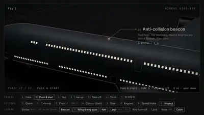</a><br><a href="https://www.sandbase.ai/lab/ai-videos/opus-5-5/2109082358091792711?lang=zh-CN&utm_source=github&utm_medium=readme&utm_campaign=awesome-opus-5.5&utm_content=card"><b>十分钟生成的动态图形动画</b></a><br><sub><a href="https://x.com/motion_so/status/2109082358091792711">@motion_so</a> · 0:56</sub></td></tr>
<tr><td width="33%" valign="top"><a href="https://www.sandbase.ai/lab/media/x/opus-5-5/2109230605908975962/video.mp4">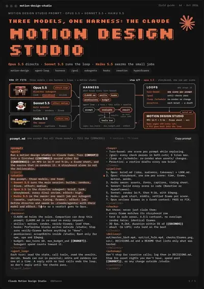</a><br><a href="https://www.sandbase.ai/lab/ai-videos/opus-5-5/2109230605908975962?lang=zh-CN&utm_source=github&utm_medium=readme&utm_campaign=awesome-opus-5.5&utm_content=card"><b>多模型循环驱动的动态设计工作流</b></a><br><sub><a href="https://x.com/N01ennn/status/2109230605908975962">@N01ennn</a> · 0:24</sub></td><td width="33%" valign="top"><a href="https://www.sandbase.ai/lab/media/x/opus-5-5/2109290983896818132/video.mp4"></a><br><a href="https://www.sandbase.ai/lab/ai-videos/opus-5-5/2109290983896818132?lang=zh-CN&utm_source=github&utm_medium=readme&utm_campaign=awesome-opus-5.5&utm_content=card"><b>基于 Claude Next 完全通过代码生成的动画</b></a><br><sub><a href="https://x.com/chetaslua/status/2109290983896818132">@chetaslua</a> · 0:22</sub></td><td width="33%" valign="top"><a href="https://www.sandbase.ai/lab/media/x/opus-5-5/2109345018490053100/video.mp4"></a><br><a href="https://www.sandbase.ai/lab/ai-videos/opus-5-5/2109345018490053100?lang=zh-CN&utm_source=github&utm_medium=readme&utm_campaign=awesome-opus-5.5&utm_content=card"><b>人类消失后的概念视觉动画</b></a><br><sub><a href="https://x.com/Mr_Salio/status/2109345018490053100">@Mr_Salio</a> · 0:56 · <a href="https://www.sandbase.ai/lab/ai-videos/opus-5-5/2109345018490053100?lang=zh-CN&utm_source=github&utm_medium=readme&utm_campaign=awesome-opus-5.5&utm_content=card">提示词</a></sub></td></tr>
<tr><td width="33%" valign="top"><a href="https://www.sandbase.ai/lab/media/x/opus-5-5/2109690569563746755/video.mp4"></a><br><a href="https://www.sandbase.ai/lab/ai-videos/opus-5-5/2109690569563746755?lang=zh-CN&utm_source=github&utm_medium=readme&utm_campaign=awesome-opus-5.5&utm_content=card"><b>通过代码生成的35种艺术风格动画</b></a><br><sub><a href="https://x.com/Voxyz_ai/status/2109690569563746755">@Voxyz_ai</a> · 0:41</sub></td><td width="33%" valign="top"><a href="https://www.sandbase.ai/lab/media/x/opus-5-5/2110013871532490973/video.mp4"></a><br><a href="https://www.sandbase.ai/lab/ai-videos/opus-5-5/2110013871532490973?lang=zh-CN&utm_source=github&utm_medium=readme&utm_campaign=awesome-opus-5.5&utm_content=card"><b>AI产品动态视频设计展示</b></a><br><sub><a href="https://x.com/LexnLin/status/2110013871532490973">@LexnLin</a> · 0:40</sub></td><td width="33%" valign="top"><a href="https://www.sandbase.ai/lab/media/x/opus-5-5/2110119492076404869/video.mp4"></a><br><a href="https://www.sandbase.ai/lab/ai-videos/opus-5-5/2110119492076404869?lang=zh-CN&utm_source=github&utm_medium=readme&utm_campaign=awesome-opus-5.5&utm_content=card"><b>代码配乐剪辑的动漫片头视频</b></a><br><sub><a href="https://x.com/aimikoda/status/2110119492076404869">@aimikoda</a> · 0:32 · <a href="https://www.sandbase.ai/lab/ai-videos/opus-5-5/2110119492076404869?lang=zh-CN&utm_source=github&utm_medium=readme&utm_campaign=awesome-opus-5.5&utm_content=card">提示词</a></sub></td></tr>
<tr><td width="33%" valign="top"><a href="https://www.sandbase.ai/lab/media/x/opus-5-5/2110131745094029472/video.mp4"></a><br><a href="https://www.sandbase.ai/lab/ai-videos/opus-5-5/2110131745094029472?lang=zh-CN&utm_source=github&utm_medium=readme&utm_campaign=awesome-opus-5.5&utm_content=card"><b>Mac菜单栏中的公寓视频展示</b></a><br><sub><a href="https://x.com/0xProbabillity/status/2110131745094029472">@0xProbabillity</a> · 0:49</sub></td><td width="33%" valign="top"><a href="https://www.sandbase.ai/lab/media/x/opus-5-5/2110394800411185404/video.mp4"></a><br><a href="https://www.sandbase.ai/lab/ai-videos/opus-5-5/2110394800411185404?lang=zh-CN&utm_source=github&utm_medium=readme&utm_campaign=awesome-opus-5.5&utm_content=card"><b>AE快剪动态设计测试对比</b></a><br><sub><a href="https://x.com/AmirMushich/status/2110394800411185404">@AmirMushich</a> · 0:16</sub></td><td width="33%" valign="top"><a href="https://www.sandbase.ai/lab/media/x/opus-5-5/2110770664101527568/video.mp4"></a><br><a href="https://www.sandbase.ai/lab/ai-videos/opus-5-5/2110770664101527568?lang=zh-CN&utm_source=github&utm_medium=readme&utm_campaign=awesome-opus-5.5&utm_content=card"><b>无关键帧的键盘打字动效</b></a><br><sub><a href="https://x.com/seeconvm/status/2110770664101527568">@seeconvm</a> · 0:12</sub></td></tr>
<tr><td width="33%" valign="top"><a href="https://www.sandbase.ai/lab/media/x/opus-5-5/2111024434958275063/video.mp4"></a><br><a href="https://www.sandbase.ai/lab/ai-videos/opus-5-5/2111024434958275063?lang=zh-CN&utm_source=github&utm_medium=readme&utm_campaign=awesome-opus-5.5&utm_content=card"><b>DeepSeek v4.1 Flash 配合 OpenDesign Motion 演示</b></a><br><sub><a href="https://x.com/OpenDesignHQ/status/2111024434958275063">@OpenDesignHQ</a> · 0:16</sub></td><td width="33%" valign="top"><a href="https://www.sandbase.ai/lab/media/x/opus-5-5/2111925755215040779/video.mp4"></a><br><a href="https://www.sandbase.ai/lab/ai-videos/opus-5-5/2111925755215040779?lang=zh-CN&utm_source=github&utm_medium=readme&utm_campaign=awesome-opus-5.5&utm_content=card"><b>自动化视频剪辑与3D场景动画</b></a><br><sub><a href="https://x.com/rileybrown/status/2111925755215040779">@rileybrown</a> · 1:37</sub></td><td width="33%" valign="top"><a href="https://www.sandbase.ai/lab/media/x/opus-5-5/2112180280110776797/video.mp4"></a><br><a href="https://www.sandbase.ai/lab/ai-videos/opus-5-5/2112180280110776797?lang=zh-CN&utm_source=github&utm_medium=readme&utm_campaign=awesome-opus-5.5&utm_content=card"><b>基于 Remotion 的动态设计工作流与参数控制</b></a><br><sub><a href="https://x.com/beamnxw/status/2112180280110776797">@beamnxw</a> · 0:15</sub></td></tr>
<tr><td width="33%" valign="top"><a href="https://www.sandbase.ai/lab/media/x/opus-5-5/2112536814393454735/video.mp4"></a><br><a href="https://www.sandbase.ai/lab/ai-videos/opus-5-5/2112536814393454735?lang=zh-CN&utm_source=github&utm_medium=readme&utm_campaign=awesome-opus-5.5&utm_content=card"><b>基于GSAP的无缝循环SVG动画</b></a><br><sub><a href="https://x.com/OdinLovis/status/2112536814393454735">@OdinLovis</a> · 0:35</sub></td></tr>
</table>

</details>

<a id="game"></a>

## 游戏

<table>
<tr><td width="33%" valign="top"><a href="https://www.sandbase.ai/lab/media/x/opus-5-5/2102451997395866021/video.mp4"></a><br><a href="https://www.sandbase.ai/lab/ai-videos/opus-5-5/2102451997395866021?lang=zh-CN&utm_source=github&utm_medium=readme&utm_campaign=awesome-opus-5.5&utm_content=card"><b>一次性生成的马力欧卡丁车可玩游戏</b></a><br><sub><a href="https://x.com/bridgemindai/status/2102451997395866021">@bridgemindai</a> · 0:52</sub></td><td width="33%" valign="top"><a href="https://www.sandbase.ai/lab/media/x/opus-5-5/2102463453176979794/video.mp4"></a><br><a href="https://www.sandbase.ai/lab/ai-videos/opus-5-5/2102463453176979794?lang=zh-CN&utm_source=github&utm_medium=readme&utm_campaign=awesome-opus-5.5&utm_content=card"><b>受安提基特拉机械启发的程序化生成游戏</b></a><br><sub><a href="https://x.com/edwinarbus/status/2102463453176979794">@edwinarbus</a> · 1:00</sub></td><td width="33%" valign="top"><a href="https://www.sandbase.ai/lab/media/x/opus-5-5/2102487879809126834/video.mp4"></a><br><a href="https://www.sandbase.ai/lab/ai-videos/opus-5-5/2102487879809126834?lang=zh-CN&utm_source=github&utm_medium=readme&utm_campaign=awesome-opus-5.5&utm_content=card"><b>使用 Opus 构建的 Roblox 动漫格斗游戏</b></a><br><sub><a href="https://x.com/WoahWurdz/status/2102487879809126834">@WoahWurdz</a> · 2:13</sub></td></tr>
<tr><td width="33%" valign="top"><a href="https://www.sandbase.ai/lab/media/x/opus-5-5/2102490803503264062/video.mp4"></a><br><a href="https://www.sandbase.ai/lab/ai-videos/opus-5-5/2102490803503264062?lang=zh-CN&utm_source=github&utm_medium=readme&utm_campaign=awesome-opus-5.5&utm_content=card"><b>Claude Opus 5.5制作的游戏演示</b></a><br><sub><a href="https://x.com/Dr_Singularity/status/2102490803503264062">@Dr_Singularity</a> · 2:11</sub></td><td width="33%" valign="top"><a href="https://www.sandbase.ai/lab/media/x/opus-5-5/2102502712621531543/video.mp4"></a><br><a href="https://www.sandbase.ai/lab/ai-videos/opus-5-5/2102502712621531543?lang=zh-CN&utm_source=github&utm_medium=readme&utm_campaign=awesome-opus-5.5&utm_content=card"><b>Opus 5.5单次生成的游戏展示</b></a><br><sub><a href="https://x.com/inlovewithgo/status/2102502712621531543">@inlovewithgo</a> · 0:17</sub></td><td width="33%" valign="top"><a href="https://www.sandbase.ai/lab/media/x/opus-5-5/2102737051057832358/video.mp4"></a><br><a href="https://www.sandbase.ai/lab/ai-videos/opus-5-5/2102737051057832358?lang=zh-CN&utm_source=github&utm_medium=readme&utm_campaign=awesome-opus-5.5&utm_content=card"><b>Three.js制作的清流钓鱼游戏</b></a><br><sub><a href="https://x.com/hayashimon1/status/2102737051057832358">@hayashimon1</a> · 0:42</sub></td></tr>
</table>

<details>
<summary><b>展开全部 87 条</b></summary>

<table>
<tr><td width="33%" valign="top"><a href="https://www.sandbase.ai/lab/media/x/opus-5-5/2102760783344189761/video.mp4"></a><br><a href="https://www.sandbase.ai/lab/ai-videos/opus-5-5/2102760783344189761?lang=zh-CN&utm_source=github&utm_medium=readme&utm_campaign=awesome-opus-5.5&utm_content=card"><b>Three.js实现的可游玩日本风光乘船场景</b></a><br><sub><a href="https://x.com/MengTo/status/2102760783344189761">@MengTo</a> · 1:00</sub></td><td width="33%" valign="top"><a href="https://www.sandbase.ai/lab/media/x/opus-5-5/2102834362530079093/video.mp4"></a><br><a href="https://www.sandbase.ai/lab/ai-videos/opus-5-5/2102834362530079093?lang=zh-CN&utm_source=github&utm_medium=readme&utm_campaign=awesome-opus-5.5&utm_content=card"><b>纯代码浏览器开放世界游戏预告片</b></a><br><sub><a href="https://x.com/LexnLin/status/2102834362530079093">@LexnLin</a> · 3:02</sub></td><td width="33%" valign="top"><a href="https://www.sandbase.ai/lab/media/x/opus-5-5/2102855299413516678/video.mp4"></a><br><a href="https://www.sandbase.ai/lab/ai-videos/opus-5-5/2102855299413516678?lang=zh-CN&utm_source=github&utm_medium=readme&utm_campaign=awesome-opus-5.5&utm_content=card"><b>全新换肤的经典Chrome小恐龙游戏</b></a><br><sub><a href="https://x.com/danmana/status/2102855299413516678">@danmana</a> · 0:34</sub></td></tr>
<tr><td width="33%" valign="top"><a href="https://www.sandbase.ai/lab/media/x/opus-5-5/2102874271316078841/video.mp4"></a><br><a href="https://www.sandbase.ai/lab/ai-videos/opus-5-5/2102874271316078841?lang=zh-CN&utm_source=github&utm_medium=readme&utm_campaign=awesome-opus-5.5&utm_content=card"><b>多人在线开放世界纽约游戏</b></a><br><sub><a href="https://x.com/mattshumer_/status/2102874271316078841">@mattshumer_</a> · 1:18</sub></td><td width="33%" valign="top"><a href="https://www.sandbase.ai/lab/media/x/opus-5-5/2102882622053535814/video.mp4">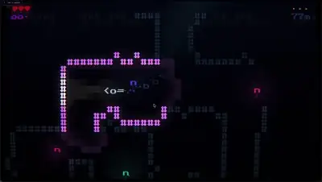</a><br><a href="https://www.sandbase.ai/lab/ai-videos/opus-5-5/2102882622053535814?lang=zh-CN&utm_source=github&utm_medium=readme&utm_campaign=awesome-opus-5.5&utm_content=card"><b>使用Opus制作的深海恐怖游戏</b></a><br><sub><a href="https://x.com/ggsimm/status/2102882622053535814">@ggsimm</a> · 0:35</sub></td><td width="33%" valign="top"><a href="https://www.sandbase.ai/lab/media/x/opus-5-5/2102932763750084797/video.mp4"></a><br><a href="https://www.sandbase.ai/lab/ai-videos/opus-5-5/2102932763750084797?lang=zh-CN&utm_source=github&utm_medium=readme&utm_campaign=awesome-opus-5.5&utm_content=card"><b>Three.js与Blender制作的共生体战衣游戏玩法</b></a><br><sub><a href="https://x.com/xikhar/status/2102932763750084797">@xikhar</a> · 2:10</sub></td></tr>
<tr><td width="33%" valign="top"><a href="https://www.sandbase.ai/lab/media/x/opus-5-5/2102991290568954264/video.mp4"></a><br><a href="https://www.sandbase.ai/lab/ai-videos/opus-5-5/2102991290568954264?lang=zh-CN&utm_source=github&utm_medium=readme&utm_campaign=awesome-opus-5.5&utm_content=card"><b>基于Three.js的真三国无双风格动作游戏</b></a><br><sub><a href="https://x.com/BubuStd/status/2102991290568954264">@BubuStd</a> · 0:19</sub></td><td width="33%" valign="top"><a href="https://www.sandbase.ai/lab/media/x/opus-5-5/2103198490746900830/video.mp4"></a><br><a href="https://www.sandbase.ai/lab/ai-videos/opus-5-5/2103198490746900830?lang=zh-CN&utm_source=github&utm_medium=readme&utm_campaign=awesome-opus-5.5&utm_content=card"><b>浏览器中运行的日式划船游戏</b></a><br><sub><a href="https://x.com/buildwithsid/status/2103198490746900830">@buildwithsid</a> · 1:11</sub></td><td width="33%" valign="top"><a href="https://www.sandbase.ai/lab/media/x/opus-5-5/2103282610948464811/video.mp4"></a><br><a href="https://www.sandbase.ai/lab/ai-videos/opus-5-5/2103282610948464811?lang=zh-CN&utm_source=github&utm_medium=readme&utm_campaign=awesome-opus-5.5&utm_content=card"><b>完全从零重构的塞尔达时之笛游戏演示</b></a><br><sub><a href="https://x.com/LexnLin/status/2103282610948464811">@LexnLin</a> · 0:37</sub></td></tr>
<tr><td width="33%" valign="top"><a href="https://www.sandbase.ai/lab/media/x/opus-5-5/2103437168731636090/video.mp4"></a><br><a href="https://www.sandbase.ai/lab/ai-videos/opus-5-5/2103437168731636090?lang=zh-CN&utm_source=github&utm_medium=readme&utm_campaign=awesome-opus-5.5&utm_content=card"><b>斯普拉遁风格游戏试玩演示</b></a><br><sub><a href="https://x.com/k2sbhai/status/2103437168731636090">@k2sbhai</a> · 1:55</sub></td><td width="33%" valign="top"><a href="https://www.sandbase.ai/lab/media/x/opus-5-5/2103456630679773669/video.mp4"></a><br><a href="https://www.sandbase.ai/lab/ai-videos/opus-5-5/2103456630679773669?lang=zh-CN&utm_source=github&utm_medium=readme&utm_campaign=awesome-opus-5.5&utm_content=card"><b>使用Claude构建的3D射击游戏</b></a><br><sub><a href="https://x.com/karankendre/status/2103456630679773669">@karankendre</a> · 0:22</sub></td><td width="33%" valign="top"><a href="https://www.sandbase.ai/lab/media/x/opus-5-5/2103755997533839416/video.mp4"></a><br><a href="https://www.sandbase.ai/lab/ai-videos/opus-5-5/2103755997533839416?lang=zh-CN&utm_source=github&utm_medium=readme&utm_campaign=awesome-opus-5.5&utm_content=card"><b>多角色游戏实机演示与混剪视频</b></a><br><sub><a href="https://x.com/rehan_shei/status/2103755997533839416">@rehan_shei</a> · 0:30</sub></td></tr>
<tr><td width="33%" valign="top"><a href="https://www.sandbase.ai/lab/media/x/opus-5-5/2103789415323562325/video.mp4"></a><br><a href="https://www.sandbase.ai/lab/ai-videos/opus-5-5/2103789415323562325?lang=zh-CN&utm_source=github&utm_medium=readme&utm_campaign=awesome-opus-5.5&utm_content=card"><b>Unity制作的俯视角警车追逐街机游戏</b></a><br><sub><a href="https://x.com/froessell/status/2103789415323562325">@froessell</a> · 0:59 · <a href="https://www.sandbase.ai/lab/ai-videos/opus-5-5/2103789415323562325?lang=zh-CN&utm_source=github&utm_medium=readme&utm_campaign=awesome-opus-5.5&utm_content=card">提示词</a></sub></td><td width="33%" valign="top"><a href="https://www.sandbase.ai/lab/media/x/opus-5-5/2103789882309234711/video.mp4"></a><br><a href="https://www.sandbase.ai/lab/ai-videos/opus-5-5/2103789882309234711?lang=zh-CN&utm_source=github&utm_medium=readme&utm_campaign=awesome-opus-5.5&utm_content=card"><b>落日背景下的金属探测器小游戏演示</b></a><br><sub><a href="https://x.com/zacxbt/status/2103789882309234711">@zacxbt</a> · 0:25</sub></td><td width="33%" valign="top"><a href="https://www.sandbase.ai/lab/media/x/opus-5-5/2103801828744061307/video.mp4">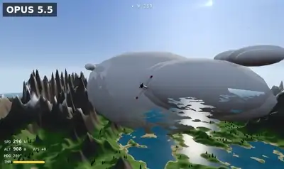</a><br><a href="https://www.sandbase.ai/lab/ai-videos/opus-5-5/2103801828744061307?lang=zh-CN&utm_source=github&utm_medium=readme&utm_campaign=awesome-opus-5.5&utm_content=card"><b>单HTML文件中的程序化山脉飞行模拟器</b></a><br><sub><a href="https://x.com/cyrilXBT/status/2103801828744061307">@cyrilXBT</a> · 0:15</sub></td></tr>
<tr><td width="33%" valign="top"><a href="https://www.sandbase.ai/lab/media/x/opus-5-5/2103808699466944604/video.mp4">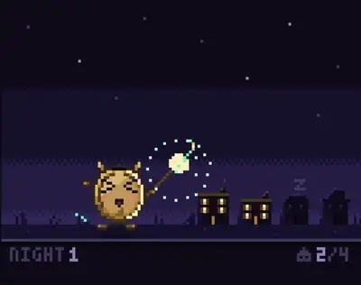</a><br><a href="https://www.sandbase.ai/lab/ai-videos/opus-5-5/2103808699466944604?lang=zh-CN&utm_source=github&utm_medium=readme&utm_campaign=awesome-opus-5.5&utm_content=card"><b>使用Opus编写的像素小游戏</b></a><br><sub><a href="https://x.com/zacxbt/status/2103808699466944604">@zacxbt</a> · 0:19 · <a href="https://www.sandbase.ai/lab/ai-videos/opus-5-5/2103808699466944604?lang=zh-CN&utm_source=github&utm_medium=readme&utm_campaign=awesome-opus-5.5&utm_content=card">提示词</a></sub></td><td width="33%" valign="top"><a href="https://www.sandbase.ai/lab/media/x/opus-5-5/2103821040174698674/video.mp4"></a><br><a href="https://www.sandbase.ai/lab/ai-videos/opus-5-5/2103821040174698674?lang=zh-CN&utm_source=github&utm_medium=readme&utm_campaign=awesome-opus-5.5&utm_content=card"><b>使用Claude构建的飞机模拟器游戏</b></a><br><sub><a href="https://x.com/karankendre/status/2103821040174698674">@karankendre</a> · 0:32</sub></td><td width="33%" valign="top"><a href="https://www.sandbase.ai/lab/media/x/opus-5-5/2103911086541951003/video.mp4"></a><br><a href="https://www.sandbase.ai/lab/ai-videos/opus-5-5/2103911086541951003?lang=zh-CN&utm_source=github&utm_medium=readme&utm_campaign=awesome-opus-5.5&utm_content=card"><b>使用Unity制作的钓鱼小游戏</b></a><br><sub><a href="https://x.com/ForkedPush/status/2103911086541951003">@ForkedPush</a> · 1:41</sub></td></tr>
<tr><td width="33%" valign="top"><a href="https://www.sandbase.ai/lab/media/x/opus-5-5/2103966645588984183/video.mp4"></a><br><a href="https://www.sandbase.ai/lab/ai-videos/opus-5-5/2103966645588984183?lang=zh-CN&utm_source=github&utm_medium=readme&utm_campaign=awesome-opus-5.5&utm_content=card"><b>用Opus 5.5制作的视频游戏</b></a><br><sub><a href="https://x.com/jorge_coder/status/2103966645588984183">@jorge_coder</a> · 2:36</sub></td><td width="33%" valign="top"><a href="https://www.sandbase.ai/lab/media/x/opus-5-5/2104001664793600012/video.mp4"></a><br><a href="https://www.sandbase.ai/lab/ai-videos/opus-5-5/2104001664793600012?lang=zh-CN&utm_source=github&utm_medium=readme&utm_campaign=awesome-opus-5.5&utm_content=card"><b>基于Three.js和Blender构建的网页游戏场景</b></a><br><sub><a href="https://x.com/xikhar/status/2104001664793600012">@xikhar</a> · 2:21</sub></td><td width="33%" valign="top"><a href="https://www.sandbase.ai/lab/media/x/opus-5-5/2104002281641542008/video.mp4"></a><br><a href="https://www.sandbase.ai/lab/ai-videos/opus-5-5/2104002281641542008?lang=zh-CN&utm_source=github&utm_medium=readme&utm_campaign=awesome-opus-5.5&utm_content=card"><b>Three.js程序化生成的3D场景Willowmere</b></a><br><sub><a href="https://x.com/jurlycat/status/2104002281641542008">@jurlycat</a> · 1:01</sub></td></tr>
<tr><td width="33%" valign="top"><a href="https://www.sandbase.ai/lab/media/x/opus-5-5/2104004272946094296/video.mp4"></a><br><a href="https://www.sandbase.ai/lab/ai-videos/opus-5-5/2104004272946094296?lang=zh-CN&utm_source=github&utm_medium=readme&utm_campaign=awesome-opus-5.5&utm_content=card"><b>开放世界奇幻科幻游戏更新展示</b></a><br><sub><a href="https://x.com/aniketjart/status/2104004272946094296">@aniketjart</a> · 0:25</sub></td><td width="33%" valign="top"><a href="https://www.sandbase.ai/lab/media/x/opus-5-5/2104045641706189192/video.mp4"></a><br><a href="https://www.sandbase.ai/lab/ai-videos/opus-5-5/2104045641706189192?lang=zh-CN&utm_source=github&utm_medium=readme&utm_campaign=awesome-opus-5.5&utm_content=card"><b>茶杯头风格卡通迷你游戏展示</b></a><br><sub><a href="https://x.com/SestinaTW/status/2104045641706189192">@SestinaTW</a> · 0:41</sub></td><td width="33%" valign="top"><a href="https://www.sandbase.ai/lab/media/x/opus-5-5/2104109918894580091/video.mp4"></a><br><a href="https://www.sandbase.ai/lab/ai-videos/opus-5-5/2104109918894580091?lang=zh-CN&utm_source=github&utm_medium=readme&utm_campaign=awesome-opus-5.5&utm_content=card"><b>Opus 5.5耗时36小时构建的魔兽风格游戏</b></a><br><sub><a href="https://x.com/Stefan_3D_AI/status/2104109918894580091">@Stefan_3D_AI</a> · 1:17</sub></td></tr>
<tr><td width="33%" valign="top"><a href="https://www.sandbase.ai/lab/media/x/opus-5-5/2104215873120764032/video.mp4"></a><br><a href="https://www.sandbase.ai/lab/ai-videos/opus-5-5/2104215873120764032?lang=zh-CN&utm_source=github&utm_medium=readme&utm_campaign=awesome-opus-5.5&utm_content=card"><b>受塞尔达启发的画笔武器冒险游戏</b></a><br><sub><a href="https://x.com/DannyLimanseta/status/2104215873120764032">@DannyLimanseta</a> · 1:44</sub></td><td width="33%" valign="top"><a href="https://www.sandbase.ai/lab/media/x/opus-5-5/2104253584737230926/video.mp4"></a><br><a href="https://www.sandbase.ai/lab/ai-videos/opus-5-5/2104253584737230926?lang=zh-CN&utm_source=github&utm_medium=readme&utm_campaign=awesome-opus-5.5&utm_content=card"><b>Three.js打造的无缝太空探索游戏</b></a><br><sub><a href="https://x.com/Rubzem/status/2104253584737230926">@Rubzem</a> · 4:30</sub></td><td width="33%" valign="top"><a href="https://www.sandbase.ai/lab/media/x/opus-5-5/2104283163413606580/video.mp4"></a><br><a href="https://www.sandbase.ai/lab/ai-videos/opus-5-5/2104283163413606580?lang=zh-CN&utm_source=github&utm_medium=readme&utm_campaign=awesome-opus-5.5&utm_content=card"><b>Opus 5.5制作的Three.js 3D游戏</b></a><br><sub><a href="https://x.com/maxt3chno/status/2104283163413606580">@maxt3chno</a> · 3:09</sub></td></tr>
<tr><td width="33%" valign="top"><a href="https://www.sandbase.ai/lab/media/x/opus-5-5/2104435752637710723/video.mp4"></a><br><a href="https://www.sandbase.ai/lab/ai-videos/opus-5-5/2104435752637710723?lang=zh-CN&utm_source=github&utm_medium=readme&utm_campaign=awesome-opus-5.5&utm_content=card"><b>一次性生成的 3D 游戏演示</b></a><br><sub><a href="https://x.com/t31kx/status/2104435752637710723">@t31kx</a> · 1:00</sub></td><td width="33%" valign="top"><a href="https://www.sandbase.ai/lab/media/x/opus-5-5/2104871105752391780/video.mp4"></a><br><a href="https://www.sandbase.ai/lab/ai-videos/opus-5-5/2104871105752391780?lang=zh-CN&utm_source=github&utm_medium=readme&utm_campaign=awesome-opus-5.5&utm_content=card"><b>使用Claude Opus单次提示生成的Roblox游戏</b></a><br><sub><a href="https://x.com/bletDemonJH/status/2104871105752391780">@bletDemonJH</a> · 1:29</sub></td><td width="33%" valign="top"><a href="https://www.sandbase.ai/lab/media/x/opus-5-5/2104923213394575365/video.mp4"></a><br><a href="https://www.sandbase.ai/lab/ai-videos/opus-5-5/2104923213394575365?lang=zh-CN&utm_source=github&utm_medium=readme&utm_campaign=awesome-opus-5.5&utm_content=card"><b>浏览器端运行的类无人深空太空探索游戏</b></a><br><sub><a href="https://x.com/ai_growth_avii/status/2104923213394575365">@ai_growth_avii</a> · 1:19</sub></td></tr>
<tr><td width="33%" valign="top"><a href="https://www.sandbase.ai/lab/media/x/opus-5-5/2104941391272956125/video.mp4"></a><br><a href="https://www.sandbase.ai/lab/ai-videos/opus-5-5/2104941391272956125?lang=zh-CN&utm_source=github&utm_medium=readme&utm_campaign=awesome-opus-5.5&utm_content=card"><b>Perplexity Computer端到端构建的网页开放世界游戏</b></a><br><sub><a href="https://x.com/AravSrinivas/status/2104941391272956125">@AravSrinivas</a> · 1:28</sub></td><td width="33%" valign="top"><a href="https://www.sandbase.ai/lab/media/x/opus-5-5/2105065901972173054/video.mp4"></a><br><a href="https://www.sandbase.ai/lab/ai-videos/opus-5-5/2105065901972173054?lang=zh-CN&utm_source=github&utm_medium=readme&utm_campaign=awesome-opus-5.5&utm_content=card"><b>蜘蛛侠同人游戏预告片</b></a><br><sub><a href="https://x.com/KalraIshaan11/status/2105065901972173054">@KalraIshaan11</a> · 1:27</sub></td><td width="33%" valign="top"><a href="https://www.sandbase.ai/lab/media/x/opus-5-5/2106149214380040667/video.mp4"></a><br><a href="https://www.sandbase.ai/lab/ai-videos/opus-5-5/2106149214380040667?lang=zh-CN&utm_source=github&utm_medium=readme&utm_campaign=awesome-opus-5.5&utm_content=card"><b>格斗游戏移植至 Three.js 的多种玩法展示</b></a><br><sub><a href="https://x.com/GamefxAI/status/2106149214380040667">@GamefxAI</a> · 3:00</sub></td></tr>
<tr><td width="33%" valign="top"><a href="https://www.sandbase.ai/lab/media/x/opus-5-5/2106221451024179584/video.mp4"></a><br><a href="https://www.sandbase.ai/lab/ai-videos/opus-5-5/2106221451024179584?lang=zh-CN&utm_source=github&utm_medium=readme&utm_campaign=awesome-opus-5.5&utm_content=card"><b>可破坏网页的多人火柴人游戏</b></a><br><sub><a href="https://x.com/RoundtableSpace/status/2106221451024179584">@RoundtableSpace</a> · 0:26</sub></td><td width="33%" valign="top"><a href="https://www.sandbase.ai/lab/media/x/opus-5-5/2106307854085029889/video.mp4"></a><br><a href="https://www.sandbase.ai/lab/ai-videos/opus-5-5/2106307854085029889?lang=zh-CN&utm_source=github&utm_medium=readme&utm_campaign=awesome-opus-5.5&utm_content=card"><b>爱丽丝镜中奇遇活花园网页交互游戏</b></a><br><sub><a href="https://x.com/ring_hyacinth/status/2106307854085029889">@ring_hyacinth</a> · 1:55</sub></td><td width="33%" valign="top"><a href="https://www.sandbase.ai/lab/media/x/opus-5-5/2106387548486738010/video.mp4"></a><br><a href="https://www.sandbase.ai/lab/ai-videos/opus-5-5/2106387548486738010?lang=zh-CN&utm_source=github&utm_medium=readme&utm_campaign=awesome-opus-5.5&utm_content=card"><b>融合英雄联盟与龙珠斗士Z的自制游戏演示</b></a><br><sub><a href="https://x.com/GamefxAI/status/2106387548486738010">@GamefxAI</a> · 1:43</sub></td></tr>
<tr><td width="33%" valign="top"><a href="https://www.sandbase.ai/lab/media/x/opus-5-5/2106834027332411885/video.mp4"></a><br><a href="https://www.sandbase.ai/lab/ai-videos/opus-5-5/2106834027332411885?lang=zh-CN&utm_source=github&utm_medium=readme&utm_campaign=awesome-opus-5.5&utm_content=card"><b>单个HTML文件复刻的我的世界游戏</b></a><br><sub><a href="https://x.com/dummerspast39/status/2106834027332411885">@dummerspast39</a> · 1:10</sub></td><td width="33%" valign="top"><a href="https://www.sandbase.ai/lab/media/x/opus-5-5/2106925689190354989/video.mp4"></a><br><a href="https://www.sandbase.ai/lab/ai-videos/opus-5-5/2106925689190354989?lang=zh-CN&utm_source=github&utm_medium=readme&utm_campaign=awesome-opus-5.5&utm_content=card"><b>将波巴·费特引入荒野大镖客2模组演示</b></a><br><sub><a href="https://x.com/ChrisGPT/status/2106925689190354989">@ChrisGPT</a> · 0:46</sub></td><td width="33%" valign="top"><a href="https://www.sandbase.ai/lab/media/x/opus-5-5/2107062652656869444/video.mp4"></a><br><a href="https://www.sandbase.ai/lab/ai-videos/opus-5-5/2107062652656869444?lang=zh-CN&utm_source=github&utm_medium=readme&utm_campaign=awesome-opus-5.5&utm_content=card"><b>Opus 5.5构建的3D游戏展示</b></a><br><sub><a href="https://x.com/TheCherno/status/2107062652656869444">@TheCherno</a> · 0:38</sub></td></tr>
<tr><td width="33%" valign="top"><a href="https://www.sandbase.ai/lab/media/x/opus-5-5/2107080145165037869/video.mp4"></a><br><a href="https://www.sandbase.ai/lab/ai-videos/opus-5-5/2107080145165037869?lang=zh-CN&utm_source=github&utm_medium=readme&utm_campaign=awesome-opus-5.5&utm_content=card"><b>Blender与Unity构建的3D游戏世界演示</b></a><br><sub><a href="https://x.com/hakimieiqbal/status/2107080145165037869">@hakimieiqbal</a> · 0:53</sub></td><td width="33%" valign="top"><a href="https://www.sandbase.ai/lab/media/x/opus-5-5/2107100320816095625/video.mp4"></a><br><a href="https://www.sandbase.ai/lab/ai-videos/opus-5-5/2107100320816095625?lang=zh-CN&utm_source=github&utm_medium=readme&utm_campaign=awesome-opus-5.5&utm_content=card"><b>Three.js可交互日本风光游船场景</b></a><br><sub><a href="https://x.com/mdaman010/status/2107100320816095625">@mdaman010</a> · 1:00</sub></td><td width="33%" valign="top"><a href="https://www.sandbase.ai/lab/media/x/opus-5-5/2107317122854772949/video.mp4"></a><br><a href="https://www.sandbase.ai/lab/ai-videos/opus-5-5/2107317122854772949?lang=zh-CN&utm_source=github&utm_medium=readme&utm_campaign=awesome-opus-5.5&utm_content=card"><b>基于Three.js的游戏概念演示</b></a><br><sub><a href="https://x.com/chetanankola/status/2107317122854772949">@chetanankola</a> · 0:52</sub></td></tr>
<tr><td width="33%" valign="top"><a href="https://www.sandbase.ai/lab/media/x/opus-5-5/2107505970809336071/video.mp4"></a><br><a href="https://www.sandbase.ai/lab/ai-videos/opus-5-5/2107505970809336071?lang=zh-CN&utm_source=github&utm_medium=readme&utm_campaign=awesome-opus-5.5&utm_content=card"><b>ThreeJS制作的氛围感动作解谜RPG游戏</b></a><br><sub><a href="https://x.com/DannyLimanseta/status/2107505970809336071">@DannyLimanseta</a> · 1:04</sub></td><td width="33%" valign="top"><a href="https://www.sandbase.ai/lab/media/x/opus-5-5/2107713497224130638/video.mp4"></a><br><a href="https://www.sandbase.ai/lab/ai-videos/opus-5-5/2107713497224130638?lang=zh-CN&utm_source=github&utm_medium=readme&utm_campaign=awesome-opus-5.5&utm_content=card"><b>在VRChat着色器中运行Doom的RISC-V模拟器</b></a><br><sub><a href="https://x.com/Michael_Moroz_/status/2107713497224130638">@Michael_Moroz_</a> · 3:11</sub></td><td width="33%" valign="top"><a href="https://www.sandbase.ai/lab/media/x/opus-5-5/2107804983416467598/video.mp4"></a><br><a href="https://www.sandbase.ai/lab/ai-videos/opus-5-5/2107804983416467598?lang=zh-CN&utm_source=github&utm_medium=readme&utm_campaign=awesome-opus-5.5&utm_content=card"><b>完全通过代码构建的HD-2D像素风游戏</b></a><br><sub><a href="https://x.com/hakimieiqbal/status/2107804983416467598">@hakimieiqbal</a> · 1:20</sub></td></tr>
<tr><td width="33%" valign="top"><a href="https://www.sandbase.ai/lab/media/x/opus-5-5/2107949345312018897/video.mp4"></a><br><a href="https://www.sandbase.ai/lab/ai-videos/opus-5-5/2107949345312018897?lang=zh-CN&utm_source=github&utm_medium=readme&utm_campaign=awesome-opus-5.5&utm_content=card"><b>在浏览器中运行的无畏契约3D复刻实验</b></a><br><sub><a href="https://x.com/GamefxAI/status/2107949345312018897">@GamefxAI</a> · 2:49</sub></td><td width="33%" valign="top"><a href="https://www.sandbase.ai/lab/media/x/opus-5-5/2108250145703727143/video.mp4"></a><br><a href="https://www.sandbase.ai/lab/ai-videos/opus-5-5/2108250145703727143?lang=zh-CN&utm_source=github&utm_medium=readme&utm_campaign=awesome-opus-5.5&utm_content=card"><b>在赛博朋克2077中运行我的世界</b></a><br><sub><a href="https://x.com/Roxx_0x/status/2108250145703727143">@Roxx_0x</a> · 0:54</sub></td><td width="33%" valign="top"><a href="https://www.sandbase.ai/lab/media/x/opus-5-5/2108341523930878202/video.mp4"></a><br><a href="https://www.sandbase.ai/lab/ai-videos/opus-5-5/2108341523930878202?lang=zh-CN&utm_source=github&utm_medium=readme&utm_campaign=awesome-opus-5.5&utm_content=card"><b>改进战斗与动作效果的网页端游戏</b></a><br><sub><a href="https://x.com/xikhar/status/2108341523930878202">@xikhar</a> · 0:59</sub></td></tr>
<tr><td width="33%" valign="top"><a href="https://www.sandbase.ai/lab/media/x/opus-5-5/2108369354991759658/video.mp4"></a><br><a href="https://www.sandbase.ai/lab/ai-videos/opus-5-5/2108369354991759658?lang=zh-CN&utm_source=github&utm_medium=readme&utm_campaign=awesome-opus-5.5&utm_content=card"><b>Three.js制作的飓风飞行3D游戏</b></a><br><sub><a href="https://x.com/techartist_/status/2108369354991759658">@techartist_</a> · 0:21</sub></td><td width="33%" valign="top"><a href="https://www.sandbase.ai/lab/media/x/opus-5-5/2108618648763896141/video.mp4"></a><br><a href="https://www.sandbase.ai/lab/ai-videos/opus-5-5/2108618648763896141?lang=zh-CN&utm_source=github&utm_medium=readme&utm_campaign=awesome-opus-5.5&utm_content=card"><b>将我的世界内容加载器接入GTA5的演示</b></a><br><sub><a href="https://x.com/Roxx_0x/status/2108618648763896141">@Roxx_0x</a> · 1:11</sub></td><td width="33%" valign="top"><a href="https://www.sandbase.ai/lab/media/x/opus-5-5/2108793548954845313/video.mp4"></a><br><a href="https://www.sandbase.ai/lab/ai-videos/opus-5-5/2108793548954845313?lang=zh-CN&utm_source=github&utm_medium=readme&utm_campaign=awesome-opus-5.5&utm_content=card"><b>基于 Three.js 构建的独立游戏原型</b></a><br><sub><a href="https://x.com/willstrk/status/2108793548954845313">@willstrk</a> · 0:59</sub></td></tr>
<tr><td width="33%" valign="top"><a href="https://www.sandbase.ai/lab/media/x/opus-5-5/2108860261897584940/video.mp4"></a><br><a href="https://www.sandbase.ai/lab/ai-videos/opus-5-5/2108860261897584940?lang=zh-CN&utm_source=github&utm_medium=readme&utm_campaign=awesome-opus-5.5&utm_content=card"><b>使用 Blender 和 Unity 构建的海岛游戏</b></a><br><sub><a href="https://x.com/rewind02/status/2108860261897584940">@rewind02</a> · 0:53</sub></td><td width="33%" valign="top"><a href="https://www.sandbase.ai/lab/media/x/opus-5-5/2108931642542698801/video.mp4"></a><br><a href="https://www.sandbase.ai/lab/ai-videos/opus-5-5/2108931642542698801?lang=zh-CN&utm_source=github&utm_medium=readme&utm_campaign=awesome-opus-5.5&utm_content=card"><b>纯代码构建的浏览器浮空岛飞行游戏</b></a><br><sub><a href="https://x.com/0xRhinoX/status/2108931642542698801">@0xRhinoX</a> · 0:28</sub></td><td width="33%" valign="top"><a href="https://www.sandbase.ai/lab/media/x/opus-5-5/2109034305968336929/video.mp4"></a><br><a href="https://www.sandbase.ai/lab/ai-videos/opus-5-5/2109034305968336929?lang=zh-CN&utm_source=github&utm_medium=readme&utm_campaign=awesome-opus-5.5&utm_content=card"><b>Three.js渲染的雨夜日本便利店游戏场景</b></a><br><sub><a href="https://x.com/NFT_Chen/status/2109034305968336929">@NFT_Chen</a> · 0:47</sub></td></tr>
<tr><td width="33%" valign="top"><a href="https://www.sandbase.ai/lab/media/x/opus-5-5/2109165742084206694/video.mp4"></a><br><a href="https://www.sandbase.ai/lab/ai-videos/opus-5-5/2109165742084206694?lang=zh-CN&utm_source=github&utm_medium=readme&utm_campaign=awesome-opus-5.5&utm_content=card"><b>机械恐龙与程序化可破坏植被测试</b></a><br><sub><a href="https://x.com/wizardbrainz/status/2109165742084206694">@wizardbrainz</a> · 0:48</sub></td><td width="33%" valign="top"><a href="https://www.sandbase.ai/lab/media/x/opus-5-5/2109267022865732000/video.mp4"></a><br><a href="https://www.sandbase.ai/lab/ai-videos/opus-5-5/2109267022865732000?lang=zh-CN&utm_source=github&utm_medium=readme&utm_campaign=awesome-opus-5.5&utm_content=card"><b>六边形网格治愈系海岛建造游戏</b></a><br><sub><a href="https://x.com/hakimieiqbal/status/2109267022865732000">@hakimieiqbal</a> · 3:21</sub></td><td width="33%" valign="top"><a href="https://www.sandbase.ai/lab/media/x/opus-5-5/2109296959236592127/video.mp4"></a><br><a href="https://www.sandbase.ai/lab/ai-videos/opus-5-5/2109296959236592127?lang=zh-CN&utm_source=github&utm_medium=readme&utm_campaign=awesome-opus-5.5&utm_content=card"><b>使用Three.js构建的无人机竞速游戏</b></a><br><sub><a href="https://x.com/ai_growth_avii/status/2109296959236592127">@ai_growth_avii</a> · 0:30</sub></td></tr>
<tr><td width="33%" valign="top"><a href="https://www.sandbase.ai/lab/media/x/opus-5-5/2109585491280453986/video.mp4"></a><br><a href="https://www.sandbase.ai/lab/ai-videos/opus-5-5/2109585491280453986?lang=zh-CN&utm_source=github&utm_medium=readme&utm_campaign=awesome-opus-5.5&utm_content=card"><b>使用 Claude Opus 和 Unity 制作的钓鱼游戏</b></a><br><sub><a href="https://x.com/rewind02/status/2109585491280453986">@rewind02</a> · 0:27</sub></td><td width="33%" valign="top"><a href="https://www.sandbase.ai/lab/media/x/opus-5-5/2109610577731494054/video.mp4"></a><br><a href="https://www.sandbase.ai/lab/ai-videos/opus-5-5/2109610577731494054?lang=zh-CN&utm_source=github&utm_medium=readme&utm_campaign=awesome-opus-5.5&utm_content=card"><b>Three.js制作的浮岛街机游戏Skyhold</b></a><br><sub><a href="https://x.com/slash1sol/status/2109610577731494054">@slash1sol</a> · 0:30</sub></td><td width="33%" valign="top"><a href="https://www.sandbase.ai/lab/media/x/opus-5-5/2109628088430510337/video.mp4"></a><br><a href="https://www.sandbase.ai/lab/ai-videos/opus-5-5/2109628088430510337?lang=zh-CN&utm_source=github&utm_medium=readme&utm_campaign=awesome-opus-5.5&utm_content=card"><b>纯代码生成的网页游戏演示</b></a><br><sub><a href="https://x.com/0xbobaaa/status/2109628088430510337">@0xbobaaa</a> · 0:30</sub></td></tr>
<tr><td width="33%" valign="top"><a href="https://www.sandbase.ai/lab/media/x/opus-5-5/2109647747607412834/video.mp4"></a><br><a href="https://www.sandbase.ai/lab/ai-videos/opus-5-5/2109647747607412834?lang=zh-CN&utm_source=github&utm_medium=readme&utm_campaign=awesome-opus-5.5&utm_content=card"><b>复古俯视角警车追逐游戏原型</b></a><br><sub><a href="https://x.com/RisingSunInt_/status/2109647747607412834">@RisingSunInt_</a> · 3:34</sub></td><td width="33%" valign="top"><a href="https://www.sandbase.ai/lab/media/x/opus-5-5/2109696536812908857/video.mp4"></a><br><a href="https://www.sandbase.ai/lab/ai-videos/opus-5-5/2109696536812908857?lang=zh-CN&utm_source=github&utm_medium=readme&utm_campaign=awesome-opus-5.5&utm_content=card"><b>使用Claude构建的完整3D游戏</b></a><br><sub><a href="https://x.com/hasibdreamer35/status/2109696536812908857">@hasibdreamer35</a> · 0:59</sub></td><td width="33%" valign="top"><a href="https://www.sandbase.ai/lab/media/x/opus-5-5/2109760948093522051/video.mp4"></a><br><a href="https://www.sandbase.ai/lab/ai-videos/opus-5-5/2109760948093522051?lang=zh-CN&utm_source=github&utm_medium=readme&utm_campaign=awesome-opus-5.5&utm_content=card"><b>模型间3D游戏演示能力对比评测</b></a><br><sub><a href="https://x.com/ChrisGPT/status/2109760948093522051">@ChrisGPT</a> · 0:19</sub></td></tr>
<tr><td width="33%" valign="top"><a href="https://www.sandbase.ai/lab/media/x/opus-5-5/2109902063916257466/video.mp4"></a><br><a href="https://www.sandbase.ai/lab/ai-videos/opus-5-5/2109902063916257466?lang=zh-CN&utm_source=github&utm_medium=readme&utm_campaign=awesome-opus-5.5&utm_content=card"><b>Three.js第一人称开放世界游戏</b></a><br><sub><a href="https://x.com/badboyfoxy/status/2109902063916257466">@badboyfoxy</a> · 2:32</sub></td><td width="33%" valign="top"><a href="https://www.sandbase.ai/lab/media/x/opus-5-5/2109920822068654290/video.mp4"></a><br><a href="https://www.sandbase.ai/lab/ai-videos/opus-5-5/2109920822068654290?lang=zh-CN&utm_source=github&utm_medium=readme&utm_campaign=awesome-opus-5.5&utm_content=card"><b>商业帝国大亨游戏的沙滩内容更新</b></a><br><sub><a href="https://x.com/alexcooldev/status/2109920822068654290">@alexcooldev</a> · 0:27</sub></td><td width="33%" valign="top"><a href="https://www.sandbase.ai/lab/media/x/opus-5-5/2109952769171800391/video.mp4"></a><br><a href="https://www.sandbase.ai/lab/ai-videos/opus-5-5/2109952769171800391?lang=zh-CN&utm_source=github&utm_medium=readme&utm_campaign=awesome-opus-5.5&utm_content=card"><b>Three.js开发的MMORPG游戏原型</b></a><br><sub><a href="https://x.com/PawelJLisowski/status/2109952769171800391">@PawelJLisowski</a> · 0:53</sub></td></tr>
<tr><td width="33%" valign="top"><a href="https://www.sandbase.ai/lab/media/x/opus-5-5/2109956613926797384/video.mp4"></a><br><a href="https://www.sandbase.ai/lab/ai-videos/opus-5-5/2109956613926797384?lang=zh-CN&utm_source=github&utm_medium=readme&utm_campaign=awesome-opus-5.5&utm_content=card"><b>多轮迭代生成的可玩MMORPG游戏</b></a><br><sub><a href="https://x.com/PawelJLisowski/status/2109956613926797384">@PawelJLisowski</a> · 1:23</sub></td><td width="33%" valign="top"><a href="https://www.sandbase.ai/lab/media/x/opus-5-5/2110001876330512855/video.mp4"></a><br><a href="https://www.sandbase.ai/lab/ai-videos/opus-5-5/2110001876330512855?lang=zh-CN&utm_source=github&utm_medium=readme&utm_campaign=awesome-opus-5.5&utm_content=card"><b>构建治愈系钓鱼游戏的工作流程</b></a><br><sub><a href="https://x.com/rewind02/status/2110001876330512855">@rewind02</a> · 0:14</sub></td><td width="33%" valign="top"><a href="https://www.sandbase.ai/lab/media/x/opus-5-5/2110352122575274388/video.mp4"></a><br><a href="https://www.sandbase.ai/lab/ai-videos/opus-5-5/2110352122575274388?lang=zh-CN&utm_source=github&utm_medium=readme&utm_campaign=awesome-opus-5.5&utm_content=card"><b>具备动态天气的商业模拟游戏开发</b></a><br><sub><a href="https://x.com/alexcooldev/status/2110352122575274388">@alexcooldev</a> · 2:06</sub></td></tr>
<tr><td width="33%" valign="top"><a href="https://www.sandbase.ai/lab/media/x/opus-5-5/2110396961878606106/video.mp4">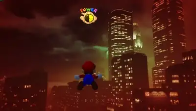</a><br><a href="https://www.sandbase.ai/lab/ai-videos/opus-5-5/2110396961878606106?lang=zh-CN&utm_source=github&utm_medium=readme&utm_campaign=awesome-opus-5.5&utm_content=card"><b>在 GTA5 与我的世界中运行的超级马力欧64</b></a><br><sub><a href="https://x.com/Roxx_0x/status/2110396961878606106">@Roxx_0x</a> · 2:07</sub></td><td width="33%" valign="top"><a href="https://www.sandbase.ai/lab/media/x/opus-5-5/2110433923436052799/video.mp4"></a><br><a href="https://www.sandbase.ai/lab/ai-videos/opus-5-5/2110433923436052799?lang=zh-CN&utm_source=github&utm_medium=readme&utm_campaign=awesome-opus-5.5&utm_content=card"><b>索尼克穿越到 GTA 5 洛圣都</b></a><br><sub><a href="https://x.com/0xDeniAi/status/2110433923436052799">@0xDeniAi</a> · 0:29</sub></td><td width="33%" valign="top"><a href="https://www.sandbase.ai/lab/media/x/opus-5-5/2110460775722852744/video.mp4"></a><br><a href="https://www.sandbase.ai/lab/ai-videos/opus-5-5/2110460775722852744?lang=zh-CN&utm_source=github&utm_medium=readme&utm_campaign=awesome-opus-5.5&utm_content=card"><b>基于Three.js的机场机坪策略游戏</b></a><br><sub><a href="https://x.com/anxuanng/status/2110460775722852744">@anxuanng</a> · 0:30</sub></td></tr>
<tr><td width="33%" valign="top"><a href="https://www.sandbase.ai/lab/media/x/opus-5-5/2110773148081606775/video.mp4"></a><br><a href="https://www.sandbase.ai/lab/ai-videos/opus-5-5/2110773148081606775?lang=zh-CN&utm_source=github&utm_medium=readme&utm_campaign=awesome-opus-5.5&utm_content=card"><b>在Unity 6中构建舒适农场游戏</b></a><br><sub><a href="https://x.com/Mnilax/status/2110773148081606775">@Mnilax</a> · 0:15</sub></td><td width="33%" valign="top"><a href="https://www.sandbase.ai/lab/media/x/opus-5-5/2111290504491258080/video.mp4"></a><br><a href="https://www.sandbase.ai/lab/ai-videos/opus-5-5/2111290504491258080?lang=zh-CN&utm_source=github&utm_medium=readme&utm_campaign=awesome-opus-5.5&utm_content=card"><b>Opus 5.5 与虚幻引擎构建的游戏世界</b></a><br><sub><a href="https://x.com/xikhar/status/2111290504491258080">@xikhar</a> · 1:36</sub></td><td width="33%" valign="top"><a href="https://www.sandbase.ai/lab/media/x/opus-5-5/2111428789272019234/video.mp4"></a><br><a href="https://www.sandbase.ai/lab/ai-videos/opus-5-5/2111428789272019234?lang=zh-CN&utm_source=github&utm_medium=readme&utm_campaign=awesome-opus-5.5&utm_content=card"><b>将概念艺术转化为可游玩的 3D 世界</b></a><br><sub><a href="https://x.com/hakimieiqbal/status/2111428789272019234">@hakimieiqbal</a> · 0:18</sub></td></tr>
<tr><td width="33%" valign="top"><a href="https://www.sandbase.ai/lab/media/x/opus-5-5/2111583999294398792/video.mp4"></a><br><a href="https://www.sandbase.ai/lab/ai-videos/opus-5-5/2111583999294398792?lang=zh-CN&utm_source=github&utm_medium=readme&utm_campaign=awesome-opus-5.5&utm_content=card"><b>使用Unity和Opus构建的钓鱼游戏</b></a><br><sub><a href="https://x.com/sorenxet/status/2111583999294398792">@sorenxet</a> · 1:03</sub></td><td width="33%" valign="top"><a href="https://www.sandbase.ai/lab/media/x/opus-5-5/2111807938914361770/video.mp4"></a><br><a href="https://www.sandbase.ai/lab/ai-videos/opus-5-5/2111807938914361770?lang=zh-CN&utm_source=github&utm_medium=readme&utm_campaign=awesome-opus-5.5&utm_content=card"><b>Unity 构建的温馨农场游戏</b></a><br><sub><a href="https://x.com/Mnilax/status/2111807938914361770">@Mnilax</a> · 0:22</sub></td><td width="33%" valign="top"><a href="https://www.sandbase.ai/lab/media/x/opus-5-5/2111892085444092101/video.mp4"></a><br><a href="https://www.sandbase.ai/lab/ai-videos/opus-5-5/2111892085444092101?lang=zh-CN&utm_source=github&utm_medium=readme&utm_campaign=awesome-opus-5.5&utm_content=card"><b>使用Unity构建的惬意钓鱼游戏</b></a><br><sub><a href="https://x.com/sorenxet/status/2111892085444092101">@sorenxet</a> · 0:14</sub></td></tr>
<tr><td width="33%" valign="top"><a href="https://www.sandbase.ai/lab/media/x/opus-5-5/2111904848530555303/video.mp4"></a><br><a href="https://www.sandbase.ai/lab/ai-videos/opus-5-5/2111904848530555303?lang=zh-CN&utm_source=github&utm_medium=readme&utm_campaign=awesome-opus-5.5&utm_content=card"><b>在我的世界和 GTA5 中运行堡垒之夜</b></a><br><sub><a href="https://x.com/Roxx_0x/status/2111904848530555303">@Roxx_0x</a> · 1:51</sub></td><td width="33%" valign="top"><a href="https://www.sandbase.ai/lab/media/x/opus-5-5/2111987727067652561/video.mp4"></a><br><a href="https://www.sandbase.ai/lab/ai-videos/opus-5-5/2111987727067652561?lang=zh-CN&utm_source=github&utm_medium=readme&utm_campaign=awesome-opus-5.5&utm_content=card"><b>Three.js 打造的特斯拉 Roadster 特技翻滚游戏</b></a><br><sub><a href="https://x.com/aniketjart/status/2111987727067652561">@aniketjart</a> · 0:23</sub></td><td width="33%" valign="top"><a href="https://www.sandbase.ai/lab/media/x/opus-5-5/2112213933272490380/video.mp4"></a><br><a href="https://www.sandbase.ai/lab/ai-videos/opus-5-5/2112213933272490380?lang=zh-CN&utm_source=github&utm_medium=readme&utm_campaign=awesome-opus-5.5&utm_content=card"><b>使用Opus 5.5制作的休闲钓鱼游戏</b></a><br><sub><a href="https://x.com/sorenxet/status/2112213933272490380">@sorenxet</a> · 0:27</sub></td></tr>
</table>

</details>

<a id="ui-demo"></a>

## 产品界面

<table>
<tr><td width="33%" valign="top"><a href="https://www.sandbase.ai/lab/media/x/opus-5-5/2102554209166000267/video.mp4"></a><br><a href="https://www.sandbase.ai/lab/ai-videos/opus-5-5/2102554209166000267?lang=zh-CN&utm_source=github&utm_medium=readme&utm_campaign=awesome-opus-5.5&utm_content=card"><b>纯代码生成的卡点产品视频</b></a><br><sub><a href="https://x.com/twoclipping/status/2102554209166000267">@twoclipping</a> · 0:20 · <a href="https://www.sandbase.ai/lab/ai-videos/opus-5-5/2102554209166000267?lang=zh-CN&utm_source=github&utm_medium=readme&utm_campaign=awesome-opus-5.5&utm_content=card">提示词</a></sub></td><td width="33%" valign="top"><a href="https://www.sandbase.ai/lab/media/x/opus-5-5/2102808261389058079/video.mp4"></a><br><a href="https://www.sandbase.ai/lab/ai-videos/opus-5-5/2102808261389058079?lang=zh-CN&utm_source=github&utm_medium=readme&utm_campaign=awesome-opus-5.5&utm_content=card"><b>使用Claude Opus 5.5单提示词生成的仪表盘</b></a><br><sub><a href="https://x.com/sparkpxldesign/status/2102808261389058079">@sparkpxldesign</a> · 0:34</sub></td><td width="33%" valign="top"><a href="https://www.sandbase.ai/lab/media/x/opus-5-5/2102885216692162993/video.mp4"></a><br><a href="https://www.sandbase.ai/lab/ai-videos/opus-5-5/2102885216692162993?lang=zh-CN&utm_source=github&utm_medium=readme&utm_campaign=awesome-opus-5.5&utm_content=card"><b>在网页画图工具中复现蒙娜丽莎</b></a><br><sub><a href="https://x.com/ehsanik/status/2102885216692162993">@ehsanik</a> · 0:31 · <a href="https://www.sandbase.ai/lab/ai-videos/opus-5-5/2102885216692162993?lang=zh-CN&utm_source=github&utm_medium=readme&utm_campaign=awesome-opus-5.5&utm_content=card">提示词</a></sub></td></tr>
<tr><td width="33%" valign="top"><a href="https://www.sandbase.ai/lab/media/x/opus-5-5/2102893439159251247/video.mp4"></a><br><a href="https://www.sandbase.ai/lab/ai-videos/opus-5-5/2102893439159251247?lang=zh-CN&utm_source=github&utm_medium=readme&utm_campaign=awesome-opus-5.5&utm_content=card"><b>记账管理应用宣传视频</b></a><br><sub><a href="https://x.com/gonahmias/status/2102893439159251247">@gonahmias</a> · 0:38</sub></td><td width="33%" valign="top"><a href="https://www.sandbase.ai/lab/media/x/opus-5-5/2103132260589338762/video.mp4"></a><br><a href="https://www.sandbase.ai/lab/ai-videos/opus-5-5/2103132260589338762?lang=zh-CN&utm_source=github&utm_medium=readme&utm_campaign=awesome-opus-5.5&utm_content=card"><b>展示全新应用资产的短片动画</b></a><br><sub><a href="https://x.com/jackfriks/status/2103132260589338762">@jackfriks</a> · 0:20 · <a href="https://www.sandbase.ai/lab/ai-videos/opus-5-5/2103132260589338762?lang=zh-CN&utm_source=github&utm_medium=readme&utm_campaign=awesome-opus-5.5&utm_content=card">提示词</a></sub></td><td width="33%" valign="top"><a href="https://www.sandbase.ai/lab/media/x/opus-5-5/2103273003555402193/video.mp4"></a><br><a href="https://www.sandbase.ai/lab/ai-videos/opus-5-5/2103273003555402193?lang=zh-CN&utm_source=github&utm_medium=readme&utm_campaign=awesome-opus-5.5&utm_content=card"><b>纯代码构建的多UI状态动态设计</b></a><br><sub><a href="https://x.com/twoclipping/status/2103273003555402193">@twoclipping</a> · 0:14 · <a href="https://www.sandbase.ai/lab/ai-videos/opus-5-5/2103273003555402193?lang=zh-CN&utm_source=github&utm_medium=readme&utm_campaign=awesome-opus-5.5&utm_content=card">提示词</a></sub></td></tr>
</table>

<details>
<summary><b>展开全部 22 条</b></summary>

<table>
<tr><td width="33%" valign="top"><a href="https://www.sandbase.ai/lab/media/x/opus-5-5/2104138101102621133/video.mp4"></a><br><a href="https://www.sandbase.ai/lab/ai-videos/opus-5-5/2104138101102621133?lang=zh-CN&utm_source=github&utm_medium=readme&utm_campaign=awesome-opus-5.5&utm_content=card"><b>带声音和动效的梗图落地页展示</b></a><br><sub><a href="https://x.com/notdwd/status/2104138101102621133">@notdwd</a> · 0:08 · <a href="https://www.sandbase.ai/lab/ai-videos/opus-5-5/2104138101102621133?lang=zh-CN&utm_source=github&utm_medium=readme&utm_campaign=awesome-opus-5.5&utm_content=card">提示词</a></sub></td><td width="33%" valign="top"><a href="https://www.sandbase.ai/lab/media/x/opus-5-5/2104206095313215591/video.mp4"></a><br><a href="https://www.sandbase.ai/lab/ai-videos/opus-5-5/2104206095313215591?lang=zh-CN&utm_source=github&utm_medium=readme&utm_campaign=awesome-opus-5.5&utm_content=card"><b>用于解释用户体验设计决策的动效</b></a><br><sub><a href="https://x.com/moguzbulbul/status/2104206095313215591">@moguzbulbul</a> · 0:42</sub></td><td width="33%" valign="top"><a href="https://www.sandbase.ai/lab/media/x/opus-5-5/2104262648519156094/video.mp4"></a><br><a href="https://www.sandbase.ai/lab/ai-videos/opus-5-5/2104262648519156094?lang=zh-CN&utm_source=github&utm_medium=readme&utm_campaign=awesome-opus-5.5&utm_content=card"><b>带配音与音乐的卡路里追踪应用原型</b></a><br><sub><a href="https://x.com/anshuc/status/2104262648519156094">@anshuc</a> · 0:38 · <a href="https://www.sandbase.ai/lab/ai-videos/opus-5-5/2104262648519156094?lang=zh-CN&utm_source=github&utm_medium=readme&utm_campaign=awesome-opus-5.5&utm_content=card">提示词</a></sub></td></tr>
<tr><td width="33%" valign="top"><a href="https://www.sandbase.ai/lab/media/x/opus-5-5/2106011248265486693/video.mp4"></a><br><a href="https://www.sandbase.ai/lab/ai-videos/opus-5-5/2106011248265486693?lang=zh-CN&utm_source=github&utm_medium=readme&utm_campaign=awesome-opus-5.5&utm_content=card"><b>交互式TLDR网页爬虫插件演示</b></a><br><sub><a href="https://x.com/AnatoliKopadze/status/2106011248265486693">@AnatoliKopadze</a> · 0:33 · <a href="https://www.sandbase.ai/lab/ai-videos/opus-5-5/2106011248265486693?lang=zh-CN&utm_source=github&utm_medium=readme&utm_campaign=awesome-opus-5.5&utm_content=card">提示词</a></sub></td><td width="33%" valign="top"><a href="https://www.sandbase.ai/lab/media/x/opus-5-5/2106192761632231813/video.mp4"></a><br><a href="https://www.sandbase.ai/lab/ai-videos/opus-5-5/2106192761632231813?lang=zh-CN&utm_source=github&utm_medium=readme&utm_campaign=awesome-opus-5.5&utm_content=card"><b>就诊记录iOS应用发布视频</b></a><br><sub><a href="https://x.com/seri_nonnon/status/2106192761632231813">@seri_nonnon</a> · 0:43</sub></td><td width="33%" valign="top"><a href="https://www.sandbase.ai/lab/media/x/opus-5-5/2106426962738880879/video.mp4"></a><br><a href="https://www.sandbase.ai/lab/ai-videos/opus-5-5/2106426962738880879?lang=zh-CN&utm_source=github&utm_medium=readme&utm_campaign=awesome-opus-5.5&utm_content=card"><b>策略游戏风格的仓库管理软件界面</b></a><br><sub><a href="https://x.com/DilumSanjaya/status/2106426962738880879">@DilumSanjaya</a> · 1:12</sub></td></tr>
<tr><td width="33%" valign="top"><a href="https://www.sandbase.ai/lab/media/x/opus-5-5/2107641212291424400/video.mp4"></a><br><a href="https://www.sandbase.ai/lab/ai-videos/opus-5-5/2107641212291424400?lang=zh-CN&utm_source=github&utm_medium=readme&utm_campaign=awesome-opus-5.5&utm_content=card"><b>策略游戏风格矿山管理软件</b></a><br><sub><a href="https://x.com/tradphi/status/2107641212291424400">@tradphi</a> · 0:32</sub></td><td width="33%" valign="top"><a href="https://www.sandbase.ai/lab/media/x/opus-5-5/2109221315769221401/video.mp4"></a><br><a href="https://www.sandbase.ai/lab/ai-videos/opus-5-5/2109221315769221401?lang=zh-CN&utm_source=github&utm_medium=readme&utm_campaign=awesome-opus-5.5&utm_content=card"><b>用于重新映射鼠标按键的macOS应用</b></a><br><sub><a href="https://x.com/marclou/status/2109221315769221401">@marclou</a> · 0:24</sub></td><td width="33%" valign="top"><a href="https://www.sandbase.ai/lab/media/x/opus-5-5/2109333037024469257/video.mp4">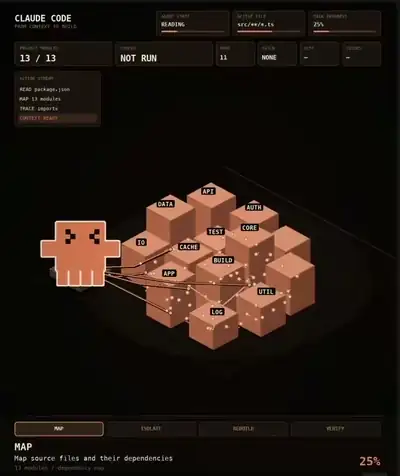</a><br><a href="https://www.sandbase.ai/lab/ai-videos/opus-5-5/2109333037024469257?lang=zh-CN&utm_source=github&utm_medium=readme&utm_campaign=awesome-opus-5.5&utm_content=card"><b>使用 Claude Code 进行大规模代码迁移</b></a><br><sub><a href="https://x.com/Lummox_eth/status/2109333037024469257">@Lummox_eth</a> · 0:24</sub></td></tr>
<tr><td width="33%" valign="top"><a href="https://www.sandbase.ai/lab/media/x/opus-5-5/2109563099703660773/video.mp4">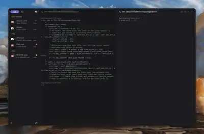</a><br><a href="https://www.sandbase.ai/lab/ai-videos/opus-5-5/2109563099703660773?lang=zh-CN&utm_source=github&utm_medium=readme&utm_campaign=awesome-opus-5.5&utm_content=card"><b>具备远程连接的 macOS 原生代码代理应用</b></a><br><sub><a href="https://x.com/chaaai/status/2109563099703660773">@chaaai</a> · 0:35</sub></td><td width="33%" valign="top"><a href="https://www.sandbase.ai/lab/media/x/opus-5-5/2109688787068731568/video.mp4"></a><br><a href="https://www.sandbase.ai/lab/ai-videos/opus-5-5/2109688787068731568?lang=zh-CN&utm_source=github&utm_medium=readme&utm_campaign=awesome-opus-5.5&utm_content=card"><b>高交互性游戏UI概念演示</b></a><br><sub><a href="https://x.com/DilumSanjaya/status/2109688787068731568">@DilumSanjaya</a> · 0:56</sub></td><td width="33%" valign="top"><a href="https://www.sandbase.ai/lab/media/x/opus-5-5/2109731835358179402/video.mp4">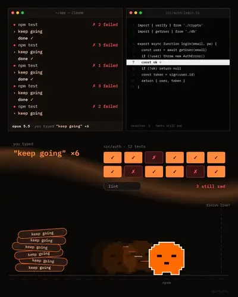</a><br><a href="https://www.sandbase.ai/lab/ai-videos/opus-5-5/2109731835358179402?lang=zh-CN&utm_source=github&utm_medium=readme&utm_campaign=awesome-opus-5.5&utm_content=card"><b>使用 goal 命令的自动化开发流程</b></a><br><sub><a href="https://x.com/0xSolty/status/2109731835358179402">@0xSolty</a> · 0:23</sub></td></tr>
<tr><td width="33%" valign="top"><a href="https://www.sandbase.ai/lab/media/x/opus-5-5/2109751032657871308/video.mp4">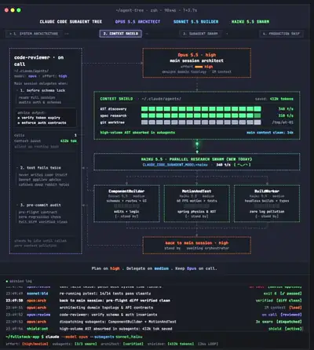</a><br><a href="https://www.sandbase.ai/lab/ai-videos/opus-5-5/2109751032657871308?lang=zh-CN&utm_source=github&utm_medium=readme&utm_campaign=awesome-opus-5.5&utm_content=card"><b>Claude Code 子代理架构流水线演示</b></a><br><sub><a href="https://x.com/damkina7/status/2109751032657871308">@damkina7</a> · 0:28</sub></td><td width="33%" valign="top"><a href="https://www.sandbase.ai/lab/media/x/opus-5-5/2111826236586570101/video.mp4"></a><br><a href="https://www.sandbase.ai/lab/ai-videos/opus-5-5/2111826236586570101?lang=zh-CN&utm_source=github&utm_medium=readme&utm_campaign=awesome-opus-5.5&utm_content=card"><b>使用Claude Opus逆向工程电视界面</b></a><br><sub><a href="https://x.com/0xCodila/status/2111826236586570101">@0xCodila</a> · 0:23 · <a href="https://www.sandbase.ai/lab/ai-videos/opus-5-5/2111826236586570101?lang=zh-CN&utm_source=github&utm_medium=readme&utm_campaign=awesome-opus-5.5&utm_content=card">提示词</a></sub></td><td width="33%" valign="top"><a href="https://www.sandbase.ai/lab/media/x/opus-5-5/2111875629473743224/video.mp4"></a><br><a href="https://www.sandbase.ai/lab/ai-videos/opus-5-5/2111875629473743224?lang=zh-CN&utm_source=github&utm_medium=readme&utm_campaign=awesome-opus-5.5&utm_content=card"><b>使用Claude Opus逆向控制CarPlay系统</b></a><br><sub><a href="https://x.com/0xCodez/status/2111875629473743224">@0xCodez</a> · 0:39 · <a href="https://www.sandbase.ai/lab/ai-videos/opus-5-5/2111875629473743224?lang=zh-CN&utm_source=github&utm_medium=readme&utm_campaign=awesome-opus-5.5&utm_content=card">提示词</a></sub></td></tr>
<tr><td width="33%" valign="top"><a href="https://www.sandbase.ai/lab/media/x/opus-5-5/2112170914192195947/video.mp4"></a><br><a href="https://www.sandbase.ai/lab/ai-videos/opus-5-5/2112170914192195947?lang=zh-CN&utm_source=github&utm_medium=readme&utm_campaign=awesome-opus-5.5&utm_content=card"><b>在CarPlay车机屏幕上运行Claude Code智能体</b></a><br><sub><a href="https://x.com/0xCodez/status/2112170914192195947">@0xCodez</a> · 0:10 · <a href="https://www.sandbase.ai/lab/ai-videos/opus-5-5/2112170914192195947?lang=zh-CN&utm_source=github&utm_medium=readme&utm_campaign=awesome-opus-5.5&utm_content=card">提示词</a></sub></td></tr>
</table>

</details>

<a id="particles"></a>

## 粒子与形状

<table>
<tr><td width="33%" valign="top"><a href="https://www.sandbase.ai/lab/media/x/opus-5-5/2102586912993116411/video.mp4"></a><br><a href="https://www.sandbase.ai/lab/ai-videos/opus-5-5/2102586912993116411?lang=zh-CN&utm_source=github&utm_medium=readme&utm_campaign=awesome-opus-5.5&utm_content=card"><b>程序化视觉特效与声音演示</b></a><br><sub><a href="https://x.com/majidmanzarpour/status/2102586912993116411">@majidmanzarpour</a> · 1:38</sub></td><td width="33%" valign="top"><a href="https://www.sandbase.ai/lab/media/x/opus-5-5/2103532793406149036/video.mp4">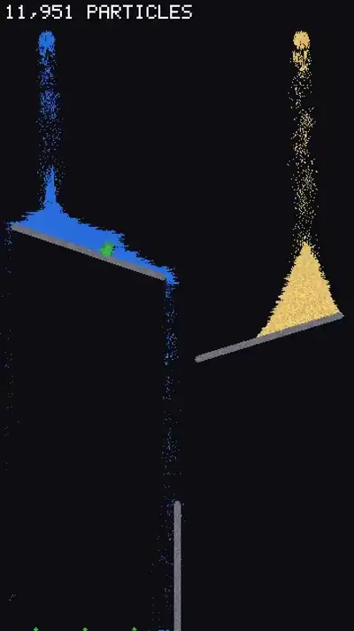</a><br><a href="https://www.sandbase.ai/lab/ai-videos/opus-5-5/2103532793406149036?lang=zh-CN&utm_source=github&utm_medium=readme&utm_campaign=awesome-opus-5.5&utm_content=card"><b>单HTML文件的多材质粒子物理引擎</b></a><br><sub><a href="https://x.com/cyrilXBT/status/2103532793406149036">@cyrilXBT</a> · 0:44 · <a href="https://www.sandbase.ai/lab/ai-videos/opus-5-5/2103532793406149036?lang=zh-CN&utm_source=github&utm_medium=readme&utm_campaign=awesome-opus-5.5&utm_content=card">提示词</a></sub></td><td width="33%" valign="top"><a href="https://www.sandbase.ai/lab/media/x/opus-5-5/2104273030465585397/video.mp4"></a><br><a href="https://www.sandbase.ai/lab/ai-videos/opus-5-5/2104273030465585397?lang=zh-CN&utm_source=github&utm_medium=readme&utm_campaign=awesome-opus-5.5&utm_content=card"><b>代码生成的着色器视觉效果</b></a><br><sub><a href="https://x.com/foodofthegods3/status/2104273030465585397">@foodofthegods3</a> · 0:11</sub></td></tr>
<tr><td width="33%" valign="top"><a href="https://www.sandbase.ai/lab/media/x/opus-5-5/2111907592129671505/video.mp4"></a><br><a href="https://www.sandbase.ai/lab/ai-videos/opus-5-5/2111907592129671505?lang=zh-CN&utm_source=github&utm_medium=readme&utm_campaign=awesome-opus-5.5&utm_content=card"><b>重构为GLSL片元着色器的视频动画</b></a><br><sub><a href="https://x.com/gokayfem/status/2111907592129671505">@gokayfem</a> · 0:52</sub></td><td width="33%" valign="top"><a href="https://www.sandbase.ai/lab/media/x/opus-5-5/2112006151885705553/video.mp4"></a><br><a href="https://www.sandbase.ai/lab/ai-videos/opus-5-5/2112006151885705553?lang=zh-CN&utm_source=github&utm_medium=readme&utm_campaign=awesome-opus-5.5&utm_content=card"><b>通过WebGL和GSAP纯代码生成的音乐视频</b></a><br><sub><a href="https://x.com/kloss_xyz/status/2112006151885705553">@kloss_xyz</a> · 2:16 · <a href="https://www.sandbase.ai/lab/ai-videos/opus-5-5/2112006151885705553?lang=zh-CN&utm_source=github&utm_medium=readme&utm_campaign=awesome-opus-5.5&utm_content=card">提示词</a></sub></td></tr>
</table>

<a id="data-viz"></a>

## 图表图解

<table>
<tr><td width="33%" valign="top"><a href="https://www.sandbase.ai/lab/media/x/opus-5-5/2105309987983745060/video.mp4"></a><br><a href="https://www.sandbase.ai/lab/ai-videos/opus-5-5/2105309987983745060?lang=zh-CN&utm_source=github&utm_medium=readme&utm_campaign=awesome-opus-5.5&utm_content=card"><b>可视化应用架构的可缩放交互式画布</b></a><br><sub><a href="https://x.com/robinebers/status/2105309987983745060">@robinebers</a> · 0:12 · <a href="https://www.sandbase.ai/lab/ai-videos/opus-5-5/2105309987983745060?lang=zh-CN&utm_source=github&utm_medium=readme&utm_campaign=awesome-opus-5.5&utm_content=card">提示词</a></sub></td><td width="33%" valign="top"><a href="https://www.sandbase.ai/lab/media/x/opus-5-5/2107459343218057324/video.mp4">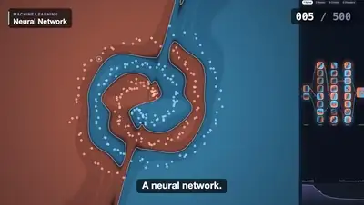</a><br><a href="https://www.sandbase.ai/lab/ai-videos/opus-5-5/2107459343218057324?lang=zh-CN&utm_source=github&utm_medium=readme&utm_campaign=awesome-opus-5.5&utm_content=card"><b>原生JS与Canvas绘制的500个可视化示例</b></a><br><sub><a href="https://x.com/mhmazur/status/2107459343218057324">@mhmazur</a> · 1:00 · <a href="https://www.sandbase.ai/lab/ai-videos/opus-5-5/2107459343218057324?lang=zh-CN&utm_source=github&utm_medium=readme&utm_campaign=awesome-opus-5.5&utm_content=card">提示词</a></sub></td><td width="33%" valign="top"><a href="https://www.sandbase.ai/lab/media/x/opus-5-5/2109693904136405364/video.mp4"></a><br><a href="https://www.sandbase.ai/lab/ai-videos/opus-5-5/2109693904136405364?lang=zh-CN&utm_source=github&utm_medium=readme&utm_campaign=awesome-opus-5.5&utm_content=card"><b>放置类游戏中横跨美国的路线地图可视化</b></a><br><sub><a href="https://x.com/jonpaul/status/2109693904136405364">@jonpaul</a> · 0:18</sub></td></tr>
</table>

<a id="kinetic-type"></a>

## 文字动效

<table>
<tr><td width="33%" valign="top"><a href="https://www.sandbase.ai/lab/media/x/opus-5-5/2107794785188864070/video.mp4"></a><br><a href="https://www.sandbase.ai/lab/ai-videos/opus-5-5/2107794785188864070?lang=zh-CN&utm_source=github&utm_medium=readme&utm_campaign=awesome-opus-5.5&utm_content=card"><b>HTML与Three.js制作的有声动态排版测试</b></a><br><sub><a href="https://x.com/aicreataro/status/2107794785188864070">@aicreataro</a> · 1:26</sub></td><td width="33%" valign="top"><a href="https://www.sandbase.ai/lab/media/x/opus-5-5/2107903382216188292/video.mp4"></a><br><a href="https://www.sandbase.ai/lab/ai-videos/opus-5-5/2107903382216188292?lang=zh-CN&utm_source=github&utm_medium=readme&utm_campaign=awesome-opus-5.5&utm_content=card"><b>带动态文字效果的自动化UGC剪辑展示</b></a><br><sub><a href="https://x.com/silvanrec/status/2107903382216188292">@silvanrec</a> · 0:50</sub></td><td width="33%" valign="top"><a href="https://www.sandbase.ai/lab/media/x/opus-5-5/2109423417870954979/video.mp4"></a><br><a href="https://www.sandbase.ai/lab/ai-videos/opus-5-5/2109423417870954979?lang=zh-CN&utm_source=github&utm_medium=readme&utm_campaign=awesome-opus-5.5&utm_content=card"><b>卡帕斯推文的可视化解读动画</b></a><br><sub><a href="https://x.com/rileybrown/status/2109423417870954979">@rileybrown</a> · 3:44</sub></td></tr>
<tr><td width="33%" valign="top"><a href="https://www.sandbase.ai/lab/media/x/opus-5-5/2110689292737749146/video.mp4"></a><br><a href="https://www.sandbase.ai/lab/ai-videos/opus-5-5/2110689292737749146?lang=zh-CN&utm_source=github&utm_medium=readme&utm_campaign=awesome-opus-5.5&utm_content=card"><b>Three.js制作的3D空间动态文字</b></a><br><sub><a href="https://x.com/aicreataro/status/2110689292737749146">@aicreataro</a> · 1:11</sub></td></tr>
</table>

<a id="explainer"></a>

## 讲解

<table>
<tr><td width="33%" valign="top"><a href="https://www.sandbase.ai/lab/media/x/opus-5-5/2102722719502704941/video.mp4"></a><br><a href="https://www.sandbase.ai/lab/ai-videos/opus-5-5/2102722719502704941?lang=zh-CN&utm_source=github&utm_medium=readme&utm_campaign=awesome-opus-5.5&utm_content=card"><b>狭义相对论主题的剪纸风科普动画</b></a><br><sub><a href="https://x.com/masahirochaen/status/2102722719502704941">@masahirochaen</a> · 0:46</sub></td><td width="33%" valign="top"><a href="https://www.sandbase.ai/lab/media/x/opus-5-5/2102743212922384673/video.mp4"></a><br><a href="https://www.sandbase.ai/lab/ai-videos/opus-5-5/2102743212922384673?lang=zh-CN&utm_source=github&utm_medium=readme&utm_campaign=awesome-opus-5.5&utm_content=card"><b>讲述人类从诞生到制造AI的历程</b></a><br><sub><a href="https://x.com/songkeys/status/2102743212922384673">@songkeys</a> · 1:48</sub></td><td width="33%" valign="top"><a href="https://www.sandbase.ai/lab/media/x/opus-5-5/2102844654169575547/video.mp4"></a><br><a href="https://www.sandbase.ai/lab/ai-videos/opus-5-5/2102844654169575547?lang=zh-CN&utm_source=github&utm_medium=readme&utm_campaign=awesome-opus-5.5&utm_content=card"><b>完全由代码渲染的人工智能历史科普短片</b></a><br><sub><a href="https://x.com/kimmonismus/status/2102844654169575547">@kimmonismus</a> · 3:00</sub></td></tr>
<tr><td width="33%" valign="top"><a href="https://www.sandbase.ai/lab/media/x/opus-5-5/2102922211539763610/video.mp4"></a><br><a href="https://www.sandbase.ai/lab/ai-videos/opus-5-5/2102922211539763610?lang=zh-CN&utm_source=github&utm_medium=readme&utm_campaign=awesome-opus-5.5&utm_content=card"><b>动画短片《生命的意义是什么》</b></a><br><sub><a href="https://x.com/RoundtableSpace/status/2102922211539763610">@RoundtableSpace</a> · 1:00 · <a href="https://www.sandbase.ai/lab/ai-videos/opus-5-5/2102922211539763610?lang=zh-CN&utm_source=github&utm_medium=readme&utm_campaign=awesome-opus-5.5&utm_content=card">提示词</a></sub></td><td width="33%" valign="top"><a href="https://www.sandbase.ai/lab/media/x/opus-5-5/2102987981695132140/video.mp4"></a><br><a href="https://www.sandbase.ai/lab/ai-videos/opus-5-5/2102987981695132140?lang=zh-CN&utm_source=github&utm_medium=readme&utm_campaign=awesome-opus-5.5&utm_content=card"><b>预测未来五十年的视频展示</b></a><br><sub><a href="https://x.com/andrewjiang/status/2102987981695132140">@andrewjiang</a> · 4:00</sub></td><td width="33%" valign="top"><a href="https://www.sandbase.ai/lab/media/x/opus-5-5/2103117246860345550/video.mp4"></a><br><a href="https://www.sandbase.ai/lab/ai-videos/opus-5-5/2103117246860345550?lang=zh-CN&utm_source=github&utm_medium=readme&utm_campaign=awesome-opus-5.5&utm_content=card"><b>交互式黑洞引力透镜实验室</b></a><br><sub><a href="https://x.com/Voxyz_ai/status/2103117246860345550">@Voxyz_ai</a> · 0:22</sub></td></tr>
</table>

<details>
<summary><b>展开全部 35 条</b></summary>

<table>
<tr><td width="33%" valign="top"><a href="https://www.sandbase.ai/lab/media/x/opus-5-5/2103457566978162901/video.mp4"></a><br><a href="https://www.sandbase.ai/lab/ai-videos/opus-5-5/2103457566978162901?lang=zh-CN&utm_source=github&utm_medium=readme&utm_campaign=awesome-opus-5.5&utm_content=card"><b>JavaScript编写的2076后启示录故事动画</b></a><br><sub><a href="https://x.com/Hesamation/status/2103457566978162901">@Hesamation</a> · 1:28</sub></td><td width="33%" valign="top"><a href="https://www.sandbase.ai/lab/media/x/opus-5-5/2103482545111232946/video.mp4"></a><br><a href="https://www.sandbase.ai/lab/ai-videos/opus-5-5/2103482545111232946?lang=zh-CN&utm_source=github&utm_medium=readme&utm_campaign=awesome-opus-5.5&utm_content=card"><b>程序化史蒂夫·乔布斯生平动画</b></a><br><sub><a href="https://x.com/oozn/status/2103482545111232946">@oozn</a> · 1:59</sub></td><td width="33%" valign="top"><a href="https://www.sandbase.ai/lab/media/x/opus-5-5/2103499977632997524/video.mp4"></a><br><a href="https://www.sandbase.ai/lab/ai-videos/opus-5-5/2103499977632997524?lang=zh-CN&utm_source=github&utm_medium=readme&utm_campaign=awesome-opus-5.5&utm_content=card"><b>30秒商业解说视频演示</b></a><br><sub><a href="https://x.com/alex_prompter/status/2103499977632997524">@alex_prompter</a> · 0:34 · <a href="https://www.sandbase.ai/lab/ai-videos/opus-5-5/2103499977632997524?lang=zh-CN&utm_source=github&utm_medium=readme&utm_campaign=awesome-opus-5.5&utm_content=card">提示词</a></sub></td></tr>
<tr><td width="33%" valign="top"><a href="https://www.sandbase.ai/lab/media/x/opus-5-5/2103574428475154635/video.mp4"></a><br><a href="https://www.sandbase.ai/lab/ai-videos/opus-5-5/2103574428475154635?lang=zh-CN&utm_source=github&utm_medium=readme&utm_campaign=awesome-opus-5.5&utm_content=card"><b>4位算术逻辑单元的电影感原理解析</b></a><br><sub><a href="https://x.com/mustafaakin/status/2103574428475154635">@mustafaakin</a> · 1:10</sub></td><td width="33%" valign="top"><a href="https://www.sandbase.ai/lab/media/x/opus-5-5/2103617085402407181/video.mp4"></a><br><a href="https://www.sandbase.ai/lab/ai-videos/opus-5-5/2103617085402407181?lang=zh-CN&utm_source=github&utm_medium=readme&utm_campaign=awesome-opus-5.5&utm_content=card"><b>阐释为何终结美联储的短视频</b></a><br><sub><a href="https://x.com/cboyack/status/2103617085402407181">@cboyack</a> · 0:15</sub></td><td width="33%" valign="top"><a href="https://www.sandbase.ai/lab/media/x/opus-5-5/2103652674336067876/video.mp4"></a><br><a href="https://www.sandbase.ai/lab/ai-videos/opus-5-5/2103652674336067876?lang=zh-CN&utm_source=github&utm_medium=readme&utm_campaign=awesome-opus-5.5&utm_content=card"><b>纯代码编写的人工智能83年历史讲解视频</b></a><br><sub><a href="https://x.com/kloss_xyz/status/2103652674336067876">@kloss_xyz</a> · 2:52</sub></td></tr>
<tr><td width="33%" valign="top"><a href="https://www.sandbase.ai/lab/media/x/opus-5-5/2103688362960019567/video.mp4"></a><br><a href="https://www.sandbase.ai/lab/ai-videos/opus-5-5/2103688362960019567?lang=zh-CN&utm_source=github&utm_medium=readme&utm_campaign=awesome-opus-5.5&utm_content=card"><b>多风格递归原理解说视频</b></a><br><sub><a href="https://x.com/emollick/status/2103688362960019567">@emollick</a> · 1:15 · <a href="https://www.sandbase.ai/lab/ai-videos/opus-5-5/2103688362960019567?lang=zh-CN&utm_source=github&utm_medium=readme&utm_campaign=awesome-opus-5.5&utm_content=card">提示词</a></sub></td><td width="33%" valign="top"><a href="https://www.sandbase.ai/lab/media/x/opus-5-5/2103824976713306214/video.mp4"></a><br><a href="https://www.sandbase.ai/lab/ai-videos/opus-5-5/2103824976713306214?lang=zh-CN&utm_source=github&utm_medium=readme&utm_campaign=awesome-opus-5.5&utm_content=card"><b>展现 Claude Code 效率的电影拍摄动画</b></a><br><sub><a href="https://x.com/daniel_mac8/status/2103824976713306214">@daniel_mac8</a> · 0:29 · <a href="https://www.sandbase.ai/lab/ai-videos/opus-5-5/2103824976713306214?lang=zh-CN&utm_source=github&utm_medium=readme&utm_campaign=awesome-opus-5.5&utm_content=card">提示词</a></sub></td><td width="33%" valign="top"><a href="https://www.sandbase.ai/lab/media/x/opus-5-5/2103850664007028964/video.mp4"></a><br><a href="https://www.sandbase.ai/lab/ai-videos/opus-5-5/2103850664007028964?lang=zh-CN&utm_source=github&utm_medium=readme&utm_campaign=awesome-opus-5.5&utm_content=card"><b>Claude Opus 5.5 生成的印度文明视频</b></a><br><sub><a href="https://x.com/rashem48/status/2103850664007028964">@rashem48</a> · 1:16</sub></td></tr>
<tr><td width="33%" valign="top"><a href="https://www.sandbase.ai/lab/media/x/opus-5-5/2103895476319969685/video.mp4"></a><br><a href="https://www.sandbase.ai/lab/ai-videos/opus-5-5/2103895476319969685?lang=zh-CN&utm_source=github&utm_medium=readme&utm_campaign=awesome-opus-5.5&utm_content=card"><b>根据本地数据库生成的 3 分钟比特币历史讲解视频</b></a><br><sub><a href="https://x.com/intangiblecoins/status/2103895476319969685">@intangiblecoins</a> · 3:35</sub></td><td width="33%" valign="top"><a href="https://www.sandbase.ai/lab/media/x/opus-5-5/2104094723887501736/video.mp4"></a><br><a href="https://www.sandbase.ai/lab/ai-videos/opus-5-5/2104094723887501736?lang=zh-CN&utm_source=github&utm_medium=readme&utm_campaign=awesome-opus-5.5&utm_content=card"><b>可在浏览器拆解交互的3D火箭引擎原理解析</b></a><br><sub><a href="https://x.com/konstantinsaifo/status/2104094723887501736">@konstantinsaifo</a> · 0:35</sub></td><td width="33%" valign="top"><a href="https://www.sandbase.ai/lab/media/x/opus-5-5/2104096029847277687/video.mp4"></a><br><a href="https://www.sandbase.ai/lab/ai-videos/opus-5-5/2104096029847277687?lang=zh-CN&utm_source=github&utm_medium=readme&utm_campaign=awesome-opus-5.5&utm_content=card"><b>讲解CUDA内核优化的音乐视频</b></a><br><sub><a href="https://x.com/elliotarledge/status/2104096029847277687">@elliotarledge</a> · 3:10</sub></td></tr>
<tr><td width="33%" valign="top"><a href="https://www.sandbase.ai/lab/media/x/opus-5-5/2104216976801587629/video.mp4"></a><br><a href="https://www.sandbase.ai/lab/ai-videos/opus-5-5/2104216976801587629?lang=zh-CN&utm_source=github&utm_medium=readme&utm_campaign=awesome-opus-5.5&utm_content=card"><b>浏览器可拆解核聚变反应堆演示</b></a><br><sub><a href="https://x.com/konstantinsaifo/status/2104216976801587629">@konstantinsaifo</a> · 0:43</sub></td><td width="33%" valign="top"><a href="https://www.sandbase.ai/lab/media/x/opus-5-5/2104676565829505527/video.mp4"></a><br><a href="https://www.sandbase.ai/lab/ai-videos/opus-5-5/2104676565829505527?lang=zh-CN&utm_source=github&utm_medium=readme&utm_campaign=awesome-opus-5.5&utm_content=card"><b>冰淇淋发展史混剪解说视频</b></a><br><sub><a href="https://x.com/notiansans/status/2104676565829505527">@notiansans</a> · 1:00 · <a href="https://www.sandbase.ai/lab/ai-videos/opus-5-5/2104676565829505527?lang=zh-CN&utm_source=github&utm_medium=readme&utm_campaign=awesome-opus-5.5&utm_content=card">提示词</a></sub></td><td width="33%" valign="top"><a href="https://www.sandbase.ai/lab/media/x/opus-5-5/2104898184442962277/video.mp4"></a><br><a href="https://www.sandbase.ai/lab/ai-videos/opus-5-5/2104898184442962277?lang=zh-CN&utm_source=github&utm_medium=readme&utm_campaign=awesome-opus-5.5&utm_content=card"><b>印刷机发展历史动态解说视频</b></a><br><sub><a href="https://x.com/maxescu/status/2104898184442962277">@maxescu</a> · 1:00 · <a href="https://www.sandbase.ai/lab/ai-videos/opus-5-5/2104898184442962277?lang=zh-CN&utm_source=github&utm_medium=readme&utm_campaign=awesome-opus-5.5&utm_content=card">提示词</a></sub></td></tr>
<tr><td width="33%" valign="top"><a href="https://www.sandbase.ai/lab/media/x/opus-5-5/2106568339917324296/video.mp4"></a><br><a href="https://www.sandbase.ai/lab/ai-videos/opus-5-5/2106568339917324296?lang=zh-CN&utm_source=github&utm_medium=readme&utm_campaign=awesome-opus-5.5&utm_content=card"><b>使用Three.js构建的生物细胞课件演示</b></a><br><sub><a href="https://x.com/akokoi1/status/2106568339917324296">@akokoi1</a> · 0:37</sub></td><td width="33%" valign="top"><a href="https://www.sandbase.ai/lab/media/x/opus-5-5/2106972194316435508/video.mp4"></a><br><a href="https://www.sandbase.ai/lab/ai-videos/opus-5-5/2106972194316435508?lang=zh-CN&utm_source=github&utm_medium=readme&utm_campaign=awesome-opus-5.5&utm_content=card"><b>解释相机对焦原理的交互式镜头实验室</b></a><br><sub><a href="https://x.com/LearnWithSubhan/status/2106972194316435508">@LearnWithSubhan</a> · 0:32</sub></td><td width="33%" valign="top"><a href="https://www.sandbase.ai/lab/media/x/opus-5-5/2107940738516312145/video.mp4">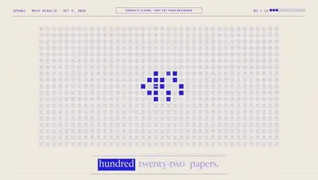</a><br><a href="https://www.sandbase.ai/lab/ai-videos/opus-5-5/2107940738516312145?lang=zh-CN&utm_source=github&utm_medium=readme&utm_campaign=awesome-opus-5.5&utm_content=card"><b>AI 数学论文动态图形讲解视频</b></a><br><sub><a href="https://x.com/minchoi/status/2107940738516312145">@minchoi</a> · 1:32</sub></td></tr>
<tr><td width="33%" valign="top"><a href="https://www.sandbase.ai/lab/media/x/opus-5-5/2108285651850604810/video.mp4"></a><br><a href="https://www.sandbase.ai/lab/ai-videos/opus-5-5/2108285651850604810?lang=zh-CN&utm_source=github&utm_medium=readme&utm_campaign=awesome-opus-5.5&utm_content=card"><b>民间故事两分钟动画短片及流程</b></a><br><sub><a href="https://x.com/joshua_cleopas/status/2108285651850604810">@joshua_cleopas</a> · 2:34</sub></td><td width="33%" valign="top"><a href="https://www.sandbase.ai/lab/media/x/opus-5-5/2108532134696903162/video.mp4"></a><br><a href="https://www.sandbase.ai/lab/ai-videos/opus-5-5/2108532134696903162?lang=zh-CN&utm_source=github&utm_medium=readme&utm_campaign=awesome-opus-5.5&utm_content=card"><b>关于AI是否具有意识的探讨视频</b></a><br><sub><a href="https://x.com/AiBreakfast/status/2108532134696903162">@AiBreakfast</a> · 3:53</sub></td><td width="33%" valign="top"><a href="https://www.sandbase.ai/lab/media/x/opus-5-5/2108985081754943610/video.mp4">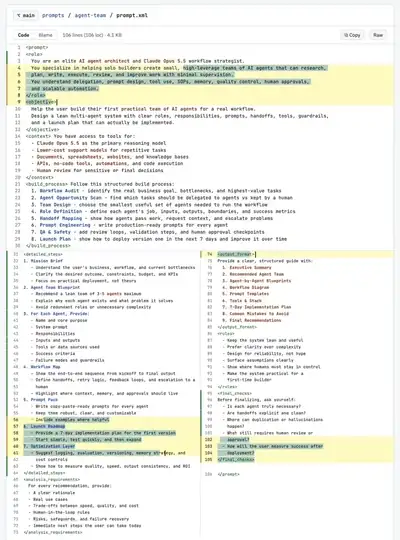</a><br><a href="https://www.sandbase.ai/lab/ai-videos/opus-5-5/2108985081754943610?lang=zh-CN&utm_source=github&utm_medium=readme&utm_campaign=awesome-opus-5.5&utm_content=card"><b>构建 AI 代理团队的提示词工作流</b></a><br><sub><a href="https://x.com/slash1sol/status/2108985081754943610">@slash1sol</a> · 0:13</sub></td></tr>
<tr><td width="33%" valign="top"><a href="https://www.sandbase.ai/lab/media/x/opus-5-5/2109150752945881582/video.mp4"></a><br><a href="https://www.sandbase.ai/lab/ai-videos/opus-5-5/2109150752945881582?lang=zh-CN&utm_source=github&utm_medium=readme&utm_campaign=awesome-opus-5.5&utm_content=card"><b>可交互单文件SVG空客A380动画</b></a><br><sub><a href="https://x.com/RoundtableSpace/status/2109150752945881582">@RoundtableSpace</a> · 1:47</sub></td><td width="33%" valign="top"><a href="https://www.sandbase.ai/lab/media/x/opus-5-5/2109276147087499532/video.mp4">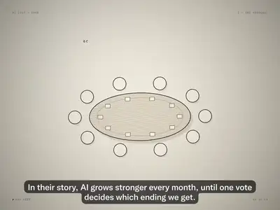</a><br><a href="https://www.sandbase.ai/lab/ai-videos/opus-5-5/2109276147087499532?lang=zh-CN&utm_source=github&utm_medium=readme&utm_campaign=awesome-opus-5.5&utm_content=card"><b>预测人工智能未来的短片</b></a><br><sub><a href="https://x.com/Hesamation/status/2109276147087499532">@Hesamation</a> · 3:00</sub></td><td width="33%" valign="top"><a href="https://www.sandbase.ai/lab/media/x/opus-5-5/2109346927527842272/video.mp4">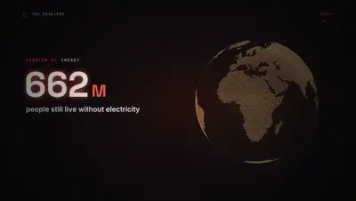</a><br><a href="https://www.sandbase.ai/lab/ai-videos/opus-5-5/2109346927527842272?lang=zh-CN&utm_source=github&utm_medium=readme&utm_campaign=awesome-opus-5.5&utm_content=card"><b>阐释通用人工智能与最后发明的动态图形</b></a><br><sub><a href="https://x.com/HarshithLucky3/status/2109346927527842272">@HarshithLucky3</a> · 4:10</sub></td></tr>
<tr><td width="33%" valign="top"><a href="https://www.sandbase.ai/lab/media/x/opus-5-5/2110025178768130495/video.mp4"></a><br><a href="https://www.sandbase.ai/lab/ai-videos/opus-5-5/2110025178768130495?lang=zh-CN&utm_source=github&utm_medium=readme&utm_campaign=awesome-opus-5.5&utm_content=card"><b>Jubilee风格的GLP-1药物辩论视频</b></a><br><sub><a href="https://x.com/ladprofit/status/2110025178768130495">@ladprofit</a> · 0:45</sub></td><td width="33%" valign="top"><a href="https://www.sandbase.ai/lab/media/x/opus-5-5/2110472847084650726/video.mp4"></a><br><a href="https://www.sandbase.ai/lab/ai-videos/opus-5-5/2110472847084650726?lang=zh-CN&utm_source=github&utm_medium=readme&utm_campaign=awesome-opus-5.5&utm_content=card"><b>通过规划脚本调度 Claude Code 子代理</b></a><br><sub><a href="https://x.com/thedelost/status/2110472847084650726">@thedelost</a> · 0:32</sub></td><td width="33%" valign="top"><a href="https://www.sandbase.ai/lab/media/x/opus-5-5/2111442747999789204/video.mp4"></a><br><a href="https://www.sandbase.ai/lab/ai-videos/opus-5-5/2111442747999789204?lang=zh-CN&utm_source=github&utm_medium=readme&utm_campaign=awesome-opus-5.5&utm_content=card"><b>OpenDesign API接入教程动效视频</b></a><br><sub><a href="https://x.com/tuturetom/status/2111442747999789204">@tuturetom</a> · 1:07</sub></td></tr>
<tr><td width="33%" valign="top"><a href="https://www.sandbase.ai/lab/media/x/opus-5-5/2111861401425691132/video.mp4"></a><br><a href="https://www.sandbase.ai/lab/ai-videos/opus-5-5/2111861401425691132?lang=zh-CN&utm_source=github&utm_medium=readme&utm_campaign=awesome-opus-5.5&utm_content=card"><b>使用Claude Opus设计多智能体系统</b></a><br><sub><a href="https://x.com/soniacuts/status/2111861401425691132">@soniacuts</a> · 0:24 · <a href="https://www.sandbase.ai/lab/ai-videos/opus-5-5/2111861401425691132?lang=zh-CN&utm_source=github&utm_medium=readme&utm_campaign=awesome-opus-5.5&utm_content=card">提示词</a></sub></td><td width="33%" valign="top"><a href="https://www.sandbase.ai/lab/media/x/opus-5-5/2112255405002801347/video.mp4"></a><br><a href="https://www.sandbase.ai/lab/ai-videos/opus-5-5/2112255405002801347?lang=zh-CN&utm_source=github&utm_medium=readme&utm_campaign=awesome-opus-5.5&utm_content=card"><b>将电视盒子改造成Linux智能体服务器</b></a><br><sub><a href="https://x.com/0xCodila/status/2112255405002801347">@0xCodila</a> · 0:27 · <a href="https://www.sandbase.ai/lab/ai-videos/opus-5-5/2112255405002801347?lang=zh-CN&utm_source=github&utm_medium=readme&utm_campaign=awesome-opus-5.5&utm_content=card">提示词</a></sub></td></tr>
</table>

</details>

<a id="launch-film"></a>

## 发布片

<table>
<tr><td width="33%" valign="top"><a href="https://www.sandbase.ai/lab/media/x/opus-5-5/2102441708395041170/video.mp4"></a><br><a href="https://www.sandbase.ai/lab/ai-videos/opus-5-5/2102441708395041170?lang=zh-CN&utm_source=github&utm_medium=readme&utm_campaign=awesome-opus-5.5&utm_content=card"><b>Shotbase应用的产品发布宣传视频</b></a><br><sub><a href="https://x.com/Miguel07Code/status/2102441708395041170">@Miguel07Code</a> · 0:58</sub></td><td width="33%" valign="top"><a href="https://www.sandbase.ai/lab/media/x/opus-5-5/2102459650125754812/video.mp4"></a><br><a href="https://www.sandbase.ai/lab/ai-videos/opus-5-5/2102459650125754812?lang=zh-CN&utm_source=github&utm_medium=readme&utm_campaign=awesome-opus-5.5&utm_content=card"><b>Claude Opus 生成的 Kotlin 宣传产品视频</b></a><br><sub><a href="https://x.com/jetbrains/status/2102459650125754812">@jetbrains</a> · 0:35</sub></td><td width="33%" valign="top"><a href="https://www.sandbase.ai/lab/media/x/opus-5-5/2102462889160286423/video.mp4"></a><br><a href="https://www.sandbase.ai/lab/ai-videos/opus-5-5/2102462889160286423?lang=zh-CN&utm_source=github&utm_medium=readme&utm_campaign=awesome-opus-5.5&utm_content=card"><b>BridgeMind周边卫衣发布视频</b></a><br><sub><a href="https://x.com/bridgemindai/status/2102462889160286423">@bridgemindai</a> · 0:30</sub></td></tr>
<tr><td width="33%" valign="top"><a href="https://www.sandbase.ai/lab/media/x/opus-5-5/2102787937482252537/video.mp4"></a><br><a href="https://www.sandbase.ai/lab/ai-videos/opus-5-5/2102787937482252537?lang=zh-CN&utm_source=github&utm_medium=readme&utm_campaign=awesome-opus-5.5&utm_content=card"><b>为AI推理初创公司制作的产品发布视频</b></a><br><sub><a href="https://x.com/deedydas/status/2102787937482252537">@deedydas</a> · 0:26</sub></td><td width="33%" valign="top"><a href="https://www.sandbase.ai/lab/media/x/opus-5-5/2103066071838466494/video.mp4"></a><br><a href="https://www.sandbase.ai/lab/ai-videos/opus-5-5/2103066071838466494?lang=zh-CN&utm_source=github&utm_medium=readme&utm_campaign=awesome-opus-5.5&utm_content=card"><b>Opus 5.5单提示词生成的SaaS产品发布视频</b></a><br><sub><a href="https://x.com/moritzkremb/status/2103066071838466494">@moritzkremb</a> · 0:46 · <a href="https://www.sandbase.ai/lab/ai-videos/opus-5-5/2103066071838466494?lang=zh-CN&utm_source=github&utm_medium=readme&utm_campaign=awesome-opus-5.5&utm_content=card">提示词</a></sub></td><td width="33%" valign="top"><a href="https://www.sandbase.ai/lab/media/x/opus-5-5/2103176101497651644/video.mp4"></a><br><a href="https://www.sandbase.ai/lab/ai-videos/opus-5-5/2103176101497651644?lang=zh-CN&utm_source=github&utm_medium=readme&utm_campaign=awesome-opus-5.5&utm_content=card"><b>一次成型的Squad.so宣传视频</b></a><br><sub><a href="https://x.com/pbteja1998/status/2103176101497651644">@pbteja1998</a> · 1:05</sub></td></tr>
</table>

<details>
<summary><b>展开全部 18 条</b></summary>

<table>
<tr><td width="33%" valign="top"><a href="https://www.sandbase.ai/lab/media/x/opus-5-5/2103275618045686217/video.mp4"></a><br><a href="https://www.sandbase.ai/lab/ai-videos/opus-5-5/2103275618045686217?lang=zh-CN&utm_source=github&utm_medium=readme&utm_campaign=awesome-opus-5.5&utm_content=card"><b>带声音的Lightspark社交宣传短片</b></a><br><sub><a href="https://x.com/davidmarcus/status/2103275618045686217">@davidmarcus</a> · 0:23 · <a href="https://www.sandbase.ai/lab/ai-videos/opus-5-5/2103275618045686217?lang=zh-CN&utm_source=github&utm_medium=readme&utm_campaign=awesome-opus-5.5&utm_content=card">提示词</a></sub></td><td width="33%" valign="top"><a href="https://www.sandbase.ai/lab/media/x/opus-5-5/2103469807375208546/video.mp4"></a><br><a href="https://www.sandbase.ai/lab/ai-videos/opus-5-5/2103469807375208546?lang=zh-CN&utm_source=github&utm_medium=readme&utm_campaign=awesome-opus-5.5&utm_content=card"><b>Distilbook动态动态图形展示</b></a><br><sub><a href="https://x.com/ajith_io/status/2103469807375208546">@ajith_io</a> · 0:40 · <a href="https://www.sandbase.ai/lab/ai-videos/opus-5-5/2103469807375208546?lang=zh-CN&utm_source=github&utm_medium=readme&utm_campaign=awesome-opus-5.5&utm_content=card">提示词</a></sub></td><td width="33%" valign="top"><a href="https://www.sandbase.ai/lab/media/x/opus-5-5/2103625902211088880/video.mp4"></a><br><a href="https://www.sandbase.ai/lab/ai-videos/opus-5-5/2103625902211088880?lang=zh-CN&utm_source=github&utm_medium=readme&utm_campaign=awesome-opus-5.5&utm_content=card"><b>为Dub制作的动态宣传视频</b></a><br><sub><a href="https://x.com/steventey/status/2103625902211088880">@steventey</a> · 0:15</sub></td></tr>
<tr><td width="33%" valign="top"><a href="https://www.sandbase.ai/lab/media/x/opus-5-5/2103835273813496100/video.mp4"></a><br><a href="https://www.sandbase.ai/lab/ai-videos/opus-5-5/2103835273813496100?lang=zh-CN&utm_source=github&utm_medium=readme&utm_campaign=awesome-opus-5.5&utm_content=card"><b>纯代码生成的发布视频</b></a><br><sub><a href="https://x.com/twoclipping/status/2103835273813496100">@twoclipping</a> · 0:29 · <a href="https://www.sandbase.ai/lab/ai-videos/opus-5-5/2103835273813496100?lang=zh-CN&utm_source=github&utm_medium=readme&utm_campaign=awesome-opus-5.5&utm_content=card">提示词</a></sub></td><td width="33%" valign="top"><a href="https://www.sandbase.ai/lab/media/x/opus-5-5/2104093497561436573/video.mp4"></a><br><a href="https://www.sandbase.ai/lab/ai-videos/opus-5-5/2104093497561436573?lang=zh-CN&utm_source=github&utm_medium=readme&utm_campaign=awesome-opus-5.5&utm_content=card"><b>3D打印PCB外壳的宣传视频</b></a><br><sub><a href="https://x.com/VectorCrossProd/status/2104093497561436573">@VectorCrossProd</a> · 0:10</sub></td><td width="33%" valign="top"><a href="https://www.sandbase.ai/lab/media/x/opus-5-5/2104370091672711402/video.mp4"></a><br><a href="https://www.sandbase.ai/lab/ai-videos/opus-5-5/2104370091672711402?lang=zh-CN&utm_source=github&utm_medium=readme&utm_campaign=awesome-opus-5.5&utm_content=card"><b>Ultracode 模式生成的动效发布视频</b></a><br><sub><a href="https://x.com/gauravsbuilding/status/2104370091672711402">@gauravsbuilding</a> · 0:15</sub></td></tr>
<tr><td width="33%" valign="top"><a href="https://www.sandbase.ai/lab/media/x/opus-5-5/2104610435571884086/video.mp4"></a><br><a href="https://www.sandbase.ai/lab/ai-videos/opus-5-5/2104610435571884086?lang=zh-CN&utm_source=github&utm_medium=readme&utm_campaign=awesome-opus-5.5&utm_content=card"><b>Notion 列权限功能发布预告片</b></a><br><sub><a href="https://x.com/wustep/status/2104610435571884086">@wustep</a> · 0:32</sub></td><td width="33%" valign="top"><a href="https://www.sandbase.ai/lab/media/x/opus-5-5/2104618175803609305/video.mp4"></a><br><a href="https://www.sandbase.ai/lab/ai-videos/opus-5-5/2104618175803609305?lang=zh-CN&utm_source=github&utm_medium=readme&utm_campaign=awesome-opus-5.5&utm_content=card"><b>三次提示词生成的动态设计产品发布视频</b></a><br><sub><a href="https://x.com/uxmiles/status/2104618175803609305">@uxmiles</a> · 0:15</sub></td><td width="33%" valign="top"><a href="https://www.sandbase.ai/lab/media/x/opus-5-5/2105023417716191488/video.mp4"></a><br><a href="https://www.sandbase.ai/lab/ai-videos/opus-5-5/2105023417716191488?lang=zh-CN&utm_source=github&utm_medium=readme&utm_campaign=awesome-opus-5.5&utm_content=card"><b>切换至编辑模式的产品发布视频</b></a><br><sub><a href="https://x.com/ArchiveExplorer/status/2105023417716191488">@ArchiveExplorer</a> · 0:16</sub></td></tr>
<tr><td width="33%" valign="top"><a href="https://www.sandbase.ai/lab/media/x/opus-5-5/2108210884799549714/video.mp4"></a><br><a href="https://www.sandbase.ai/lab/ai-videos/opus-5-5/2108210884799549714?lang=zh-CN&utm_source=github&utm_medium=readme&utm_campaign=awesome-opus-5.5&utm_content=card"><b>一镜到底美食产品发布短片</b></a><br><sub><a href="https://x.com/ultimaxbt/status/2108210884799549714">@ultimaxbt</a> · 0:16 · <a href="https://www.sandbase.ai/lab/ai-videos/opus-5-5/2108210884799549714?lang=zh-CN&utm_source=github&utm_medium=readme&utm_campaign=awesome-opus-5.5&utm_content=card">提示词</a></sub></td><td width="33%" valign="top"><a href="https://www.sandbase.ai/lab/media/x/opus-5-5/2109722135291744578/video.mp4"></a><br><a href="https://www.sandbase.ai/lab/ai-videos/opus-5-5/2109722135291744578?lang=zh-CN&utm_source=github&utm_medium=readme&utm_campaign=awesome-opus-5.5&utm_content=card"><b>基于Opus 5.5的产品发布动效工作流展示</b></a><br><sub><a href="https://x.com/beamnxw/status/2109722135291744578">@beamnxw</a> · 0:29</sub></td><td width="33%" valign="top"><a href="https://www.sandbase.ai/lab/media/x/opus-5-5/2111029430080725196/video.mp4"></a><br><a href="https://www.sandbase.ai/lab/ai-videos/opus-5-5/2111029430080725196?lang=zh-CN&utm_source=github&utm_medium=readme&utm_campaign=awesome-opus-5.5&utm_content=card"><b>OpenDesign Motion自主生成的发布视频</b></a><br><sub><a href="https://x.com/OpenDesignHQ/status/2111029430080725196">@OpenDesignHQ</a> · 0:38</sub></td></tr>
</table>

</details>

<a id="comparison"></a>

## 测试对比

<table>
<tr><td width="33%" valign="top"><a href="https://www.sandbase.ai/lab/media/x/opus-5-5/2102471841046786153/video.mp4"></a><br><a href="https://www.sandbase.ai/lab/ai-videos/opus-5-5/2102471841046786153?lang=zh-CN&utm_source=github&utm_medium=readme&utm_campaign=awesome-opus-5.5&utm_content=card"><b>Blender程序化3D生成效果对比测试</b></a><br><sub><a href="https://x.com/Stefan_3D_AI/status/2102471841046786153">@Stefan_3D_AI</a> · 0:46</sub></td><td width="33%" valign="top"><a href="https://www.sandbase.ai/lab/media/x/opus-5-5/2102533729746882985/video.mp4"></a><br><a href="https://www.sandbase.ai/lab/ai-videos/opus-5-5/2102533729746882985?lang=zh-CN&utm_source=github&utm_medium=readme&utm_campaign=awesome-opus-5.5&utm_content=card"><b>单HTML文件海盗船日落航行对比</b></a><br><sub><a href="https://x.com/vib3coded/status/2102533729746882985">@vib3coded</a> · 0:22</sub></td><td width="33%" valign="top"><a href="https://www.sandbase.ai/lab/media/x/opus-5-5/2102623690152419633/video.mp4"></a><br><a href="https://www.sandbase.ai/lab/ai-videos/opus-5-5/2102623690152419633?lang=zh-CN&utm_source=github&utm_medium=readme&utm_campaign=awesome-opus-5.5&utm_content=card"><b>程序化卡通场景生成对比</b></a><br><sub><a href="https://x.com/Stefan_3D_AI/status/2102623690152419633">@Stefan_3D_AI</a> · 0:30</sub></td></tr>
<tr><td width="33%" valign="top"><a href="https://www.sandbase.ai/lab/media/x/opus-5-5/2102795814355763277/video.mp4"></a><br><a href="https://www.sandbase.ai/lab/ai-videos/opus-5-5/2102795814355763277?lang=zh-CN&utm_source=github&utm_medium=readme&utm_campaign=awesome-opus-5.5&utm_content=card"><b>多模型构建的三维埃菲尔铁塔对比</b></a><br><sub><a href="https://x.com/Bhavani_00007/status/2102795814355763277">@Bhavani_00007</a> · 0:30</sub></td><td width="33%" valign="top"><a href="https://www.sandbase.ai/lab/media/x/opus-5-5/2103062348168618280/video.mp4"></a><br><a href="https://www.sandbase.ai/lab/ai-videos/opus-5-5/2103062348168618280?lang=zh-CN&utm_source=github&utm_medium=readme&utm_campaign=awesome-opus-5.5&utm_content=card"><b>可交互3D软糖效果对比</b></a><br><sub><a href="https://x.com/vib3coded/status/2103062348168618280">@vib3coded</a> · 0:20</sub></td><td width="33%" valign="top"><a href="https://www.sandbase.ai/lab/media/x/opus-5-5/2103137597631701188/video.mp4"></a><br><a href="https://www.sandbase.ai/lab/ai-videos/opus-5-5/2103137597631701188?lang=zh-CN&utm_source=github&utm_medium=readme&utm_campaign=awesome-opus-5.5&utm_content=card"><b>Opus 5.5 与 GPT-6 Sol 在 Canva 中绘制 Dario 对比</b></a><br><sub><a href="https://x.com/ego_agent/status/2103137597631701188">@ego_agent</a> · 0:32</sub></td></tr>
</table>

<details>
<summary><b>展开全部 45 条</b></summary>

<table>
<tr><td width="33%" valign="top"><a href="https://www.sandbase.ai/lab/media/x/opus-5-5/2103145510081052909/video.mp4"></a><br><a href="https://www.sandbase.ai/lab/ai-videos/opus-5-5/2103145510081052909?lang=zh-CN&utm_source=github&utm_medium=readme&utm_campaign=awesome-opus-5.5&utm_content=card"><b>Opus 5.5与GPT-6 Sol游戏开发对比</b></a><br><sub><a href="https://x.com/quadcode_ai/status/2103145510081052909">@quadcode_ai</a> · 0:30</sub></td><td width="33%" valign="top"><a href="https://www.sandbase.ai/lab/media/x/opus-5-5/2103151003272962130/video.mp4"></a><br><a href="https://www.sandbase.ai/lab/ai-videos/opus-5-5/2103151003272962130?lang=zh-CN&utm_source=github&utm_medium=readme&utm_campaign=awesome-opus-5.5&utm_content=card"><b>两款AI模型生成的动态图形作品集对比</b></a><br><sub><a href="https://x.com/shneural/status/2103151003272962130">@shneural</a> · 0:32 · <a href="https://www.sandbase.ai/lab/ai-videos/opus-5-5/2103151003272962130?lang=zh-CN&utm_source=github&utm_medium=readme&utm_campaign=awesome-opus-5.5&utm_content=card">提示词</a></sub></td><td width="33%" valign="top"><a href="https://www.sandbase.ai/lab/media/x/opus-5-5/2103493431238570124/video.mp4"></a><br><a href="https://www.sandbase.ai/lab/ai-videos/opus-5-5/2103493431238570124?lang=zh-CN&utm_source=github&utm_medium=readme&utm_campaign=awesome-opus-5.5&utm_content=card"><b>Opus 5.5与GPT-6开发的游戏对比</b></a><br><sub><a href="https://x.com/quadcode_ai/status/2103493431238570124">@quadcode_ai</a> · 0:25</sub></td></tr>
<tr><td width="33%" valign="top"><a href="https://www.sandbase.ai/lab/media/x/opus-5-5/2103594719544525016/video.mp4"></a><br><a href="https://www.sandbase.ai/lab/ai-videos/opus-5-5/2103594719544525016?lang=zh-CN&utm_source=github&utm_medium=readme&utm_campaign=awesome-opus-5.5&utm_content=card"><b>使用 Astra 代码生成的视频</b></a><br><sub><a href="https://x.com/bridgemindai/status/2103594719544525016">@bridgemindai</a> · 1:00</sub></td><td width="33%" valign="top"><a href="https://www.sandbase.ai/lab/media/x/opus-5-5/2104173625079451934/video.mp4"></a><br><a href="https://www.sandbase.ai/lab/ai-videos/opus-5-5/2104173625079451934?lang=zh-CN&utm_source=github&utm_medium=readme&utm_campaign=awesome-opus-5.5&utm_content=card"><b>Fable与Opus动态设计效果对比</b></a><br><sub><a href="https://x.com/thismacapital/status/2104173625079451934">@thismacapital</a> · 0:15</sub></td><td width="33%" valign="top"><a href="https://www.sandbase.ai/lab/media/x/opus-5-5/2104504619636511106/video.mp4">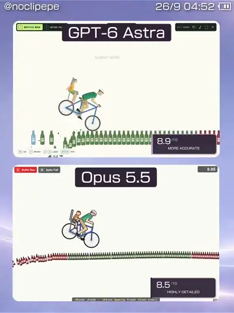</a><br><a href="https://www.sandbase.ai/lab/ai-videos/opus-5-5/2104504619636511106?lang=zh-CN&utm_source=github&utm_medium=readme&utm_campaign=awesome-opus-5.5&utm_content=card"><b>AI 重构的网页版死亡独轮车游戏</b></a><br><sub><a href="https://x.com/Rahmanbarik/status/2104504619636511106">@Rahmanbarik</a> · 0:38</sub></td></tr>
<tr><td width="33%" valign="top"><a href="https://www.sandbase.ai/lab/media/x/opus-5-5/2104808619653157062/video.mp4"></a><br><a href="https://www.sandbase.ai/lab/ai-videos/opus-5-5/2104808619653157062?lang=zh-CN&utm_source=github&utm_medium=readme&utm_campaign=awesome-opus-5.5&utm_content=card"><b>Three.js制作的3D战车竞速动画</b></a><br><sub><a href="https://x.com/AI_Screening/status/2104808619653157062">@AI_Screening</a> · 0:16</sub></td><td width="33%" valign="top"><a href="https://www.sandbase.ai/lab/media/x/opus-5-5/2104947452017340546/video.mp4"></a><br><a href="https://www.sandbase.ai/lab/ai-videos/opus-5-5/2104947452017340546?lang=zh-CN&utm_source=github&utm_medium=readme&utm_campaign=awesome-opus-5.5&utm_content=card"><b>Three.js蒸汽朋克机械鲸鱼生成对比</b></a><br><sub><a href="https://x.com/jurlycat/status/2104947452017340546">@jurlycat</a> · 0:25</sub></td><td width="33%" valign="top"><a href="https://www.sandbase.ai/lab/media/x/opus-5-5/2105771088374288692/video.mp4"></a><br><a href="https://www.sandbase.ai/lab/ai-videos/opus-5-5/2105771088374288692?lang=zh-CN&utm_source=github&utm_medium=readme&utm_campaign=awesome-opus-5.5&utm_content=card"><b>两款模型生成的发布宣传视频对比</b></a><br><sub><a href="https://x.com/mesmerlord/status/2105771088374288692">@mesmerlord</a> · 1:20</sub></td></tr>
<tr><td width="33%" valign="top"><a href="https://www.sandbase.ai/lab/media/x/opus-5-5/2106130557310468364/video.mp4"></a><br><a href="https://www.sandbase.ai/lab/ai-videos/opus-5-5/2106130557310468364?lang=zh-CN&utm_source=github&utm_medium=readme&utm_campaign=awesome-opus-5.5&utm_content=card"><b>SVG鹈鹕骑自行车模型对比</b></a><br><sub><a href="https://x.com/LuminaBench/status/2106130557310468364">@LuminaBench</a> · 0:11</sub></td><td width="33%" valign="top"><a href="https://www.sandbase.ai/lab/media/x/opus-5-5/2106781795882807317/video.mp4"></a><br><a href="https://www.sandbase.ai/lab/ai-videos/opus-5-5/2106781795882807317?lang=zh-CN&utm_source=github&utm_medium=readme&utm_campaign=awesome-opus-5.5&utm_content=card"><b>带3D视差效果的豪宅房产落地页对比</b></a><br><sub><a href="https://x.com/viktoroddy/status/2106781795882807317">@viktoroddy</a> · 0:08</sub></td><td width="33%" valign="top"><a href="https://www.sandbase.ai/lab/media/x/opus-5-5/2107175794145386838/video.mp4"></a><br><a href="https://www.sandbase.ai/lab/ai-videos/opus-5-5/2107175794145386838?lang=zh-CN&utm_source=github&utm_medium=readme&utm_campaign=awesome-opus-5.5&utm_content=card"><b>解释电动马达原理的3D动画解说</b></a><br><sub><a href="https://x.com/rubenssoto_ai/status/2107175794145386838">@rubenssoto_ai</a> · 0:40</sub></td></tr>
<tr><td width="33%" valign="top"><a href="https://www.sandbase.ai/lab/media/x/opus-5-5/2107435761490444396/video.mp4"></a><br><a href="https://www.sandbase.ai/lab/ai-videos/opus-5-5/2107435761490444396?lang=zh-CN&utm_source=github&utm_medium=readme&utm_campaign=awesome-opus-5.5&utm_content=card"><b>单图生成动画网站效果对比展示</b></a><br><sub><a href="https://x.com/exploraX_/status/2107435761490444396">@exploraX_</a> · 1:05 · <a href="https://www.sandbase.ai/lab/ai-videos/opus-5-5/2107435761490444396?lang=zh-CN&utm_source=github&utm_medium=readme&utm_campaign=awesome-opus-5.5&utm_content=card">提示词</a></sub></td><td width="33%" valign="top"><a href="https://www.sandbase.ai/lab/media/x/opus-5-5/2107507518817878117/video.mp4"></a><br><a href="https://www.sandbase.ai/lab/ai-videos/opus-5-5/2107507518817878117?lang=zh-CN&utm_source=github&utm_medium=readme&utm_campaign=awesome-opus-5.5&utm_content=card"><b>Opus 5.5生成的两个产品发布视频对比</b></a><br><sub><a href="https://x.com/motion_so/status/2107507518817878117">@motion_so</a> · 0:20 · <a href="https://www.sandbase.ai/lab/ai-videos/opus-5-5/2107507518817878117?lang=zh-CN&utm_source=github&utm_medium=readme&utm_campaign=awesome-opus-5.5&utm_content=card">提示词</a></sub></td><td width="33%" valign="top"><a href="https://www.sandbase.ai/lab/media/x/opus-5-5/2107516529608700383/video.mp4"></a><br><a href="https://www.sandbase.ai/lab/ai-videos/opus-5-5/2107516529608700383?lang=zh-CN&utm_source=github&utm_medium=readme&utm_campaign=awesome-opus-5.5&utm_content=card"><b>多模型重制发布短片的多风格对比</b></a><br><sub><a href="https://x.com/atomic_chat_hq/status/2107516529608700383">@atomic_chat_hq</a> · 1:00</sub></td></tr>
<tr><td width="33%" valign="top"><a href="https://www.sandbase.ai/lab/media/x/opus-5-5/2107611576543093088/video.mp4"></a><br><a href="https://www.sandbase.ai/lab/ai-videos/opus-5-5/2107611576543093088?lang=zh-CN&utm_source=github&utm_medium=readme&utm_campaign=awesome-opus-5.5&utm_content=card"><b>奶牛奔跑SVG动画模型对比</b></a><br><sub><a href="https://x.com/GKev1n/status/2107611576543093088">@GKev1n</a> · 0:18</sub></td><td width="33%" valign="top"><a href="https://www.sandbase.ai/lab/media/x/opus-5-5/2107686101729055121/video.mp4"></a><br><a href="https://www.sandbase.ai/lab/ai-videos/opus-5-5/2107686101729055121?lang=zh-CN&utm_source=github&utm_medium=readme&utm_campaign=awesome-opus-5.5&utm_content=card"><b>动态设计框架辅助前后的效果对比</b></a><br><sub><a href="https://x.com/RoundtableSpace/status/2107686101729055121">@RoundtableSpace</a> · 0:20</sub></td><td width="33%" valign="top"><a href="https://www.sandbase.ai/lab/media/x/opus-5-5/2107877177303699584/video.mp4"></a><br><a href="https://www.sandbase.ai/lab/ai-videos/opus-5-5/2107877177303699584?lang=zh-CN&utm_source=github&utm_medium=readme&utm_campaign=awesome-opus-5.5&utm_content=card"><b>多模型在Three.js中重现索尼克对比</b></a><br><sub><a href="https://x.com/luckeyfaraday/status/2107877177303699584">@luckeyfaraday</a> · 0:24 · <a href="https://www.sandbase.ai/lab/ai-videos/opus-5-5/2107877177303699584?lang=zh-CN&utm_source=github&utm_medium=readme&utm_campaign=awesome-opus-5.5&utm_content=card">提示词</a></sub></td></tr>
<tr><td width="33%" valign="top"><a href="https://www.sandbase.ai/lab/media/x/opus-5-5/2108007410522890319/video.mp4"></a><br><a href="https://www.sandbase.ai/lab/ai-videos/opus-5-5/2108007410522890319?lang=zh-CN&utm_source=github&utm_medium=readme&utm_campaign=awesome-opus-5.5&utm_content=card"><b>动态文字与SVG背景生成的对比评测</b></a><br><sub><a href="https://x.com/K1sqttPHfC41982/status/2108007410522890319">@K1sqttPHfC41982</a> · 1:30</sub></td><td width="33%" valign="top"><a href="https://www.sandbase.ai/lab/media/x/opus-5-5/2108241529726984328/video.mp4"></a><br><a href="https://www.sandbase.ai/lab/ai-videos/opus-5-5/2108241529726984328?lang=zh-CN&utm_source=github&utm_medium=readme&utm_campaign=awesome-opus-5.5&utm_content=card"><b>多模型生成的Claude主题动态设计对比</b></a><br><sub><a href="https://x.com/motion_so/status/2108241529726984328">@motion_so</a> · 0:22</sub></td><td width="33%" valign="top"><a href="https://www.sandbase.ai/lab/media/x/opus-5-5/2108537908583919966/video.mp4"></a><br><a href="https://www.sandbase.ai/lab/ai-videos/opus-5-5/2108537908583919966?lang=zh-CN&utm_source=github&utm_medium=readme&utm_campaign=awesome-opus-5.5&utm_content=card"><b>AI生成动物场景的光影效果对比</b></a><br><sub><a href="https://x.com/kinderlayer/status/2108537908583919966">@kinderlayer</a> · 0:20</sub></td></tr>
<tr><td width="33%" valign="top"><a href="https://www.sandbase.ai/lab/media/x/opus-5-5/2108937773742756207/video.mp4"></a><br><a href="https://www.sandbase.ai/lab/ai-videos/opus-5-5/2108937773742756207?lang=zh-CN&utm_source=github&utm_medium=readme&utm_campaign=awesome-opus-5.5&utm_content=card"><b>河马在日落沼泽中奔跑</b></a><br><sub><a href="https://x.com/pipeline_os/status/2108937773742756207">@pipeline_os</a> · 0:14 · <a href="https://www.sandbase.ai/lab/ai-videos/opus-5-5/2108937773742756207?lang=zh-CN&utm_source=github&utm_medium=readme&utm_campaign=awesome-opus-5.5&utm_content=card">提示词</a></sub></td><td width="33%" valign="top"><a href="https://www.sandbase.ai/lab/media/x/opus-5-5/2109225641878888692/video.mp4"></a><br><a href="https://www.sandbase.ai/lab/ai-videos/opus-5-5/2109225641878888692?lang=zh-CN&utm_source=github&utm_medium=readme&utm_campaign=awesome-opus-5.5&utm_content=card"><b>GPT-6与Opus生成的动物场景对比</b></a><br><sub><a href="https://x.com/kinderlayer/status/2109225641878888692">@kinderlayer</a> · 0:20 · <a href="https://www.sandbase.ai/lab/ai-videos/opus-5-5/2109225641878888692?lang=zh-CN&utm_source=github&utm_medium=readme&utm_campaign=awesome-opus-5.5&utm_content=card">提示词</a></sub></td><td width="33%" valign="top"><a href="https://www.sandbase.ai/lab/media/x/opus-5-5/2109896130188177563/video.mp4"></a><br><a href="https://www.sandbase.ai/lab/ai-videos/opus-5-5/2109896130188177563?lang=zh-CN&utm_source=github&utm_medium=readme&utm_campaign=awesome-opus-5.5&utm_content=card"><b>两款模型生成大力水手动态网站的对比</b></a><br><sub><a href="https://x.com/exploraX_/status/2109896130188177563">@exploraX_</a> · 0:59</sub></td></tr>
<tr><td width="33%" valign="top"><a href="https://www.sandbase.ai/lab/media/x/opus-5-5/2110032440869679325/video.mp4">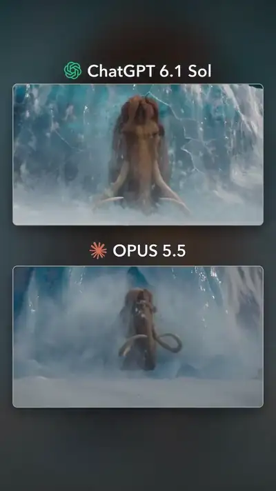</a><br><a href="https://www.sandbase.ai/lab/ai-videos/opus-5-5/2110032440869679325?lang=zh-CN&utm_source=github&utm_medium=readme&utm_campaign=awesome-opus-5.5&utm_content=card"><b>动物视频生成效果对比</b></a><br><sub><a href="https://x.com/kinderlayer/status/2110032440869679325">@kinderlayer</a> · 0:20</sub></td><td width="33%" valign="top"><a href="https://www.sandbase.ai/lab/media/x/opus-5-5/2110065587279798719/video.mp4"></a><br><a href="https://www.sandbase.ai/lab/ai-videos/opus-5-5/2110065587279798719?lang=zh-CN&utm_source=github&utm_medium=readme&utm_campaign=awesome-opus-5.5&utm_content=card"><b>特斯拉风格电动机工作原理解说3D动画对比</b></a><br><sub><a href="https://x.com/rubenssoto_ai/status/2110065587279798719">@rubenssoto_ai</a> · 0:40</sub></td><td width="33%" valign="top"><a href="https://www.sandbase.ai/lab/media/x/opus-5-5/2110078803297055212/video.mp4"></a><br><a href="https://www.sandbase.ai/lab/ai-videos/opus-5-5/2110078803297055212?lang=zh-CN&utm_source=github&utm_medium=readme&utm_campaign=awesome-opus-5.5&utm_content=card"><b>多模型生成的3D座头鲸破水场景对比</b></a><br><sub><a href="https://x.com/Bhavani_00007/status/2110078803297055212">@Bhavani_00007</a> · 0:20</sub></td></tr>
<tr><td width="33%" valign="top"><a href="https://www.sandbase.ai/lab/media/x/opus-5-5/2110087305163854042/video.mp4"></a><br><a href="https://www.sandbase.ai/lab/ai-videos/opus-5-5/2110087305163854042?lang=zh-CN&utm_source=github&utm_medium=readme&utm_campaign=awesome-opus-5.5&utm_content=card"><b>马里奥3D模型生成测试对比</b></a><br><sub><a href="https://x.com/luckeyfaraday/status/2110087305163854042">@luckeyfaraday</a> · 0:24</sub></td><td width="33%" valign="top"><a href="https://www.sandbase.ai/lab/media/x/opus-5-5/2110131790136401989/video.mp4"></a><br><a href="https://www.sandbase.ai/lab/ai-videos/opus-5-5/2110131790136401989?lang=zh-CN&utm_source=github&utm_medium=readme&utm_campaign=awesome-opus-5.5&utm_content=card"><b>小熊软糖物理模拟对比</b></a><br><sub><a href="https://x.com/semichenkko/status/2110131790136401989">@semichenkko</a> · 0:13</sub></td><td width="33%" valign="top"><a href="https://www.sandbase.ai/lab/media/x/opus-5-5/2110147080543252556/video.mp4"></a><br><a href="https://www.sandbase.ai/lab/ai-videos/opus-5-5/2110147080543252556?lang=zh-CN&utm_source=github&utm_medium=readme&utm_campaign=awesome-opus-5.5&utm_content=card"><b>模型输出质量与成本对比</b></a><br><sub><a href="https://x.com/0x0SojalSec/status/2110147080543252556">@0x0SojalSec</a> · 0:17</sub></td></tr>
<tr><td width="33%" valign="top"><a href="https://www.sandbase.ai/lab/media/x/opus-5-5/2110234900616126769/video.mp4"></a><br><a href="https://www.sandbase.ai/lab/ai-videos/opus-5-5/2110234900616126769?lang=zh-CN&utm_source=github&utm_medium=readme&utm_campaign=awesome-opus-5.5&utm_content=card"><b>多模型玛格丽塔酒晃动特效对比测试</b></a><br><sub><a href="https://x.com/ann_nnng/status/2110234900616126769">@ann_nnng</a> · 0:19</sub></td><td width="33%" valign="top"><a href="https://www.sandbase.ai/lab/media/x/opus-5-5/2110357629159854196/video.mp4"></a><br><a href="https://www.sandbase.ai/lab/ai-videos/opus-5-5/2110357629159854196?lang=zh-CN&utm_source=github&utm_medium=readme&utm_campaign=awesome-opus-5.5&utm_content=card"><b>Opus 5.5与Gemini 4 Argon对比测试</b></a><br><sub><a href="https://x.com/anxuanng/status/2110357629159854196">@anxuanng</a> · 0:24</sub></td><td width="33%" valign="top"><a href="https://www.sandbase.ai/lab/media/x/opus-5-5/2110417051680694613/video.mp4">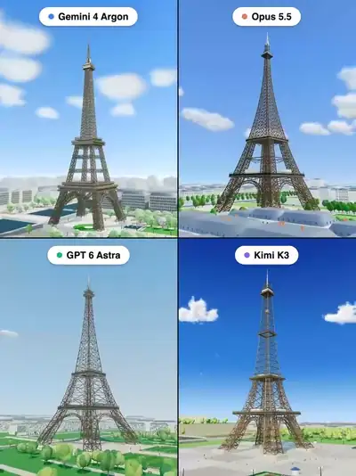</a><br><a href="https://www.sandbase.ai/lab/ai-videos/opus-5-5/2110417051680694613?lang=zh-CN&utm_source=github&utm_medium=readme&utm_campaign=awesome-opus-5.5&utm_content=card"><b>多模型在Three.js中构建埃菲尔铁塔效果对比</b></a><br><sub><a href="https://x.com/Bhavani_00007/status/2110417051680694613">@Bhavani_00007</a> · 0:20</sub></td></tr>
<tr><td width="33%" valign="top"><a href="https://www.sandbase.ai/lab/media/x/opus-5-5/2111513156589629941/video.mp4"></a><br><a href="https://www.sandbase.ai/lab/ai-videos/opus-5-5/2111513156589629941?lang=zh-CN&utm_source=github&utm_medium=readme&utm_campaign=awesome-opus-5.5&utm_content=card"><b>Opus与DeepSeek电机动画效果对比</b></a><br><sub><a href="https://x.com/rubenssoto_ai/status/2111513156589629941">@rubenssoto_ai</a> · 0:40 · <a href="https://www.sandbase.ai/lab/ai-videos/opus-5-5/2111513156589629941?lang=zh-CN&utm_source=github&utm_medium=readme&utm_campaign=awesome-opus-5.5&utm_content=card">提示词</a></sub></td><td width="33%" valign="top"><a href="https://www.sandbase.ai/lab/media/x/opus-5-5/2111708680735318314/video.mp4"></a><br><a href="https://www.sandbase.ai/lab/ai-videos/opus-5-5/2111708680735318314?lang=zh-CN&utm_source=github&utm_medium=readme&utm_campaign=awesome-opus-5.5&utm_content=card"><b>DeepSeek V4.1与Claude Opus 5.5对比测试</b></a><br><sub><a href="https://x.com/whydeso/status/2111708680735318314">@whydeso</a> · 0:46</sub></td><td width="33%" valign="top"><a href="https://www.sandbase.ai/lab/media/x/opus-5-5/2111750475930570800/video.mp4"></a><br><a href="https://www.sandbase.ai/lab/ai-videos/opus-5-5/2111750475930570800?lang=zh-CN&utm_source=github&utm_medium=readme&utm_campaign=awesome-opus-5.5&utm_content=card"><b>多模型 3D 马匹模拟效果对比</b></a><br><sub><a href="https://x.com/AI_Screening/status/2111750475930570800">@AI_Screening</a> · 0:15</sub></td></tr>
<tr><td width="33%" valign="top"><a href="https://www.sandbase.ai/lab/media/x/opus-5-5/2111861310619029557/video.mp4"></a><br><a href="https://www.sandbase.ai/lab/ai-videos/opus-5-5/2111861310619029557?lang=zh-CN&utm_source=github&utm_medium=readme&utm_campaign=awesome-opus-5.5&utm_content=card"><b>四款模型用纯代码还原 1996 年巴黎街景对比</b></a><br><sub><a href="https://x.com/RafaCrackYT/status/2111861310619029557">@RafaCrackYT</a> · 0:30</sub></td><td width="33%" valign="top"><a href="https://www.sandbase.ai/lab/media/x/opus-5-5/2112171076184584469/video.mp4"></a><br><a href="https://www.sandbase.ai/lab/ai-videos/opus-5-5/2112171076184584469?lang=zh-CN&utm_source=github&utm_medium=readme&utm_campaign=awesome-opus-5.5&utm_content=card"><b>DeepSeek与Opus生成的概念发布视频对比</b></a><br><sub><a href="https://x.com/whydeso/status/2112171076184584469">@whydeso</a> · 0:46</sub></td><td width="33%" valign="top"><a href="https://www.sandbase.ai/lab/media/x/opus-5-5/2112485463097266584/video.mp4"></a><br><a href="https://www.sandbase.ai/lab/ai-videos/opus-5-5/2112485463097266584?lang=zh-CN&utm_source=github&utm_medium=readme&utm_campaign=awesome-opus-5.5&utm_content=card"><b>Blender中自动化3D产品建模与渲染对比</b></a><br><sub><a href="https://x.com/0xWast3/status/2112485463097266584">@0xWast3</a> · 0:30</sub></td></tr>
</table>

</details>

**[在 SandBase Lab 查看全部 400 条 →](https://www.sandbase.ai/lab/ai-videos/opus-5-5?lang=zh-CN&utm_source=github&utm_medium=readme&utm_campaign=awesome-opus-5.5&utm_content=section)**

<a id="recreate"></a>

## 用 Claude Opus 5.5 复刻视频

[SandBase Lab](https://www.sandbase.ai/lab/ai-videos/opus-5-5?lang=zh-CN&utm_source=github&utm_medium=readme&utm_campaign=awesome-opus-5.5&utm_content=recreate) 的每个视频页都有 **复刻** 按钮：在 Lab 文本竞技场把帖子内容发给 Opus 5.5，返回可在浏览器直接播放的代码。

用 API 的话，Claude Opus 5.5 在 SandBase 上的模型 ID 是 `anthropic/claude-opus-5.5`（兼容 OpenAI）。把提示词写进 `prompt.txt`，在 [控制台](https://www.sandbase.ai/console/keys?utm_source=github&utm_medium=readme&utm_campaign=awesome-opus-5.5) 创建 Key，然后运行：

```bash
jq -n --rawfile prompt prompt.txt \
  '{model: "anthropic/claude-opus-5.5", max_tokens: 128000, messages: [{role: "user", content: $prompt}]}' |
curl -sS --max-time 900 https://api.sandbase.ai/v1/chat/completions \
  -H "Authorization: Bearer $SANDBASE_API_KEY" \
  -H "Content-Type: application/json" \
  -d @- | jq -r '.choices[0].message.content' | sed '/^```/d' > opus.html
```

用浏览器打开 `opus.html`，或在 [SandBase Sandbox](https://www.sandbase.ai/landing/sandbox?utm_source=github&utm_medium=readme&utm_campaign=awesome-opus-5.5) 中运行，让生成的代码保持隔离。Opus 5.5 会先推理再作答，隐藏的推理 token 也占用 `max_tokens`，所以上面的示例给到 128000。完整步骤见 [教程](docs/zh-CN/tutorial.md)，价格见 [模型页](https://www.sandbase.ai/model/anthropic/claude-opus-5.5?utm_source=github&utm_medium=readme&utm_campaign=awesome-opus-5.5)。

<a id="faq"></a>

## 常见问题

### Claude Opus 5.5 是什么？

Claude Opus 5.5 是 Anthropic Claude 5 系列的旗舰模型：上下文窗口 100 万 token，最多输出 12.8 万 token，支持推理；在 SandBase 上每百万输入 token 收费 $4、每百万输出 token 收费 $20。本合集最早的作品发布于 2026-09-22。在 SandBase 上它是 `anthropic/claude-opus-5.5`。来源：`sandbase inspect anthropic/claude-opus-5.5` 与本合集的原帖。

### 这些 Claude Opus 5.5 视频是怎么做出来的？

模型并不直接渲染视频。它写出一个网页（用 Three.js、Canvas、SVG 或 WebGL 的 HTML），作者再把页面播放过程录下来；也有作者用 Remotion 或 HyperFrames 组织时间线，让 Opus 驱动画面。产物与分辨率无关、还能继续改，所以动效设计师拿它做 showreel 和发布片。见 [教程](docs/zh-CN/tutorial.md)。

### 在哪里找到视频的提示词？

标有 **提示词** 的视频，其 Lab 页面上有作者的提示词。[提示词索引](docs/zh-CN/prompts.md) 列出了全部。

### 怎么写好 Claude Opus 5.5 提示词？

要求它输出一个独立 HTML 文件，说明用哪个渲染方式；按节拍描述整段过程，并给一个创作标尺（比如"当作你的 showreel，全力以赴"）。用输入清单（界面状态、照片、BPM 音乐）代替直接给内容，并禁止外部素材，保证页面离线可跑。详细写法和模板见 [提示词写法](docs/zh-CN/prompt-guide.md)。

### 怎么调用 Claude Opus 5.5 API？

在 SandBase 上模型 ID 是 `anthropic/claude-opus-5.5`，使用兼容 OpenAI 的 `/v1/chat/completions` 接口，一个 Key 调用所有模型。见 [复刻](#recreate) 和 [模型页](https://www.sandbase.ai/model/anthropic/claude-opus-5.5?utm_source=github&utm_medium=readme&utm_campaign=awesome-opus-5.5)。

### Claude Opus 5.5 比 GPT-6 Astra、Fable 5.1、Gemini 4 Argon 或 DeepSeek V4.1 Flash 更强吗？

分两类证据。**实测：** Lab [Evals 榜单](https://www.sandbase.ai/lab/evals?lang=zh-CN&utm_source=github&utm_medium=readme&utm_campaign=awesome-opus-5.5)（Artificial Analysis，2026-10-19 快照）上，Opus 5.5 的智能指数 57.6，在 695 个模型中排 **第 1**；编码和 agentic 榜还没有它的数据；混合成本 $5.982/百万 token，在 190 个模型中排第 188，速度 97.79 token/秒，在 371 个模型中排第 187。Lab [Pelican Test](https://www.sandbase.ai/lab/pelican-test?lang=zh-CN&utm_source=github&utm_medium=readme&utm_campaign=awesome-opus-5.5) 得分 3.46，22 个模型中排第 4，每张图约 $0.199，是前五名里最贵的。**创作者反馈：** 与 GPT-6 Astra 各有胜负——有人更喜欢 Opus 的品味和细节，也有人觉得 Astra 的果冻质感或甲板细节更好；面对 Fable 5.1 则多位创作者认为 Opus 明显更强。详见 [模型对比](docs/zh-CN/model-comparison.md)。

### 做一个视频要花多少钱？

创作者报告：一分钟发布片约 $2；Three.js 埃菲尔铁塔 $8.95（10 分钟）；Blender 场景 $13.3（35 分钟，19.96 万输出 token）；多小时的长片在 $60–$68，消耗 5600 万到 1.3 亿 token。SandBase 标价为每百万输入 token $4、每百万输出 token $20，推理 token 按输出计费。

### 可以转用这些视频吗？

默认不可以，视频归作者所有。见 [MEDIA-RIGHTS](MEDIA-RIGHTS.md)。

<a id="contribute"></a>

## 推荐作品

发现了应该收录的 Claude Opus 5.5 作品？附上 X 原帖 [提交给我们](https://github.com/sandbase-lab/awesome-opus-5.5/issues/new?template=submit-video.yml)。通过后会先加入 SandBase Lab，下一次每日同步时出现在这里。觉得有用的话，点个 ⭐ 能让更多人看到。

## 致谢与权利

所有视频、提示词和帖子归作者所有。每张卡片都注明作者并链接原帖。MIT 许可证只覆盖本仓库的脚本。更正署名或下架视频请见 [MEDIA-RIGHTS](MEDIA-RIGHTS.md)。

与 Anthropic 无隶属或背书关系。

---

由 [SandBase Lab](https://www.sandbase.ai/lab/?lang=zh-CN&utm_source=github&utm_medium=readme&utm_campaign=awesome-opus-5.5) 维护 · [全部 AI 视频合集](https://www.sandbase.ai/lab/ai-videos?lang=zh-CN&utm_source=github&utm_medium=readme&utm_campaign=awesome-opus-5.5)
